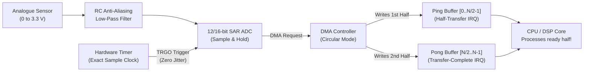

## Key figures {.stats style=tiles}

| Value | Label | Change | Verdict |
|---|---|---|---|
| > 2 × f_max | Nyquist-Shannon minimum sampling rate to prevent frequency aliasing | anti-alias filter | good |
| 4,096 steps | Voltage resolution of a 12-bit Analogue-to-Digital Converter (ADC) | `0.8 mV` at `3.3 V` | good |
| 0% CPU | Processor load while Direct Memory Access (DMA) streams ADC samples | background copy | good |
| 2 halves | Ping-pong circular DMA buffer (`Half-Complete` & `Complete` interrupts) | zero lost samples | good |

## Introduction {.abstract}

Every embedded system bridges the analogue physical world and digital software. An **Analogue-to-Digital Converter (ADC)** quantises continuous voltages into binary numbers at a fixed sample rate, while **Pulse-Width Modulation (PWM)** and **Digital-to-Analogue Converters (DACs)** drive actuators. Hardware timers and **Direct Memory Access (DMA)** stream millions of samples per second into **Static Random-Access Memory (SRAM)** without waking the **Central Processing Unit (CPU)**.

## 1. Zero-CPU hardware signal chain {.wide}

Instead of firing an interrupt on every single sample, link a hardware timer trigger (`TRGO`) to the ADC and let a circular DMA channel fill a double buffer:



[[CAPTION:Figure]] While the DMA controller fills the Pong half of the buffer, the CPU safely processes the completed Ping half with zero race conditions.

## 2. Choosing an ADC architecture

Microcontrollers integrate **Successive Approximation Register (SAR)** converters for fast general-purpose sampling, while precision instrumentation uses **Sigma-Delta (`ΣΔ`)** converters:

```compare
| Successive Approximation Register (`SAR`) | Sigma-Delta (`ΣΔ` / Delta-Sigma)
Conversion principle | Binary search using a capacitive charge-redistribution DAC | Oversamples at megahertz with a 1-bit modulator and digital decimation filter
Typical resolution | **10 to 16 bits** (`1,024` to `65,536` steps) | **16 to 24 bits** (`65,536` to `16.7 million` steps)
Typical sample rate | **100 kSPS to 5+ MSPS** (fast snapshots) | **10 SPS to 100 kSPS** (high precision, higher latency)
Built-in digital filtering | None (requires external RC anti-aliasing filter) | Built-in `sinc` filter (often rejects `50 Hz` / `60 Hz` mains hum)
Best suited for | Motor current control, battery sensing, ultrasonic & audio | Strain gauges, thermocouples, weigh scales & precision metering
```

## 3. Resolution, effective bits and oversampling

A 12-bit ADC referenced to `Vref = 3.300 V` has a **Least Significant Bit (`LSB`)** step size of `3.300 V / 4096 = 0.805 mV`. Real noise reduces this to an **Effective Number of Bits (ENOB)**:

```cards cols=2 style=top
Hardware Oversampling (+N extra bits) | Sampling `4^N` times faster and right-shifting the sum by `N` bits trades speed for resolution. Averaging **16 samples** (`4^2`) boosts a 12-bit ADC to **14-bit effective resolution** (`+12 dB` Signal-to-Noise Ratio) | purple
Sample-and-Hold Capacitor (`Chold`) | When an ADC multiplexes a channel, an internal `~5 pF` capacitor must charge to the pin voltage. High-impedance dividers (`> 50 kΩ`) need a `100 nF` ceramic bypass capacitor on the pin or a longer sampling time (`Tsamp`) | blue
```

```figure
@segments
title: Ping-Pong Circular DMA Buffer in SRAM (1,024 samples total) — eliminates sample-by-sample interrupt overhead
4 | Ping Half (Samples 0..511) — DMA triggers Half-Transfer Interrupt (HT) when full | CPU analyses Ping | green
4 | Pong Half (Samples 512..1023) — DMA fills Pong concurrently in background | DMA writing Pong | purple
```

## 4. Driving power with pulse-width modulation

Because linear amplifiers waste power as heat, embedded systems switch **Metal-Oxide-Semiconductor Field-Effect Transistors (MOSFETs)** fully on and off using timer **PWM** channels:

```lcd cols=1
// Timer configured for 20 kHz centre-aligned PWM (ARR = 4000):
TIM1->CCR1 = 1000; // 25.0% Duty Cycle -> V_avg = 0.25 * V_bus
TIM1->CCR1 = 3000; // 75.0% Duty Cycle -> V_avg = 0.75 * V_bus
TIM1->BDTR |= TIM_BDTR_DTG_500NS; // Hardware dead-time insertion!
-- Centre-aligned PWM triggers ADC at the exact midpoint of the pulse
```

> [!WARNING]
> When driving a half-bridge or H-bridge inverter (high-side + low-side MOSFETs), always enable hardware **dead-time insertion** (`100 ns` to `500 ns`) so both transistors never conduct simultaneously (**shoot-through** short circuit).

## 5. Mixed-signal board & firmware checklist {style=card colour=purple}

```checklist
[x] Fit an external `R-C` anti-aliasing filter before the ADC pin to attenuate frequencies above half the sample rate (`f_s / 2`)
[x] Trigger the ADC from a hardware timer (`TIM_TRGO`), never from a software delay loop, to eliminate sampling phase jitter
[x] Run the microcontroller's built-in ADC offset self-calibration routine at startup and after large temperature swings
[x] Read the internal bandgap voltage reference channel (`VREFINT`) to compensate for battery `Vdd` sag in software
[x] When using `DMA` on Cortex-M7 (with Data Cache), place DMA buffers in non-cacheable SRAM or call `SCB_InvalidateDCache()`
```

## 6. Acronym guide: every term defined {.wide}

```cards cols=4 style=label
ADC & DAC | Analogue-to-Digital Converter (voltage to integer) and Digital-to-Analogue Converter (integer to voltage)
SAR | Successive Approximation Register: fast binary-search ADC architecture integrated into most microcontrollers
DMA | Direct Memory Access: hardware engine that transfers data between peripherals and SRAM without CPU instructions
PWM | Pulse-Width Modulation: encoding an analogue level into the duty cycle (on-time ratio) of a square wave
ENOB & SNR | Effective Number of Bits (real noise-free resolution) and Signal-to-Noise Ratio (measured in decibels)
LSB & Vref | Least Significant Bit (smallest measurable voltage step) and Reference Voltage defining the ADC full scale
SPS & MSPS | Samples Per Second and Mega-Samples Per Second (million conversions per second)
MOSFET | Metal-Oxide-Semiconductor Field-Effect Transistor: fast electronic switch driven by PWM timer channels
```

## In short {.summary}

Clock your **ADC** from a hardware timer and stream samples into a **ping-pong DMA buffer**. Average `4^N` samples for extra resolution, and synchronise **PWM** switching with ADC sampling.

### Obey the sampling theorem

Any signal frequency above half your sampling rate folds back into your data as a phantom low-frequency alias.

### Let DMA move the bytes

Firing an interrupt at `500 kHz` leaves only 2 microseconds per sample; a 512-sample DMA ping-pong buffer cuts interrupts to `1 kHz`.

### Sample PWM in the quiet middle

Trigger motor current ADCs at the midpoint of a centre-aligned PWM pulse when transistor switching ringing has settled.
