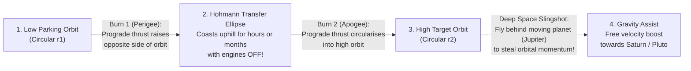

## Key figures {.stats style=tiles}

| Value | Label | Change | Verdict |
|---|---|---|---|
| 7.8 km/s | Horizontal speed (28,000 km/h) required to stay in Low Earth Orbit (LEO) | falls around Earth | good |
| 90% | Share of a launchpad rocket's total mass that is just propellant! | tyranny of rocket eq | bad |
| 35,786 km | Altitude where orbital period equals 23 h 56 m in Geostationary Equatorial Orbit (GEO) | hovers over 1 spot | good |
| 1.5 M km | Distance to Sun-Earth Lagrange Point L2 (home of the James Webb telescope) | gravitational balance | good |

## Introduction {.abstract}

Why do astronauts float inside the **International Space Station (ISS)** at `400 km` altitude? Not because gravity is zero—Earth's gravity at `400 km` is still **88% as strong** as on the ground! Astronauts float because the station is **falling towards Earth continuously**, while travelling sideways so fast (**`7.8 kilometres per second`**) that Earth's curved surface drops away beneath it at the exact same rate. Understanding **Isaac Newton's cannonball**, **Konstantin Tsiolkovsky's rocket equation**, **Hohmann transfer ellipses** and **Lagrange points** explains every counter-intuitive rule of spaceflight.

## 1. Newton's cannonball: why orbit is sideways speed, not height

Imagine firing a cannon horizontally from a tall mountain above the atmosphere. A slow cannonball arcs into the ground; a **`7.8 km/s`** cannonball falls around the curve of the Earth forever without ever hitting the surface:

```cards cols=1 style=top
The Counter-Intuitive Rule of Orbital Speed | **Lower orbits are FASTER; higher orbits are SLOWER!** Because gravity weakens with distance (`1 / r²`), a satellite in Low Earth Orbit (`400 km`) must race at `7.8 km/s` (`90 minutes` per lap), whereas a Geostationary TV satellite at `35,786 km` cruises at just `3.07 km/s` (`24 hours` per lap) | navy
Orbital Rendezvous Paradox ("Brake to Catch Up!") | If your spacecraft is trailing 10 km behind the Space Station in the same orbit and you fire your engines to speed up, your extra energy **pushes you into a higher, slower orbit** and you fall *further behind*! To catch up, you fire thrusters **retrograde (braking)** to drop into a lower, faster lane, overtake from below, and boost back up | blue
```

```figure
@segments
title: Where a 500-tonne launch rocket's mass actually goes (The Tyranny of the Rocket Equation!)
6 | Stage 1 Propellant (Kerosene/Methane + Liquid Oxygen) — ~72% | Dropped at 70 km | amber
2 | Stage 2 Propellant — ~18% | Burns to orbit | blue
1 | Tanks, Engines & Fairing (~7%) | Dry structure | navy
1 | Actual Payload (~2 to 4%!) | Satellite! | green
```

## 2. The tyranny of the Tsiolkovsky rocket equation

In space there is no air or road to push against; a rocket accelerates solely by throwing exhaust gas backward at high speed (**Conservation of Momentum**). Because you must also carry the fuel you will burn five minutes from now, required fuel mass grows **exponentially** with desired velocity change (**Delta-v, `Δv`**):

```lcd cols=1
Tsiolkovsky Rocket Equation:
  Delta_v = v_exhaust * ln(m_initial / m_final)
          = Isp * g0  * ln(m_initial / m_final)

Why rockets drop empty stages (Staging):
  - Single stage carrying dead tank weight to orbit: barely reaches 2% payload
  - Dropping heavy Stage 1 tank + 9 engines halfway up resets m_final,
    letting Stage 2 push 15+ tonnes into Low Earth Orbit!
-- Specific Impulse (Isp) measures engine fuel efficiency in seconds:
-- Chemical (LOX/RP-1): ~310 s | Hydrogen (LH2): ~450 s | Ion Thruster: ~3,000 s!
```

```chart type=bar title="Delta-v budget required from Earth's surface (m/s)" unit=" m/s" max=18000
Suborbital (100km) | 1400
Low Earth (LEO) | 9400
GEO Transfer (GTO) | 11900
Moon Landing | 15000
```

> [!TIP]
> Launching from `0 km/h` to `400 km` LEO takes **`9,400 m/s`** of `Δv` (more than 60% of the energy needed to reach the Moon or Mars!). As writer Robert Heinlein put it: *"Once you are in Low Earth Orbit, you are halfway to anywhere in the solar system."*

## 3. Comparing the four major Earth orbital regimes {.wide}

```compare
| Low Earth Orbit (`LEO`) | Medium Earth Orbit (`MEO`) | Geostationary Orbit (`GEO`) | Sun-Synchronous Polar (`SSO`)
Altitude above Earth | **`160` to `2,000 km`** (`ISS` at `400 km`) | **`2,000` to `35,786 km`** (`GPS` at `20,200 km`) | **Exactly `35,786 km`** over the Equator | **`600` to `800 km`** (`98°` tilted polar orbit)
Orbital speed & period | `7.8 km/s` (**`~90 minutes`** per orbit) | `3.9 km/s` (**`12 hours`** per orbit) | `3.07 km/s` (**`23 h 56 m 04 s`** = 1 sidereal day) | `7.5 km/s` (**`~100 minutes`** per orbit)
View from the ground | Zips across the sky in `5` to `10 minutes` | Moves slowly across sky; `4+` always visible | **Appears completely motionless** in the sky! | Crosses every latitude at the **exact same local solar time**
Round-trip radio latency | **`4` to `25 ms`** (fast enough for live calls) | `~125 to 140 ms` | **`~480 to 600 ms`** (noticeable voice delay) | `~10 ms` (when passing over ground station)
Primary missions | `ISS`, `Starlink`, Hubble & crewed missions | `GPS`, `Galileo`, `GLONASS` & `BeiDou` navigation | Weather satellites, broadcast TV dishes | Earth imaging, climate & spy satellites (consistent shadows)
```

## 4. Changing orbits: Hohmann transfers & gravity assists

Fuel is precious in space, so mission planners never fly in straight lines. Instead, they coast along minimum-energy **Keplerian ellipses**:



[[CAPTION:Figure]] A Hohmann transfer uses just two short engine burns: one to stretch the circle into an ellipse, and a second at the top (`apogee`) to round it out again.

## 5. The five Lagrange points (`L1` to `L5`): gravitational parking spots

Where two massive bodies orbit each other (such as the **Sun and Earth**), five special balance points exist. At each point, their combined gravitational pull cancels out the **centrifugal force** of a smaller co-orbiting satellite:

```cards cols=2 style=label
L1 (1.5 million km sunward of Earth) | Unstable balance point directly between Earth and the Sun; provides an uninterrupted 24/7 view of solar storms (`SOHO` and `DSCOVR` space-weather satellites)
L2 (1.5 million km behind Earth's night side) | Keeps the Sun, Earth and Moon all behind the spacecraft's heat shield at once—the cold, dark home of the **James Webb Space Telescope (`JWST`)** and **Gaia**
L3 (Opposite side of the Sun) | Hidden behind the Sun at all times; unstable and rarely used
L4 & L5 (60° ahead and 60° behind Earth's orbit) | Naturally **stable gravitational valleys** forming equilateral triangles with the Sun and Earth; collect ancient "Trojan" asteroids and dust without needing fuel to stay put
```

## 6. Spaceflight rules of thumb {style=card colour=blue}

```checklist
[x] **Launch eastward near the Equator** (such as Cape Canaveral or Kourou) to get a free **`+460 m/s`** velocity boost from Earth's rotation
[x] **Change orbital altitude at Perigee/Apogee** (`prograde` / `retrograde` burns) where kinetic energy leverage is highest (**Oberth Effect**)
[x] **Change orbital inclination (tilt) at Apogee** where the satellite is moving slowest; plane changes in fast Low Earth Orbit burn enormous fuel
[x] **Use aerobraking / heat shields** when arriving at Mars, Venus or Earth so atmospheric drag sheds `7 to 11 km/s` for free without burning propellant
```

## 7. Acronym guide: every term defined {.wide}

```cards cols=4 style=label
LEO, MEO & GEO | Low Earth Orbit (<2,000 km), Medium Earth Orbit (navigation) and Geostationary Equatorial Orbit (35,786 km)
SSO & GTO | Sun-Synchronous Orbit (constant sun angle for cameras) and Geostationary Transfer Orbit (elliptical stepping stone to GEO)
Delta-v (Δv) | Change in Velocity (metres per second): the universal currency of spacecraft manoeuvring and mission fuel budgets
Isp | Specific Impulse (measured in seconds): how many seconds 1 kg of propellant produces 1 kg-force of thrust (rocket miles-per-gallon)
Perigee & Apogee | The lowest point (fastest speed) and highest point (slowest speed) of an elliptical orbit around Earth
Prograde & Retrograde | Firing thrusters forward in the direction of orbital motion (raises orbit) vs backward against motion (lowers orbit)
L1..L5 | Lagrange Points: five points in a two-body orbital system where gravity and orbital centrifugal forces cancel out
ISS & JWST | International Space Station (in 400 km LEO) and James Webb Space Telescope (orbiting Sun-Earth L2)
```

## In short {.summary}

Staying in space is about **horizontal speed (`7.8 km/s`)**, not height. **Staging** defeats the exponential rocket equation, while **two-burn Hohmann ellipses** move satellites between orbits with minimal fuel and **Lagrange point `L2`** parks telescopes in Earth's shadow.

### Gravity is strong in low Earth orbit

Astronauts are weightless only because they and their spacecraft are in continuous free-fall around the curve of the Earth.

### Slow down to drop down and speed up

Braking drops a spacecraft into a lower orbit with a shorter circumference and higher velocity—the key to every orbital docking.

### Every kilogram to orbit costs ten

Because you must carry the fuel to lift the fuel, shaving one kilogram off a deep-space probe saves ten to twenty kilograms on the launchpad.
