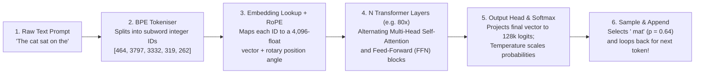

## Key figures {.stats style=tiles}

| Value | Label | Change | Verdict |
|---|---|---|---|
| ~0.75 words | Average English text covered by 1 Byte-Pair Encoding (BPE) token | ~4 characters | good |
| 140 GB | High-bandwidth Video Random-Access Memory (VRAM) for 70B weights in 16-bit | memory-bound | bad |
| O(N²) | Compute scaling of full Self-Attention across context length N | quadratic cost | bad |
| 1 token | Output generated per forward pass during autoregressive decoding | loop step-by-step | good |

## Introduction {.abstract}

Despite appearing to reason and converse, a decoder-only **Large Language Model (LLM)** performs one mathematical operation at each step. Given a sequence of input tokens `t₁, t₂, ..., tₙ`, the neural network computes a probability distribution over its entire vocabulary (`100,000 to 256,000` subword tokens) for the next token `tₙ₊₁`. The runtime samples one token from that distribution, appends it to the prompt, and runs the network again (**autoregressive decoding**).

## 1. End-to-end forward pass: from prompt to next token {.wide}



[[CAPTION:Figure]] Models never see raw letters or words: the tokeniser converts text into integer IDs, maps them into a high-dimensional geometric space, and refines them across dozens of layers.

## 2. Inside a single Transformer layer: Attention + `FFN`

How does the ambiguous word *"bank"* know whether it means a grassy river edge or a financial institution? Through **Scaled Dot-Product Self-Attention**:

```lcd cols=1
[Inside Layer L of N — Residual Stream Highway: x_out = x + Attention(x) + FFN(x)]

1. Multi-Head Self-Attention (Routes context BETWEEN token positions):
   Every token vector projects three learned vectors:
     - Query (Q): "What context or grammatical partners am I looking for?"
     - Key   (K): "What kind of information do I contain?"
     - Value (V): "Here is the semantic payload I pass along if you attend to me."
   Score = Softmax( (Q * K^T) / sqrt(d_k) + CausalMask ) * V

2. Feed-Forward Network (FFN / SwiGLU — Processes EACH token independently):
   Acts as a massive learned Key-Value lookup table storing factual associations!
-- Attention moves context across the sentence; FFN looks up facts about that context.
```

```chart type=bar title="Where parameters live inside a modern 70-billion-parameter model (%)" unit="%" max=100
Feed-Forward (FFN) | 67
Attention (QKV+O) | 31
Embeddings & Head | 2
```

## 3. Two inference phases: prefill vs autoregressive decode

Serving a language model in production splits into two hardware regimes with opposite bottlenecks:

```compare
| Phase 1: Prompt Prefill (Parallel) | Phase 2: Token Generation / Decode (Sequential)
What happens | GPU processes all input prompt tokens simultaneously in one forward pass to populate the **`KV Cache`** | Model generates output tokens **one at a time**; each step reads the entire `KV Cache` plus all `140 GB` of weights
Hardware bottleneck | **Compute-bound** (limited by matrix-multiplication TeraFLOPS) | **Memory-bandwidth-bound** (limited by how fast `VRAM` streams `140 GB` per token)
Primary latency metric | **Time To First Token (`TTFT`)**, measured in milliseconds | **Inter-Token Latency (`ITL`)**, measured in tokens per second
```

## 4. The three-stage training pipeline {.wide}

```cards cols=3 style=top
Stage 1: Self-Supervised Pre-Training | Clusters of thousands of accelerators train for months on `10 to 15 trillion` web, code and book tokens using next-token cross-entropy loss. This produces a **Base Model** that completes documents and absorbs world knowledge, but does not follow user instructions reliably | blue
Stage 2: Supervised Fine-Tuning (`SFT`) | Engineers train the base model on `100k to 1M` curated `(User Prompt, Ideal Assistant Response)` conversations. This teaches conversational turn-taking, formatting and instruction following | green
Stage 3: Preference Alignment (`RLHF` / `DPO`) | Human raters or verifier models score candidate answers. **Reinforcement Learning from Human Feedback (RLHF)** or **Direct Preference Optimisation (DPO)** shifts probability mass toward helpful, truthful and safe completions, while reasoning models train with verifiable maths and code rewards | purple
```

## 5. Sampling, context windows and `RAG` {style=card colour=blue}

```checklist
[x] **Temperature (`T`) controls randomness**: Dividing logits by `T = 0` always picks the single top token (greedy); `T = 0.7 to 1.0` flattens probabilities for creative writing
[x] **Key-Value (`KV`) Cache saves compute**: Storing past tokens' `K` and `V` tensors in `VRAM` avoids recomputing the entire prompt on every generated word
[x] **Quantisation (`FP16 -> INT8 / INT4`)**: Compressing 16-bit weights to 4-bit integers cuts memory footprint 4-fold and speeds up memory-bound token generation
[x] **Retrieval-Augmented Generation (`RAG`)**: Injecting verified search snippets directly into the prompt grounds answers in live facts and slashes hallucinations
```

## 6. Acronym guide: every term defined {.wide}

```cards cols=4 style=label
LLM & BPE | Large Language Model (neural network trained on text) and Byte-Pair Encoding (subword tokenisation algorithm)
QKV & FFN | Query, Key and Value vectors (self-attention lookup projections) and Feed-Forward Network (multi-layer perceptron storing facts)
RoPE & SwiGLU | Rotary Position Embedding (encodes relative token distance via angle rotation) and Swish-Gated Linear Unit (`FFN` activation)
KV Cache & VRAM | Key-Value Activation Cache (stores past token states during decoding) and Video Random-Access Memory (high-bandwidth GPU memory)
SFT & RLHF | Supervised Fine-Tuning (instruction imitation stage) and Reinforcement Learning from Human Feedback (alignment training stage)
DPO & RAG | Direct Preference Optimisation (reward-free alignment loss) and Retrieval-Augmented Generation (grounding prompts with external search)
TTFT & ITL | Time To First Token (prompt prefill latency) and Inter-Token Latency (streaming generation speed in tokens per second)
FP16 & INT4 | 16-bit Floating Point (`2 bytes` per weight) and 4-bit Integer quantisation (`0.5 bytes` per weight for fast local inference)
```

## In short {.summary}

A Transformer converts subword **tokens** into high-dimensional **vectors** and uses **Self-Attention (`Q, K, V`)** to route context between words. It then uses **Feed-Forward Networks (`FFN`)** to look up learned facts and predicts one token at a time via **autoregressive decoding**.

### Vectors encode meaning as geometry

In a 4,096-dimensional embedding space, words with similar meanings point in similar geometric directions (`King - Man + Woman ≈ Queen`).

### Attention is content-addressable lookup

Self-attention lets every word dynamically query every earlier word in the context window, resolving pronouns and ambiguity in parallel.

### Decoding is a memory-bandwidth race

Because generating a single word requires reading billions of model weights from memory, token generation speed depends on `VRAM` bandwidth (`TB/s`), not raw compute.
