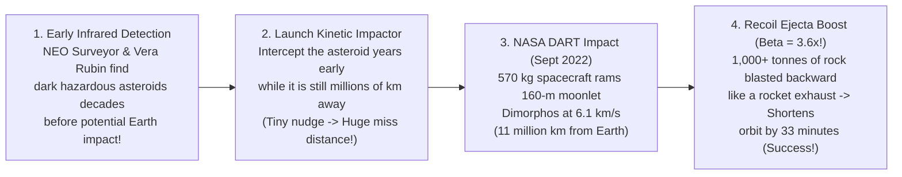

## Key figures {.stats style=tiles}

| Value | Label | Change | Verdict |
|---|---|---|---|
| 4% of Moon | Total mass of the entire Main Asteroid Belt combined (mostly in Ceres!) | not a dense field! | good |
| 10 km | Size of the Chicxulub asteroid that ended the non-avian dinosaurs 66M yr ago | 100M Megatons | bad |
| 2 Tails | Every active comet grows a blue Ion Tail and a curved white/yellow Dust Tail | points away from Sun | good |
| -33 minutes | Orbital period change when our kinetic impactor rammed asteroid Dimorphos! | planetary defence | good |

## Introduction {.abstract}

**Asteroids** and **Comets** are the leftover construction debris from the birth of the Solar System **4.567 billion years ago**. While the planets melted and differentiated into cores and mantles, asteroids and comets stayed relatively pristine—preserving the original minerals, water ice and **amino acids** of the protoplanetary nebula. Yet orbital resonances with **Jupiter** occasionally kick these rocky and icy time capsules onto Earth-crossing paths (**Near-Earth Objects, `NEOs`**). For the first time in Earth's 4.5-billion-year history, humanity now has the telescopes and kinetic impactor spacecraft (**Double Asteroid Redirection Test, `DART`**) to deflect a dinosaur-killer.

## 1. Comparing asteroids, comets and meteoroids {.wide}

What is the difference between a **Meteoroid**, a **Meteor** and a **Meteorite**? Location! In space it is a **Meteoroid** (`< 1 metre` pebble or boulder). Streaking through Earth's atmosphere at `11 to 72 km/s` as a "shooting star" plasma trail it is a **Meteor** (or **Bolide** fireball), and if a rock hits the ground, it is a **Meteorite**!

```compare
| Asteroids (`C-Type`, `S-Type`, `M-Type`) | Short-Period Comets (`Jupiter Family`) | Long-Period Comets (`Oort Cloud`)
Where they formed & live | Formed inside or near the Frost Line (`2 to 4 AU`); live in the **Main Belt (`2.1–3.3 AU`)**, **Trojans** or **Near-Earth (`NEO`)** orbits | Formed beyond Neptune (`> 30 AU`); stored in the flat **Kuiper Belt & Scattered Disk** | Formed near the giant planets (`5–30 AU`), then flung into the spherical **Oort Cloud (`2,000–100,000 AU`)**
Composition | **Carbonaceous (`C`, `75%`)**: clay + organics; **Stony (`S`, `17%`)**: silicates; **Metallic (`M`, `8%`)**: Iron-Nickel cores | **"Dirty Snowballs" / "Icy Dirtballs"**: `~50%` water/CO/CO₂ ice + `50%` silicate dust and dark organic tar | Pristine volatile ices (`H₂O`, `CO`, `CH₄`, `NH₃`, `HCN`) + untouched pre-solar interstellar dust grains
Orbital shape & tilt | Mostly **low-inclination, near-circular** orbits in the same plane as the planets | Elliptical orbits (`Period < 200 years`) tilted `< 30°` (`Comet 67P/Churyumov-Gerasimenko`, `Halley`) | **Extreme parabolas (`Period 1,000 to Millions of years`)** arriving from *any* angle (`Hale-Bopp`, `NEOWISE`)
Famous space missions | **`OSIRIS-REx`** (`Bennu` sample return), **`Hayabusa2`** (`Ryugu`), **`Psyche`** (metal world) & **`Dawn`** (`Ceres/Vesta`) | **ESA `Rosetta` & `Philae` lander** (`Comet 67P`), **`Stardust`** (`Wild 2` sample return) & **`Deep Impact`** | **ESA `Comet Interceptor` (`2029`)**: will wait at `L2` to ambush a pristine first-time Oort Cloud comet!
```

## 2. Why comets grow two tails (and why both point away from the Sun!)

A comet's solid **nucleus** is typically just `1 to 20 km` wide and darker than coal (`4%` reflectivity). When it swings inside `~3 AU`, sunlight sublimates ice directly into gas. That gas inflates a `100,000-km` atmosphere (**Coma**) and **two distinct tails** that always point *away* from the Sun:

```lcd cols=1
                                              [Curved Yellow/White Dust Tail]
                                          . - '   (Pushed gently by Solar Photon Radiation
                                    . - '          Pressure; lags behind along orbit!)
       ( THE SUN )  ===>       . - '
     Solar Wind & Light   [Comet Nucleus + Coma] ===================> [Straight Blue Ion Tail]
                                |                 (CO+ ions swept straight back at 400 km/s
                                |                  by the magnetised Solar Wind!)
                                v  Comet's Orbital Path
```

- **Why Meteor Showers Happen (`Perseids` in August, `Geminids` in December)**: As a comet orbits the Sun, it leaves a dusty gravel trail along its elliptical track. Whenever Earth ploughs through **Comet Swift-Tuttle's** debris stream every August, sand-sized comet grains vaporise at `59 km/s` at `100 km` altitude—creating the **Perseid meteor shower**!

## 3. Orbital resonance gaps: how Jupiter flings asteroids at Earth

Hollywood movies show the **Main Asteroid Belt** as a crowded obstacle course where spaceships dodge boulders every second. In reality, the average distance between two `1-km` asteroids is **`over 1 million kilometres`** (`3×` the Earth-Moon distance!). So how do asteroids ever leave the belt to hit Earth? Through **Kirkwood Orbital Resonances** with **Jupiter**:

```figure
@segments
title: Main Asteroid Belt zones and Kirkwood Resonance Gaps (Where an asteroid's period is a simple fraction of Jupiter's 11.86-year orbit!)
3 | Inner Belt (2.1–2.5 AU): Silicate S-Type Asteroids | Stony | amber
1 | 3:1 Kirkwood Gap (2.50 AU): EMPTIED! Flung into Near-Earth Orbits! | NEO Delivery! | red
3 | Middle Belt (2.5–2.82 AU): Ceres (940 km Dwarf Planet) & Vesta | 5:2 & 7:3 Gaps | blue
3 | Outer Belt (2.82–3.3 AU): Dark Carbonaceous C-Type Asteroids (2:1 Gap at 3.28 AU) | Water-Rich | teal
```

```chart type=bar title="Impact kinetic energy by object diameter (log10 Megatons of TNT)" unit=" log MT" max=10
Chelyabinsk (20m) | 0
Tunguska (50m) | 1
Regional (140m) | 3
Global (1 km) | 5
Chicxulub (10 km)! | 8
```

## 4. What meteorites tell us in the lab {style=card colour=amber}

```checklist
[x] **Carbonaceous Chondrites (`Murchison`, `Bennu`, `Ryugu`)**: Contain untouched pre-solar diamond/silicon-carbide stardust, `10%` locked water, **over 70 amino acids** and all five nucleobases of `DNA`/`RNA` (`A, C, G, T, U`)!
[x] **Iron Meteorites (`Widmanstätten` Crystal Patterns)**: Pieces of the shattered cores of ancient protoplanets that cooled at just `1 to 100 °C per million years`
[x] **The Iridium Spike (`Alvarez Hypothesis`, 1980)**: Walter and Luis Alvarez proved a `10-km` asteroid killed the dinosaurs (`66 million years` ago) by finding a global clay layer enriched 100-fold in **Iridium** (rare in Earth's crust, abundant in asteroids) plus the `180-km` **Chicxulub crater** in Mexico!
[x] **Over 95% of `1-km+` Near-Earth Asteroids Are Already Tracked**: None of the known `1-km+` "planet killers" are on a collision course with Earth for centuries; current surveys (`NEO Surveyor`, `Rubin`) focus on `140-metre` city-destroyers
```

## 5. Impact hazard scales and the `DART` planetary defence test {.wide}

Every day, `~100 tonnes` of microscopic cosmic dust drifts harmlessly down to Earth. Larger impacts follow an inverse power law—small airbursts happen every century, while civilisation-threatening impacts happen every `10 to 100 million years`:



[[CAPTION:Figure]] Why try to blow up an asteroid with a nuclear bomb (turning one cannonball into a thousand radioactive shotgun pellets!) when a **gentle `1 cm/s` velocity nudge** applied **10 years early** causes the asteroid to miss Earth completely by `30,000 kilometres`?

## 6. Acronym guide: every term defined {.wide}

```cards cols=4 style=label
NEO & PHO | Near-Earth Object (perihelion `< 1.3 AU`) and Potentially Hazardous Object (`> 140 m` wide passing within `0.05 AU` / `19.5` Moon distances of Earth)
Atira, Aten, Apollo, Amor | The four orbital classes of Near-Earth Asteroids based on whether their orbits stay inside, cross or graze Earth's `1.0 AU` orbit
C, S & M Types | Carbonaceous (dark, primitive, water/organic-rich), Silicaceous/Stony (rocky inner belt) and Metallic (Iron-Nickel core fragments)
Chondrite & Achondrite | Primitive stony meteorite containing spherical melted droplets (**Chondrules** from the solar nebula) vs differentiated volcanic/core rock
Yarkovsky Effect | Tiny thermal-radiation thrust caused when a spinning asteroid re-emits afternoon heat into space—slowly drifting asteroids into Kirkwood gaps!
Torino & Palermo Scales | Public (`0 to 10`) and technical logarithmic scales rating an asteroid's collision probability and kinetic damage potential
DART & Hera | Double Asteroid Redirection Test (`2022` impactor at Dimorphos) and European Space Agency **Hera** follow-up probe (`arriving 2026` to weigh the crater)
OSIRIS-REx & Hayabusa2 | Sample-return missions that brought pristine carbon-rich gravel back to Earth from asteroids **Bennu** (`2023`) and **Ryugu** (`2020`)
```

## In short {.summary}

**Asteroids and Comets** are both our **creators** and a natural **hazard**. Carbonaceous asteroids and comets delivered water and prebiotic organic molecules to the young Earth, while **Kirkwood resonances** with Jupiter occasionally perturb rocks into **Near-Earth Orbits**. Thanks to **sky surveys and kinetic impactors (`DART`)**, asteroid impacts are the **only major natural disaster humanity can prevent**.

### Why asteroids are irregular potatoes while planets are round

Gravity only crushes solid rock into a sphere (**Hydrostatic Equilibrium**) once an object exceeds `~400 to 600 km` across (`Ceres` is round; smaller asteroids are lumpy rubble piles!).

### Many asteroids are flying piles of gravel

`OSIRIS-REx` and `Hayabusa2` revealed that asteroids like **Bennu** and **Dimorphos** are not solid monoliths—they are loose **"rubble piles"** with `50%` empty void space inside!

### Dinosaurs didn't have a space programme

The Chicxulub impactor (`66M years ago`) released `10 billion Hiroshima bombs` of energy and blocked sunlight for years; today, **Vera Rubin** and **infrared survey telescopes** stand guard so we never get caught by surprise.
