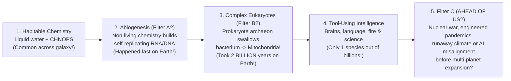

## Key figures {.stats style=tiles}

| Value | Label | Change | Verdict |
|---|---|---|---|
| ~40 Billion | Estimated Earth-sized planets in the Habitable Zone across our Milky Way! | Kepler statistics | good |
| 4.1+ B yrs | How early microbial life appeared on Earth (almost as soon as oceans cooled!) | abiogenesis is fast? | good |
| 1420–1662 MHz | The "Water Hole" quiet radio band between H and OH monitored for alien beacons | cosmic meeting place | good |
| Type 0.73 | Humanity's current rank on the Kardashev planetary energy scale (~18 TW) | Type I = 10¹⁶ W | bad |

## Introduction {.abstract}

Our Milky Way contains **100 to 400 billion stars**, **40 billion habitable-zone rocky worlds**, and has existed for **13.5 billion years**—nearly three times the age of Earth (`4.5B yr`). Even if a technological civilisation travels between stars at `1% of light speed`, it could send robotic probes to every star in the galaxy in just **10 million years**. This stark contradiction between vast cosmic numbers and the absence of confirmed alien evidence is **Enrico Fermi's Paradox (`1950`): *"Where is everybody?"***

## 1. The Drake Equation (`1961`): breaking down the odds {.wide}

In 1961, radio astronomer **Frank Drake** wrote down a seven-factor framework at Green Bank Observatory to estimate **`N`**—the number of communicating civilisations in our galaxy today. Notice how modern astrophysics has **solved the first three astronomical factors**, while the last four biological and sociological factors remain wide open:

```figure
@segments
title: The Seven Factors of the Drake Equation:  N = R* × fp × ne × fl × fi × fc × L  (Green = Measured by Astrophysics; Amber/Red = Unknown!)
2 | 1. R* (~2/yr): Milky Way Star Formation | Measured! | green
2 | 2. fp (~1.0): Stars with Planets (Kepler) | Measured! | green
2 | 3. ne (~0.2–0.4): Rocky Worlds in Habitable Zone | Measured! | green
1 | 4. fl (?): Fraction where Life begins | Lab / JWST | amber
1 | 5. fi (?): Fraction evolving Intelligence | Unknown! | amber
1 | 6. fc (?): Fraction building Technology | Unknown! | red
1 | 7. L (Years!): Lifetime of detectable signals! | The Key! | red
```

```lcd cols=2
What We Know Today (Factors 1 to 3):
  - R* ≈ 1.5 to 3 new stars born per year in the Milky Way
  - f_p ≈ 1.0 (nearly 100% of stars host planets!)
  - n_e ≈ 0.2 to 0.4 habitable-zone rocky worlds per star
  --> Result: ~1 new habitable rocky world forms EVERY YEAR!
---
Why Factor 7 (L = Civilisation Longevity) Rules the Answer:
  If R* * fp * ne * fl * fi * fc ≈ 1 civilisation per 10,000 years:
    - If L = 100 years (destroys itself / goes quiet) -> N = 0.01 (We are ALONE!)
    - If L = 10,000,000 years (long-lived spacefarers) -> N = 1,000 civilisations!
```

## 2. Categorising solutions to the Fermi paradox {.wide}

```compare
| Category 1: "Rare Earth / We Are First" (No One Out There) | Category 2: "They Are Out There, But Silent / Unseen" | Category 3: "Cosmic Quarantine / Transcension"
Core argument | Simple microbial slime may be common, but **complex multicellular intelligence** requires a lottery win of planetary coincidences | Technological civilisations exist, but **interstellar distances (`light-years`)** and communication physics make detection hard | Advanced civilisations deliberately avoid broadcasting or expanding in ways 21st-century humans recognise
Leading hypotheses | **1. Rare Earth (`Ward & Brownlee`)**: Plate tectonics, a giant Moon stabilising axial tilt, a Jupiter comet shield & quiet `G-dwarf` star are rare together.<br>**2. Early Universe Gamma-Ray Bursts**: Deadly supernova/quasar radiation sterilised galaxies until the last few billion years—making humans among the **firstborn**! | **1. Brief Radio Window (`L` is tiny)**: Humanity only leaked high-power omnidirectional TV/radio for `~80 years` before switching to tight fibre-optics and encrypted lasers!<br>**2. Subsurface Ocean Worlds**: Intelligences trapped under `20 km` of ice on Europa-like worlds never see the stars or build rockets.<br>**3. Aestivation / Dark Forest**: Staying quiet to conserve energy or avoid hostile probes. | **1. Zoo / Planetarium Hypothesis**: Non-interference directive (like watching an uncontacted nature reserve).<br>**2. Post-Biological Miniaturisation**: Advanced minds migrate into dense, cold, energy-efficient quantum compute substrates around red/white dwarfs rather than strip-mining loud galaxies.
```

## 3. The great filter hypothesis: behind us or ahead of us?

If the galaxy is not full of noisy empires, at least **one step** between a sterile rock and a starfaring civilisation must be an almost impassable bottleneck (**The Great Filter**). Humanity's deepest question is whether that filter lies **behind us** or **in front of us**:



[[CAPTION:Figure]] Single-celled bacteria appeared on Earth almost immediately (`> 4.0B years ago`), yet life stayed **microscopic slime for 3 billion years** until a freak symbiotic merger created **Eukaryotic cells** with **mitochondria**!

## 4. The Kardashev scale of civilisation energy (`1964`)

Soviet astrophysicist **Nikolai Kardashev** ranked civilisations by total power consumption (`P`, where Carl Sagan defined continuous rank **`K = (log₁₀(P_Watts) - 6) / 10`**):

```chart type=bar title="Total power harnessed by Kardashev civilisation level (log10 Watts)" unit=" log W" max=40
Humanity (Type 0.73) | 13
Type I (Planetary) | 16
Type II (Stellar) | 26
Type III (Galactic) | 36
```

## 5. Biosignatures vs technosignatures: how we actually search {.wide}

Today's scientific search follows two parallel tracks: **Astrobiologists** look for primitive life (`Biosignatures` in our Solar System and exoplanet atmospheres), while **Search for Extraterrestrial Intelligence (`SETI`)** astronomers look for technology (`Technosignatures`):

```cards cols=2 style=top
1. Atmospheric Biosignatures (`JWST` & `Habitable Worlds Observatory`) | Looking for **thermodynamic chemical disequilibrium** in exoplanet air—such as abundant **Oxygen (`O₂`) + Ozone (`O₃`)** coexisting alongside **Methane (`CH₄`)**, Water (`H₂O`) and Nitrous Oxide (`N₂O`), or the **Vegetation Red Edge** reflectance jump at `700 nm` | green
2. Solar System In-Situ Life Search (`Mars`, `Europa`, `Enceladus`) | **`Perseverance`** caching ancient lakebed cores in Jezero Crater (`Mars Sample Return`), **`Europa Clipper`** & **`Dragonfly`** testing for homochiral amino acids (life uses `100% left-handed` amino acids, whereas non-living meteoritic chemistry is `50/50`!) | teal
3. Narrowband Radio & Optical `SETI` (`Breakthrough Listen`, `FAST`, `Allen Array`) | Nature never produces a radio signal narrower than `~500 Hz` (thermal Doppler broadening). Finding a **`1 Hz` narrowband beacon** inside the quiet **`1420–1662 MHz` "Water Hole"** (`H` to `OH`) or a nanosecond monochromatic laser pulse is an unmistakable artificial technosignature! | blue
4. Megastructures & Industrial Pollution (`Dyson Spheres`, `CFCs`, `NO₂`) | **Freeman Dyson (`1960`)** noted that a civilisation capturing its star's light with solar swarms (**Dyson Swarm**) must re-radiate waste heat as a **`100–300 K` mid-infrared excess**; `JWST` can also spot artificial greenhouse gases (`CFCs`) in exoplanet transits! | amber
```

## 6. Acronym guide: every term defined {.wide}

```cards cols=4 style=label
SETI & METI | Search for Extraterrestrial Intelligence (passive listening) and Messaging Extraterrestrial Intelligence (active transmission, e.g. `1974 Arecibo Message`)
CHNOPS & LUCA | Carbon, Hydrogen, Nitrogen, Oxygen, Phosphorus, Sulphur (elements of life) and **Last Universal Common Ancestor** (`~4.0B yr ago` on Earth)
Water Hole | Quiet microwave radio band (`1420 to 1662 MHz`, `18–21 cm`) between Neutral Hydrogen (`H`) and Hydroxyl (`OH`), where `H + OH = H₂O`!
Wow! Signal | Famous 72-second narrowband `1420 MHz` radio spike recorded by the Big Ear telescope in Ohio (`1977`); never repeated (likely a cosmic hydrogen maser)
Kardashev I, II, III | Civilisation harnessing all power reaching its **Planet (`10¹⁶ W`)**, all output of its **Star (`10²⁶ W`)**, or all stars in its **Galaxy (`10³⁶ W`)**
Von Neumann Probe | Self-replicating autonomous spacecraft proposed by mathematician John von Neumann that mines asteroids to build copies of itself across the galaxy
Homochirality | Biochemical signature of life: living organisms exclusively use **L-amino acids** (left-handed) and **D-sugars** (right-handed), unlike abiotic `50/50` mixtures
HWO & LIFE | Habitable Worlds Observatory (`NASA` optical/UV/IR flagship) and Large Interferometer For Exoplanets (`ESA` mid-infrared space interferometer concept)
```

## In short {.summary}

Astrophysics has proved that **rocky planets, liquid water and prebiotic organic molecules are ubiquitous** across the Milky Way. Whether we are alone depends on the biological **Great Filter** (the leap from chemistry to microbes, or from microbes to complex brains). It also depends on **Factor `L`**—whether technological civilisations learn to survive their own inventions for millions of years.

### Why finding microbes on Europa changes the great filter

If we find *independent* microbial life on **Enceladus or Europa**, it proves **Step 2 (Abiogenesis)** is easy—which pushes the **Great Filter** closer to us!

### Earth has been broadcasting oxygen for 2 billion years

Our radio signals only started in `1900`, yet the **Great Oxidation Event (`2.4 billion years ago`)** filled Earth's sky with `21% Oxygen`. Any alien telescope with `JWST` technology could have spotted that biosignature while Earth only had single-celled algae!

### The best way to increase `N` in the Drake Equation is to increase `L`

We cannot change how fast stars form (`R*`), but by protecting our biosphere and becoming a sustainable spacefaring civilisation, humanity directly increases **`L`**.
