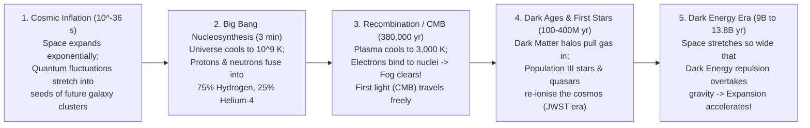

## Key figures {.stats style=tiles}

| Value | Label | Change | Verdict |
|---|---|---|---|
| 13.8 B yrs | Age of the universe since the hot Big Bang (measured via Planck satellite data) | ±20 million yrs | good |
| 2.725 K | Temperature of the Cosmic Microwave Background (CMB) radiation today | cooled from 3,000 K | good |
| 95% Dark | Share of the universe made of Dark Energy (68%) and Dark Matter (27%) | only 5% atoms! | bad |
| 93 B ly | Diameter of the observable universe (stretched by space expansion!) | 46.5 B ly radius | good |

## Introduction {.abstract}

The Big Bang was not an explosion of matter into an empty room; it was the rapid expansion of **space itself** **13.8 billion years ago**. As space stretched, the primeval plasma cooled enough for quarks to bind into protons (`3 minutes`) and electrons to lock onto nuclei at **Recombination (`380,000 years`)**. Over hundreds of millions of years, **Dark Matter** halos pulled gas together into the first stars and galaxies. Today, astronomers use the **Lambda-Cold Dark Matter (`ΛCDM`)** model to track how **Dark Energy** accelerates cosmic expansion.

## 1. Timeline of the universe: from `10⁻³⁶` seconds to today {.wide}



[[CAPTION:Figure]] For the first `380,000 years`, the universe was an opaque glowing fog of free electrons and photons. The moment atoms formed, that light escaped as the **Cosmic Microwave Background (`CMB`)**.

## 2. What the universe is actually made of (`ΛCDM` energy budget)

Every star, planet, nebula, tree and human being accounts for less than **5%** of the mass-energy density of the cosmos:

```figure
@segments
title: Mass-energy composition of the universe today (Measured by Planck satellite CMB acoustic peaks & Type Ia supernovae)
7 | Dark Energy (~68.3% — Uniform vacuum energy accelerating the expansion of space) | Repulsive | purple
2 | Cold Dark Matter (~26.8% — Invisible gravitational scaffolding) | Halos | blue
1 | Ordinary Baryonic Matter (~4.9% — 4.4% intergalactic gas, only 0.5% stars & planets!) | Atoms | green
```

```compare
| Ordinary Baryonic Matter (`4.9%`) | Cold Dark Matter (`26.8%`) | Dark Energy (`Λ`, `68.3%`)
What is it? | Protons, neutrons and electrons (the entire Periodic Table of elements) | Non-baryonic particles that **do not absorb, reflect or emit light** | Intrinsic energy density of empty space (**Cosmological Constant `Λ`**)
How it interacts | Gravity + Electromagnetism + Strong & Weak nuclear forces | **Gravity only** (passes straight through ordinary rock and detectors) | Acts as a **smooth negative pressure** pushing space apart on mega-scales
Observational proof | Visible stars, X-ray gas clouds, Big Bang deuterium abundance | **Flat galaxy rotation curves** (Vera Rubin), gravitational lensing, Bullet Cluster | **Distant Type Ia supernovae** are dimmer/further than a coasting universe predicts
Effect on cosmos | Cools and collapses into stars, planets and living organisms | Built the gravitational "cosmic web" wells that pulled galaxies together | Causes cosmic expansion to **accelerate** over the last 5 billion years
```

## 3. Cosmological redshift and the Hubble tension

Why are almost all galaxies moving away from us, with speed proportional to distance (**Hubble-Lemaître Law: `v = H₀ × d`**)? Because galaxies are like raisins baked into rising bread dough—as the dough (**space**) expands between them, every raisin moves away from every other raisin:

```cards cols=1 style=top
Cosmological Redshift (`z`) Is Not Just Doppler Motion | As a photon travels across billions of light-years of expanding space, the **wavelength of light stretches right along with space itself**: `1 + z = a_now / a_emitted`. The Cosmic Microwave Background emitted as visible orange light (`3,000 K`, wavelength `~1 µm`) has stretched by a factor of **`z ≈ 1,100`** into cold `2.725 K` microwaves (`wavelength ~1 mm`)! | blue
The "Hubble Tension" (`67.4` vs `73.0 km/s/Mpc`) | Today's biggest mystery in cosmology: measuring the expansion rate **`H₀`** from the early universe (`Planck CMB`) gives **`67.4 km/s per Megaparsec`**, whereas measuring nearby galaxies using **Cepheid variables and Type Ia supernovae** (`SH0ES` / Hubble / Webb) gives **`73.0 km/s/Mpc`**—hinting at new physics! | amber
```

## 4. The cosmic distance ladder: how we measure the universe

Astronomers cannot stretch a tape measure across space; they calibrate a chain of overlapping **distance rungs**:

```steps
1. Radar & Stellar Parallax (`0 to 30,000 light-years`) | The **Gaia** space telescope measures the tiny apparent shift (`arcseconds`) of nearby stars against the background as Earth orbits from January to July (`1 Parsec = 3.26 light-years`) | green
2. Cepheid Variable Stars (`up to 100 Million light-years`) | **Henrietta Swan Leavitt** discovered that pulsating Cepheid stars brighten and dim on a clockwork period directly tied to their true luminosity—comparing true brightness to apparent brightness (`1 / d²`) reveals exact distance! | blue
3. Type Ia Supernovae (`up to 10+ Billion light-years`) | Because White Dwarfs always explode at the exact same **`1.44 M☉` Chandrasekhar mass limit**, they detonate with a uniform peak brightness (`M ≈ -19.3`) visible halfway across the observable universe | amber
4. Cosmological Redshift (`z = 1 to 14+`) | For the most distant infant galaxies seen by the **James Webb Space Telescope (`JWST`)**, spectroscopic redshift `z` directly maps distance and lookback time | purple
```

## 5. How we know the Big Bang happened {style=card colour=blue}

```checklist
[x] **1. Hubble Expansion (`1929`)**: Galaxies in every direction exhibit redshift proportional to distance, showing space was smaller in the past
[x] **2. Cosmic Microwave Background (`1965`)**: Arno Penzias and Robert Wilson detected the uniform `2.725 K` thermal afterglow predicted by George Gamow and Ralph Alpher
[x] **3. Primordial Element Abundances (`BBN`)**: The universe's oldest pristine gas clouds contain `~75% ¹H`, `~25% ⁴He` and trace Lithium-7—matching 3-minute Big Bang fusion maths to four decimal places
[x] **4. Baryon Acoustic Oscillations (`BAO`)**: Sound waves frozen into the `CMB` at `380,000 years` appear today as a characteristic `~490-million-light-year` spacing between galaxy clusters
```

## 6. Acronym guide: every term defined {.wide}

```cards cols=4 style=label
ΛCDM | Lambda-Cold Dark Matter: the standard mathematical model of cosmology (`Λ` = Dark Energy, `CDM` = Cold Dark Matter)
CMB & BBN | Cosmic Microwave Background (`2.725 K` relic light from 380,000 yr) and Big Bang Nucleosynthesis (first 3-minute H/He fusion)
H₀ & Mpc | Hubble Constant (`~67–73 km/s/Mpc` expansion rate) and Megaparsec (`3.26 million light-years`, the unit of intergalactic distance)
Redshift (z) | Fractional stretching of a photon's wavelength (`Δλ / λ₀`) caused by the expansion of space during its journey to Earth
BAO | Baryon Acoustic Oscillations: frozen sound-wave ripples from the early plasma that serve as a "standard ruler" across cosmic time
WIMP & Axion | Weakly Interacting Massive Particle and Axion: leading theoretical particle physics candidates for Cold Dark Matter
JWST & Planck | James Webb Space Telescope (infrared early-galaxy observatory) and European Space Agency Planck `CMB` mission
ly, AU & pc | Light-year (`9.46 trillion km`), Astronomical Unit (`150M km` Earth-Sun distance) and Parsec (`3.26 light-years`)
```

## In short {.summary}

Our universe began **13.8 billion years ago** in a hot, dense state and has been expanding and cooling ever since. **Cold Dark Matter (`27%`)** provided the gravitational scaffolding that assembled galaxies, **ordinary atoms (`5%`)** lit up the stars, and **Dark Energy (`68%`)** is now accelerating the expansion of space itself.

### Looking far is looking back in time

Because light travels at a finite speed (`300,000 km/s`), viewing a galaxy `13 billion light-years` away shows it as an infant just `800 million years` after the Big Bang.

### Why the observable universe is 93 billion light-years wide

Even though the universe is `13.8 billion years` old, space kept stretching while light travelled towards us—placing the emitters of that ancient light `46.5 billion light-years` away today.

### Dark matter built our galaxy

Without Dark Matter's extra gravity pulling gas together early on, ordinary matter after the Big Bang was too sparse and warm to collapse into galaxies like ours.
