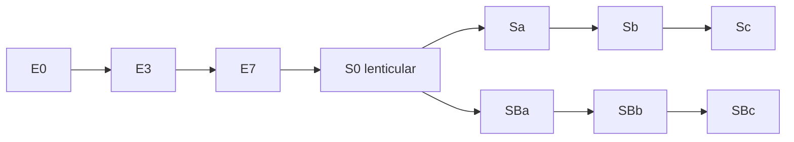

## Key figures {.stats style=tiles}

| Value | Label |
|---|---|
| Hundreds of billions | Galaxies in the observable universe |
| 230 km/s | Speed of the Sun round the Milky Way: one lap in 230 million years |
| 5 : 1 | Dark matter to ordinary matter, across the universe |
| 100,000 light-years | Across the Milky Way's disk of stars |

## Introduction {.abstract}

A **galaxy** is an island of stars, gas, dust and **dark matter**, bound by its own gravity. Ours, the **Milky Way**, is a barred spiral of 100 to 400 billion stars, inside a dark matter halo ten times wider. Galaxies are not scattered at random: gravity has strung them along a sponge-like **cosmic web** of filaments and clusters, round voids hundreds of millions of light-years across.

## 1. The Milky Way, to scale

We live inside the disk, 26,000 light-years from the centre, in the Orion Spur. Mapping it took 21 cm radio surveys, infrared telescopes, and Gaia's positions for nearly two billion stars.

```sizes shape=circle nested=yes unit=" ly"
Dark matter halo | 1000000 | About 85 % of the mass, 1 to 1.5 trillion Suns | purple
Stellar halo | 300000 | Globular clusters and old star streams | teal
Disk | 100000 | Four spiral arms, only 1,000 ly thick | blue
Bar and bulge | 10000 | Old stars round the centre | amber
```

At the centre is **Sagittarius A***, a black hole of 4.3 million Suns.

Why do the arms not wind up as the disk turns? Because they are **density waves**, not fixed spokes: traffic jams that gas clouds drive into, compress, and light up with new blue stars.

## 2. Hubble's tuning fork

Edwin Hubble sorted galaxies by shape in 1926: ellipticals on the handle, then spirals with and without a bar on the two prongs.



The sequence is not one of age: Hubble's "early" and "late" types are only names.

## 3. Rotation curves: the evidence for dark matter

In the Solar System, orbits slow with distance: Neptune moves at 5.4 km/s, nine times slower than Mercury, because the Sun holds nearly all the mass. In the 1970s **Vera Rubin and Kent Ford** measured stars and gas far out in Andromeda and other spirals. Their speed did not fall at all.

```plot type=function from=0.5 to=30 width=360 height=260 xtitle="Distance from the centre (kpc)" ytitle="Orbital speed (km/s)"
curve: Observed | 230 * (1 - exp(-x / 2.5))
curve: Expected from stars and gas | 587 * x / pow(x * x + 9, 0.75)
```

> [!IMPORTANT]
> A flat curve means the mass inside each radius keeps growing in step with the radius, far beyond the last stars: each galaxy sits in a **dark matter halo**.

## 4. Our cosmic address {style=card colour=blue}

```onion
Solar System | 26,000 ly from the galactic centre | amber
Milky Way | 100,000 ly across | blue
Local Group | 80 galaxies, 10 million ly | teal
Virgo Supercluster | M87 at 54 million ly | navy
Laniakea | 100,000 galaxies, 520 million ly | purple
```

Laniakea, mapped by Brent Tully in 2014, is a basin of galaxies that all flow towards the Great Attractor.

## 5. Three kinds of galaxy {.wide}

```compare
| Spirals and barred spirals | Ellipticals | Lenticulars and irregulars
Shape | A flat, turning disk of dusty arms round a bulge. Two in three have a bar | Smooth, featureless, from round (E0) to cigar-shaped (E7) | **Lenticular**: a disk and bulge with no arms. **Irregular**: no order at all
New stars | **Forming**: 1 to 5 Suns' worth a year | **"Red and dead"**: almost none | **Irregulars** blaze with them. **Lenticulars** have mostly stopped
Gas and dust | **Rich**: 10 to 20 % of the disk is cold gas | **Almost none** cold, but hot X-ray gas at 10 million K | Irregulars up to 50 % gas. Lenticulars lost theirs
How stars move | **In order**: one plane, one direction, 200 to 250 km/s | **At random**, like bees round a hive | Rotation, distorted by neighbours
Where, and how made | Thin surroundings: the Milky Way, Andromeda, M51 | **Cores of rich clusters**, built by mergers: M87 in Virgo | Dwarfs are the commonest galaxies: the Magellanic Clouds
```

## 6. How galaxies change {.wide}

```flow
[Gas in filaments|blue] -cools-> [Spiral disk|blue] -merger-> [Starburst|amber] -gas floods centre-> [Quasar|red] -gas blown out-> [Elliptical|grey]
In a merger the stars almost never touch: they are too far apart. The gas clouds collide, form stars in a burst, and feed the central black hole, whose outflow then stops star formation.
```

The Milky Way and Andromeda close at 110 km/s. A 2025 study using Gaia and Hubble gives them only about even odds of merging in the next 10 billion years.

## 7. Glossary {.wide}

```glossary cols=4
AGN | Active galactic nucleus: a black hole feeding on gas
kpc, Mpc | Kiloparsec (3,260 ly) and megaparsec (3.26 million ly)
LMC, SMC | The Large and Small Magellanic Clouds
M31, M87 | Andromeda, and the giant elliptical in Virgo
MOND | Modified Newtonian Dynamics, an alternative to dark matter
Quasar | The brightest kind of AGN
SFR | Star formation rate, in Suns' worth a year
```

## In short {.summary}

Galaxies are shaped by dark matter and by collisions. Spirals make stars along their arms, flat rotation curves show the halos they sit in, and mergers turn spirals into ellipticals.

### Blue arms, red ellipticals

Blue O and B stars live only about 10 million years, so blue light marks new stars. Ellipticals hold only old, red ones.

### Stars miss, gas collides

When galaxies collide, their stars pass each other by. Only the gas clouds meet.

### Black holes keep the heat

A galaxy's central black hole weighs about 0.1 to 0.5 % of its bulge, because its outflows stop the galaxy growing too fast.
