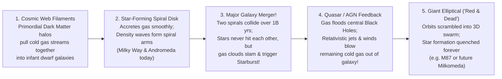

## Key figures {.stats style=tiles}

| Value | Label | Change | Verdict |
|---|---|---|---|
| 2 Trillion | Estimated number of galaxies in the observable universe | 100B–400B stars/MW | good |
| 220 km/s | Orbital speed of our Sun around the Milky Way centre (1 lap = 230M years!) | Cosmic Year | good |
| ~5:1 Ratio | Dark Matter halo mass compared to ordinary stellar + gas mass in galaxies | Vera Rubin proof | good |
| 4.5 B yrs | Time until the Milky Way and Andromeda collide to form an elliptical galaxy! | Milkomeda merger | good |

## Introduction {.abstract}

A **galaxy** is a gravitationally bound island of stars, interstellar gas, cosmic dust and **Dark Matter** orbiting a common centre of mass. Our home galaxy—a barred spiral called the **Milky Way**—contains **100 to 400 billion stars** spanning `100,000 light-years`, embedded inside an invisible **Dark Matter Halo** ten times wider. Across the universe, galaxies are not scattered at random; gravity weaves them along a sponge-like **Cosmic Web** of filaments, supercluster nodes (`Laniakea`) and `150-million-light-year` voids.

## 1. Anatomy of our home: the Milky Way barred spiral (`SBbc`) {.wide}

We live *inside* the Milky Way's dusty disk (`26,000 light-years` from the centre in the **Orion Spur**). Mapping our own galaxy required `21 cm` radio telescopes, infrared surveys (`Spitzer`/`WISE`) and **Gaia** 3D astrometry of 1.8 billion stars:

```figure
@segments
title: From the Milky Way's central black hole outward to the Dark Matter Halo (Diameter of visible stellar disk ≈ 100,000 light-years)
1 | 1. Galactic Centre: Sagittarius A* (4.3M M☉ Black Hole) & Nuclear Cluster | Core (0 ly) | red
2 | 2. Central Peanut Bar & Bulge (10,000 ly): Old metal-rich & metal-poor stars | Bar | amber
3 | 3. Thin & Thick Stellar Disk (Radius 50,000 ly; only 1,000 ly thick!): 4 Spiral Arms + Sun at 26k ly | Spiral Disk | blue
2 | 4. Stellar Halo (150,000 ly): 150+ Ancient Globular Clusters & Stellar Streams | Pop II Halo | teal
2 | 5. Invisible Dark Matter Halo (~1,000,000 ly across!): 85% of the Milky Way's total mass (~1.5 Trillion M☉)! | Dark Halo | purple
```

- **Why don't spiral arms wind up tightly and disappear after a few rotations ("The Winding Dilemma")?** Because spiral arms are **not fixed solid spokes** of stars! As **Chia-Chiao Lin and Frank Shu** explained, spiral arms are **density waves**—cosmic traffic jams moving slowly through the disk. Gas clouds pile up as they enter the traffic jam, compress to trigger bright blue star formation (lighting up the arm!), and continue out the other side.

## 2. Comparing the three major galaxy classes (Hubble's tuning fork) {.wide}

In 1926, **Edwin Hubble** arranged galaxies into his famous **Tuning Fork Diagram**:

```compare
| Spiral & Barred Spiral Galaxies (`Sa–Sc` / `SBa–SBc`) | Elliptical Galaxies (`E0` Spherical to `E7` Cigar) | Lenticular (`S0`) & Irregular (`Irr` / Dwarf) Galaxies
Visual morphology | Flat rotating disk with dusty spiral arms + central bulge (`2/3` have a central bar!) | Smooth, featureless 3D ellipsoids ranging from spheres (`E0`) to rugby balls (`E7`) | **Lenticular (`S0`)**: Disk + bulge with no spiral arms; **Irregular**: Chaotic, asymmetric blobs
Star formation rate | **Active!** `1 to 5` new solar masses of stars born per year in spiral arms | **"Red and Dead"!** Almost zero new star formation; dominated by old red/yellow stars | **Irregulars (`LMC/SMC`)**: Bursting with new blue stars! **Lenticulars**: Mostly quenched
Cold gas & dust content | **Rich (`10 to 20%` of disk mass)** in cold `H I` and `H₂` molecular clouds | **Virtually none (`< 1%`)**; filled with hot `10⁷ K` X-ray-emitting plasma | Irregulars are up to **50% gas**; Lenticulars lost their gas via ram-pressure stripping
Stellar orbital motion | **Ordered rotation**: all disk stars orbit in the same flat plane (`v ≈ 200–250 km/s`) | **Random 3D swarm orbits** (like bees in a beehive; supported by velocity dispersion `σ`) | Mix of rotation and tidal distortion from larger neighbouring galaxies
Where they are found & how they form | Common in **low-density field environments** and galaxy group outskirts (`Milky Way`, `M31`, `Whirlpool M51`) | Dominate the crowded **cores of rich galaxy clusters** (`M87` in Virgo)—built by **major mergers of spirals**! | **Dwarf galaxies** are the most abundant galaxies by number (`Sagittarius Dwarf`, `Magellanic Clouds`)
```

## 3. Vera Rubin and the flat rotation curve proof of dark matter

In our Solar System, planets obey **Keplerian decline (`v ∝ 1 / √r`)**: Neptune (`5.4 km/s`) orbits nearly **9 times slower** than Mercury (`47.4 km/s`) because `99.8%` of the mass sits in the Sun. In the 1970s, **Vera Rubin and Kent Ford** measured orbital speeds out to the edges of **Andromeda (`M31`)** and dozens of spiral galaxies—and found a shock:

```chart type=line title="Galaxy Orbital Speed vs Radius (km/s): Expected Keplerian vs Observed!" unit=" km/s" min=0 max=260 step=65 height=180 colours=red,blue values=last
series: Expected (Stars Only), Observed (Vera Rubin)
2kpc | 180 | 190
5kpc | 210 | 220
10kpc | 150 | 225
20kpc | 105 | 225
30kpc | 85 | 230
```

> [!IMPORTANT]
> Look at the blue curve above: stars at the far outer edge of a galaxy orbit **just as fast (`~225 km/s`)** as stars near the centre! By Newton's law (`v = √(GM(r) / r)`), a flat velocity curve (`v ≈ constant`) proves that enclosed mass `M(r)` keeps growing linearly with radius far beyond the visible stars—embedded in a giant **Dark Matter Halo**!

## 4. Galaxy evolution: mergers, quasars & `AGN` feedback



[[CAPTION:Figure]] When the **Milky Way and Andromeda collide in 4.5 billion years**, individual stars will almost never hit each other! Instead, gravity will fling stars into tidal tails and merge both galaxies into a giant **Elliptical Galaxy (`Milkomeda`)**.

## 5. Our cosmic address in the Cosmic Web {style=card colour=blue}

```checklist
[x] **1. Solar System & Orion Arm**: Located `26,000 light-years` (`8 kiloparsecs`) from the Milky Way's centre, orbiting once every `230 million years`
[x] **2. The Local Group (`Diameter ~10 Million ly`)**: Over `80` bound galaxies dominated by two giants (**Andromeda** and the **Milky Way**) plus **Triangulum (`M33`)** and the **Magellanic Clouds**
[x] **3. Virgo Supercluster (`Diameter ~110 Million ly`)**: Our Local Group falls toward the **Virgo Cluster** (`1,300+` galaxies anchored by giant elliptical **`M87`** at `54 million light-years`)
[x] **4. Laniakea Supercluster (`Diameter ~520 Million ly`)**: Mapped by **Brent Tully (`2014`)**—a basin of `100,000 galaxies` (`10¹⁷ M☉`) flowing along cosmic web filaments toward the **Great Attractor**!
```

## 6. Acronym guide: every term defined {.wide}

```cards cols=4 style=label
MW, M31 & M87 | The Milky Way (our barred spiral), Messier 31 (Andromeda Galaxy) and Messier 87 (giant elliptical at the core of the Virgo Cluster)
Sa..Sc, SBa..SBc, E0..E7 | Hubble Tuning Fork classes: unbarred spirals (`Sa–Sc`), barred spirals (`SBa–SBc`) and ellipticals (`E0` sphere to `E7` elongated)
kpc & Mpc | Kiloparsec (`3,260 light-years`, standard galaxy scale) and Megaparsec (`3.26 million light-years`, intergalactic scale)
LMC & SMC | Large and Small Magellanic Clouds: irregular satellite galaxies orbiting our Milky Way at `160,000` and `200,000 light-years`
AGN & Quasar | Active Galactic Nucleus and Quasi-Stellar Object: a supermassive black hole accreting gas and regulating host galaxy star formation
SFR & Starburst | Star Formation Rate (solar masses of new stars per year; `~2 M☉/yr` in Milky Way vs `100+ M☉/yr` in colliding **Starburst** galaxies)
MOND vs CDM | Modified Newtonian Dynamics (alternative gravity hypothesis) vs Cold Dark Matter (standard halo model supported by CMB & Bullet Cluster)
Cosmic Web & Void | Filamentary network of dark matter and galaxy superclusters surrounding `100-to-300-million-light-year` underdense **Cosmic Voids**
```

## In short {.summary}

Galaxies are dynamic ecosystems shaped by **Dark Matter** and **cosmic collisions**. **Spiral galaxies** form new stars along rotating density-wave arms, while **Vera Rubin's flat rotation curves** prove that galaxies sit inside massive Dark Matter halos. Over billions of years, **major mergers and black hole feedback** transform spirals into giant **elliptical galaxies**.

### Why spiral arms glow blue and ellipticals glow red

Hot, massive blue stars (`O` and `B` types) live only `10 million years`—so blue spiral arms mark recent star birth, whereas red ellipticals contain only old low-mass stars.

### Stars never collide when galaxies crash

Even during a head-on collision between the Milky Way and Andromeda, stars sit so far apart that the two stellar disks pass through each other like ghosts. Only the giant interstellar gas clouds collide!

### Black holes act as galactic thermostats

Every large galaxy's central black hole weighs `~0.1 to 0.2%` of its stellar bulge (**`M–σ` Relation**), because `AGN` jets heat and expel gas whenever the galaxy grows too fast.
