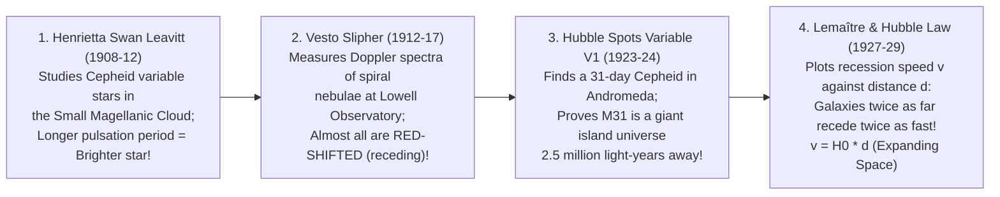

## Key figures {.stats style=tiles}

| Value | Label | Change | Verdict |
|---|---|---|---|
| 1924 / 1929 | Years Edwin Hubble proved Andromeda is a galaxy and discovered expansion | Mount Wilson 100-in | good |
| ~70 km/s/Mpc | Recession velocity added for every Megaparsec (3.26 million light-years) | Hubble Constant H₀ | good |
| 67.4 vs 73.0 | The 5-sigma "Hubble Tension" between early-universe light and local stars! | biggest mystery | bad |
| 14,000 Mly | Hubble Sphere radius beyond which space recedes faster than light (v > c)! | metric expansion | good |

## Introduction {.abstract}

Until 1924, astronomers debated whether the **Milky Way** was the entire universe and whether spiral "nebulae" were mere gas clouds inside our galaxy. Using the Mount Wilson telescope and **Henrietta Swan Leavitt's Cepheid variable law**, **Edwin Hubble** proved that **Andromeda (`M31`)** lies millions of light-years outside the Milky Way. Five years later, Hubble combined his distances with **Vesto Slipher's** redshifts and **Georges Lemaître's** relativity equations to prove that space is expanding (**`v = H₀ × d`**).

## 1. How Hubble broke open the cosmos (1908–1929) {.wide}



[[CAPTION:Figure]] In October 1923, Edwin Hubble spotted a Cepheid variable star (`V1`) inside the Andromeda nebula. Crossing out `"N"` (Nova) and writing **`"VAR!"`**, he expanded the known universe a hundred-thousand-fold overnight.

## 2. Leavitt's law & the Hubble-Lemaître diagram

Why are **Cepheid variable stars** the master key to extragalactic distance? Because a star that looks dim could either be a small nearby star or a giant distant star. Henrietta Leavitt discovered that Cepheids breathe in and out like a clockwork metronome (`1 to 100 days`) whose **period tells you its exact wattage**:

```lcd cols=1
[Henrietta Leavitt's Period-Luminosity Law ("Standard Candles")]
  1. Measure how many days the Cepheid takes to pulse from bright -> dim -> bright (Period P)
  2. Leavitt's Law gives true Absolute Magnitude (M):  M_v ≈ -2.81 * log10(P_days) - 1.43
  3. Compare true brightness (M) with apparent brightness in telescope (m):
       Distance (Parsecs) = 10^( (m - M + 5) / 5 )

[The Hubble-Lemaître Linear Law:  v = H_0 * d]
  - A galaxy at  10 Mpc (32.6 million ly) recedes at:  ~  700 km/s
  - A galaxy at 100 Mpc (326  million ly) recedes at:  ~7,000 km/s
```

```chart type=line title="The Hubble-Lemaître Law: Recession Velocity vs Distance (km/s)" unit=" km/s" min=0 max=30000 step=10000 height=180 colours=blue,red values=last
series: Early Planck (67.4), Local SH0ES (73.0)
0Mpc | 0 | 0
100Mpc | 6740 | 7300
200Mpc | 13480 | 14600
300Mpc | 20220 | 21900
400Mpc | 26960 | 29200
```

## 3. Metric expansion vs local motion through space

Why is **Andromeda (`M31`)** moving *towards* the Milky Way at `110 km/s` (`blueshifted`) if the universe is expanding? And how can distant galaxies recede **faster than the speed of light (`v > c`)** without violating Einstein's Special Relativity?

```cards cols=1 style=top
Metric Expansion (Stretching the Grid) vs Peculiar Velocity | Special Relativity forbids any object from flying *through* local space faster than `c` (**Peculiar Velocity**). However, General Relativity places no speed limit on how fast **space itself** can stretch between two distant galaxies! Beyond the **Hubble Sphere (`~14 billion light-years`)**, cumulative expansion adds up to `> 300,000 km/s` | blue
Why Andromeda Approaches Us (Gravity Wins Locally!) | Inside bound **galaxy groups** (like our **Local Group** across `~3 Megaparsecs`) and inside **atoms, planets and solar systems**, electromagnetic forces and local gravity easily overpower cosmic expansion. Space only stretches noticeably across the vast **intergalactic voids** between galaxy clusters! | teal
```

## 4. Why Hubble & Webb work as a team {style=card colour=blue}

```checklist
[x] **Cosmological Redshift stretches starlight into Infrared**: Because space has stretched by `1 + z`, ultraviolet and visible light from the first galaxies (`z > 10`) arrives at Earth as **mid-infrared** light (`2 to 5 µm`)
[x] **Hubble (`HST`, 2.4 m mirror in 540 km LEO)**: Sees **Ultraviolet, Visible and Near-Infrared (`0.1 to 1.7 µm`)**; serviced 5 times by astronauts and still operating after 34+ years!
[x] **James Webb (`JWST`, 6.5 m gold mirror at Sun-Earth L2)**: Passively cooled to `40 K (-233 °C)` behind a 5-layer sunshield to see **Infrared (`0.6 to 28 µm`)**—peering straight through dust clouds and out to `z = 14`
[x] **Redshift Formula (`z`)**: Astronomers measure how far spectral absorption lines (like Hydrogen `Hα` at `656.3 nm`) shift redward: `z = (λ_observed - λ_rest) / λ_rest`
```

## 5. The modern crisis: the `5σ` "Hubble Tension" {.wide}

In the 1920s, Edwin Hubble overestimated `H₀` as `~500 km/s/Mpc` because he did not yet know there were two different types of Cepheid stars. Today, we measure **`H₀`** to `1%` precision—yet our **two gold-standard methods disagree by `> 5 standard deviations (5σ)`**:

```compare
| Early-Universe Method (`H₀ = 67.4 ± 0.5 km/s/Mpc`) | Late-Universe Distance Ladder (`H₀ = 73.0 ± 1.0 km/s/Mpc`) | Independent Tie-Breaker Methods (Underway Now!)
How it works | Measures sound-wave horizon (`BAO`) in the **`380,000-year` Cosmic Microwave Background (`CMB`)** and projects forward using the `ΛCDM` model | Calibrates **Parallax -> Cepheids -> Type Ia Supernovae** across nearby galaxies (`SH0ES` team using **Hubble** and **James Webb**) | Bypasses Cepheids completely to test whether stellar dust/crowding or **new dark physics** causes the gap
Key instruments | European Space Agency **`Planck`** satellite, `ACT` and `SPT` ground telescopes | **`HST` (Hubble)**, **`JWST` (James Webb)** and **`Gaia`** parallax astrometry | **Tip of the Red Giant Branch (`TRGB`)** (`Wendy Freedman`), **Gravitational Wave Standard Sirens** (`LIGO`) & time-delay lensing
Implied cosmic age | **13.80 billion years** (standard `ΛCDM` cosmology) | **~12.8 to 13.0 billion years** if `H₀ = 73` without modifying Dark Energy! | **James Webb (`JWST`)** confirmed Hubble's Cepheid measurements match—ruling out simple telescope blurring!
```

## 6. Acronym guide: every term defined {.wide}

```cards cols=4 style=label
H₀ & Mpc | Hubble Constant (`km/s per Megaparsec` expansion rate) and Megaparsec (`1 million Parsecs` = `3.26 million light-years`)
Cepheid & TRGB | Pulsating supergiant "standard candle" star and Tip of the Red Giant Branch (helium-flash brightness marker in old stars)
z & Peculiar Velocity | Cosmological Redshift (`1 + z = a_now / a_then` scale factor ratio) and a galaxy's local gravitational motion through space
SH0ES | Supernovae, H0, for the Equation of State of Dark Energy: Nobel laureate Adam Riess's distance-ladder research team
HST & JWST | Hubble Space Telescope (`2.4 m` UV/optical/near-IR observatory) and James Webb Space Telescope (`6.5 m` infrared observatory)
CMB & BAO | Cosmic Microwave Background (`380,000 yr` relic radiation) and Baryon Acoustic Oscillations (primordial sound-wave ruler)
M31 & Local Group | Messier 31 (the Andromeda Galaxy, `2.5M ly` away) and our gravitationally bound group of `80+` galaxies (`~3 Mpc` across)
Standard Siren | Merging neutron stars or black holes whose gravitational wave amplitude gives direct distance without needing a distance ladder
```

## In short {.summary}

**Henrietta Leavitt** gave astronomy its yardstick (**Cepheid variables**), and **Edwin Hubble + Georges Lemaître** used it to prove that the universe is a vast, expanding fabric of galaxies (**`v = H₀ × d`**). Today, a `5σ` mismatch between early-universe and local measurements of **`H₀`** (**the Hubble Tension**) may point to new physics beyond standard cosmology.

### Galaxies do not fly through space; space stretches between them

Except for local gravitational tugs like Andromeda's approach, cosmic redshift happens because the metric fabric of space expands while light is in transit.

### Why Brooklyn is not expanding

Cosmic expansion only wins in the near-empty voids *between* galaxy clusters; inside galaxies, solar systems and atoms, gravity and electromagnetic bonds hold distances fixed.

### Webb proved Cepheids are not a mirage

Sharp infrared images from the **James Webb Space Telescope** confirmed that crowded stars did not skew Hubble's Cepheid distances—making the **Hubble Tension** a genuine cosmic puzzle.
