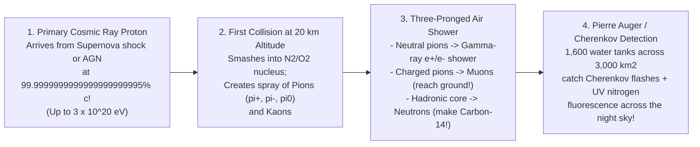

## Key figures {.stats style=tiles}

| Value | Label | Change | Verdict |
|---|---|---|---|
| 100 B / cm²/s | Solar Neutrinos passing straight through your thumbnail every single second! | ghost particles | good |
| 3 × 10²⁰ eV | Energy of the "Oh-My-God" cosmic ray proton (10 million× Geneva collider!) | 1 proton = 90 km/h ball! | good |
| 1 km³ Ice | Volume of Antarctic ice wired with 5,160 optical sensors at IceCube | catches blue flashes | good |
| 1.7 seconds | Delay between Gravitational Waves and Gamma Rays from 130M light-years away! | neutron star merger | good |

## Introduction {.abstract}

For four centuries, astronomy relied on a single messenger: **Photons** (electromagnetic light). Yet photons have a fatal flaw—they cannot escape the dense cores of stars or supernova fireballs without scattering for thousands of years! Today, **Multi-Messenger Astrophysics** combines **four fundamental cosmic messengers**. **Photons** carry light, **Cosmic Rays** bring charged atomic nuclei, **Neutrinos** pass straight through solid walls as uncharged ghost particles, and **Gravitational Waves** ripple spacetime itself.

## 1. Comparing the four messengers of the cosmos {.wide}

Each messenger reveals a different piece of the cosmic engine—and combining two or more messengers from the *same* event unlocks physics impossible with light alone:

```compare
| 1. Electromagnetic Photons (`Light`) | 2. Cosmic Rays (`Charged Nuclei`) | 3. Astrophysical Neutrinos (`ν_e, ν_μ, ν_τ`) | 4. Gravitational Waves (`Spacetime Ripples`)
What is the particle? | Massless gauge boson (`γ`, radio to gamma rays) | **`90%` Protons (`¹H`)**, `9%` Helium (`⁴He`), `1%` heavy nuclei + `e⁻` | Nearly massless, electrically neutral fermions (`< 0.8 eV`) | Quadrupole metric strain (`h = ΔL / L`) of spacetime
Path through space | **Straight line**, but **blocked/absorbed** by dust, gas or `CMB` | **Scrambled!** Bent into loops by galactic **magnetic fields**! | **Dead-straight line!** Passes through stars, dust & whole planets! | **Dead-straight line!** Zero absorption through any matter!
Where does it come from? | Stellar surfaces, nebulae, accretion disks, cosmic background | **Supernova shockwaves** (`Fermi acceleration`) & **Active Galactic Nuclei** | **Solar fusion core**, **Supernova core collapse** (`99%` of energy!) & `AGN` jets | Bulk acceleration of **compact masses** (`Black Hole` & `Neutron Star` mergers)
Flagship detectors | `JWST`, `Hubble`, `ALMA`, `Chandra`, `Fermi`, `CTAO` | **`Pierre Auger` (`3,000 km²` Argentina)**, `Telescope Array`, `AMS-02` (ISS) | **`IceCube` (South Pole)**, **`Super-Kamiokande`**, `KM3NeT` & `DUNE` | **`LIGO`**, **`Virgo`**, **`KAGRA`**, `Pulsar Timing Arrays` & `LISA`
```

## 2. Cosmic rays: how nature beats the Large Hadron Collider by `10⁷×`

In 1912, **Victor Hess** rode a hydrogen balloon to `5,300 metres` during a solar eclipse and proved that ionising radiation comes *down from deep space* (**Cosmic Rays**). When a single high-energy proton from a distant supernova or black hole jet slams into a nitrogen nucleus `20 km` above Earth, it triggers a **billion-particle cascade (`Extensive Air Shower`)**:



```chart type=bar title="Particle kinetic energy comparison (log10 electron-volts, eV)" unit=" log eV" max=22
Visible Photon | 0
Medical X-Ray | 4
Solar Proton | 9
CERN Collider | 13
Supernova Knee | 15
Oh-My-God Ray! | 20
```

- **Why you are hit by 1 relativistic Muon every second (Einstein's Time Dilation in your living room!)**: Cosmic ray collisions `15 km` up create unstable **Muons (`μ⁻`)** that decay in just **`2.2 microseconds`**. Even at light speed, `2.2 µs` only covers `660 metres`—so none should ever reach the ground! Because they travel at `0.9994 c`, Einstein's **Special Relativity time dilation** slows their internal clock by `30×`, letting them rain right through your roof!

## 3. Neutrinos: catching the "ghost particle" in a cubic kilometre of ice

Every time four protons fuse into Helium in the **core of the Sun**, two protons turn into neutrons and spit out two **Electron Neutrinos (`ν_e`)**. A photon takes **100,000 years** to bounce out of the Sun's dense interior. In contrast, the neutrino flies straight out at nearly the speed of light in **2.3 seconds**—giving us a live feed of the Sun's nuclear furnace!

```cards cols=1 style=top
How do you catch a particle that passes through a light-year of solid lead? | You build a **giant target** (`50,000 tonnes` of ultra-pure water at **`Super-Kamiokande`** in Japan, or **`1 billion tonnes` of clear glacier ice** `1.5 to 2.5 km` beneath the South Pole at **`IceCube`**) and wait! Out of trillions of passing neutrinos, a lucky few score a direct hit on an atomic nucleus—creating a relativistic **Muon** or **Electron** that travels *faster than the speed of light in water/ice (`0.75 c`)* and emits a cone of electric-blue **Cherenkov radiation** (`sonic boom of light`)! | blue
Supernova `1987A`: When Neutrinos Beat Light by 3 Hours! | When a massive star collapses into a Neutron Star, **99% of the gravitational binding energy (`10⁴⁶ Joules`)** escapes in a `10-second` burst of **Neutrinos**! On **23 February 1987**, three underground neutrino detectors (`Kamiokande-II`, `IMB`, `Baksan`) caught **25 neutrinos** from `Supernova 1987A` in the Large Magellanic Cloud **three hours before** the shockwave broke through the star's surface to make visible light! | teal
```

## 4. Two historic multi-messenger breakthroughs

Magnetic fields deflect **Cosmic Rays**, hiding their sources for 100 years—until astronomers linked **Gravitational Waves**, **Neutrinos** and **Light**:

```lcd cols=1
[Event 1: GW170817 — Merging Neutron Stars (17 August 2017)]
  - 12:41:04 UTC: LIGO & Virgo record a 100-s Gravitational Wave chirp (130M ly away)
  - +1.74 seconds: Fermi catches a Short Gamma-Ray Burst (GRB 170817A)!
                   (Proves gravity and light travel at the EXACT same speed to 10^-15!)
  - +11 hours:    70 telescopes spot the radioactive Kilonova forging Gold & Platinum!

[Event 2: IceCube-170922A — The Blazar Neutrino Gun (22 September 2017)]
  - IceCube at the South Pole catches a single 290-TeV high-energy Neutrino track
  - Automated alert points gamma-ray dishes to Blazar TXS 0506+056 (4B ly away)
  - Proves supermassive black hole jets accelerate ultra-high-energy Cosmic Rays!
```

## 5. Acronym guide: every term defined {.wide}

```cards cols=4 style=label
CR & UHECR | Cosmic Ray (relativistic charged atomic nucleus) and Ultra-High-Energy Cosmic Ray (`> 10¹⁸ eV`, extragalactic origin)
GZK Limit | Greisen-Zatsepin-Kuzmin Limit (`5 × 10¹⁹ eV`): cosmic rays above this energy collide with `CMB` photons and lose energy within `150M ly`
eV, TeV & PeV | Electron-volt, Tera-electron-volt (`10¹² eV`) and Peta-electron-volt (`10¹⁵ eV`): standard units of particle kinetic energy
ν_e, ν_μ & ν_τ | Electron, Muon and Tau Neutrinos: the three quantum flavours of neutrinos, which **oscillate (morph)** into one another in flight!
Cherenkov Light | Blue flash of light emitted when a charged particle travels through water, ice or air faster than the local phase velocity of light (`c / n`)
IceCube & Super-K | `1 km³` South Pole Antarctic neutrino telescope and `50,000-tonne` underground water Cherenkov detector in Kamioka, Japan
SN 1987A & Blazar | The 1987 supernova in the Large Magellanic Cloud (first astrophysical neutrino burst) and an `AGN` whose relativistic jet points straight at Earth
GW170817 & GRB | First binary Neutron Star merger caught in both Gravitational Waves and a Short Gamma-Ray Burst (`17 August 2017`)
```

## In short {.summary}

**Multi-Messenger Astrophysics** gives humanity four complementary senses to explore the cosmos. **Photons** image surfaces and gas, while **Cosmic Rays** bring actual samples of matter accelerated by shockwaves. Meanwhile, **Neutrinos** peer inside the nuclear cores of stars and black hole jets, and **Gravitational Waves** track colliding compact objects.

### Neutrinos solved the solar neutrino problem

For 30 years, detectors only caught **one-third** of expected solar neutrinos—leading some to fear the Sun's core had shut down! **`SNO`** and **`Super-Kamiokande`** proved neutrinos have mass and morph between three flavours (`ν_e <-> ν_μ <-> ν_τ`) on their 8-minute flight to Earth.

### Cosmic rays date ancient archaeology on Earth

When galactic cosmic rays hit nitrogen high in our atmosphere, they create radioactive **Carbon-14 (`¹⁴C`, half-life 5,730 years)**. Archaeologists use that exact cosmic-ray isotope to radiocarbon-date the Dead Sea Scrolls and ancient timber!

### Gravity and light race at the exact same speed

After travelling `130 million years` across intergalactic space from **`GW170817`**, gravitational waves and gamma-ray photons arrived at Earth within **`1.7 seconds`** of each other!
