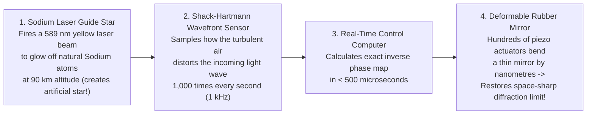

## Key figures {.stats style=tiles}

| Value | Label | Change | Verdict |
|---|---|---|---|
| 1 octave | Slice of the Electromagnetic Spectrum visible to human eyes (400 to 700 nm) | out of 60+ octaves! | bad |
| 2 Windows | Only Optical and Radio waves reach Earth's surface unimpeded by air! | why space telescopes | good |
| 6.5 metres | Diameter of the James Webb Space Telescope's 18-segment gold-coated mirror | 40 K cold at L2 | good |
| 12,000 km | Virtual dish size of the Event Horizon Telescope using radio interferometry | 20 micro-arcseconds! | good |

## Introduction {.abstract}

Looking at the universe in **visible light alone (`400 to 700 nm`)** is like listening to a Beethoven symphony on a piano where only **one middle octave** works. Cold planet-forming dust clouds glow in **far-infrared and millimetre radio**, while spiral-arm hydrogen gas whispers at **`21 cm` radio**. Newborn stars blaze in **ultraviolet**, and black hole accretion disks radiate **X-rays and Gamma rays**. Because Earth's atmosphere blocks most wavelengths, modern astrophysics combines giant ground observatories with cryogenic **space telescopes**.

## 1. Why we go to space: Earth's atmospheric opacity {.wide}

Earth's atmosphere (`O₂`, `O₃` ozone, `H₂O` water vapour and `CO₂`) protects life by absorbing lethal high-energy photons—which also blinds ground telescopes to everything except the **Optical Window** and the **Radio Window**:

```figure
@segments
title: Across 18 orders of magnitude of the Electromagnetic Spectrum (Which wavelengths reach the ground vs require Space Telescopes?)
2 | 1. Gamma & X-Rays (< 10 nm): BLOCKED at 50–100 km by N2/O2 -> Space Only (Fermi, Chandra) | Blocked (100%) | red
1 | 2. Ultraviolet (10–320 nm): BLOCKED by Ozone -> Space (Hubble) | Blocked | purple
2 | 3. Optical Window (320–900 nm): REACHES GROUND! (ELT, Vera Rubin, Keck) | Transparent! | green
2 | 4. Mid/Far-Infrared (2–500 µm): BLOCKED by H2O/CO2 -> Space (JWST at L2) | Blocked | amber
3 | 5. Radio Window (1 mm to 20 m): REACHES GROUND! (ALMA, VLA, SKA dishes) | Transparent! | blue
```

## 2. What each band of the spectrum reveals about the cosmos {.wide}

Temperature dictates wavelength via **Wien's Displacement Law (`λ_peak ≈ 2,898 µm·K / T`)**: the hotter the astrophysical engine, the shorter and more energetic the photons it emits!

```compare
| Radio & Millimetre (`1 mm to 20 m`) | Infrared (`0.7 µm to 300 µm`) | Visible & Ultraviolet (`10 nm to 700 nm`) | X-Rays & Gamma Rays (`< 10 nm`, `> 100 eV`)
Typical source temp | **`3 K to 100 K`** (plus non-thermal magnetic synchrotron radiation) | **`20 K to 3,000 K`** (cool dust, brown dwarfs, redshifted early galaxies) | **`3,000 K to 100,000 K`** (main-sequence stars, hot `O/B` stars, nebulae) | **`1,000,000 K to 10¹⁰ K`** (or relativistic particle jets & nuclear decay)
What shines here? | **Cosmic Microwave Background (`CMB`)**, cold `H I` (`21 cm`), `CO` molecular clouds, **Pulsars**, `Quasar` jets | **Star nurseries hidden behind dust**, protoplanetary disks, **Exoplanet atmospheres**, `z > 10` first galaxies! | **Stars (`Sun = 5,778 K`)**, reflection & emission nebulae, galaxy starlight, white dwarfs | **Black hole accretion disks**, `10⁷ K` galaxy cluster gas, **Supernova shocks**, Neutron Star mergers (`GRBs`)
Why it is special | Passes straight through galactic dust and Earth clouds day or night; allows continent-wide **interferometry** | **Penetrates opaque cosmic dust clouds** (`Mie scattering` drops as `λ⁻⁴`) and catches high-redshift light | Highest native angular resolution per metre of mirror for traditional optical cameras and spectrographs | Probes the most violent gravity, magnetic fields and nuclear explosions in the universe
Flagship observatories | **`ALMA`** (Chile), **`VLA`**, **`FAST`** (500 m China), **`SKA`** & **`Event Horizon Telescope`** | **`JWST` (James Webb)**, `Spitzer`, `Herschel` and `Euclid` | **`Hubble` (`HST`)**, **`Keck`**, **`VLT`**, **`Vera Rubin`** and **`Extremely Large Telescope` (`39 m`)** | **`Chandra`**, **`XMM-Newton`**, **`IXPE`**, **`Fermi` Gamma-Ray** and **`Cherenkov CTAO`**
```

## 3. Why telescope diameter (`D`) and wavelength (`λ`) govern sharpness

Why does a radio dish need to be **kilometres wide** just to match the sharpness of a small backyard optical telescope? Because of wave diffraction (**The Rayleigh Criterion**):

```lcd cols=1
The Fundamental Law of Telescope Angular Resolution (Diffraction Limit):
  theta_min (radians)  =  1.22 * ( Wavelength_lambda / Mirror_Diameter_D )

Why Wavelength (lambda) Changes Everything:
  - Hubble (Optical, lambda = 500 nm, D = 2.4 m)      -> Resolution = 0.05 arcseconds (Sharp!)
  - JWST   (Infrared, lambda = 2,000 nm, D = 6.5 m)   -> Resolution = 0.07 arcseconds (Needs 3x bigger mirror!)
  - Single Radio Dish (lambda = 21 cm, D = 100 m)     -> Resolution = 520  arcseconds (10,000x blurrier than Hubble!)

How Radio Astronomers Cheat Diffraction (Aperture Synthesis Interferometry):
  - Combine signals from dishes separated by Baseline B = 10,000 km using atomic clocks!
  - Effective resolution becomes:  theta = lambda / B  ->  0.00002 arcseconds (20 micro-arcseconds = EHT!)
```

```chart type=bar title="Primary mirror collecting diameter of flagship optical/IR telescopes (m)" unit=" m" max=44
Hubble Space (HST) | 2.4
James Webb (JWST) | 6.5
Vera C. Rubin | 8.4
Keck I & II | 10.0
Giant Magellan | 25.4
European ELT! | 39.3
```

## 4. How ground telescopes defeat twinkling: Adaptive Optics (`AO`)

Stars do not twinkle in space; turbulent warm and cold air cells in Earth's atmosphere bend starlight `1,000 times per second`. Without correction, air turbulence blurs a `10-metre` ground telescope down to the sharpness of a `20 cm` backyard scope! **Adaptive Optics (`AO`)** cancels the atmosphere in real time:



[[CAPTION:Figure]] Using laser guide stars and deformable mirrors at the **`VLT`** and **Keck**, astronomers tracked individual stars (`S2`) whipping around the Milky Way's central black hole (`Sagittarius A*`) at `7,650 km/s`!

## 5. Focusing X-rays and gamma rays {style=card colour=blue}

```checklist
[x] **Why normal mirrors fail for X-rays**: If an X-ray hits a mirror head-on, it does not reflect—it shoots straight into the glass like a bullet into paper!
[x] **Wolter Grazing-Incidence Mirrors (`Chandra` / `XMM-Newton`)**: Nested barrel-shaped iridium/gold cylinders deflect X-rays at a shallow `0.5°` grazing angle—just like **skipping a flat stone across a pond**!
[x] **Pair-Production Trackers (`Fermi` Space Telescope)**: Gamma rays (`> 20 MeV`) cannot be focused by any mirror; instead, tungsten plates convert the gamma ray into an **electron-positron pair (`e⁻ + e⁺`)** whose silicon tracks point back to the source
[x] **Atmospheric Cherenkov Arrays (`CTAO` / `VERITAS`)**: Ultra-high-energy gamma rays (`TeV`) smash into the upper atmosphere and create a `nanosecond` flash of blue **Cherenkov light**, turning the whole sky into a giant detector!
```

## 6. Acronym guide: every term defined {.wide}

```cards cols=4 style=label
EM & λ | Electromagnetic spectrum (all photon energies from radio to gamma) and Wavelength (`c = λ × f`)
HST, JWST & Roman | Hubble Space Telescope (UV/Optical), James Webb Space Telescope (Infrared) and Nancy Grace Roman (wide-field IR survey)
VLT, Keck & ELT | Very Large Telescope (`4 × 8.2 m` in Chile), Keck Observatory (`2 × 10 m` in Hawaii) and Extremely Large Telescope (`39.3 m` under construction)
ALMA, VLA & SKA | Atacama Large Millimeter Array (Chile), Very Large Array (New Mexico) and Square Kilometre Array (Australia/South Africa)
VLBI & EHT | Very-Long-Baseline Interferometry (atomic-clock-linked radio dishes) and Event Horizon Telescope (imaged `M87*` and `Sgr A*`)
AO & LGS | Adaptive Optics (real-time deformable mirror correction) and Laser Guide Star (`589 nm` sodium-layer artificial reference star)
CCD & Microcalorimeter | Charge-Coupled Device (silicon optical photon sensor) and cryogenic X-ray sensor that measures the heat of a single photon
Arcsec & mas | Arcsecond (`1/3,600th` of a degree; size of a coin at `4 km`) and Milli-arcsecond (`1/1,000th` of an arcsecond)
```

## In short {.summary}

Every band of the **Electromagnetic Spectrum** unlocks a different temperature regime of the universe. **Radio and Infrared (`ALMA`, `JWST`)** peer into cold, dusty star nurseries and the earliest redshifted galaxies. Meanwhile, **Optical (`Hubble`, `ELT`)** maps stars with **Adaptive Optics**, and **X-ray/Gamma (`Chandra`, `Fermi`)** captures the million-degree violence of black holes.

### Why Webb uses a gold mirror at 40 kelvin

Pure gold reflects **98%+ of infrared light**. Furthermore, a tennis-court-sized sunshield chills the telescope to **`-233 °C (`40 K`)`** so its own heat never blinds its infrared cameras!

### Bigger mirrors do two things at once

Doubling a telescope's diameter `D` collects **4 times more photons (`Area ∝ D²`)** to see fainter galaxies *and* halves the diffraction blur (**`θ ∝ 1 / D`**) to resolve finer detail.

### Radio astronomy links the entire planet into one dish

By recording radio waves alongside hydrogen-maser atomic clock timestamps across continents (**`VLBI`**), the **Event Horizon Telescope** achieves a sharpness equivalent to reading a newspaper in New York from London!
