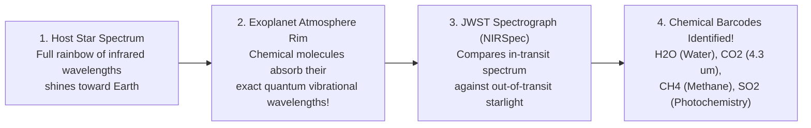

## Key figures {.stats style=tiles}

| Value | Label | Change | Verdict |
|---|---|---|---|
| 5,700+ | Confirmed exoplanets discovered across the Milky Way since 1992 | billions exist! | good |
| 0.0084% | Brightness dip (84 parts per million) when an Earth-sized planet transits a Sun | Kepler precision | good |
| 9 cm/s | Reflex wobble speed of the Sun caused by Earth's gravity (walking pace!) | 12.5 m/s for Jupiter | good |
| 4.24 ly | Distance to the closest known exoplanet, Proxima Centauri b | habitable zone | good |

## Introduction {.abstract}

Why did it take until the 1990s to confirm planets around other stars? Stars outshine their planets by **one billion to ten billion times** in visible light—like spotting a firefly beside a searchlight from `1,000 km` away. Instead of trying to see the planet directly, astronomers watch the **host star** for two tiny signatures. A periodic **brightness dip** occurs when a planet crosses the star (**Transit Photometry**), while a **Doppler colour shift** reveals the star wobbling (**Radial Velocity**).

## 1. The four exoplanet detection methods {.wide}

Combining **Transit Photometry** (planet **radius**) with **Radial Velocity** (planet **mass**) lets astronomers calculate bulk **density (`ρ = M / V`)**. That density reveals whether a distant world is a rocky Earth, an ocean water-world, or a puffy gas giant!

```compare
| 1. Transit Photometry (`~75%` of finds) | 2. Radial Velocity / Wobble (`~19%`) | 3. Gravitational Microlensing (`~4%`) | 4. Direct Coronagraphic Imaging (`~1.5%`)
Physical principle | Planet crosses star's disk, blocking a fraction `(R_planet / R_star)²` of starlight | Star and planet orbit a common centre of mass (`barycentre`), shifting starlight blue/red | Foreground star + planet bend and magnify light from a distant background star | Starlight-blocking mask (**coronagraph**) + adaptive optics reveal glowing young planets
What it measures | **Planet radius (`R_p`)** and orbital period `P` | **Minimum planet mass (`M_p sin i`)** and eccentricity | Planet-to-star mass ratio at wide `1 to 10 AU` orbits (even free-floating rogue planets!) | Direct infrared brightness, temperature and orbital motion (`e.g. HR 8799` system)
Sensitivity sweet spot | Close-in planets whose orbital plane aligns edge-on (`i ≈ 90°`) with Earth | Massive planets or rocky planets orbiting lightweight **Red Dwarf (`M-dwarf`)** stars | One-time alignments toward the crowded **Milky Way galactic bulge** | Giant young planets (`> 2 Jupiters`) orbiting far (`> 10 AU`) from their host star
Key observatories | `Kepler`, `TESS`, `CoRoT` and `PLATO` | `HARPS`, `ESPRESSO` (Chile) and `Keck/KPF` | `OGLE`, `MOA` and upcoming `Nancy Grace Roman` | `JWST`, `VLT/SPHERE` and `Gemini Planet Imager`
```

## 2. Reading a transit light curve: radius, orbit & rings

When the **Kepler** or **Transiting Exoplanet Survey Satellite (`TESS`)** mission stares at hundreds of thousands of stars simultaneously, a periodic box-shaped dip in brightness reveals an orbiting world:

```lcd cols=1
Relative Starlight Brightness
 1.0000 |-------------                 -------------                 ------
        |             \               /             \               /
 0.9900 |              \_____________/               \_____________/
        |              |<-- Transit ->|              |<-- Next Dip ->|
        +-----------------------------------------------------------------> Time
        |<------------- Orbital Period P (gives distance a via Kepler's 3rd Law) ------------->|

What the depth of the dip tells us:
  Transit Depth (Delta_F) = (R_planet / R_star)^2
  - Jupiter-sized planet crossing a Sun-like star -> 1.0% dip   (10,000 ppm — detectable from ground!)
  - Earth-sized planet crossing a Sun-like star   -> 0.0084% dip (84 ppm — requires space telescope!)
```

```chart type=bar title="Confirmed exoplanets by size / mass category (%)" unit="%" max=45
Neptune-Like | 35
Gas Giants | 31
Super-Earths | 30
Rocky / Earth-Size | 4
```

## 3. Surprising worlds not found in our solar system

Before 1995, astronomers assumed every planetary system looked like ours (small rocky planets close in, gas giants far out). Exoplanet surveys uncovered completely alien architectures:

```cards cols=2 style=top
Hot Jupiters (3-Day Roasting Gas Giants) | Like **51 Pegasi b** (the first planet found around a Sun-like star in 1995): Jupiter-mass gas giants orbiting **10× closer to their star than Mercury**, roasted to `1,500 K` with supersonic winds of vaporised iron and silicate glass rain! | amber
Super-Earths & Mini-Neptunes (The Most Common Worlds!) | The galaxy's most abundant planets are **`1.2 to 3.5` times Earth's radius**—a size completely missing from our Solar System! Below `~1.6 R⊕` they are dense rocky **Super-Earths**; above `~2.0 R⊕` they retain thick hydrogen/steam envelopes (**Mini-Neptunes** / **Hycean** worlds) | teal
Tidally Locked "Eyeball" Worlds (`TRAPPIST-1`) | Around cool Red Dwarf stars, the habitable zone is so close that gravity locks one side of the planet in **permanent daylight** and the other in **eternal night**, ringed by a permanent twilight terminator | blue
Lava Worlds & Ultra-Short-Period Planets | Rocky planets like **55 Cancri e** and **Kepler-78b** that complete an entire "year" in just **`8 to 18 hours`**, with dayside oceans of molten magma | red
```

## 4. How `JWST` sniffs alien air: transmission spectroscopy {.wide}

How can we tell if an exoplanet `100 light-years` away has water vapour or carbon dioxide? During a transit, a sliver of starlight filters through the planet's upper **atmosphere** on its way to the **James Webb Space Telescope (`JWST`)**:



[[CAPTION:Figure]] Because every molecule absorbs specific infrared wavelengths, the planet appears slightly *larger* at wavelengths absorbed by its air—turning the transit into a chemical barcode scanner.

## 5. The habitable zone & biosignature checklist {style=card colour=teal}

```checklist
[x] **The "Goldilocks" Habitable Zone**: Orbital distance where surface temperatures allow **liquid water (`0 to 100 °C`)** under sufficient atmospheric pressure
[x] **Red Dwarf (`M-Dwarf`) Trade-Off**: Red dwarfs make up `75%` of stars and make transits easy to spot, but violent **ultraviolet (`UV`) superflares** can strip away a close planet's atmosphere
[x] **Chemical Disequilibrium (The Real Biosignature)**: Finding **Oxygen (`O₂`) / Ozone (`O₃`)** *simultaneously* with a reducing gas like **Methane (`CH₄`)**—because they destroy each other rapidly unless living organisms replenish both!
[x] **Next-Gen Direct Flagship (`Habitable Worlds Observatory`)**: Future `6-to-8-metre` space telescope using an internal coronagraph or external **Starshade** to image Earth twins around Sun-like stars
```

## 6. Acronym guide: every term defined {.wide}

```cards cols=4 style=label
R⊕ & M⊕ | Earth Radius (`6,371 km`) and Earth Mass (`5.97 × 10²⁴ kg`): standard units for rocky and Super-Earth exoplanets
R_J & M_J | Jupiter Radius (`11.2 R⊕`) and Jupiter Mass (`318 M⊕`): standard units for giant exoplanets
ppm & m/s | Parts per million (`10⁻⁶` brightness dip in transit light curves) and metres per second (Doppler radial velocity wobble speed)
RV & TTV | Radial Velocity (Doppler star-wobble method) and Transit Timing Variation (gravitational tugs between multi-planet siblings)
TESS & Kepler | Transiting Exoplanet Survey Satellite (all-sky nearby star survey) and Kepler Space Telescope (found >2,700 exoplanets)
HARPS & ESPRESSO | High Accuracy Radial velocity Planet Searcher and Echelle SPectrograph for Rocky Exoplanets (European Southern Observatory)
JWST & HWO | James Webb Space Telescope (6.5 m infrared observatory) and Habitable Worlds Observatory (planned 2040s Earth-twin imager)
HZ & AU | Circumstellar Habitable Zone (liquid-water orbital belt) and Astronomical Unit (`149.6 million km` Earth-Sun distance)
```

## In short {.summary}

Astronomers rarely see exoplanets directly. Instead, **transit light curves** measure a planet's shadow (`radius`), **Doppler star wobble** measures its gravitational tug (`mass`), and **transmission spectroscopy** reads the chemical barcode of starlight filtering through alien skies.

### Planets outnumber stars

Kepler statistics prove that on average **every star in the Milky Way hosts at least one planet**, meaning over **100 billion planets** orbit in our galaxy alone.

### Mass plus radius reveals composition

Measuring a planet's shadow alone cannot tell a rocky world from a mini gas cloud; combining transit size with Doppler mass unlocks its true interior density.

### No single gas proves life

Volcanoes and sunlight can fake oxygen or methane alone; astronomers look for **chemical disequilibrium** (`O₂ + CH₄ + H₂O` together) as the fingerprint of a living biosphere.
