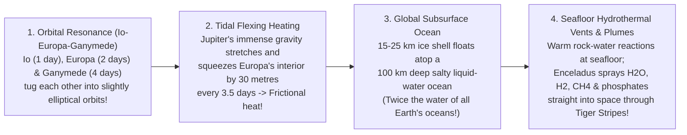

## Key figures {.stats style=tiles}

| Value | Label | Change | Verdict |
|---|---|---|---|
| 4.567 B yr | Exact age of the Solar System (dated via Calcium-Aluminium inclusions in meteorites) | supernova trigger | good |
| ~2.7 AU | The Frost Line (Snow Line) where water ice condensed during planet formation | rocky vs gas giants | good |
| 2× Earth's! | Volume of liquid water hidden beneath the icy crust of Jupiter's moon Europa | tidal flexing heat | good |
| 100,000 AU | Outer radius of the spherical Oort Cloud (~1.5 light-years — halfway to alpha Cen!) | trillion comets | good |

## Introduction {.abstract}

**4.567 billion years ago**, a shockwave from a nearby supernova compressed a cold molecular cloud core, causing it to collapse into the spinning **Protosolar Nebula**. While **99.86% of the mass** fell into the centre to ignite the **Sun**, the remaining `0.14%` flattened into a dusty protoplanetary disk. The **Frost Line (`~2.7 AU`)** inside that disk explains why inner planets are rocky, while outer planets grew into giants with **ocean moons**.

## 1. How the frost line split the solar system in two {.wide}

Inside `~2.7 AU` (between Mars and Jupiter), the young Sun's heat kept **water (`H₂O`), ammonia (`NH₃`) and methane (`CH₄`)** vaporised as gas. Only rare heavy **metals and silicate rocks (`~0.6%` of nebula mass)** could condense into solid pebbles there. Outside the **Frost Line (`T < 170 K`)**, abundant **ices froze solid**, quadrupling the solid building material. That extra ice allowed **10-Earth-mass cores** to form fast enough to vacuum up runaway envelopes of **Hydrogen and Helium gas** before the nebula cleared!

```figure
@segments
title: Architectural zones of the Solar System (Logarithmic scale from 0.4 AU out to 100,000 AU!)
2 | 1. Inner Terrestrial Zone (0.4–1.5 AU): Mercury, Venus, Earth, Mars (Rock & Iron) | Inside Frost Line | red
1 | 2. Main Asteroid Belt (2.1–3.3 AU): Jupiter's gravity prevented a 5th planet! | Frost Line (2.7 AU) | amber
3 | 3. Giant Planet Zone (5–30 AU): Gas Giants (Jupiter, Saturn) & Ice Giants (Uranus, Neptune) | Icy Cores + H2/He | blue
2 | 4. Kuiper Belt & Scattered Disk (30–100 AU): Pluto, Eris, Haumea & Short-Period Comets | Primordial Ice | teal
2 | 5. Oort Cloud (2,000–100,000 AU): Spherical shell of 1 trillion icy bodies flung out by Jupiter! | Edge of Sun's Gravity | purple
```

## 2. Comparing the three planetary classes {.wide}

Why do planetary scientists separate **Uranus and Neptune ("Ice Giants")** from **Jupiter and Saturn ("Gas Giants")**? Because Uranus and Neptune formed slower and further out, capturing mostly **supercritical water, ammonia and methane ("ices")** with only a `15%` hydrogen/helium skin!

```compare
| Terrestrial Planets (`Mercury, Venus, Earth, Mars`) | Gas Giants (`Jupiter & Saturn`) | Ice Giants (`Uranus & Neptune`)
Distance from Sun | `0.39 to 1.52 AU` (inside the Frost Line) | `5.20 AU` (**Jupiter**) and `9.58 AU` (**Saturn**) | `19.2 AU` (**Uranus**) and `30.1 AU` (**Neptune**)
Mass (`Earth = 1 M⊕`) | `0.055 M⊕` (Mercury) to **`1.0 M⊕` (Earth)** | **`318 M⊕` (Jupiter)** and **`95 M⊕` (Saturn)** | **`14.5 M⊕` (Uranus)** and **`17.1 M⊕` (Neptune)**
Bulk composition | **Silicate rock mantle** (`Mg, Si, O`) + **metallic Iron-Nickel core** | **`~90%` Hydrogen & Helium** over a fuzzy heavy-element core | **`~65 to 80%` "Ices" (`H₂O, NH₃, CH₄`)** over rock + `15%` `H₂/He` atmosphere
Internal exotic physics | Liquid iron outer core dynamo (`Earth`) & plate tectonics | **Liquid Metallic Hydrogen** ocean under `2 million bar` pressure! | **Superionic water mantle** & high-pressure **diamond rain** (`CH₄` pyrolysis)!
Moons & ring systems | Few moons (`0, 0, 1, 2`), **zero rings** | **`95` (`Jupiter`) and `146` (`Saturn`) moons** + spectacular icy rings | `28` (`Uranus`) and `16` (`Neptune`) moons + narrow dark dusty rings
```

## 3. When giant planets wandered: grand tack & the Nice model

Our Solar System did not stay where it was born. Computer simulations and Apollo Moon rocks reveal two dramatic planetary migrations:

```cards cols=1 style=top
1. The "Grand Tack" (`First 5 Million Years` — Why Mars Is So Small!) | Newborn **Jupiter** spiralled inward through the gas disk all the way to **`1.5 AU`** (Mars's current orbit!), truncating the rocky disk so Mars starved at `0.1 M⊕`. Only when **Saturn** caught up and locked into a `3:2` orbital resonance did the pair reverse direction ("tack" like a sailboat) and migrate back out to `5.2 AU`! | amber
2. The "Nice Model" Instability (`~4.0 Billion Years Ago`) | **Uranus and Neptune** originally formed much closer in (`12 to 17 AU`). Gravitational tugs with Jupiter and Saturn triggered a chaotic orbital shake-up—flinging Neptune outward to `30 AU`, scattering the primordial **Kuiper Belt** into the **Oort Cloud**, and pelting the inner planets during the **Late Heavy Bombardment**! | blue
```

## 4. Subsurface ocean worlds: where life may hide today

Before the `Voyager`, `Galileo` and `Cassini` missions, astronomers thought liquid water could only exist inside the warm inner **Goldilocks Zone** (`Venus–Mars`). Instead, **Laplace orbital resonance tidal flexing** kneads the interiors of outer icy moons—melting vast **global liquid-water oceans** beneath their frozen shells!



```chart type=bar title="Total liquid water volume compared to Earth's oceans (Earth = 1.0x)" unit="x Earth" max=30
Ganymede (Jupiter) | 26.0
Titan (Saturn) | 12.0
Callisto (Jupiter) | 10.0
Europa (Jupiter) | 2.2
Earth (All Oceans) | 1.0
Enceladus (Saturn) | 0.02
```

## 5. Comparing the top three astrobiology ocean moons {style=card colour=blue}

```checklist
[x] **Europa (`Jupiter` — Target of `NASA Europa Clipper` & `ESA JUICE`)**: `100 km` deep salty ocean in direct contact with a **rocky silicate seafloor** (enabling hydrothermal chemistry!), covered by a `15–25 km` fractured ice shell
[x] **Enceladus (`Saturn` — Sampled directly by `Cassini`!)**: Only `500 km` wide, yet South Pole **"Tiger Stripe" geysers** spray ocean water into space containing **molecular Hydrogen (`H₂`), organics, silica nanoparticles and phosphates**—every element needed for life (`C, H, N, O, P, S`)!
[x] **Titan (`Saturn` — Target of `NASA Dragonfly` nuclear octocopter, 2034)**: The only moon with a **thick Nitrogen atmosphere (`1.5 bar`)**, surface rivers/lakes of **liquid Methane and Ethane (`-179 °C`)**, *plus* a deep subsurface liquid-water ocean!
[x] **Triton (`Neptune` — Captured Kuiper Belt Object)**: Orbits Neptune **backwards (`retrograde`)** with active nitrogen-ice geysers and a likely ammonia-rich internal ocean
```

## 6. Acronym guide: every term defined {.wide}

```cards cols=4 style=label
AU & Frost Line | Astronomical Unit (`149.6 million km` Earth-Sun distance) and the `~2.7 AU` boundary where water vapour froze into solid ice in the protoplanetary disk
CAI | Calcium-Aluminium-Rich Inclusions: the oldest solid mineral grains in carbonaceous meteorites, dating Solar System birth to `4,567.3 ± 0.16 million years`
KBO & TNO | Kuiper Belt Object (`30–55 AU` icy ring beyond Neptune, including Pluto and Arrokoth) and Trans-Neptunian Object
Oort Cloud | Vast spherical cloud of `~10¹²` icy planetesimals (`2,000 to 100,000 AU`) that supplies Long-Period Comets when nudged by passing stars
Laplace Resonance | `4:2:1` orbital period lock of Jupiter's moons **Io (`1.77 d`)**, **Europa (`3.55 d`)** and **Ganymede (`7.15 d`)** that drives continuous tidal heating
JUICE & Clipper | JUpiter ICy moons Explorer (`ESA` mission to Ganymede/Europa) and NASA's **Europa Clipper** (`49` close flybys of Europa starting in `2030`)
Cassini-Huygens | Historic `NASA/ESA/ASI` Saturn orbiter (`2004–2017`) that discovered Enceladus's plumes and landed the **Huygens** probe on Titan's surface
CHNOPS | Carbon, Hydrogen, Nitrogen, Oxygen, Phosphorus and Sulphur: the six essential chemical elements of all known biological life
```

## In short {.summary}

The **Frost Line (`~2.7 AU`)** divided the newborn Solar System into small **rocky inner planets** and massive **outer gas/ice giants**. Giant-planet migration (**Grand Tack** and **Nice Model**) later sculpted the Asteroid Belt, Kuiper Belt and Oort Cloud. Today, **tidal flexing** inside the icy moons of Jupiter and Saturn maintains **ten times more liquid water** in the outer Solar System than on Earth!

### Why Jupiter outweighs all other planets combined

Sitting just outside the **`2.7 AU` Frost Line**, Jupiter got first pick of the densest ring of water-ice pebbles. It built a `10 M⊕` core fast enough to vacuum up `300 Earth masses` of Hydrogen gas before the disk vanished.

### Saturn's rings are surprisingly young

`Cassini` measurements show Saturn's bright icy rings are only **`100 to 400 million years` old**—formed when Saturn's **Roche tidal gravity** tore an icy moon apart while dinosaurs walked the Earth!

### Enceladus gives us free ocean samples in space

We do not need to drill through `20 km` of ice on **Enceladus**—its South Pole geysers blast fresh subsurface ocean water straight into orbit for spacecraft to fly through and taste!
