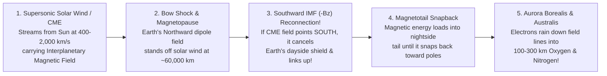

## Key figures {.stats style=tiles}

| Value | Label | Change | Verdict |
|---|---|---|---|
| 11 years | Average sunspot and solar magnetic polarity flip cycle (22-yr Hale cycle) | Solar Max peak | good |
| 400–800 km/s | Continuous supersonic speed of the Solar Wind streaming past Earth | 1M °C corona | good |
| 8.3 minutes | Travel time for X-ray light from a Solar Flare to hit Earth's ionosphere | 15–72 h for plasma! | bad |
| 1859 | Year of the Carrington Event superstorm that sparked fires in telegraph stations | benchmark storm | bad |

## Introduction {.abstract}

Our Sun is not a quiet yellow lightbulb; it is a seething sphere of magnetised **plasma** whose equator spins faster (`25 days`) than its poles (`35 days`). This **differential rotation** winds up magnetic field lines like rubber bands until they snap and burst through the surface. Those eruptions produce **sunspots**, **solar flares** and billion-tonne **Coronal Mass Ejections (CMEs)**. Only Earth's liquid-iron outer core—which generates our protective **Magnetosphere**—shields our atmosphere, satellites and electrical power grids from this continuous supersonic storm.

## 1. Inside-out anatomy of the Sun and the coronal heating puzzle {.wide}

Why does the Sun's visible surface (**Photosphere**) sit at a relatively cool **`5,778 K`**, while the tenuous outer atmosphere (**Corona**) blazes at **`1,000,000 to 3,000,000 K`**? **Alfvén magnetic waves** and **nanoflare magnetic reconnection** whip through the corona, dumping magnetic energy into the thin plasma and accelerating the **Solar Wind**:

```figure
@segments
title: From the Sun's nuclear core to the supersonic solar wind (Notice how a photon takes 100,000 years to random-walk out of the Radiative Zone!)
2 | 1. Core (0–25% R☉): 15M K Fusion Furnace | p-p fusion | red
3 | 2. Radiative Zone (25–70% R☉): Photons scatter for 100,000 yrs! | Random walk | amber
2 | 3. Tachocline & Convective Zone (70–100% R☉): Magnetic Dynamo | Boiling cells | blue
1 | 4. Photosphere (5,778 K): Sunspots & visible light | Surface | green
2 | 5. Chromosphere & Corona (1M–3M K!): Launches Solar Wind & CMEs | Magnetic loops | purple
```

## 2. Solar flares vs Coronal Mass Ejections (`CMEs`) {.wide}

People often confuse **Solar Flares** with **Coronal Mass Ejections**. A **Flare** is the **muzzle flash** of a cannon (pure light travelling at `300,000 km/s`), whereas a **`CME`** is the **cannonball** (magnetised plasma arriving 1 to 3 days later):

```compare
| Solar Flare ("The Muzzle Flash") | Coronal Mass Ejection — `CME` ("The Cannonball") | Solar Energetic Particle (`SEP`) Radiation Storm
What is launched? | Intense flash of **X-rays and Extreme Ultraviolet (`EUV`) photons** | **`1 to 10 billion tonnes`** of magnetised plasma + embedded magnetic field | Relativistic **protons and heavy ions** accelerated to `10 to 80%` light speed
Travel time to Earth | **Exactly `8 minutes 20 seconds`** (speed of light `c`) | **`15 to 72 hours`** (travels at `500 to 3,000 km/s`) | **`20 minutes to several hours`** after a major flare or `CME` shockwave
Classification scale | **`A, B, C, M, X` classes** (logarithmic `10×` steps; `X10+` is extreme) | Measured by speed (`km/s`), angular width (**Halo `CME`**) and **`Bz` magnetic tilt** | **NOAA `S1` to `S5`** solar radiation storm scale
Primary impact on Earth | Ionises the sunlit upper atmosphere (`D-layer`), causing immediate **High-Frequency (`HF`) radio blackouts** (`R1–R5`) for aviation and ships | Compresses Earth's magnetosphere; if its magnetic field points **Southward (`-Bz`)**, triggers severe **Geomagnetic Storms (`G1–G5`)** & aurorae! | Flips bits in satellite memory (**Single-Event Upsets**), degrades solar panels, and poses radiation hazards to astronauts and polar flights
```

## 3. How Earth's magnetosphere deflects the storm (and why `-Bz` matters!)



[[CAPTION:Figure]] Why can two identical `CMEs` hit Earth and one does nothing while the other sparks global aurorae? It depends on **`Bz`**: a **Northward (`+Bz`)** `CME` bounces off Earth's northward magnetic shield, whereas a **Southward (`-Bz`)** `CME` unlocks the shield via **magnetic reconnection**!

## 4. Aurora colours: atomic quantum physics in the sky

When magnetotail electrons plunge down Earth's polar magnetic field lines, they collide with upper-atmosphere gas atoms (`80 to 400 km` altitude). As excited electrons drop back down to lower quantum shells, they emit pure spectral colours:

```cards cols=2 style=label
Emerald Green (`557.7 nm` — Most Common) | Emitted by **atomic Oxygen (`O`)** between **`100 and 200 km`** altitude (`0.7-second` forbidden transition lifetime); where human night vision is most sensitive
Crimson Red (`630.0 nm` — High-Altitude Crown) | Emitted by **atomic Oxygen (`O`)** very high up (`200 to 400 km`) where air is so thin that atoms can wait `110 seconds` to radiate a red photon without being bumped!
Violet, Blue & Pink Lower Fringe (`427.8 nm`) | Emitted by ionised and neutral **molecular Nitrogen (`N₂⁺` / `N₂`)** below **`100 km`** during energetic substorms when fast electrons punch deep into the atmosphere
Van Allen Radiation Belts (Inner & Outer) | Two doughnut-shaped magnetic traps (`1,000–6,000 km` protons; `13,000–60,000 km` electrons) discovered by **James Van Allen** on `Explorer 1` in 1958
```

```chart type=bar title="Typical aurora emission altitude in Earth's atmosphere (km)" unit=" km" max=450
Red Oxygen (630nm) | 350
Green Oxygen | 130
Pink/Blue Nitrogen | 95
Airliner Flight | 11
```

## 5. How space weather threatens infrastructure (and how we defend it)

```steps
1. L1 Early Warning Buoys (`DSCOVR` & `ACE`) | Spacecraft parked at **Sun-Earth Lagrange Point `L1`** (`1.5 million km` upstream) measure the `CME`'s real-time speed and **`-Bz` magnetic polarity** `15 to 60 minutes` before it hits Earth | green
2. Satellite Atmospheric Drag Surge | Extreme ultraviolet heating puffs up Earth's upper **thermosphere**, increasing air drag on Low Earth Orbit (`LEO`) satellites (`Starlink`, `ISS`) up to **10-fold** and corrupting **Global Navigation Satellite System (`GNSS`)** timing | amber
3. Geomagnetically Induced Currents (`GICs`) | Rapidly waving magnetic fields (`dB/dt`) induce quasi-Direct Current (`DC`) flows along hundreds of kilometres of bedrock and into high-voltage **power grid transformers**—saturating iron cores and melting windings (`1989 Quebec Blackout`)! | red
4. Grid & Spacecraft Hardening | Power operators switch in neutral-blocking capacitors and hold reserve capacity during **`G4/G5` alerts**, while spacecraft use **Error-Correcting Code (`ECC`)** memory and safe-mode orientation | blue
```

## 6. Acronym guide: every term defined {.wide}

```cards cols=4 style=label
CME & SEP | Coronal Mass Ejection (billion-tonne plasma cloud) and Solar Energetic Particles (high-energy proton radiation storm)
IMF & Bz | Interplanetary Magnetic Field (solar magnetic field carried by the solar wind) and its North-South vertical component (`-Bz` opens shield)
EUV & HF | Extreme Ultraviolet radiation (ionises upper atmosphere) and High-Frequency radio (`3–30 MHz` skywave communications)
G1..G5, S1..S5, R1..R5 | National Oceanic and Atmospheric Administration (`NOAA`) 5-level scales for **Geomagnetic**, **Solar Radiation** and **Radio Blackout** storms
Kp Index & Dst | Planetary K-index (`0 to 9` global geomagnetic activity gauge; `Kp ≥ 7` brings mid-latitude aurorae) and Disturbance Storm Time index
GIC | Geomagnetically Induced Current: low-frequency ground current driven into long power lines and pipelines during magnetic storms
SOHO, SDO & Parker | Solar and Heliospheric Observatory, Solar Dynamics Observatory and **Parker Solar Probe** (flies directly through the Sun's corona!)
SEU & ECC | Single-Event Upset (cosmic/solar proton flipping a RAM bit in orbit) and Error-Correcting Code memory
```

## In short {.summary}

The Sun's twisted magnetic dynamo drives an **11-year cycle** of **solar flares** (light arriving in 8 minutes) and **Coronal Mass Ejections** (plasma clouds arriving in 1–3 days). Earth's **magnetosphere** deflects this bombardment, channelling energy into the polar **aurorae** while `L1` sentinel satellites warn power grids of incoming **`-Bz`** superstorms.

### Flares travel at light speed; CMEs take days

A solar flare blacks out dayside shortwave radio in 8 minutes, whereas the heavy plasma cloud (`CME`) that sparks aurorae takes 18 to 72 hours to cross `150 million km`.

### Southward `-Bz` is the key to the lock

Even a fast `CME` glances harmlessly off Earth's magnetic shield unless its internal magnetic field points **South (`-Bz`)**, linking up with Earth's North-pointing field.

### Long wires act as antennas for magnetic storms

During a `G5` storm, waving ionospheric currents turn continent-spanning high-voltage transmission lines into giant Faraday induction loops.
