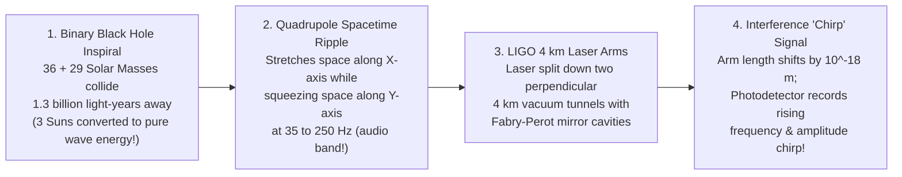

## Key figures {.stats style=tiles}

| Value | Label | Change | Verdict |
|---|---|---|---|
| 299,792 km/s | Escape velocity at the Event Horizon (equals the speed of light, c) | point of no return | bad |
| 3.0 km | Schwarzschild radius if you compressed the entire Sun into a black hole | 9 mm for Earth! | good |
| 4.3 M Suns | Mass of Sagittarius A*, the supermassive black hole at our galaxy's centre | 26,000 ly away | good |
| 10⁻¹⁸ metres | Spacetime stretch detected by laser interferometers (1/1,000th of a proton!) | gravitational wave | good |

## Introduction {.abstract}

In 1915, Albert Einstein replaced Isaac Newton's invisible gravitational tether with **General Relativity**. In Einstein's geometric view, **matter and energy tell spacetime how to curve, and curved spacetime tells matter and light how to move**. When a dying star's core or galactic centre packs enough mass into a tiny volume, spacetime curves so steeply that escape velocity exceeds the **speed of light (`c`)**. Nothing—not even a photon—can climb back out across this boundary, creating a **Black Hole**.

## 1. Anatomy of a spinning (`Kerr`) black hole {.wide}

Paradoxically, nothing escapes from *inside* the event horizon, yet the region *just outside* a feeding black hole is the brightest powerhouse in the universe. Friction and magnetic fields in the **accretion disk** convert up to **42% of infalling matter's rest mass** into radiation (versus `0.7%` in nuclear fusion!):

```figure
@segments
title: Radial zones moving outward from the centre of a rotating black hole (Measured in Schwarzschild radii, Rs = 2GM / c²)
1 | 0: Singularity / Kerr Ring (Classical breakdown) | Core | red
2 | 1.0 Rs: Event Horizon (Escape velocity = c; point of no return) | Boundary | purple
2 | 1.5 Rs: Photon Sphere (Light orbits in circles!) | Lensing | blue
3 | 3.0 Rs: Innermost Stable Circular Orbit (ISCO) & Glowing Accretion Disk | X-Rays (10⁷ K) | amber
2 | Relativistic Polar Jets (Twisted magnetic fields launch plasma at 99.9% c!) | Quasar | teal
```

```lcd cols=2
Schwarzschild Radius (Non-Rotating Event Horizon):
  R_s = (2 * G * M) / c^2   ≈  2.95 km * (M / M_sun)

Examples of R_s if compressed into a Black Hole:
  - Earth (1 M_earth)         -> R_s = 8.87 millimetres (a marble!)
  - The Sun (1 M_sun)         -> R_s = 2.95 kilometres
  - Sagittarius A* (4.3M Sun) -> R_s = 12.7 million km (18x Sun's radius)
  - M87* (6.5 Billion Suns)   -> R_s = 19 billion km (3x Pluto's orbit!)
---
Gravitational Time Dilation near the Horizon:
  t_distant = t_local / sqrt(1 - R_s / r)

What an outside observer sees as a probe falls in:
  - As r approaches R_s, the probe's clock appears to tick SLOWER and SLOWER
  - Light from the probe stretches into longer, redder wavelengths (Redshift)
  - The probe's onboard clock feels completely normal as it crosses R_s!
```

## 2. Three classes of black holes across the cosmos {.wide}

```compare
| Stellar-Mass Black Holes | Intermediate-Mass (`IMBH`) | Supermassive Black Holes (`SMBH`)
Typical mass (`M☉`) | **`3 to ~100` Solar Masses** | **`100 to 100,000` Solar Masses** | **`1 Million to 40 Billion` Solar Masses**
Event horizon diameter | `18 to 600 km` (city to country size) | `600 to 600,000 km` (planet to star size) | **Solar-system sized** (`0.08 to 250 AU`)
How they form | Core collapse of massive stars (`> 25 M☉`) at the end of fusion | Runaway mergers in dense globular star clusters (`e.g. GW190521`) | Seed black holes growing over billions of years at the **centre of every large galaxy**
Tidal spaghettification | **Extreme outside the horizon!** Tears a human or star apart before crossing `R_s` | Strong tidal gradient near the horizon | **Gentle at the horizon!** You could cross `M87*`'s horizon without feeling a thing
Famous examples | **Cygnus X-1** (`21 M☉`, first discovered X-ray binary) | `HLX-1`, **Omega Centauri** cluster candidate | **Sagittarius A\*** (Milky Way) & **M87\*** (imaged by the Event Horizon Telescope)
```

## 3. Spaghettification vs tidal disruption events

Why does a small `10 M☉` black hole shred an astronaut *before* they reach the event horizon, whereas a `6.5-billion M☉` supermassive black hole lets you fall smoothly across the horizon?

```cards cols=1 style=top
Tidal Force Scales as `1 / R³` (Gradient of Gravity) | What rips an object apart is not total gravity, but the **difference in gravity between your feet and your head**. At the `30 km` horizon of a stellar black hole, gravity at your feet is millions of `g` stronger than at your head—stretching you into a thin noodle (**Spaghettification**). At the `19-billion km` horizon of `M87*`, the gravitational gradient across a 2-metre human is nearly flat! | purple
Hawking Radiation (Quantum Evaporation) | Stephen Hawking showed that quantum vacuum fluctuations right at the event horizon allow black holes to leak thermal radiation with temperature `T ∝ 1 / M`. Stellar and supermassive black holes are colder than the `2.7 K` cosmic background and take **`10⁶⁷ to 10¹⁰⁰ years`** to evaporate! | blue
```

## 4. How `LIGO` hears colliding black holes via Gravitational Waves

When two black holes spiral together at half the speed of light, they do not emit light—they shake the fabric of **spacetime itself**, radiating **Gravitational Waves** outward at speed `c`:



```chart type=bar title="Peak power output comparison (log10 Watts)" unit=" log W" max=60
Humanity Power | 13
The Sun (Light) | 26
Supernova Blast | 36
Brightest Quasar | 40
GW150914 Merger! | 49
```

> [!IMPORTANT]
> During the final `20 milliseconds` of the first detected merger (**`GW150914`**), two colliding black holes radiated **`3.6 × 10⁴⁹ Watts`** as gravitational waves—briefly outshining the combined light of **every star in the observable universe by 50-fold**!

## 5. Multi-messenger gravitational wave astronomy {style=card colour=purple}

```checklist
[x] **LIGO / Virgo / KAGRA (`10 Hz to 10 kHz`)**: Ground-based `4 km` laser interferometers that catch stellar-mass black hole and neutron star mergers
[x] **LISA Space Antenna (`0.1 mHz to 1 Hz`)**: Three spacecraft flying in a `2.5-million-km` laser triangle in solar orbit to detect supermassive black hole mergers
[x] **Pulsar Timing Arrays (`Nanohertz`)**: Monitoring millisecond pulsars across the Milky Way to detect the slow background hum of colliding galactic nuclei
[x] **Event Horizon Telescope (`EHT`)**: Earth-sized Very-Long-Baseline Interferometry (`VLBI`) radio array that directly imaged the photon rings of `M87*` and `Sgr A*`
```

## 6. Acronym guide: every term defined {.wide}

```cards cols=4 style=label
GR & c | General Relativity (Einstein's geometric theory of gravity) and the Speed of Light in vacuum (`299,792,458 m/s`)
Rs & ISCO | Schwarzschild Radius (`2GM/c²` event horizon size) and Innermost Stable Circular Orbit (closest non-plunging orbit)
SMBH & IMBH | Supermassive Black Hole (`10⁶–10¹⁰ M☉` in galaxy cores) and Intermediate-Mass Black Hole (`10²–10⁵ M☉`)
AGN & Quasar | Active Galactic Nucleus and Quasi-Stellar Radio Source: a supermassive black hole whose accretion disk outshines its host galaxy
LIGO & Virgo | Laser Interferometer Gravitational-Wave Observatory (USA) and European Virgo detector: 4 km / 3 km laser wave observatories
LISA | Laser Interferometer Space Antenna: upcoming European Space Agency (`ESA`) 3-satellite gravitational wave observatory in space
EHT & VLBI | Event Horizon Telescope and Very-Long-Baseline Interferometry (linking radio dishes across continents into one virtual dish)
Sgr A* & M87* | Sagittarius A* (our Milky Way's 4.3M M☉ central black hole) and Messier 87* (6.5B M☉ giant elliptical galaxy black hole)
```

## In short {.summary}

A black hole is pure curved spacetime where gravity overwhelms all known forces. **Accretion disks and magnetic jets** make feeding black holes the brightest engines in the cosmos. Meanwhile, **gravitational time dilation** slows clocks near the horizon, and **laser interferometers (`LIGO`)** listen to colliding black holes across the universe.

### Gravity is geometry, not a force

Planets and light rays follow the straightest possible paths (**geodesics**) through four-dimensional spacetime warped by mass and energy.

### Black holes are not cosmic vacuum cleaners

Replacing the Sun with a 1-solar-mass black hole (`6 km` across) would not suck Earth in; our planet would keep orbiting in the dark at the same speed!

### Spacetime is stiff like steel

Colliding two 30-solar-mass black holes at half light speed ripples a `4 km` laser beam on Earth by just one-thousandth the width of a proton.
