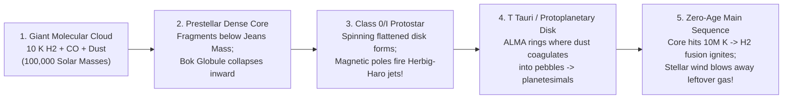

## Key figures {.stats style=tiles}

| Value | Label | Change | Verdict |
|---|---|---|---|
| ~1 atom/cm³ | Average gas density of the Interstellar Medium (better than any lab vacuum!) | 10¹⁹ in Earth air | good |
| 10 to 20 K | Temperature inside Dark Molecular Clouds where gravity collapses gas into stars | -263 °C cold! | good |
| 21.1 cm | Radio wavelength (1420.4 MHz) of the neutral Hydrogen hyperfine spin-flip | maps spiral arms | good |
| 1% Dust | Share of interstellar mass in solid silicate/carbon dust grains (blocks 50% of starlight!) | builds rocky worlds | good |

## Introduction {.abstract}

Space between the stars is not empty. Roughly **10 to 15% of the visible mass** of the Milky Way disk floats between the stars as the **Interstellar Medium (ISM)**. This turbulent ecosystem consists of **99% gas** (`Hydrogen` and `Helium`) and **1% microscopic dust grains** (`silicates, graphite and ice`). Supernova shockwaves blast gas into million-degree bubbles, while radiative cooling condenses it into **10-Kelvin Giant Molecular Clouds**. Gravity then crushes dense cores past the **Jeans Limit** to ignite new stars, and dying stars blow enriched ash back into space.

## 1. The five phases of the Interstellar Medium (`ISM`) {.wide}

How can `10 K` frozen molecular clouds coexist beside `1,000,000 K` supernova gas inside the same galaxy? Because **Thermal Pressure (`P = n × k_B × T`)** stays roughly balanced across phases: where **temperature (`T`)** is a hundred thousand times lower, **density (`n`)** is a hundred thousand times higher!

```compare
| 1. Giant Molecular Clouds (`GMC`) | 2. Cold Neutral Medium (`CNM`) | 3. Warm Neutral / Ionised (`WNM/WIM`) | 4. H II Regions (Emission Nebulae) | 5. Hot Ionised Medium (`HIM` / Coronal)
Temperature (`T`) | **`10 to 20 K`** (`-253 to -263 °C`) | **`50 to 100 K`** | **`6,000 to 10,000 K`** | **`~10,000 K`** (photoionised by `O/B` stars) | **`1,000,000 to 10,000,000 K`**
Number density (`n`) | **`10² to 10⁶` particles / cm³** | `20 to 50` atoms / cm³ | `0.2 to 0.5` atoms / cm³ | `10 to 10⁴` ions / cm³ | **`0.001 to 0.01` ions / cm³** (ultra-tenuous)
Volume of Milky Way | **`< 1%` of volume** (yet **40% of gas mass!**) | `~1 to 4%` of disk volume | **`~50 to 60%`** of disk volume | `< 1%` (bright stellar nurseries) | **`~30 to 50%`** (chimneys & superbubbles)
Dominant state of Hydrogen | **Molecular Hydrogen (`H₂`)** + Carbon Monoxide (`CO`) | **Neutral Atomic Hydrogen (`H I`)** | Atomic `H I` and ionised protons (`H II`) | **Ionised Hydrogen (`H II`)** plasma | Fully stripped plasma + heavy X-ray ions
How astronomers see it | Millimetre radio lines of **`CO`** & dust (`ALMA`) | **`21 cm` (`1420 MHz`) hyperfine radio line** | `21 cm` radio + diffuse **Hydrogen-Alpha (`Hα`)** | Glowing pink **`Hα` (`656.3 nm`)** & green `[O III]` | **Soft X-rays** (`Chandra`, `eROSITA`) & far-UV
```

## 2. How cold clouds collapse into stars: the Jeans criterion

Why doesn't every gas cloud in space collapse into stars immediately? Because internal **thermal gas pressure** (plus magnetic fields and turbulence) pushes outward against gravity. In 1902, physicist **Sir James Jeans** derived the critical threshold (**Jeans Mass, `M_J`**) where gravity wins:

```lcd cols=1
The Jeans Mass Formula:
  M_Jeans  ∝  ( Temperature / Mean_Molecular_Weight )^(3/2) * ( Density )^(-1/2)

Why Star Formation ONLY Happens in Freezing-Cold, Dense Molecular Clouds:
  - Warm Atomic Cloud (T = 100 K, n = 10/cm³)    -> M_Jeans ≈ 15,000 Solar Masses (Stable!)
  - Cold Dense Core   (T =  10 K, n = 10^5/cm³)  -> M_Jeans ≈ 1.0 Solar Mass! (Collapses!)

How a cloud cools down to 10 K in the dark:
  1. Interstellar dust shields the interior from harsh ultraviolet starlight
  2. Collisions excite Carbon Monoxide (CO) molecules, which radiate millimetre photons
     that escape freely—refrigerating the cloud core down to 10 Kelvin!
```



## 3. Comparing the five classic types of nebulae

Early astronomers called any fuzzy patch in a telescope a *"nebula"* (Latin for cloud). Spectroscopy revealed five completely different astrophysical objects:

```cards cols=1 style=top
1. Emission Nebulae / H II Regions (Stellar Nurseries — Pink/Red) | Like the **Orion Nebula (`M42`)** and **Lagoon Nebula (`M8`)**: newborn massive `O` and `B` stars blast ultraviolet photons (`> 13.6 eV`) that strip electrons off surrounding Hydrogen gas. As electrons recombine and cascade down to level `n = 2`, they emit the signature ruby-red **Hydrogen-Alpha (`Hα`, `656.3 nm`)** glow! | red
2. Reflection Nebulae (Starlight Scattered by Dust — Blue) | Like the **Pleiades (`M45`)** and **Witch Head Nebula**: the nearby stars are not hot enough to ionise hydrogen, so their starlight simply bounces off microscopic dust grains (**Rayleigh/Mie scattering**)—scattering blue light much more strongly than red, for the exact same reason Earth's daytime sky is blue! | blue
3. Dark Absorption Nebulae (`Bok Globules` — Opaque Black Silhouettes) | Like the **Horsehead Nebula** and **Coalsack**: dense clouds of dust-laden molecular gas (`10 to 20 K`) silhouetted against a bright background nebula or starfield. Opaque to visible light, yet completely transparent to **infrared telescopes (`JWST`)**! | purple
4. Planetary Nebulae & Supernova Remnants (Dying Stars!) | **Planetary Nebulae** (`Ring Nebula M57`, `Helix Nebula`) are gentle glowing shells (`[O III]` teal-green + `Hα` red) puffed off by dying Sun-like stars as they expose a hot White Dwarf core. **Supernova Remnants** (`Crab Nebula M1`, `Veil Nebula`) are violent `3,000 km/s` blast waves from exploded massive stars! | teal
```

## 4. The `21 cm` Hydrogen line and cosmic dust physics

```cards cols=2 style=label
The `21.1 cm` (`1420.4 MHz`) Spin-Flip Line | In a cold neutral Hydrogen atom (`H I`), the proton and electron spins can be **parallel** (slightly higher energy) or **anti-parallel**. Once every `~10 million years`, an atom flips from parallel to anti-parallel and emits a **`21.1 cm` radio photon** that penetrates straight through galactic dust—allowing Jan Oort and Harold Ewen (`1951`) to map the Milky Way's spiral arms!
Cold `H₂` Is Invisible (Why We Use `CO`!) | Because a symmetric **`H₂` molecule** (`H–H`) has no electric dipole moment, it cannot emit radio photons at `10 K`! Astronomers trace dark molecular clouds using the asymmetric **Carbon Monoxide (`CO`, `2.6 mm`)** molecule (`1 CO molecule per 10,000 H₂`)
Interstellar Extinction & Reddening | Sub-micron dust grains (`0.01 to 0.2 µm`—the size of cigarette smoke particles!) absorb and scatter short **blue and ultraviolet** wavelengths while letting long **infrared** wavelengths pass through (**Mie Scattering**)—making distant stars look redder than they really are
Ice Mantles: Prebiotic Chemical Factories | Inside dark clouds, dust grains grow icy coats of `H₂O`, `CO`, `NH₃` and Methanol (`CH₃OH`). Ultraviolet rays trigger surface chemistry on these grains, assembling complex organic molecules, sugars and amino-acid precursors before planets even form!
```

```chart type=bar title="Relative interstellar dust extinction by wavelength (V-band = 100%)" unit="%" max=320
UV Light (0.2 um) | 280
Blue (0.44 um) | 132
Green V (0.55 um) | 100
Near-IR (2.2 um) | 11
Mid-IR JWST (10um) | 3
```

## 5. Acronym guide: every term defined {.wide}

```cards cols=4 style=label
ISM & GMC | Interstellar Medium (gas and dust between stars) and Giant Molecular Cloud (cold `10 K` star-forming factory)
H I, H II & H₂ | Neutral Atomic Hydrogen (`H I`), Ionised Hydrogen plasma (`H II`, single proton) and Molecular Hydrogen (`H₂` diatomic gas)
CNM, WNM & HIM | Cold Neutral Medium (`~80 K`), Warm Neutral Medium (`~8,000 K`) and Hot Ionised Medium (`>10⁶ K` coronal supernova gas)
Hα & [O III] | Hydrogen-Alpha (`656.3 nm` red Balmer emission line) and Doubly Ionised Oxygen (`500.7 nm` teal-green forbidden nebula line)
21 cm Line | `1420.405 MHz` hyperfine radio transition of neutral Hydrogen (`H I`); universal marker of galactic gas and `SETI` searches
Jeans Mass (M_J) | Minimum mass a gas cloud of given temperature and density must have for self-gravity to overcome thermal pressure
PAH & Dust | Polycyclic Aromatic Hydrocarbons (ring-shaped organic soot molecules glowing in mid-IR) and silicate/carbon cosmic dust grains
ALMA & HH Object | Atacama Large Millimeter/submillimeter Array (66-dish radio telescope in Chile) and Herbig-Haro bipolar protostellar jet
```

## In short {.summary}

The **Interstellar Medium (`ISM`)** is a galactic recycling engine. **Supernovae** heat and enrich the gas with heavy elements, while **dust grains and Carbon Monoxide (`CO`)** cool dense clouds down to **`10 Kelvin`**. Once gravity overcomes the **Jeans Limit**, newborn stars light up the surrounding gas as glowing **H II emission nebulae**.

### Why infrared telescopes see through black clouds

Interstellar dust grains (`~0.1 µm`) match the wavelength of visible light and block it, whereas longer infrared waves (`2 to 28 µm` in **James Webb**) slip past the dust untouched.

### Cosmic smoke builds rocky planets

Although solid dust makes up only **1%** of the Interstellar Medium by mass, that 1% provides 100% of the silicon, iron and magnesium rock that forms planets like Earth!

### Why green stars do not exist, yet green nebulae do

Stars emit broad blackbody rainbows (`red, orange, yellow, white, blue`), whereas low-density nebulae emit sharp **quantum spectral lines**—including the neon-green `500.7 nm` line of doubly ionised oxygen (`[O III]`).
