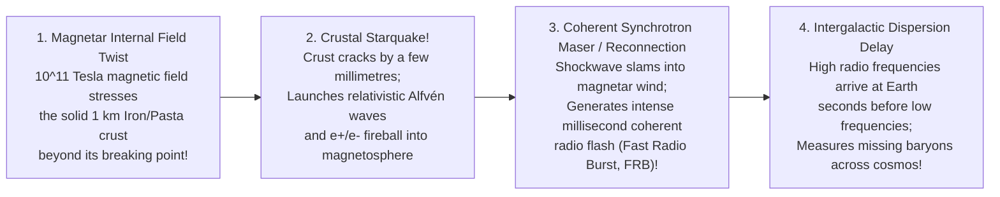

## Key figures {.stats style=tiles}

| Value | Label | Change | Verdict |
|---|---|---|---|
| ~20 km | Diameter of a Neutron Star packing 1.4 to 2.2 Solar Masses of matter! | city-sized nucleus | good |
| 716 Hz | Fastest known Pulsar spin rate (spinning 716 times every second!) | 24% speed of light! | good |
| 10¹¹ Tesla | Magnetic field of a Magnetar (1,000 trillion times stronger than Earth's!) | warps electron clouds | bad |
| 10¹² m/s² | Surface gravity (100 billion g — dropping a marshmallow hits like an A-bomb!) | bends light 30%+ | bad |

## Introduction {.abstract}

When a massive star (`8 to 25 solar masses`) runs out of nuclear fuel, gravity crushes its iron core so hard that protons and electrons merge into neutrons (`p + e⁻ -> n + ν_e`). Over **1.5 Suns of mass** collapse into a sphere the size of **central London (`~20 km`)**. Held up only by **quantum neutron degeneracy pressure** and the repulsive strong nuclear force, a **Neutron Star** is the densest visible matter in the cosmos. Because the collapsing core conserves **angular momentum** and **magnetic flux**, it emerges spinning hundreds of times per second (**Pulsar**) with a trillion-Gauss magnetic field (**Magnetar**).

## 1. Peeling the onion of a `20 km` Neutron Star {.wide}

What happens to matter squeezed to **`4 × 10¹⁴ g/cm³`** (twice the density of an atomic nucleus)? Between the solid iron crust and the superfluid core, competing nuclear attraction and Coulomb repulsion twist nuclei into **Nuclear Pasta**—the strongest material in the universe (`10 billion times` stronger than steel!):

```figure
@segments
title: Cross-section from a Neutron Star's surface to its centre (Total radius R ≈ 10 to 12 kilometres!)
1 | 1. Atmosphere (10 cm!) & Iron-56 Outer Crust (0.5 km): Ultrathin carbon/iron plasma | Solid Lattice | blue
2 | 2. Inner Crust (1 km): Free superfluid neutrons drip out of nuclei ('Neutron Drip') | Superfluid | teal
2 | 3. Nuclear Pasta Mantle (1 km): Nuclei deform into Gnocchi -> Spaghetti -> Lasagna sheets! | 10¹⁰× Steel! | amber
3 | 4. Outer Core (6 km): Frictionless Neutron Superfluid + Proton Superconductor (95% n, 5% p+e) | Quantum Liquid | purple
2 | 5. Unknown Inner Core (0–3 km): Hyperons, Bose-Einstein Pion/Kaon Condensate or Quark-Gluon Plasma? | NICER / LIGO test! | red
```

## 2. How pulsars work: the cosmic lighthouse model

In November 1967, graduate student **Jocelyn Bell Burnell** spotted a radio source pulsing every **`1.3373011 seconds`** with atomic-clock precision (nicknamed **`LGM-1`** for *"Little Green Men"*!). She had discovered the first **Pulsar**:

```lcd cols=1
           ^ Rotation Axis (Omega)
           |      //  / <-- Narrow Radio / X-Ray Synchrotron Beam
           |     //  /      (Sweeps across Earth once per rotation!)
       .---|---.//  /
     /     |   // \/  Magnetic Axis (Tilted by angle alpha from Spin Axis!)
    |   (N)|  *   |
    |  [20 km NS] |   <-- Closed Magnetosphere (Co-rotates out to Light Cylinder R = c/Omega)
     \     | (S) /
       '---|---'
          / //
         / //  <-- South Magnetic Pole Beam

Why newborn Neutron Stars spin so fast (Conservation of Angular Momentum: L = I * Omega):
  - An iron core 10,000 km wide spinning once every 10 hours collapses to 20 km wide (500x smaller R)
  - Moment of inertia (I ∝ R^2) drops by 250,000x -> Spin speed jumps to 10–100 rotations/second!
```

```chart type=bar title="Magnetic field strength across the cosmos (log10 Tesla)" unit=" log T" max=13
Earth Dipole | 0
Hospital MRI | 1
Sunspot / Lab | 2
White Dwarf | 4
Radio Pulsar | 8
Magnetar! | 11
```

## 3. Magnetars, starquakes and Fast Radio Bursts (`FRBs`)

Since 2007 (**Lorimer Burst**), radio telescopes like **`CHIME`** have detected thousands of millisecond flashes of radio waves from distant galaxies. Each flash releases as much energy in **one millisecond** as the Sun emits in **three days**:



[[CAPTION:Figure]] In April 2020, the `CHIME` and `STARE2` telescopes caught an intense **Fast Radio Burst (`FRB 200428`)** erupting from a known **Magnetar (`SGR 1935+2154`)** right inside our own Milky Way—proving that Magnetar starquakes power `FRBs`!

## 4. Mind-bending neutron star rules of thumb {style=card colour=teal}

```checklist
[x] **Gravitational Light Bending reveals the back of the star**: Gravity is so intense (`v_esc ≈ 0.5 c`) that light from the *far side* bends around the limb—so an observer sees **more than 70% of the surface at once**!
[x] **Pulsar Glitches probe superfluid quantum mechanics**: When the solid crust slows down, trillions of quantised vortices in the inner neutron superfluid suddenly unpin and transfer momentum—jerking the spin period faster by `1 part in 10⁶`
[x] **First Exoplanets Ever Found (`PSR B1257+12`, 1992)**: Aleksander Wolszczan and Dale Frail discovered the very first confirmed exoplanets (`Draugr`, `Poltergeist`, `Phobetor`) by timing microsecond wobbles in a millisecond pulsar!
[x] **Dispersion Measure (`DM`) weighs the universe**: Because intergalactic electrons slow down lower radio frequencies in an `FRB`, measuring the sweep delay counts every free electron between distant galaxies and Earth!
```

## 5. Comparing the four neutron star families {.wide}

```compare
| Normal Rotation-Powered Pulsars | Millisecond ("Recycled") Pulsars (`MSP`) | Magnetars (`SGR` & `AXP`) | X-Ray Binaries & Kilonova Mergers
Spin period (`P`) | **`0.03 to 5 seconds`** (`Crab Pulsar = 33 ms`) | **`1.4 to 10 milliseconds`** (`100 to 716 rotations/sec`!) | **Slow (`2 to 12 seconds`)**—braked rapidly by huge magnetic torque! | Milliseconds to seconds (or spiralling together at `100+ Hz`)
Magnetic field (`B`) | **`10⁷ to 10⁹ Tesla`** (`10¹¹ to 10¹³ Gauss`) | **Weaker (`10⁴ to 10⁵ Tesla`)** | **Extreme (`10¹⁰ to 10¹¹ Tesla` / `10¹⁵ Gauss`)** | `10⁴ to 10⁸ Tesla`
What powers the glow? | **Rotational kinetic energy** (`P` gradually slows down over `10–100M yrs`) | **Binary accretion spin-up**: an old pulsar strips gas from a companion star! | **Decay & twisting of the ultra-strong magnetic field** (`Starquakes`!) | Matter falling from a companion star (`X-ray bursts`) or **Neutron Star merger**
Precision & phenomena | Occasional sudden spin-ups (**"Glitches"**) when superfluid vortices unpin | **Rivals atomic clocks!** Used in **Pulsar Timing Arrays** to detect gravitational waves | Giant gamma-ray flares (`SGR 1806-20` ionised Earth's upper atmosphere from `50,000 ly`!) | **`GW170817`** merger proved colliding neutron stars forge the universe's **Gold & Platinum**!
```

## 6. Acronym guide: every term defined {.wide}

```cards cols=4 style=label
NS & TOV Limit | Neutron Star (`~1.4 to 2.2 M☉` collapsed stellar core) and Tolman-Oppenheimer-Volkoff mass limit (above which it becomes a Black Hole)
PSR & MSP | Pulsating Source of Radio (Pulsar) and Millisecond Pulsar (ancient pulsar spun up to `100–716 Hz` by accreting matter from a binary partner)
SGR & AXP | Soft Gamma Repeater and Anomalous X-ray Pulsar: the two observational classes of ultra-magnetised neutron stars (**Magnetars**)
FRB & DM | Fast Radio Burst (millisecond extragalactic radio flash) and Dispersion Measure (frequency-dependent arrival delay through cosmic plasma)
LGM-1 & Crab | "Little Green Men 1" (`PSR B1919+21`, first pulsar found by Jocelyn Bell Burnell in 1967) and the `33 ms` Crab Nebula Pulsar (from the `1054 AD` supernova)
NICER | Neutron star Interior Composition Explorer: NASA X-ray telescope mounted on the International Space Station measuring neutron star radii
CHIME | Canadian Hydrogen Intensity Mapping Experiment: stationary half-pipe radio telescope in British Columbia that discovered thousands of `FRBs`
PTA & NanoGrav | Pulsar Timing Array and North American Nanohertz Observatory for Gravitational Waves (uses millisecond pulsars as a galaxy-sized detector)
```

## In short {.summary}

A **Neutron Star** packs the mass of the Sun into a `20 km` ball of **superfluid neutrons** and **nuclear pasta**. Tilted magnetic beams turn spinning neutron stars into lighthouse **Pulsars** that rival atomic clocks, while binary accretion spins them up into `700 Hz` **Millisecond Pulsars**. Meanwhile, `10¹¹-Tesla` **Magnetars** unleash starquakes seen across the universe as **Fast Radio Bursts (`FRBs`)**.

### Why a sugar-cube of neutron star weighs 400 million tonnes

Normal atoms are **99.9999999999996% empty space** between the tiny nucleus and electron cloud; a Neutron Star crushes out all that empty space so nuclei touch wall-to-wall!

### How pulsars opened relativistic astrophysics

By refusing to dismiss a tiny `0.5-inch` scruff on `96 feet` of paper chart recorder tape in 1967, Jocelyn Bell Burnell proved that neutron stars exist in nature.

### Fast radio bursts found the universe's "missing" atoms

For decades, astronomers could not find half of the universe's ordinary `5%` baryonic matter; `FRB` radio dispersion delays proved it was hiding as diffuse ionised gas between galaxies!
