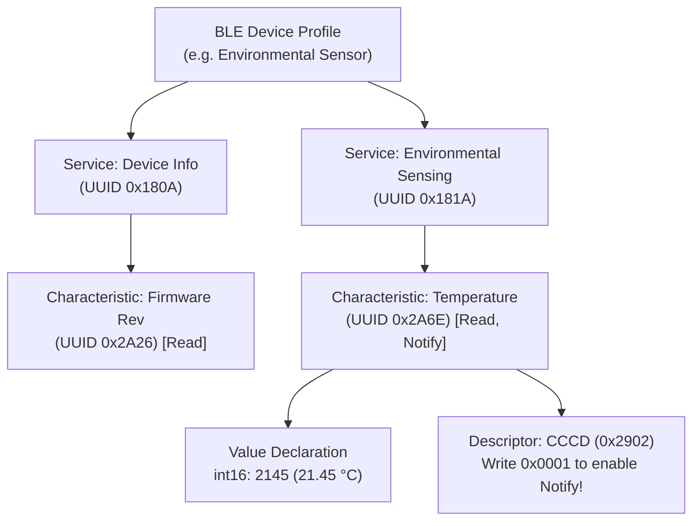

## Key figures {.stats style=tiles}

| Value | Label | Change | Verdict |
|---|---|---|---|
| 40 channels | `2 MHz` channels in `2.4 GHz` band (`3` advertising + `37` data) | frequency hopping | good |
| 31 bytes | Classic advertising payload ceiling (`254 B` in Extended Advertising) | compact beacon | good |
| 2 Mbps | High-speed `LE 2M` Physical Layer (`PHY`) bit rate (`125 kbps` Coded) | 4x range or 2x speed | good |
| < 15 µA | Average current for a Bluetooth Low Energy (BLE) 1-second connection | coin-cell friendly | good |

## Introduction {.abstract}

Unlike Classic Bluetooth, **Bluetooth Low Energy (BLE)** targets coin-cell sensors that sleep for **99%** of the time and wake for millisecond bursts. Operating in the unlicensed `2.4 GHz` **Industrial, Scientific and Medical (ISM)** band, BLE splits communication into two phases. **Generic Access Profile (GAP)** governs how devices broadcast beacons and establish connections. **Generic Attribute Profile (`GATT`)** organises all sensor readings and commands into a hierarchical table of **Services**, **Characteristics** and **Descriptors**.

## 1. Radio spectrum and access roles

To avoid **Wi-Fi** interference on channels 1, 6 and 11, a **Peripheral** (sensor) broadcasts short beacons on three dedicated **Primary Advertising Channels (`37`, `38`, `39`)**. Once a **Central** (phone or gateway) connects, both devices hop across the remaining **37 Data Channels (`0` to `36`)**:

```cards cols=1 style=top
Broadcaster / Beacon (Connectionless) | Transmits periodic non-connectable packets (`ADV_NONCONN_IND`) on channels 37, 38 and 39; any number of scanners can read the payload with zero pairing overhead | teal
Peripheral (Sensor / Actuator) | Advertises availability (`ADV_IND`), accepts a connection from a Central, and sleeps between scheduled **Connection Events** | blue
Central (Phone / Gateway) | Scans advertising channels, initiates connections to one or more Peripherals, and dictates connection timing | navy
```

```figure
@segments
title: 2.4 GHz ISM Band (2400 to 2483.5 MHz) — Advertising channels dodge main Wi-Fi channels 1, 6 and 11!
1 | Ch 37 (2402 MHz) | Adv 1 | amber
3 | Data Ch 0..10 (overlaps Wi-Fi Ch 1) | Hopping | blue
1 | Ch 38 (2426 MHz) | Adv 2 | amber
4 | Data Ch 11..36 (overlaps Wi-Fi Ch 6 & 11) | Adaptive Hopping | blue
1 | Ch 39 (2480 MHz) | Adv 3 | amber
```

## 2. Attribute hierarchy: services and characteristics

Once connected, data lives in an **Attribute Protocol (`ATT`)** table addressed by 16-bit standard or 128-bit custom **Universally Unique Identifiers (UUIDs)**:



[[CAPTION:Figure]] A Central enables server-pushed updates by writing `0x0001` (Notify) or `0x0002` (Indicate) to the Client Characteristic Configuration Descriptor (`CCCD`).

## 3. Pushing data: read vs notify vs indicate

Never make a phone poll a battery sensor with repeated `Read` requests. Instead, let the sensor push changes only when values move:

| `GATT` Operation | Direction | Radio ACKs | Throughput & Use Case |
|---|---|---|---|
| **Read Request** | Central pulls | Request + Reply | Slow (2 connection intervals); static config |
| **Write Command** | Central pushes | Link-layer only | **Fastest** firmware update (`FOTA`) streaming |
| **Notification** | Peripheral pushes | Link-layer only | **Fastest telemetry** (multiple per event) |
| **Indication** | Peripheral pushes | App-level `Confirm` | Critical alerts (waits for confirmation) |

```lcd cols=1
[GATT Server: Temperature Characteristic]
UUID:  0x2A6E  Handle: 0x0014
Props: READ | NOTIFY (CCCD 0x0015 = 0x0001)
MTU:   247 bytes (DLE = 251 B payload)
Push:  sd_ble_gatts_hvx(conn, &temp_c)
-- Data Length Extension (DLE) sends 244 B in 1 packet!
```

> [!TIP]
> Always negotiate **Maximum Transmission Unit (`MTU = 247`)** and **Data Length Extension (`DLE = 251`)** right after connecting. Default BLE 4.0 packets carry only `20 bytes` of `GATT` payload; `DLE` boosts that by **12x** to `244 bytes` per radio packet.

## 4. Physical layers (`PHY`) & timing parameters {.wide}

Bluetooth 5.0+ offers three **Physical Layer (`PHY`)** modes and three connection timing knobs that trade throughput against range and coin-cell life:

```compare
| `LE 1M PHY` (Default) | `LE 2M PHY` (High Speed) | `LE Coded PHY` (`S=2` / `S=8` Long Range)
Raw symbol / bit rate | `1 Msps` (`1 Mbps`) | `2 Msps` (`2 Mbps` — halves radio on-time!) | `1 Msps` with Forward Error Correction (`500` or `125 kbps`)
Link budget & range | Baseline (`~30` to `100 m` line-of-sight) | Slightly shorter range, **lowest energy per byte** | **`+12 dB` link budget (`4x` outdoor range)**
Max application throughput | `~700 kbps` | **`~1.4 Mbps`** (ideal for fast logs & FOTA) | `~90 kbps` (`S=8`)
```

```figure
@lanes
Fast Connection (15 ms interval, 0 latency) | *Tx/Rx Event | *Tx/Rx Event (15 ms) | *Tx/Rx Event (30 ms) | Low latency for human interface devices, higher sleep current (~180 uA)
Peripheral Latency (100 ms interval, latency = 9) | *Tx/Rx Event | Sleep (skips 9 empty events = 1.0 s!) | Sleep | *Wake immediately if sensor has data to Notify! (~12 uA)
```

## 5. Security & pairing (`LE Secure Connections`) {cols=2}

Never use legacy 6-digit passkey pairing (`LE Legacy Pairing`), which is vulnerable to passive eavesdropping. Require **Elliptic Curve Diffie-Hellman (ECDH)** key exchange:

```steps
1. Feature Exchange | Central and Peripheral exchange input/output capabilities (Display, Keyboard, or Just Works)
2. ECDH Public Key Exchange | Both sides generate P-256 elliptic curve key pairs (`LE Secure Connections`) to defeat passive sniffers | blue
3. Authentication & Bonding | Verify via Numeric Comparison, Passkey Entry or Out-of-Band (`OOB` Near-Field Communication), then store the Long-Term Key (`LTK`) in Flash | green
4. Resolvable Private Addresses | Rotate the device Media Access Control (`MAC`) address every 15 minutes using the Identity Resolving Key (`IRK`) to prevent location tracking | navy
```

## 6. Production BLE firmware checklist {style=card colour=blue}

```checklist
[x] Start with fast advertising (`100 ms`) for 30 seconds after button press, then drop to slow advertising (`1,000 ms`)
[x] Set **Peripheral Latency** (`4` to `10` intervals) so the sensor skips empty connection events without losing responsiveness
[x] Negotiate `ATT MTU = 247` and `LE 2M PHY` before streaming bulk logs or Firmware Over The Air (`FOTA`) images
[x] Require `LE Secure Connections` (`ECDH P-256`) with Man-In-The-Middle (`MITM`) protection on writable characteristics
[x] Fit a `±20 ppm` (or better) `32.768 kHz` crystal so narrow sleep-clock windows save maximum battery current
```

## 7. Acronym guide: every term defined {.wide}

```cards cols=4 style=label
BLE | Bluetooth Low Energy: ultra-low-power 2.4 GHz wireless standard introduced in Bluetooth 4.0 and expanded in 5.x
GAP | Generic Access Profile: rules governing BLE device discovery, advertising beacons and connection roles
GATT & ATT | Generic Attribute Profile and Attribute Protocol: hierarchical key-value table of Services and Characteristics
UUID | Universally Unique Identifier: 16-bit (standard SIG) or 128-bit (custom vendor) ID naming a Service or Characteristic
CCCD | Client Characteristic Configuration Descriptor (0x2902): 2-byte switch enabling Notifications or Indications
MTU & DLE | Maximum Transmission Unit (GATT buffer size) and Data Length Extension (up to 251-byte radio link-layer packets)
PHY & FEC | Physical Layer radio modulation (1M, 2M or Coded) and Forward Error Correction coding for long range
LTK & IRK | Long-Term Key (encrypts bonded connections) and Identity Resolving Key (resolves rotating private MAC addresses)
```

## In short {.summary}

Push telemetry using **`GATT` Notifications**, negotiate **`MTU = 247` + `LE 2M PHY`** to slash radio on-time, and configure **Peripheral Latency** so your sensor sleeps across empty connection intervals.

### Push with Notify, never poll

A sensor only wakes the radio when a value changes; if it has nothing to report, Peripheral Latency lets it sleep right through the connection tick.

### Negotiate `DLE` and `2M PHY`

Sending 244 bytes at `2 Mbps` instead of 20 bytes at `1 Mbps` cuts radio energy per kilobyte by more than **85%**.

### Enforce `LE Secure Connections`

A cheap **Software-Defined Radio (SDR)** sniffer cracks legacy pairing in one second; always enable `ECDH P-256` pairing.
