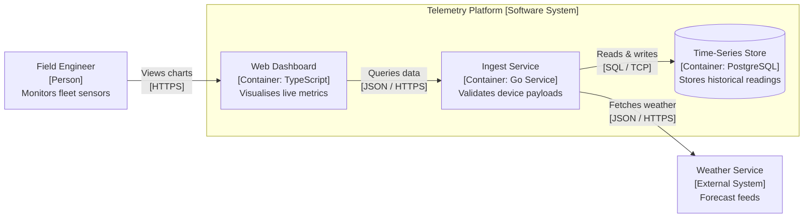

## Key figures {.stats style=tiles}

| Value | Label | Change | Verdict |
|---|---|---|---|
| 4 levels | Context, Containers, Components and Code zoom hierarchy | structured maps | good |
| 5 elements | Person, Software System, Container, Component and Relationship | simple notation | good |
| 1 model | Single text Domain-Specific Language (DSL) generating multiple views | versioned in Git | good |
| Levels 1 & 2 | Context and Container diagrams suffice for 90% of teams | low maintenance | good |

## Introduction {.abstract}

Most whiteboard architecture diagrams mix abstractions, omit element descriptions and rely on unexplained boxes and arrows. Created by Simon Brown, the **Context, Containers, Components and Code (`C4`)** model solves this by providing a hierarchical set of software maps. Like zooming in on a geographical map, engineers and stakeholders inspect a system at the exact level of detail they need. Every box states its **name**, **explicit element type**, **technology choice** and **concise responsibility**.

## 1. The four zoom levels of the C4 model {.wide}

Each level zooms inside one boundary from the level above it, serving a distinct audience:

```cards cols=4 style=top
Level 1: System Context | Shows the software system under design as a single central box surrounded by its human users (personas) and the external systems it integrates with | navy
Level 2: Container Diagram | Zooms inside the system boundary to show separately deployable units: web apps, mobile apps, microservices, firmware images and databases | blue
Level 3: Component Diagram | Zooms inside an individual container to show its internal structural building blocks (controllers, services, repositories) and their responsibilities | teal
Level 4: Code Diagram | Zooms inside a complex component to show classes, interfaces or structs, generated on demand by an Integrated Development Environment (IDE) | green
```

```figure
@lanes
Level 1 Context | *Field Engineer (Person) | *Telemetry Platform (Software System) | *Weather Service (External System)
Level 2 Containers | *Single-Page App (TypeScript) | *Ingest Service (Go API) | *Time-Series Database (PostgreSQL)
Level 3 Components | *Auth Controller | *Payload Validator | *Metrics Repository
Level 4 Code | *TelemetryPacket struct | *Validator interface | *InsertBatch() method
```

## 2. Zooming from level 1 context to level 2 containers

Every box states its **Name**, `[Element Type: Technology]` and **Responsibility**. Every arrow states its **Action Verb** and `[Protocol]` using **Hypertext Transfer Protocol Secure (HTTPS)**, **JavaScript Object Notation (JSON)**, **Structured Query Language (SQL)** and **Transmission Control Protocol (TCP)**:



[[CAPTION:Figure]] Every relationship arrow carries an active verb phrase and explicit transport technology.

## 3. What is a C4 container?

> [!IMPORTANT]
> **A C4 Container is never just a Docker container!** In the C4 vocabulary, a **Container** is any separately runnable or deployable architectural unit that executes code or stores data. If a unit must be running in order for the overall software system to work, it is a Container.

```cards cols=2 style=label
Execution Containers | A Single-Page Application (SPA) running in a browser, a server-side Application Programming Interface (API), a mobile app, a serverless function or microcontroller firmware
Data & Storage Containers | A relational database schema, a time-series store, a message broker topic, an object-storage bucket or a shared network file system
Supplementary Views | System Landscape (multiple enterprise systems), Dynamic diagrams (numbered runtime flows) and Deployment diagrams (mapping containers to servers)
When to stop zooming | Stop at Level 2 (Containers) unless a container's internal structure is complex enough to warrant a Level 3 Component diagram
```

## 4. Comparing C4 with ad-hoc diagrams and formal modelling {.wide}

```compare
| Ad-Hoc Boxes and Arrows | Unified Modelling Language (`UML`) | The C4 Architecture Model
Learning curve | None, but meaning is ambiguous to readers | Steep; strict notation rules and dozens of diagram types | **Minimal**; four intuitive zoom levels and five core abstractions
Abstraction discipline | Mixes servers, classes and users on one canvas | Enforced by diagram type, but lacks a macro-to-micro zoom story | **Strict separation** between Context, Container, Component and Code
Technology visibility | Frequently omitted from boxes and connectors | Often hidden inside stereotypes or separate deployment views | **First-class citizen** on every Container, Component and relationship
Tooling & automation | Drawn manually in slide decks; rots quickly | Requires heavy modelling suites that resist text diffs | **Plain-text DSL** in version control (`Structurizr`, `Mermaid`, `PlantUML`)
Primary audience | Only the author who drew it on the whiteboard | Software designers familiar with formal specification syntax | **Business stakeholders, architects and developers alike**
```

## 5. Diagrams as code with Structurizr

Writing architecture models in a plain-text **Domain-Specific Language (DSL)** lets teams generate multiple views from one model and review changes in pull requests:

```lcd cols=1
workspace "Fleet Telemetry" {
  model {
    eng = person "Field Engineer" "Monitors fleet health"
    sys = softwareSystem "Telemetry Platform" {
      spa = container "Web App" "Live charts" "TypeScript"
      api = container "Ingest API" "Device ingest" "Go"
      db  = container "Database" "Sensor time series" "PostgreSQL"
    }
    eng -> spa "Views dashboards" "HTTPS"
    spa -> api "Queries metrics" "JSON/HTTPS"
    api -> db  "Reads and writes" "SQL/TCP"
  }
}
-- One text model renders both Level 1 Context and Level 2 Container views
```

## 6. Diagram notation checklist {style=card colour=blue}

Every C4 diagram must stand on its own without requiring a verbal walkthrough from its author:

```checklist
[x] Every diagram has a clear title stating the diagram type and the exact system or container in scope
[x] Every box includes its Name, explicit `[Element Type: Technology]` bracket and a one-sentence description
[x] Every relationship arrow points in the direction of request initiation and carries an action verb + `[Protocol]`
[x] Every diagram includes a visual key or legend explaining box colours, shapes, borders and line styles
[x] Level 3 and Level 4 diagrams are generated automatically from code or kept only for high-complexity modules
```

## 7. Acronym guide: every term defined {.wide}

```cards cols=4 style=label
C4 | Context, Containers, Components and Code: four hierarchical zoom levels for visualising software architecture
DSL | Domain-Specific Language: a specialised text syntax used to define software architecture models as code
API & SPA | Application Programming Interface (backend service contract) and Single-Page Application (browser frontend)
IDE | Integrated Development Environment: developer editor capable of generating Level 4 code diagrams on demand
HTTPS & TCP | Hypertext Transfer Protocol Secure and Transmission Control Protocol: transport protocols shown on arrows
JSON & SQL | JavaScript Object Notation (data payload format) and Structured Query Language (database query language)
UML | Unified Modelling Language: formal visual specification standard for object-oriented software design
ADR | Architecture Decision Record: short markdown document capturing the rationale behind a key design choice
```

## In short {.summary}

Start every architecture conversation with a **Level 1 System Context** diagram and a **Level 2 Container** diagram. Keep abstractions separate across levels, put explicit technology choices inside every box and store your model as code.

### Separate your zoom levels

Never mix high-level business actors, deployable databases and low-level C++ classes on the same canvas.

### Label every box and arrow

A box with only a name is a Rorschach test; always include `[Type: Technology]` and a short responsibility phrase.

### Model once in text

Store a `Structurizr` or `Mermaid` definition in your repository so architecture diagrams update in every pull request.
