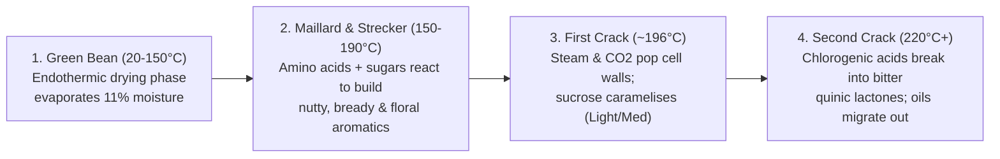

## Key figures {.stats style=tiles}

| Value | Label | Change | Verdict |
|---|---|---|---|
| 18 to 22% | Target Extraction Yield (EY) of dry roasted bean mass dissolved | balanced cup | good |
| 8 to 12% | Total Dissolved Solids (TDS) in espresso (1.3% in filter coffee) | syrupy body | good |
| 9 bar | Standard espresso gauge pressure (900 kPa — 9× atmospheric pressure) | emulsifies oils | good |
| 98.5% | Share of filter coffee that is water (magnesium, calcium & bicarbonate govern taste!) | water chemistry | good |

## Introduction {.abstract}

Roasted coffee beans consist of `~70%` insoluble cellulose structure and `~30%` water-soluble chemical compounds. Brewing coffee is a **solid-liquid chemical extraction** governed by diffusion out of microscopic cell pores and advection by flowing hot water. Different flavour molecules dissolve at different speeds based on molecular weight and polarity. Stopping extraction inside the **18% to 22% Extraction Yield (EY)** window separates bright fruit acids and caramelised sugars from harsh, dry plant astringency.

## 1. Selective dissolution: why timing controls flavour

Water does not extract all coffee compounds at the same speed. Small, polar molecules dissolve in seconds, whereas large, hydrophobic plant phenols dissolve slowly at the end of the shot:

```figure
@segments
title: Sequential extraction across an espresso shot or pour-over brew (Why stopping early tastes sour and stopping late tastes bitter!)
3 | 1. Early (0–30% time): Polar Fruit Acids, Caffeine & Floral Volatiles | Sour / Bright | amber
4 | 2. Middle (30–70% time): Maillard Melanoidins, Sugars & Caramel Notes | Sweet / Balanced! | green
3 | 3. Late (70–100% time): Heavy Plant Fibres, Quinic Lactones & Tannins | Bitter / Dry! | red
```

```chart type=bar title="Relative dissolution rate by compound family (0-100 index)" unit="%" max=100
Caffeine & acids | 95
Volatile aromas | 85
Caramel sugars | 65
Melanoidin body | 50
Bitter phenols | 20
```

## 2. Darcy's law and the espresso puck paradox

Flow through a compacted espresso bed obeys **Darcy's law** for porous media. Volumetric flow rate equals `Q = (k × A × ΔP) / (μ × L)`, where `k` is puck permeability, `A` is basket area, `ΔP` is pump pressure, `μ` is water viscosity and `L` is puck depth:

```compare
| Under-Extracted Shot (`< 18% EY`) | Balanced Sweet Spot (`18 to 22% EY`) | Over-Extracted / Channelled (`> 22% EY`)
Sensory profile | **Sharp, sour, salty**, thin body and vanishes quickly | **Ripe acidity** balanced by syrupy sweetness and cocoa finish | **Hollow, harsh, dry astringency** that coats the tongue
Flow dynamics | Fast "gusher" (grind too coarse or low dose; high permeability `k`) | Even, honey-like laminar flow across the entire bottomless basket | Slow drip or blonde jets where water punches a low-resistance hole
How to fix it | **Grind finer**, increase brew ratio (more water) or raise temperature | Lock in grinder setting, dose mass (`±0.1 g`) and distribution | **Grind slightly coarser**, declump grounds (`WDT`) or lower ratio
```

- **Why "Fines" Matter (Bimodal Particle Size Distribution)**: A burr grinder produces both larger particles (`200 to 500 µm`) that form the structural skeleton of the puck and microscopic **fines** (`< 100 µm`) that provide massive surface area for rapid extraction.
- **The Over-Pressure Trap (`> 9 to 10 bar`)**: Cranking pump pressure from `9 bar` to `15 bar` rarely speeds up an espresso shot! Excess pressure crushes the deformable cellulose bed, packs fines against the basket holes, shrinks permeability `k`, and triggers **channelling**.

## 3. Roasting chemistry: from green seed to brown bean



```chart type=line title="Chemical evolution across roast degree (relative %)" unit="%" min=0 max=100 step=25 height=180 colours=amber,green,red values=last
series: Organic Acids, Aroma Volatiles, Bitter Lactones
Green | 80 | 10 | 5
Light | 95 | 75 | 25
Medium | 70 | 95 | 55
Dark | 35 | 60 | 95
```

## 4. Water chemistry: why minerals make or break coffee {.wide}

Distilled water brews flat, sour coffee, whereas hard tap water brews chalky, lifeless coffee. Three dissolved ions govern extraction and acidity buffering:

```cards cols=3 style=top
1. Magnesium (`Mg²⁺` — The Aromatic Magnet) | Small, charge-dense magnesium ions bind strongly to oxygen-rich volatile aromatics and fruity esters, pulling bright, complex top notes into the cup without forming hard boiler scale | green
2. Calcium (`Ca²⁺` — Creamy Body & Heavy Notes) | Larger calcium ions extract heavier, creamy and chocolatey compounds, though excess calcium (`> 80 mg/L`) combines with bicarbonate to precipitate limestone scale inside espresso boilers | blue
3. Bicarbonate (`HCO₃⁻` — The Acid Buffer) | Alkalinity (`KH`) neutralises hydrogen ions (`H⁺`) from citric and malic acids. Too little buffer (`< 20 mg/L`) tastes bitingly sour; too much (`> 80 mg/L`) flattens all fruit acidity into chalk | amber
```

## 5. Barista engineering checklist {style=card colour=amber}

```checklist
[x] **Rest freshly roasted beans (`3 to 14 days`)** so trapped Carbon Dioxide (`CO₂`) gas escapes; brewing too early causes violent gas bubbles that repel water
[x] **Weigh input dose and liquid output (`Brew Ratio`)** to `0.1 g` precision (`e.g. 18.0 g dry coffee -> 36.0 g liquid espresso` in `25 to 30 seconds`)
[x] **Break up clumps before tamping** using a fine needle tool (**Weiss Distribution Technique, `WDT`**) so water flows evenly through every millimetre of the puck
[x] **Formulate brewing water** around `50 to 80 mg/L` General Hardness (`GH`, rich in `Mg²⁺`) and `30 to 45 mg/L` Alkalinity (`KH`) to balance sweetness and acidity
```

## 6. Acronym guide: every term defined {.wide}

```cards cols=4 style=label
EY & TDS | Extraction Yield (% of dry coffee mass dissolved) and Total Dissolved Solids (% concentration of coffee solids in the liquid cup)
PSD & WDT | Particle Size Distribution (spread of fines and boulders from a grinder) and Weiss Distribution Technique (needle declumping)
GH & KH | General Hardness (dissolved `Ca²⁺` and `Mg²⁺` extraction ions) and Carbonate Hardness / Alkalinity (`HCO₃⁻` acid-buffering ions)
CGA & CO₂ | Chlorogenic Acids (antioxidants that degrade into bitter quinic lactones in dark roasts) and Carbon Dioxide (roasting gas)
bar & kPa | Metric pressure units: `1 bar = 100 kilopascals (kPa)`, roughly equal to Earth's atmospheric pressure at sea level
Darcy's Law | Fluid dynamics equation describing pressure-driven flow through a porous medium such as a compacted coffee puck
Maillard Reaction | Chemical reaction between amino acids and reducing sugars above `140 °C` that creates brown melanoidins and savoury/sweet aromas
Refractometer | Optical instrument that measures the refractive index of brewed coffee to calculate exact `TDS` and Extraction Yield
```

## In short {.summary}

Great coffee relies on selective chemical extraction. **Grind size** sets surface area and Darcy flow resistance, while **brew ratio** stops the shot inside the `18 to 22% EY` sweet spot. Meanwhile, **water minerals (`Mg²⁺` and `HCO₃⁻`)** tune aroma extraction and acidity.

### Sour means early, bitter means late

Acids dissolve first, sugars and Maillard melanoidins dissolve second, and dry astringent plant phenols dissolve last.

### Higher pressure does not mean faster flow

Above `9 bar`, water compresses the coffee puck and packs microscopic fines against the basket, slowing flow and causing severe channelling.

### Water is an active solvent

Without magnesium and calcium ions to grip flavour compounds and bicarbonate to buffer acids, even the finest coffee beans taste flat and sour.
