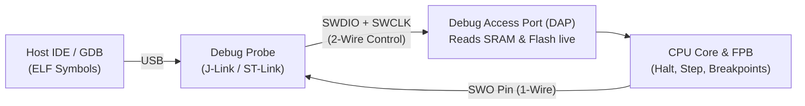

## Key figures {.stats style=tiles}

| Value | Label | Change | Verdict |
|---|---|---|---|
| 2 pins | Serial Wire Debug (SWD) clock (`SWDIO`, `SWCLK`) pin count | vs 5-pin `JTAG` | good |
| < 1 µs | Real-Time Transfer (`RTT`) log write time into target RAM | non-blocking | good |
| 8 words | Registers pushed to stack automatically on a Cortex-M fault | crash snapshot | good |
| 6 to 8 | Hardware breakpoint comparators inside a Cortex-M Flash Patch unit | hardware limit | bad |

## Introduction {.abstract}

Sprinkling `printf` calls over a slow serial port alters real-time interrupt timing and hides race conditions. Modern microcontrollers include dedicated on-chip debug silicon accessed over a 2-pin **Serial Wire Debug (SWD)** or 4-pin **Joint Test Action Group (JTAG)** probe. Without halting the **Central Processing Unit (CPU)**, a probe reads and writes **Static Random-Access Memory (SRAM)** on the fly. It also streams sub-microsecond logs via **Real-Time Transfer (`RTT`)**, samples instruction addresses over **Serial Wire Output (SWO)**, and decodes hardware crash frames.

## 1. Debug probe interfaces {.wide}

An external debug probe (`J-Link`, `ST-Link`, `CMSIS-DAP`) translates **Universal Serial Bus (USB)** commands from the host debugger (`GDB`) into wire-level transactions on the microcontroller's **Debug Access Port (DAP)**:

```cards cols=3 style=top
JTAG (4 to 5 Pins) | IEEE 1149.1 boundary-scan standard using Test Data In (`TDI`), Test Data Out (`TDO`), Test Clock (`TCK`), Test Mode Select (`TMS`) and optional Reset; supports chaining multiple chips | navy
SWD (2 Pins + Ground) | ARM-specific bi-directional protocol using Serial Wire Data Input/Output (`SWDIO`) and Serial Wire Clock (`SWCLK`) plus common Ground (`GND`) and target voltage sense (`VTref`) | teal
SWO (1 Extra Trace Pin) | Optional asynchronous trace pin streaming Instrumentation Trace Macrocell (`ITM`) `printf` packets, interrupt entry/exit timestamps and Program Counter samples at megabits per second | blue
```



[[CAPTION:Figure]] The Debug Access Port can read and write system memory over the bus matrix even while the processor core runs at full speed.

## 2. Non-intrusive logging channels

When debugging timing-sensitive motor control or radio stacks, choose a logging channel that does not stall the processor:

```compare
| Blocking `UART printf` | `SWO` / `ITM` Stimulus Port | SEGGER Real-Time Transfer (`RTT`)
Extra pins required | 1 or 2 (`TX` / `RX`) | 1 (`SWO` trace pin) | **0 extra pins** (reuses `SWDIO` + `SWCLK`)
Time to log 32 bytes | **`2,770 µs`** (at `115,200 bps`) | **`~16 µs`** (hardware FIFO at `16 MHz`) | **`< 1 µs`** (`memcpy` into SRAM ring buffer)
Safe inside fast ISRs | **No** (causes missed deadlines) | Yes (if stimulus port is non-blocking) | **Yes** (lock-free ring buffer in SRAM)
Works without probe | Yes (any serial terminal) | Needs probe with `SWO` capture | Needs `SWD` probe attached
```

## 3. Anatomy of a hardware fault crash frame

When firmware dereferences a bad pointer, divides by zero or executes corrupted memory, the hardware pushes an 8-word **Exception Stack Frame** onto the active stack (`MSP` or `PSP`) before jumping to `HardFault_Handler`:

```figure
@segments
title: 32-byte Hardware Exception Frame pushed to Stack on Fault (offset from SP)
1 | R0 (+0x00) | arg 0 | blue
1 | R1 (+0x04) | arg 1 | blue
1 | R2 (+0x08) | arg 2 | blue
1 | R3 (+0x0C) | arg 3 | blue
1 | R12 (+0x10) | scratch | teal
1 | LR (+0x14) | caller | amber
2 | PC (+0x18) — Faulting Instruction! | crash address | red
1 | xPSR (+0x1C) | status | navy
```

```lcd cols=1
[HardFault_Handler snapshot]
SCB->CFSR  = 0x00008200 (PRECISERR + BFARVALID)
SCB->BFAR  = 0x00000004 (Null struct pointer + 4 offset!)
Stacked PC = 0x080041A2 -> addr2line: sensor.c:84
Stacked LR = 0x08003F11 -> called from main_loop()
-- Decode Stacked PC with arm-none-eabi-addr2line -f -e app.elf
```

> [!TIP]
> Save the 32-byte exception frame and `SCB->CFSR` into a non-zeroed `.noinit` SRAM struct before triggering a watchdog reset. On the next boot, your firmware can transmit the exact crash line number to the cloud.

## 4. Hardware breakpoints vs data watchpoints

Debuggers cannot patch Flash memory on the fly without slow sector erases. Instead, Cortex-M cores provide a **Flash Patch and Breakpoint (FPB)** unit and a **Data Watchpoint and Trace (DWT)** unit:

```cards cols=2 style=label
Flash Patch & Breakpoint (FPB) | Contains 4 to 8 hardware comparators that halt the CPU when the instruction fetch address matches a target line of code in Flash
Data Watchpoint & Trace (DWT) | Contains 2 to 4 data comparators that halt the CPU the instant any code reads or writes a specific SRAM variable address (catches buffer overruns!)
DWT Cycle Counter (CYCCNT) | Free-running 32-bit hardware counter incrementing on every CPU clock tick; ideal for measuring exact function execution cycles
Core Sight ETM | Embedded Trace Macrocell: records every branch taken by the CPU over a 4-bit parallel trace port for full instruction replay
```

## 5. Production debug & fault-handling checklist {style=card colour=teal}

```checklist
[x] Route `SWDIO`, `SWCLK`, `SWO`, `NRST`, `VTref` and `GND` to a standard 10-pin `1.27 mm` Cortex debug header on prototypes
[x] Implement a custom `HardFault_Handler` that captures `PC`, `LR`, `CFSR` and `BFAR` into retained `.noinit` RAM before resetting
[x] Archive the exact `.elf` and `.map` file for every release build so field crash addresses map back to source lines
[x] Enable `DWT->CYCCNT` during bring-up to profile worst-case Interrupt Service Routine (`ISR`) execution time
[x] Lock read-out protection (`RDP Level 1/2`) on production units so attackers cannot dump Flash keys over `SWD`
```

## 6. Acronym guide: every term defined {.wide}

```cards cols=4 style=label
SWD & JTAG | Serial Wire Debug (2-pin ARM debug bus) and Joint Test Action Group (IEEE 1149.1 4/5-pin debug bus)
SWO & ITM | Serial Wire Output (1-pin trace wire) and Instrumentation Trace Macrocell (hardware printf/event unit)
RTT | Real-Time Transfer: SEGGER technique using target SRAM ring buffers read in the background over SWD
DAP | Debug Access Port: on-chip bridge connecting the SWD/JTAG pins to the processor bus matrix
FPB & DWT | Flash Patch and Breakpoint unit (code breakpoints) and Data Watchpoint and Trace unit (memory watchpoints)
CFSR & BFAR | Configurable Fault Status Register (why it crashed) and Bus Fault Address Register (bad memory address)
PC, LR & SP | Program Counter (current instruction), Link Register (return address) and Stack Pointer (`MSP` / `PSP`)
GDB & ELF | GNU Debugger (host debug tool) and Executable and Linkable Format (binary containing DWARF debug symbols)
```

## In short {.summary}

Use **SWD** with **Real-Time Transfer (`RTT`)** or **SWO** for microsecond logging that never disturbs timing. Set **DWT watchpoints** to catch memory corruption, and record **HardFault** stack frames in retained RAM.

### Stop printing over slow serial

A single `115,200 bps` UART log line stalls an interrupt for milliseconds; `RTT` copies the same string to RAM in under a microsecond.

### Let watchpoints catch corruption

When a global variable changes mysteriously, set a `DWT` write watchpoint on its address to halt on the exact offending instruction.

### Record every field crash

Capturing stacked `PC`, `LR` and `CFSR` before rebooting turns mysterious field resets into one-line bug fixes.
