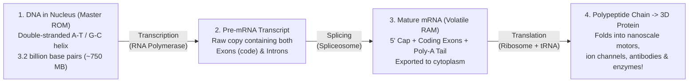

## Key figures {.stats style=tiles}

| Value | Label | Change | Verdict |
|---|---|---|---|
| 2 bits | Information stored per Deoxyribonucleic Acid (DNA) base pair (A, C, G, T) | quaternary code | good |
| ~750 MB | Total digital data in the 3.2-billion-base-pair human genome (haploid) | fits on 1 disc! | good |
| 64 codons | 3-letter Ribonucleic Acid (RNA) words (4³ = 64) mapping to 20 amino acids | fault-tolerant | good |
| 10⁻⁹ | Error rate per copied base after polymerase proofreading + mismatch repair | 99.9999999% accurate | good |

## Introduction {.abstract}

Four billion years before silicon microcontrollers, living cells evolved a high-density digital storage, compilation and execution architecture. **Deoxyribonucleic Acid (DNA)** acts as an immutable, hardware-mirrored non-volatile **Read-Only Memory (`ROM`)** inside the cell nucleus. When the cell needs to build a physical sensor, motor or enzyme, it copies a working script into volatile **Messenger Ribonucleic Acid (`mRNA`)**. It then strips out non-coding comments and feeds the tape through a molecular **Ribosome** state machine that translates 3-letter **codons** into 3D **proteins**.

## 1. The central dogma: from archive to executable hardware {.wide}

Compare the cell's molecular pipeline directly to a computer's storage and compilation pipeline:



[[CAPTION:Figure]] Firmware source code stays safe on disk while temporary object files compile in memory. Similarly, master DNA stays protected in the nucleus while temporary `mRNA` copies work in the cytoplasm.

## 2. Quaternary storage & `RAID-1` hardware mirroring

While computers store binary bits (`0` and `1`), **DNA** uses four nucleotide bases (**Adenine `A`**, **Cytosine `C`**, **Guanine `G`**, **Thymine `T`**)—encoding **2 bits per base (`4¹`)**. Notice how the double helix is a physical **`RAID-1` mirror** with built-in parity:

```cards cols=2 style=top
Complementary Base Pairing (Hardware Parity) | `A` only ever pairs with `T` (via 2 hydrogen bonds), and `G` only ever pairs with `C` (via 3 stronger hydrogen bonds). If cosmic radiation or oxidation damages `G` on the forward strand, repair enzymes read the opposite `C` on the backup strand and restore the exact base! | green
Exons vs Introns (Conditional Compilation) | Only `~1.5%` of human DNA directly codes for proteins. A single gene is split into **Exons** (expressed code segments) and **Introns** (intervening regions). By splicing Exons together in different combinations (**Alternative Splicing**), 20,000 human genes compile into over **100,000 distinct proteins** | teal
```

```figure
@segments
title: Anatomy of a Eukaryotic Gene & Mature mRNA Packet (Framed just like a network protocol!)
1 | Promoter (Start) | binding | navy
2 | 5' UTR + Start (AUG) | header | blue
3 | Exon 1 (Coding) | payload | green
1 | Intron (Cut out!) | spliced | amber
3 | Exon 2 + Stop (UAA) + Poly-A Tail | CRC/TTL | teal
```

## 3. The 64-entry codon table: why 3 bases per character?

Cells assemble proteins from **20 standard amino acids**. In `mRNA` (where **Uracil `U`** replaces Thymine `T`), reading 1 base at a time yields only `4¹ = 4` values; reading 2 bases yields `4² = 16` (still not enough for 20!). Therefore, the **Ribosome** reads non-overlapping **3-base triplets (`Codons`)**, giving **`4³ = 64` combinations**:

```lcd cols=1
[Ribosome 3-Base Codon Decoder State Machine]
Input mRNA tape:  5'- ... A U G | G C U | G G C | U A A ... -3'
                           |       |       |       |
Codon Lookup:             AUG     GCU     GGC     UAA
Amino Acid Output:       [START]-[Ala]---[Gly]---[STOP]
                         (Met)   Alanine Glycine Release!

Built-in Error Tolerance (Wobble Base Redundancy):
  GCU, GCC, GCA, GCG -> ALL four translate to Alanine (Ala)!
  -- A mutation in the 3rd base (3rd-position wobble) is often a
  -- silent no-op that leaves the compiled protein 100% unchanged!
```

## 4. Comparing biological storage with silicon storage {.wide}

```compare
| Biological `DNA` (`Eukaryotic Cell`) | Modern Silicon (`NVMe SSD` / `DRAM`)
Information density | **`~215 Petabytes per gram`** (all the world's data fits in a shoebox!) | `~1 to 4 Terabytes` per M.2 solid-state drive chip (`10 million x` less dense)
Data retention lifetime | **`1,000 to 500,000+ years`** when kept dry and cold (ancient mammoth DNA) | `5 to 10 years` unpowered (`NAND` charge leaks out of floating gates)
Read / write speed | `~50 bases/sec` (RNA Polymerase) to `1,000 bases/sec` (DNA replication) | **Gigabytes per second** (`10^9` times faster serial clock, but low parallelism)
Parallelism | **Massively parallel**: trillions of ribosomes and polymerases run simultaneously | Limited to `4 to 128` processor cores or GPU warps
Energy consumption | **Femtowatts per operation** (powered by Adenosine Triphosphate `ATP`) | Watts to Megawatts (data centres require giant cooling towers)
```

## 5. How `CRISPR-Cas9` edits live source code

Bacteria originally evolved **Clustered Regularly Interspaced Short Palindromic Repeats (`CRISPR`)** as an antivirus database storing snippets of past viral attacks. Jennifer Doudna and Emmanuelle Charpentier turned **`CRISPR-Cas9`** into a universal `Ctrl+F` search-and-replace tool for any living genome:

```steps
1. Program the 20-Base Guide RNA (`gRNA`) | Scientists synthesise a 20-letter `RNA` search string matching the exact target gene address they want to edit, and load it into the **Cas9** protein enzyme
2. Scan for `PAM` Hardware Delimiter | `Cas9` slides along billions of DNA base pairs looking for a 3-letter **Protospacer Adjacent Motif (`PAM`, `5'-NGG-3'`)**—only unzipping DNA where `NGG` appears | blue
3. Unzip & Compare 20 Letters | If the 20 DNA letters next to `PAM` match the `gRNA` search string, `Cas9` locks on and acts as molecular scissors, cutting both DNA strands | amber
4. Knock-Out or Paste New Code | The cell's repair crew either disables the broken gene (**Non-Homologous End Joining**) or pastes in a custom replacement DNA template (**Homology-Directed Repair**) | green
```

## 6. Epigenetics: runtime configuration flags {style=card colour=green}

Every cell in your body—from a brain neuron to a heart muscle cell—contains the **exact same 750 MB DNA source code**. Why do they behave differently? **Epigenetic markers** act as runtime feature flags:

```checklist
[x] **DNA Methylation (`-CH3` tags)**: Attaching methyl groups to Cytosine bases locks a gene in the `OFF` state without changing a single `A, C, G, T` letter
[x] **Histone Spooling (Chromatin Packing)**: Winding DNA tightly around histone protein spools hides inactive genes; unwinding exposes active genes to `RNA Polymerase`
[x] **Transcription Factors**: Regulatory proteins that bind to gene **Promoter** addresses like `if/else` switches in response to hormones, light or stress
[x] **Base & Prime Editing (Next-Gen CRISPR)**: Newer `Cas9` variants nick a single strand and chemically convert one letter (`C -> T`) without cutting the double helix!
```

## 7. Acronym guide: every term defined {.wide}

```cards cols=4 style=label
DNA & RNA | Deoxyribonucleic Acid (double-stranded master archive) and Ribonucleic Acid (single-stranded working messages and machinery)
A, C, G, T & U | Adenine, Cytosine, Guanine, Thymine (in DNA) and Uracil (replaces Thymine in RNA): the chemical letters of life
mRNA & tRNA | Messenger RNA (carries gene code to ribosome) and Transfer RNA (adaptor plug carrying one amino acid per 3-letter codon)
Exon & Intron | Expressed region (kept in mature mRNA) and Intervening region (spliced out before protein translation)
UTR & Codon | Untranslated Region (5' and 3' packet headers on mRNA) and a 3-nucleotide word (`AUG`, `GGC`) specifying one amino acid
CRISPR | Clustered Regularly Interspaced Short Palindromic Repeats: bacterial immune memory adapted for precision genome editing
Cas9 & gRNA | CRISPR-Associated Protein 9 (programmable DNA nuclease scissors) and Guide RNA (20-base search address)
PAM & ATP | Protospacer Adjacent Motif (`NGG` delimiter required by Cas9) and Adenosine Triphosphate (universal cellular energy currency)
```

## In short {.summary}

Life runs on a **quaternary (`A, C, G, T`) digital code**. **DNA** stores the master repository with hardware parity, while **`mRNA`** carries spliced working transcripts. **Ribosomes** execute a 64-entry codon lookup table to build proteins, and **`CRISPR-Cas9`** edits the source code in place.

### Built-in mirroring and error correction

Complementary base pairing (`A-T`, `G-C`) plus 3rd-base codon redundancy lets cells copy billions of bytes with fewer than one error per billion bases.

### Same source code, different config

A neuron and a liver cell run the exact same DNA binary; **epigenetic methylation tags** toggle different gene modules on and off.

### `CRISPR` is `sed` for genomes

By separating the **search address** (a 20-letter Guide RNA) from the **cutting engine** (`Cas9`), editing a new gene only requires synthesising a new 20-letter RNA string.
