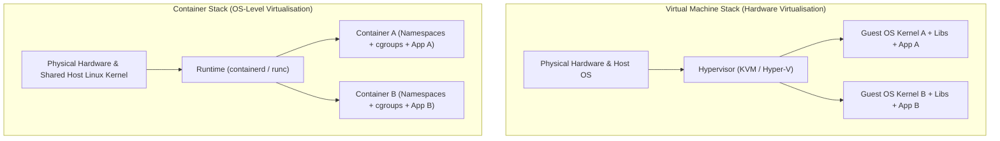

## Key figures {.stats style=tiles}

| Value | Label | Change | Verdict |
|---|---|---|---|
| < 100 ms | Typical Open Container Initiative (OCI) container startup latency | vs 30 s VM boot | good |
| 1 kernel | All containers on a host share one Linux Operating System (OS) kernel | zero guest OS | good |
| 5 to 50 MB | Typical minimal Alpine or distroless container image footprint | vs multi-GB VM | good |
| 3 pillars | Namespaces (view), Control Groups (limits) and OverlayFS (layers) | kernel native | good |

## Introduction {.abstract}

Traditional **Virtual Machines (VMs)** isolate applications by emulating computer hardware via a **hypervisor** and booting a complete Guest **Operating System (OS)** for every workload. Each VM consumes gigabytes of **Random-Access Memory (RAM)** and takes seconds to boot. **Open Container Initiative (OCI)** containers take a different approach: they run as isolated user-space processes directly on a shared host Linux kernel. By combining kernel **namespaces**, **control groups (`cgroups`)** and **union filesystems**, containers deliver reproducible packaging with bare-metal speed.

## 1. Architectural stack: virtual machines vs containers {.wide}

Compare where the isolation boundary sits in hardware virtualisation versus operating-system virtualisation:



[[CAPTION:Figure]] Virtual machines virtualise hardware to run multiple kernels; containers virtualise a single kernel to run isolated process trees.

## 2. Head-to-head comparison {.wide}

```compare
| Virtual Machine (VM) | Open Container Initiative (OCI) Container
Isolation boundary | Hardware virtualisation via a **Hypervisor** and Central Processing Unit (CPU) extensions | Kernel **namespaces** and **Control Groups (`cgroups`)** on a shared host kernel
Operating system kernel | Dedicated Guest OS kernel per virtual machine | All containers share the single host Linux kernel
Startup latency | **10 to 60 seconds** (full firmware and Guest OS boot sequence) | **Under 100 milliseconds** (spawns a regular host user-space process)
Memory & disk footprint | Gigabytes of RAM and `5` to `20 GB` disk image per instance | Megabytes of RAM and `5` to `200 MB` layered image
Cross-OS compatibility | Can run a Windows VM on a Linux host (or vice versa) | Linux containers require a Linux kernel (or a lightweight utility VM)
Security blast radius | **Strong hardware boundary**; a guest kernel panic stays inside the VM | Kernel vulnerability can affect the host unless hardened with `seccomp` and rootless mode
```

## 3. The three Linux kernel primitives {.wide}

A "container" is not a single object in the Linux kernel—it is a normal process configured with three kernel features:

```cards cols=3 style=top
1. Namespaces (What a process sees) | Partition global kernel resources so a container only sees its own Process Identifier (PID) tree (`pid`), network stack (`net`), mount table (`mnt`), hostname (`uts`), Inter-Process Communication (IPC) (`ipc`) and user IDs (`user`) | navy
2. Control Groups (What a process uses) | Linux `cgroups v2` meter and cap how much CPU time, physical RAM, block Input/Output (I/O) bandwidth and network throughput a container process group can consume, preventing noisy-neighbour starvation | blue
3. OverlayFS (Layered Copy-on-Write storage) | Stacks immutable, content-addressed read-only image layers beneath a thin Copy-on-Write (CoW) writable layer, allowing dozens of containers to share one base image on disk and in RAM page cache | teal
```

## 4. How OverlayFS image layers work

Because lower layers are immutable and addressed by their **Secure Hash Algorithm (SHA)** digest, pulling an updated application image only downloads the changed top layer:

```figure
@segments
title: Container Union Filesystem (OverlayFS) — shared read-only base layers + thin writable top layer
2 | Upperdir: Container Writable Layer (Copy-on-Write) | Ephemeral changes | amber
2 | Lowerdir 3: Application Binary (`/app/server`) | Read-only SHA-256 | green
2 | Lowerdir 2: Runtime Libraries (`libc` / certificates) | Read-only shared | blue
3 | Lowerdir 1: Base Userland (`Alpine` / `Debian`) | Read-only shared | navy
```

## 5. Multi-stage container build pattern

Multi-stage builds compile source code inside a full **Software Development Kit (SDK)** image, then copy only the compiled binary into a minimal runtime image:

```lcd cols=1
# Stage 1: Compile inside full SDK toolchain image
FROM golang:1.23-alpine AS builder
WORKDIR /src
COPY . .
RUN CGO_ENABLED=0 go build -o /out/app ./cmd/server

# Stage 2: Minimal distroless runtime image (no shell!)
FROM gcr.io/distroless/static-debian12:nonroot
COPY --from=builder /out/app /app
USER nonroot:nonroot
ENTRYPOINT ["/app"]
-- Produces a 12 MB runtime image with zero compilers or shells
```

## 6. Production container hardening checklist {style=card colour=blue}

Running a process inside a container is not a security boundary unless you strip unnecessary privileges:

```checklist
[x] Run as a non-root `USER` and enable user namespaces (`rootless` mode) so container UID 0 maps to an unprivileged host user
[x] Drop all Linux kernel capabilities (`--cap-drop=ALL`) and add back only specific capabilities if strictly needed
[x] Mount the container root filesystem as read-only (`--read-only`) and use `tmpfs` mounts for temporary directories
[x] Set explicit memory (`--memory`) and CPU (`--cpus`) limits in `cgroups` to prevent denial-of-service exhaustion
[x] Pin base images by immutable `@sha256` digest and scan layers in Continuous Integration (CI) before deployment
```

## 7. Acronym guide: every term defined {.wide}

```cards cols=4 style=label
VM & OS | Virtual Machine (hardware-emulated computer) and Operating System (kernel + userland software)
OCI | Open Container Initiative: Linux Foundation standards body defining open container image and runtime formats
PID & IPC | Process Identifier and Inter-Process Communication: kernel resources isolated per container via namespaces
cgroups | Control Groups: Linux kernel subsystem that limits, accounts for and isolates CPU, memory and I/O usage
CoW & SHA | Copy-on-Write storage layer optimisation and Secure Hash Algorithm cryptographic layer digest
CPU & RAM | Central Processing Unit and Random-Access Memory shared across host processes
I/O & SDK | Input/Output (disk and network transfers) and Software Development Kit (compiler toolchain image)
KVM & CI | Kernel-based Virtual Machine (Linux hypervisor) and Continuous Integration automated build pipeline
```

## In short {.summary}

Use **Virtual Machines** when you need strong hardware isolation between untrusted workloads or a different OS kernel; use **Containers** for fast, lightweight, reproducible packaging that shares a Linux kernel.

### Share the kernel, isolate the view

Namespaces hide other processes while `cgroups` cap CPU and RAM without paying hypervisor tax.

### Use multi-stage builds

Compile in a full toolchain stage, then copy only the static binary into a tiny distroless runtime layer.

### Never run containers as root

Drop all capabilities, mount the root filesystem read-only and run as a non-root user ID.
