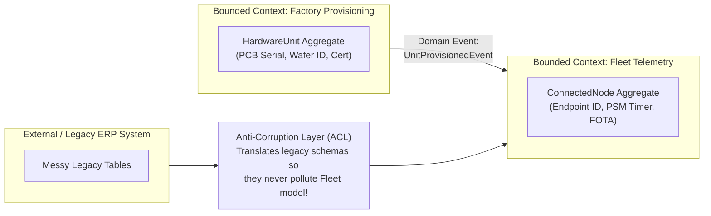

## Key figures {.stats style=tiles}

| Value | Label | Change | Verdict |
|---|---|---|---|
| 1 language | Shared Ubiquitous Language spoken by domain experts and written in code | zero translation | good |
| 1 boundary | Bounded Context within which every domain term has a single unambiguous meaning | stops God models | good |
| 1 Aggregate | Transactional consistency boundary modified in a single atomic database operation | protects invariants | good |
| Immutable | Value Objects (`Money`, `Temperature`, `GpsCoord`) have no ID and never mutate | bug-proof values | good |

## Introduction {.abstract}

Large software systems rarely fail because of slow algorithms. They fail when a single bloated `Device` or `Customer` class tries to serve billing, fleet telemetry, manufacturing and support all at once. Introduced by Eric Evans, **Domain-Driven Design (DDD)** attacks complexity on two levels. **Strategic Design** partitions a large system into explicit **Bounded Contexts** protected by **Anti-Corruption Layers (ACLs)**. **Tactical Design** models complex rules inside each context using **Entities**, **Value Objects**, **Aggregates** and **Domain Events**.

## 1. Strategic design: bounded contexts and ubiquitous language {.wide}

Trying to force one unified `Device` database schema across an entire company creates a fragile monolith. Instead, recognise that the word **"Device"** means something completely different in each **Bounded Context**:

```cards cols=3 style=top
1. Manufacturing & Provisioning Context | Here, a **"Device"** is a printed circuit board serial number, factory test log, hardware revision and X.509 Certificate Signing Request (`CSR`). It does not care about monthly billing plans! | navy
2. Fleet Telemetry & Control Context | Here, a **"Device"** is an active LwM2M/MQTT endpoint with a battery voltage, radio signal strength, firmware version and sensor time-series stream | teal
3. Commercial & Billing Context | Here, a **"Device"** is a billable subscription line item tied to a customer account, data-plan quota and invoice cycle | blue
```



[[CAPTION:Figure]] Bounded Contexts communicate via explicit Domain Events or an Anti-Corruption Layer (`ACL`) so legacy models never leak inside clean domain code.

## 2. Tactical building blocks: Entities vs Value Objects

Inside a Core Domain, stop representing everything as primitive integers and strings (**Primitive Obsession**):

```compare
| Identity & Equality | Mutability | Typical Examples
**Value Object** | **By structural value** (no ID field; two `21.5 °C` objects are equal) | **Strictly Immutable** (operations return a new instance) | `Temperature`, `Money`, `MacAddress`, `FirmwareVersion`, `GpsCoordinate`
**Entity** | **By unique Identifier (`ID`)** (persists across state changes over time) | Mutable state governed by domain methods | `SensorNode`, `MaintenanceTicket`, `FirmwareCampaign`, `Customer`
**Aggregate** | Cluster of Entities & Value Objects under **one Aggregate Root Entity** | Modified as **one atomic unit**; enforces invariants | `Order` (Root + `OrderLines`), `RolloutCampaign` (Root + `BatchTargets`)
**Domain Event** | Immutable record of a fact that **already happened** in the past tense | **Strictly Immutable** (`timestamp` + `id` + payload) | `OverheatThresholdBreached`, `FirmwareRolloutCompleted`
```

## 3. The four rules of Aggregate design

An **Aggregate** is a consistency boundary that guarantees business invariants (for example: *"A rollout campaign cannot activate with an unverified firmware signature"*):

```steps
1. Protect true invariants inside one Root | External code may only hold a reference to the **Aggregate Root**; internal child entities are modified solely by calling methods on the Root (never via public setters!)
2. Design small Aggregates | Keep Aggregates limited to the Root Entity plus the minimum Value Objects needed to check immediate invariants; huge Aggregates cause database lock contention | teal
3. Reference other Aggregates by ID only | Never embed a direct object pointer to another Aggregate (`use RolloutId`, not `Rollout*`); this keeps Aggregates independently loadable and scalable | blue
4. Use Eventual Consistency across Aggregates | Update **one Aggregate per database transaction**. When other Aggregates or Bounded Contexts need to react, publish a **Domain Event** (`Outbox Pattern`) | green
```

## 4. Rich domain model vs Anaemic Domain Model

Avoid the **Anaemic Domain Model** anti-pattern (structs with public getters/setters and all rules scattered across procedural `Manager` / `Helper` classes):

```lcd cols=1
// ANAEMIC ANTI-PATTERN (Invariants bypassed by callers!):
device.set_status(STATUS_OTA_ACTIVE); // Forgot to check battery > 30%!

// RICH AGGREGATE ROOT (Ubiquitous Language + enforced invariant):
Result<OtaStartedEvent, DomainErr>
ConnectedNode::start_firmware_update(FirmwareImage img, Percent min_batt) {
  if (this->battery_level < min_batt) {
    return Err(DomainErr::BatteryTooLowForOta);
  }
  if (!img.is_compatible_with(this->hardware_rev)) {
    return Err(DomainErr::IncompatibleHardwareRevision);
  }
  this->state = NodeState::DownloadingOta(img.version());
  return Ok(OtaStartedEvent{ this->node_id, img.version() });
}
-- It is impossible to put ConnectedNode into an invalid state!
```

## 5. Matching architecture to subdomain value

Not every service in your system deserves heavy tactical DDD modelling. Classify each **Subdomain** first:

| Subdomain Type | Business Differentiation | Recommended Architecture |
|---|---|---|
| **Core Subdomain** | Your company's secret sauce & competitive edge | **Full Tactical DDD** (Aggregates, Value Objects, Clean/Hexagonal Architecture) |
| **Supporting Subdomain** | Custom to your business, but simple rules | **Simple Transaction Script** or Active Record (`CRUD` service) |
| **Generic Subdomain** | Solved problem (Auth, Billing, Email, Logging) | **Buy SaaS or use off-the-shelf open-source** (never build from scratch!) |

## 6. Domain-driven design checklist {style=card colour=teal}

```checklist
[x] Maintain a living **Glossary of Ubiquitous Language**; rename classes and methods in code whenever domain terminology evolves
[x] Draw a **Context Map** showing every Bounded Context and whether upstream/downstream integration uses Events or an `ACL`
[x] Replace raw primitive parameters (`float temp, int unit`) with self-validating immutable **Value Objects** (`Temperature::from_celsius(21.5)`)
[x] Delete public `set_*()` methods on Aggregate Roots; expose only intention-revealing domain commands (`approve()`, `abort_rollout()`)
[x] Publish **Domain Events** via a transactional **Outbox table** so database commits and message-broker publishes never drift out of sync
```

## 7. Acronym guide: every term defined {.wide}

```cards cols=4 style=label
DDD | Domain-Driven Design: software design approach centring architecture on the core business domain and its language
ACL | Anti-Corruption Layer: translation boundary that prevents a messy external or legacy system's concepts from leaking into your domain
CRUD | Create, Read, Update and Delete: simple data-centric storage operations suitable for Supporting Subdomains without complex invariants
CQRS | Command Query Responsibility Segregation: separating write models (Aggregates validating commands) from optimised read views
ES | Event Sourcing: persisting an Aggregate's state as an append-only log of immutable Domain Events rather than overwriting rows
DTO & ORM | Data Transfer Object (wire struct) and Object-Relational Mapping (database persistence framework kept in Repositories)
ERP & SaaS | Enterprise Resource Planning (legacy back-office system) and Software as a Service (off-the-shelf Generic Subdomain)
API | Application Programming Interface: published contract between Bounded Contexts
```

## In short {.summary}

Split big systems into **Bounded Contexts** speaking a shared **Ubiquitous Language**. Protect clean models with an **Anti-Corruption Layer (`ACL`)**, and guard invariants inside small **Aggregates** built from immutable **Value Objects**.

### Stop building one giant model

A single `Device` or `User` class shared by ten teams satisfies no one; give each Bounded Context its own focused model.

### Make illegal states unrepresentable

When `Temperature`, `Voltage` and `NodeId` are distinct Value Objects instead of raw `float` and `int`, the compiler prevents swapping arguments.

### Tell, don't ask

Never pull fields out of an Entity to make a decision in a helper function; call a domain method on the Aggregate Root and let it guard its own rules.
