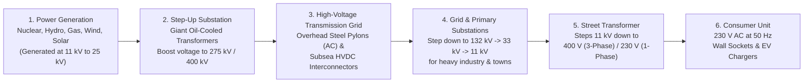

## Key figures {.stats style=tiles}

| Value | Label | Change | Verdict |
|---|---|---|---|
| 50.00 Hz | Synchronous Alternating Current (AC) grid frequency (60 Hz in Americas) | ±0.2 Hz window | good |
| 400 kV | Typical Extra-High-Voltage transmission line potential | cuts line loss 99% | good |
| 0 seconds | Built-in energy storage of copper wires—supply must match demand live! | instant balance | bad |
| 6 to 8% | Typical power lost as heat in transformers and transmission lines | I²R Joule heating | bad |

## Introduction {.abstract}

The electrical power grid is the largest synchronised machine ever built. Unlike water pipes or data networks, **Alternating Current (AC)** transmission lines store zero energy inside the wire. Power stations hundreds of kilometres away must generate the exact megawatts consumed when millions of people switch on kettles, heat pumps and factory motors at that exact millisecond. Every spinning steam, hydro and gas turbine across a synchronous grid is electromagnetically locked in step at **50.00 cycles per second (`50 Hz`)**. Understanding how transformers slash resistive heat loss, how grid frequency signals supply-demand imbalance, and how batteries tame the solar **"duck curve"** reveals the physics behind every wall socket.

## 1. End-to-end journey: from turbine to wall socket {.wide}

Why step voltage up to **400,000 Volts (`400 kV`)** only to step it back down to **230 Volts (`230 V`)** outside your house? Because power equals voltage times current (`P = V × I`), while heat lost in a wire scales with the **square of the current (`P_loss = I² × R`)**. Stepping voltage up by **`20x`** cuts current by **`20x`**, which slashes transmission heat loss by **`400x`**!



[[CAPTION:Figure]] High voltage is the secret to long-distance efficiency: raising voltage from `20 kV` to `400 kV` reduces current 20-fold and cuts `I²R` resistive heating 400-fold.

## 2. The 50 Hz heartbeat: spinning inertia & frequency

Think of the entire national grid as a heavy tandem bicycle riding up a hill. All synchronous generators push the pedals together, while every switched-on appliance acts as a brake:

```cards cols=1 style=top
Demand > Generation (Frequency Drops < 50.00 Hz) | If a large power station trips offline or millions of ovens turn on at 18:00, the electrical load exceeds mechanical steam/water input. Where does the missing energy come from? It is drawn straight out of the **rotational kinetic energy (spinning inertia)** of every heavy steel turbine rotor on the grid—causing the entire continent's turbines to slow down (`e.g. 49.85 Hz`)! | red
Generation > Demand (Frequency Rises > 50.00 Hz) | If wind gusts surge across offshore wind farms while Sunday afternoon demand is low, excess power accelerates the spinning turbines above `50.00 Hz` (`e.g. 50.15 Hz`). Grid operators must curtail generation or charge grid batteries immediately | amber
```

```figure
@segments
title: Synchronous Grid Frequency Operating Envelope (50.00 Hz nominal — automatic defences trip outside bounds!)
2 | < 48.8 Hz: Low-Frequency Demand Disconnection (Rolling Blackouts!) | Emergency | red
2 | 49.5–49.8 Hz: Fast Battery Response | Containment | amber
4 | 49.80 to 50.20 Hz: Normal Statutory Operating Band | Balanced | green
2 | > 50.5 Hz: Generators Curtail | Over-speed | amber
```

## 3. The renewable challenge: the solar duck curve

Solar panels generate peak power at midday when offices and homes need moderate electricity. Output then drops to zero at sunset just as everyone returns home to cook, heat and charge electric vehicles. Plotting **net load** (`Total Demand minus Solar & Wind`) produces a belly-and-neck silhouette known as the **duck curve**:

```chart type=line title="Typical spring day net grid demand — The Solar Duck Curve (Gigawatts)" unit=" GW" min=10 max=45 step=5 height=200 colours=blue,green,amber values=last
series: Total Demand, Solar Gen, Net Load (Duck)
04:00 | 24 | 0 | 24
08:00 | 32 | 3 | 29
13:00 | 33 | 18 | 15
16:00 | 35 | 8 | 27
19:00 | 42 | 0 | 42
23:00 | 27 | 0 | 27
```

> [!WARNING]
> Look at the steep "neck" of the duck between **13:00 (`15 GW`)** and **19:00 (`42 GW`)**: the grid must ramp up **`27 Gigawatts`** of dispatchable power (equivalent to 25 nuclear reactors!) in just six hours as the sun sets.

## 4. Comparing generation & storage technologies {.wide}

No single power source has every attribute; a reliable low-carbon grid blends **baseload**, **weather-dependent renewables**, **peakers** and **storage**:

```compare
| Nuclear & Hydro | Wind & Solar Photovoltaics (`PV`) | Open/Combined-Cycle Gas (`CCGT`) | Pumped Hydro & Grid Batteries (`BESS`)
Carbon emissions | **Zero direct `CO₂`** | **Zero direct `CO₂`** | High (`~350` to `500 g CO₂ / kWh`) | Zero (stores excess green electricity)
Dispatchability | Steady baseload (Hydro is fast-ramping) | **Weather-dependent** (intermittent) | **Fully dispatchable** on demand | **Instant dispatch** (`< 100 ms` for batteries)
Natural grid inertia | **High** (heavy synchronous steel rotors) | **Zero** (connected via power electronics inverters) | **High** (heavy spinning gas/steam turbines) | **Synthetic inertia** via Grid-Forming inverters
Startup / ramp time | Hours to days (Nuclear); seconds (Hydro) | Instant with sunlight/wind | `10` to `45 minutes` | **Milliseconds** (LiFePO4) to `20 seconds` (Pumped Hydro)
```

## 5. Three-phase AC vs High-Voltage Direct Current (`HVDC`)

Why do overhead pylons always carry **three sets of wires** (3-phase AC), whereas subsea cables between countries use **High-Voltage Direct Current (HVDC)**?

```cards cols=2 style=label
Three-Phase AC (120° Phase Separation) | Three sinusoidal voltages offset by `120°` deliver **constant, non-pulsating torque** to industrial motors and cancel out neutral return current when balanced—using 25% less copper than single-phase power
Subsea & Ultra-Long HVDC (500 to 800 kV DC) | Over `~60 km` underwater, an AC cable's insulation acts as a giant capacitor that charges and discharges 50 times a second, consuming all the cable's capacity in **reactive charging current**. `HVDC` eliminates capacitive losses and connects asynchronous grids (such as Great Britain and continental Europe)
Active (`kW`) vs Reactive Power (`kVAR`) | Inductive loads (motors, transformers) slosh magnetic energy back and forth (**Reactive Power**), lowering the **Power Factor (`cos φ`)** and heating up wires without doing useful work
```

## 6. How engineers recover from a total blackout (`Black Start`)

Most power stations need external grid electricity to run their own cooling pumps, fuel valves and excitation electromagnets. If an entire country goes dark, how do you start a power station with no power?

```steps
1. Isolate Grid Islands | Control room opens circuit breakers across the dead network to split the grid into small, manageable regional "power islands"
2. Crank a Black-Start Unit | A hydroelectric dam opens its water gate using gravity/hydraulics (or a battery-started diesel generator cranks a gas turbine) to produce the first isolated `50 Hz` voltage | green
3. Energise the Skeleton Spine | Operators carefully energise one high-voltage line to a nearby nuclear or thermal station, matching **Voltage**, **Frequency** and **Phase Angle** via a synchroscope | amber
4. Reconnect Load in Blocks | As big generators lock onto the island, substations reconnect hospitals and towns in `10 to 50 MW` steps so sudden cold-load surge never stalls the turbines | blue
```

## 7. Acronym guide: every term defined {.wide}

```cards cols=4 style=label
AC & DC | Alternating Current (reverses direction 50/60 times per second; easy to transform) and Direct Current (unidirectional flow)
HVDC | High-Voltage Direct Current: point-to-point electronics transmission used for subsea interconnectors and ultra-long lines
kV, MW & GW | Kilovolt (`1,000 Volts`), Megawatt (`1 million Watts`) and Gigawatt (`1 billion Watts` — roughly one large nuclear reactor)
kWh & MWh | Kilowatt-hour and Megawatt-hour: units of **energy** (Power × Time; a 2 kW kettle running for 30 minutes uses 1 kWh)
BESS | Battery Energy Storage System: utility-scale lithium iron phosphate (`LiFePO4`) battery arrays providing sub-second frequency response
PV & CCGT | Solar Photovoltaics (semiconductor light-to-DC cells) and Combined-Cycle Gas Turbine (gas turbine + steam heat recovery)
kVA & kVAR | Kilovolt-Ampere (Apparent Power) and Kilovolt-Ampere Reactive (magnetic reactive power sloshing in inductive loads)
SCADA & PMU | Supervisory Control and Data Acquisition and Phasor Measurement Unit (GPS-synchronised grid phase angle sensor)
```

## In short {.summary}

The grid is a continent-sized balancing act. **Transformers** step voltage up to `400 kV` so current and `I²R` heat losses stay tiny. Meanwhile, **50 Hz turbine inertia** acts as the live speedometer of supply vs demand, and **grid batteries** absorb midday solar to power the evening peak.

### High voltage saves copper and heat

Multiplying transmission voltage by 20 divides current by 20 and cuts wasted wire heating by a factor of **400**.

### Frequency is the grid's pulse

Every grid-scale battery watches the wall frequency to a thousandth of a Hertz, injecting megawatts in milliseconds whenever `50.00 Hz` dips.

### Storage flattens the duck curve

Shifting midday solar into four-hour batteries and pumped-hydro reservoirs turns intermittent sunshine into firm evening power.
