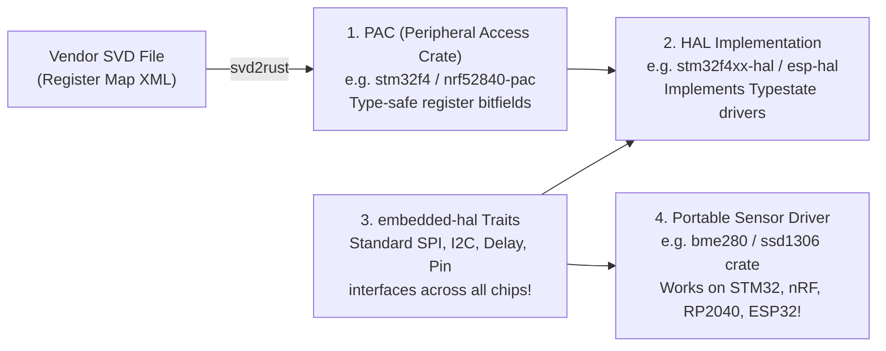

## Key figures {.stats style=tiles}

| Value | Label | Change | Verdict |
|---|---|---|---|
| 0 bytes | Runtime garbage collector or operating system required in `#![no_std]` Rust | bare-metal speed | good |
| ~70% | Industry share of severe systems vulnerabilities caused by memory unsafety | caught at compile | good |
| 1 owner | Rust borrow checker rule: either `1 mutable (&mut T)` or `N shared (&T)` refs | zero data races | good |
| 0 CPU cost | Typestate pin configuration checks happen entirely at compile time | zero-cost safety | good |

## Introduction {.abstract}

For forty years, C has ruled microcontrollers because higher-level languages required heavy runtimes or garbage collectors. **Rust** changes that equation: using `#![no_std]`, Rust compiles to bare-metal `ARM Cortex-M` and `RISC-V` machine code via **Low Level Virtual Machine (LLVM)** with the same **Static Random-Access Memory (SRAM)** footprint as C. By enforcing **ownership**, **lifetimes** and **typestate drivers** at compile time, Embedded Rust eliminates null pointers, buffer overflows and interrupt data races before flashing.

## 1. Three compile-time guarantees that C leaves to discipline {.wide}

```cards cols=3 style=top
1. Ownership & Borrowing (No Aliasing XOR Mutability) | Every value has a single owner. At any point in time, you may have **either** one mutable reference (`&mut T`) **or** any number of read-only references (`&T`)—never both. This makes accidental aliasing and dangling pointers a compile error | amber
2. Typestate Peripheral Configuration (Zero Runtime Cost) | In C, nothing stops you calling `spi_write()` before configuring the clock or pin mode. In Rust, `gpioa.pa5.into_push_pull_output()` **consumes** the unconfigured pin type and returns an `Output<PushPull>` type; using the old pin won't compile! | green
3. Fearless Concurrency (`Send` & `Sync` Traits) | In C, any function or Interrupt Service Routine (`ISR`) can read or write a global variable without a lock. In Rust, mutable global state is forbidden unless wrapped in an explicit `Mutex<RefCell<T>>` unlocked by a critical-section token | blue
```

## 2. Side-by-side: C peripheral driver vs Rust typestate driver

Compare how C and a Rust **Hardware Abstraction Layer (HAL)** configure a **General-Purpose Input/Output (GPIO)** pin and prevent accidental misuse:

```lcd cols=2
// C: Runtime register bitmasks — bugs only found on oscilloscope!
void init_and_blink(void) {
  GPIOA->MODER |= (1U << 10); // Configure PA5 as output
  GPIOA->ODR   |= (1U << 5);  // Drive PA5 high

  // BUG: Another module reconfigures PA5 as input,
  // but we still write to ODR (silently fails at runtime!):
  GPIOA->MODER &= ~(3U << 10);
  GPIOA->ODR   |= (1U << 5);  // Compiles fine, pin never moves!
}
-- C compiler cannot know whether PA5 is currently an Input or Output

// RUST (#![no_std]): Typestate moves ownership at compile time!
fn init_and_blink(dp: pac::Peripherals) {
  let gpioa = dp.GPIOA.split();
  // into_push_pull_output() consumes pa5 (Input<Floating>)
  // and returns led: PA5<Output<PushPull>>
  let mut led = gpioa.pa5.into_push_pull_output();
  led.set_high();

  let btn = led.into_floating_input(); // Consumes `led`!
  // led.set_high(); // <-- COMPILE ERROR: value `led` used after move!
}
-- Zero bytes of extra RAM or Flash; state transition is strictly types!
```

## 3. The Embedded Rust crate ecosystem {.wide}

Rust organises microcontroller support into four clean, reusable layers generated from vendor **System View Description (SVD)** schema files (`XML`):



[[CAPTION:Figure]] Because every vendor HAL implements the standard `embedded-hal` traits, a single sensor driver crate works across `STM32`, `nRF52`, `RP2040` and `ESP32` without changing a line of code.

## 4. Head-to-head comparison {.wide}

```compare
| Embedded C (`C99` / `C11`) | Embedded Rust (`#![no_std]` + `embedded-hal`)
Array & slice bounds | Unchecked pointer indexing (`buf[i]` can overwrite stack) | Checked slices (`&[u8]`) or zero-cost iterators (`for b in buf`)
Null pointers & error handling | Raw `NULL` pointers and ignored integer return codes | No `null`! Uses **`Option<T>`** and **`Result<T, E>`** with `#[must_use]`
Interrupt concurrency safety | Manual `volatile` and discipline; easy to forget critical section | Enforced by compiler via `CriticalSection` token, **`RTIC`** or **`Embassy` async**
Package reuse & build system | Fragmented (`CMake`, `Make`, vendor ZIP drops, manual copy) | Unified **`Cargo`** build tool + `crates.io` + `probe-rs` flashing/logging
Direct hardware / assembly access | Everywhere by default (any pointer cast is legal) | Explicitly quarantined inside **`unsafe { ... }`** blocks (`< 2%` of app code)
Silicon vendor & safety certification | Universal vendor SDKs; mature `ISO 26262` compilers | Rapidly growing (`Ferrocene` ISO 26262 / IEC 61508 qualified compiler)
```

## 5. Modern concurrency: `Embassy` async vs `RTIC`

Embedded Rust offers two zero-heap concurrency frameworks that beat traditional multi-stack **Real-Time Operating System (RTOS)** kernels on RAM usage:

```cards cols=2 style=label
RTIC (Real-Time Interrupt-driven Concurrency) | Uses the microcontroller's built-in hardware interrupt controller (`NVIC`) to schedule tasks with **Priority Ceiling Protocol** resource locking; shares **one single call stack** with zero deadlocks
Embassy (Bare-Metal Async / Await) | Compiles `async fn` tasks into cooperative state machines at compile time; waits on DMA, timers and radio interrupts with `< 1 KB` RAM overhead and no per-thread stack sizing guesswork
defmt (Deferred Formatting Logger) | Compiles log strings (`defmt::info!("Temp: {} C", t)`) out of the target Flash image; the MCU sends only a 1-byte string index + raw arguments over `RTT`!
C <-> Rust Interop (`FFI`) | Call certified C stacks from Rust (`bindgen`) or link a Rust static library (`#[no_mangle] pub extern "C" fn`) into an existing C `CMake` firmware project incrementally
```

## 6. Adopting Rust in firmware checklist {style=card colour=amber}

```checklist
[x] Start with `#![no_std]` and `#![no_main]`, using `heapless::Vec` and `heapless::String` for fixed-capacity static collections
[x] Set `opt-level = "z"` or `"s"` and `lto = true` (Link-Time Optimisation) in `Cargo.toml` so zero-cost abstractions inline completely
[x] Use `probe-rs` + `defmt` + `flip-link` (places stack at bottom of RAM so stack overflow hits a deterministic hardware fault)
[x] Keep `unsafe` blocks restricted to low-level HAL/PAC crates; require `#![forbid(unsafe_code)]` in application business logic
[x] When migrating a legacy C product, compile one new parser or cryptographic module in Rust as a static library (`libapp.a`) first
```

## 7. Acronym guide: every term defined {.wide}

```cards cols=4 style=label
HAL & PAC | Hardware Abstraction Layer (high-level ergonomic drivers) and Peripheral Access Crate (low-level register structs)
SVD | System View Description: ARM CMSIS XML schema describing every peripheral register and bitfield on a chip
RTIC | Real-Time Interrupt-driven Concurrency: hardware-scheduled Rust framework with compile-time deadlock freedom
LLVM | Low Level Virtual Machine: optimising compiler backend used by both `rustc` and `clang` to emit machine code
FFI & ABI | Foreign Function Interface and Application Binary Interface: calling conventions allowing C and Rust to link together
NVIC | Nested Vectored Interrupt Controller: Cortex-M hardware block used by RTIC to preempt and prioritise tasks
LTO | Link-Time Optimisation: whole-program compiler pass that strips unused code and inlines across crates
defmt | Deferred Formatting: ultra-compact logging framework that moves string formatting from the MCU to the host PC
```

## In short {.summary}

Embedded **Rust (`#![no_std]`)** gives you C's bare-metal speed and predictable memory layout while turning data races, null pointers, buffer overruns and misconfigured pins into **compile-time errors**.

### Zero-cost typestate pins

Encoding peripheral state in the type system catches hardware configuration mistakes in your editor with zero bytes of runtime overhead.

### Quarantine `unsafe` in the HAL

When 98% of your application carries `#![forbid(unsafe_code)]`, any memory corruption bug can only hide in the tiny 2% hardware boundary.

### Async without an RTOS heap

`Embassy` and `RTIC` let you write clean sequential concurrency on a single shared stack without guessing thread stack sizes.
