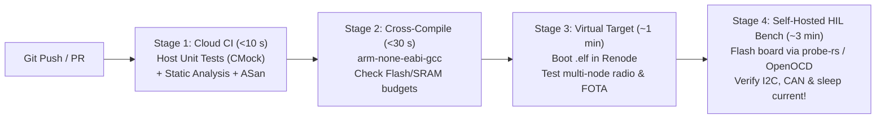

## Key figures {.stats style=tiles}

| Value | Label | Change | Verdict |
|---|---|---|---|
| < 2 seconds | Time to run 500 host-compiled unit tests on a developer laptop | instant feedback | good |
| ~80% | Share of firmware logic testable via a Hardware Abstraction Layer (HAL) | off-target | good |
| 0 boards | Physical hardware needed for instruction-set simulation (`Renode` / `QEMU`) | scales in cloud CI | good |
| 100% | Release candidates verified on real silicon by a Hardware-in-the-Loop (HIL) rig | electrical truth | good |

## Introduction {.abstract}

Testing a one-line change to a packet parser should not require cross-compiling, flashing a board over **Serial Wire Debug (SWD)** and clicking buttons by hand. High-velocity embedded teams apply the **Testing Pyramid**: they decouple business logic from vendor registers behind a thin **Hardware Abstraction Layer (HAL)** seam. That allows **80%** of the codebase to compile and run natively on a laptop in milliseconds. Full-system integration then runs inside **instruction-set simulators (`Renode`)** and automated **Hardware-in-the-Loop (HIL)** test benches.

## 1. The three-tier embedded testing pyramid {.wide}

Each tier catches a different class of defect at a different speed and infrastructure cost:

```cards cols=3 style=top
Tier 1: Host Unit Tests + Mocks (70–80% of tests) | Compile application C/C++/Rust modules natively (`gcc` / `clang` on Linux) against mocked `HAL` headers (`Unity` + `CMock`, `CppUTest` or `GoogleTest`). Runs in `< 2 s` on every save with `ASan` and coverage | green
Tier 2: Virtual Target Simulation (15–20% of tests) | Run the **exact cross-compiled target `.elf` binary** inside an instruction-set simulator (`Renode` or `QEMU`) with simulated UART, SPI sensors and virtual radio networks in cloud CI | blue
Tier 3: Hardware-in-the-Loop Rig (5–10% of tests) | A Raspberry Pi / Linux runner flashes real prototype boards via `SWD`, drives physical GPIO/ADC/I2C signals via programmable test gear, measures sleep microamps and asserts pass/fail via `pytest` | navy
```



[[CAPTION:Figure]] Fast cloud stages catch 95% of logic and memory bugs before queueing time on the physical Hardware-in-the-Loop bench.

## 2. Creating a testable hardware seam

Code that directly touches vendor registers (`I2C1->DR = 0x48`) cannot compile on a PC. Introduce a thin header interface (`i2c_bus.h`) so production builds link `i2c_stm32.c` while unit tests link an auto-generated mock (`mock_i2c_bus.c`):

```lcd cols=1
// temp_sensor.c (100% portable C — zero vendor #includes!)
#include "temp_sensor.h"
#include "i2c_bus.h" // Abstract HAL seam!

Err_t tmp102_read_celsius(uint8_t addr, float *out_c) {
  uint8_t raw[2] = {0};
  if (i2c_read_reg(addr, 0x00U, raw, 2U) != I2C_OK) {
    return ERR_BUS_FAULT; // Easy to test bus failure on PC!
  }
  int16_t counts = (int16_t)(((uint16_t)raw[0] << 4U) | (raw[1] >> 4U));
  *out_c = (float)counts * 0.0625f;
  return ERR_OK;
}
```

```lcd cols=1
// test_temp_sensor.c (Runs on x86 laptop in 0.1 ms with Unity + CMock)
void test_tmp102_converts_25C_and_handles_bus_nack(void) {
  uint8_t fake_rx[2] = {0x19, 0x00}; // +25.0 C raw bytes
  i2c_read_reg_ExpectAndReturn(0x48, 0x00, NULL, 2, I2C_OK);
  i2c_read_reg_ReturnArrayThruPtr_buf(fake_rx, 2);

  float temp = 0.0f;
  TEST_ASSERT_EQUAL(ERR_OK, tmp102_read_celsius(0x48, &temp));
  TEST_ASSERT_FLOAT_WITHIN(0.01f, 25.0f, temp);
}
-- Tests both normal conversion and I2C NACK error paths without a sensor!
```

## 3. Comparing test environments {.wide}

```compare
| Host Unit Tests (`Unity` / `CMock` / `GoogleTest`) | Instruction Simulation (`Renode` / `QEMU`) | Hardware-in-the-Loop (`HIL` + `pytest`)
Compiler used | Host `gcc` / `clang` (`x86_64` or `ARM64`) | Target cross-compiler (`arm-none-eabi-gcc`) | Target cross-compiler (`arm-none-eabi-gcc`)
Execution speed | **1,000+ tests per second** | Real-time (or deterministic virtual time) | Real-time + `SWD` flash time (`~10` to `30 s`)
Catches logic & parser bugs | **Yes (best tool — supports `ASan` & fuzzing)** | Yes | Yes (slowest way to debug logic)
Catches linker & ISR vector bugs | No (uses host OS startup) | **Yes (runs real Vector Table & RTOS)** | **Yes**
Catches electrical, DMA & timing bugs | No | Partial (peripherals are behavioural models) | **100% (real silicon, real clocks, real uA)**
```

## 4. Anatomy of an automated HIL test bench

A reliable **Hardware-in-the-Loop (`HIL`)** bench is just a dedicated Linux runner (`Raspberry Pi` or mini-PC) connected to your **Device Under Test (`DUT`)** and controllable instruments:

```steps
1. Programmable Power & Current Profiler | USB-controlled power supply or Nordic Power Profiler Kit (`PPK2`) cycles board power, tests brown-out recovery, and asserts that deep-sleep current stays `< 3.5 µA`
2. Debug Probe (`J-Link` / `ST-Link`) | Flashes the newly built `.elf` firmware via `OpenOCD`, `pyOCD` or `probe-rs` and streams `RTT` structured test logs back to the runner | blue
3. Stimulus & Bus Interfaces | USB-to-CAN (`SocketCAN`), USB-to-RS485, logic analyser (`Saleae` / `sigrok`) or an auxiliary companion MCU injects sensor waveforms and bus frames | green
4. Python `pytest` Orchestrator | Fixtures flash the board, send test vectors over UART/CAN, assert the expected responses and publish a JUnit XML report to GitHub/GitLab CI | navy
```

## 5. Firmware testability checklist {style=card colour=green}

```checklist
[x] Ban vendor SDK headers (`stm32f4xx_hal.h`) inside domain, protocol, filter and state-machine source files
[x] Run host unit tests with **AddressSanitizer (`-fsanitize=address,undefined`)** and enforce `> 80%` branch coverage on core logic
[x] Fuzz every binary frame decoder and packet parser (`libFuzzer` / `AFL++`) with millions of malformed inputs on the host
[x] Include a built-in diagnostic command shell (`CLI` over UART or `RTT`) so automated `pytest` scripts can trigger internal self-tests
[x] Run a nightly **HIL power regression test** that fails the build if a commit accidentally increases sleep current
```

## 6. Acronym guide: every term defined {.wide}

```cards cols=4 style=label
HIL & SIL | Hardware-in-the-Loop (testing on real boards) and Software-in-the-Loop (testing compiled code in simulation)
DUT | Device Under Test: the physical prototype circuit board wired into an automated Hardware-in-the-Loop test bench
HAL | Hardware Abstraction Layer: narrow C/Rust interface separating portable application code from chip-specific registers
CMock & Unity | ThrowTheSwitch C unit-testing framework (`Unity`) and automated mock-header generator (`CMock`)
ASan & UBSan | AddressSanitizer and UndefinedBehaviorSanitizer: compiler instrumentation catching memory and overflow bugs in host tests
SWD & RTT | Serial Wire Debug (2-pin flashing/debug interface) and Real-Time Transfer (fast memory-buffer logging)
ELF | Executable and Linkable Format: cross-compiled target firmware binary containing code and debug symbols
CI / CD | Continuous Integration and Continuous Delivery: automated build, test and release verification pipelines
```

## In short {.summary}

Draw a strict **HAL seam** so 80% of your firmware runs in **sub-second host unit tests** with mocks and sanitizers. Use **`Renode`** to test full `.elf` binaries in cloud CI, and reserve your **HIL bench** for electrical and power sign-off.

### Don't debug parsers on a microcontroller

A bug in a **Cyclic Redundancy Check (CRC)**, **Concise Binary Object Representation (CBOR)** or state-machine module takes 10 milliseconds to find on a PC with `ASan`.

### Mock the hardware failure paths

Unplugging an `I2C` wire at the exact byte boundary is hard by hand; a `CMock` one-liner tests timeout recovery on every commit.

### Automate your sleep-current test

One forgotten **General-Purpose Input/Output (GPIO)** pull-up ruins battery life; let a nightly `pytest` + power-profiler HIL test catch current regressions automatically.
