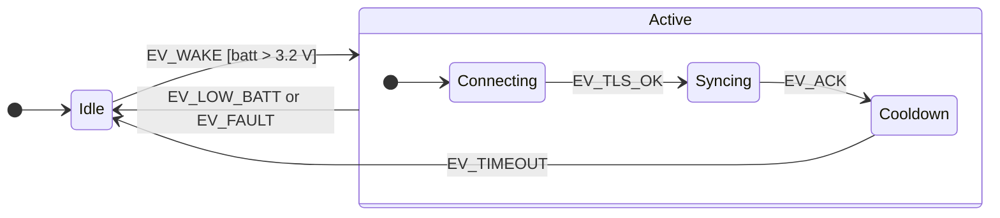

## Key figures {.stats style=tiles}

| Value | Label |
|---|---|
| 2ᴺ | Hidden states made by N independent boolean flags |
| 0 | Blocking calls in a run-to-completion event handler |
| 1 superstate | Handles a shared event for all its substates |
| 1 queue | Per active object: private state, one queue, one thread |

## Introduction {.abstract}

Firmware starts with a few harmless flags: `is_connected`, `is_retrying`, `is_low_battery`. Six months on, ten flags make **1,024 hidden states**, guarded by `if (is_connected && !is_ota)` checks that fail on an unexpected order of events. **Event-driven architecture**, with explicit **state machines** and **hierarchical state machines (HSMs)**, makes every state, event, guard and transition explicit, testable and visible.

## 1. Flags against an explicit machine {.wide}

```code-compare
@bad Flags: 4 booleans, 16 hidden states
bool connecting, connected, error, sleeping;
void on_button(void) {
  if (!sleeping && !connecting) {
    if (connected && !error) send_report();
    else if (error) {
      error = false;                 <1>
      connecting = true;
    }
  }
}
@good An explicit state machine
switch (state) {
case ST_SLEEP:
  if (ev == EV_BTN) { modem_on(); return ST_CONNECTING; }
  break;
case ST_CONNECTING:
  if (ev == EV_CONN_OK) return ST_ONLINE;
  if (ev == EV_TIMEOUT) { modem_off(); return ST_FAULT; }  <2>
  break;
}
return state;                        <3>
-- 1 | The retry timer is never reset: what if it fires now?
-- 2 | Every state and event pair is written down, with its action
-- 3 | An event a state does not handle is ignored, by design
```

## 2. Hierarchy: handle it once {.wide}

In a flat machine, an event such as a low battery that every state must handle needs an arrow from every state. David Harel's **statecharts** nest states: a substate inherits the transitions of its **superstate**.



[[CAPTION:Figure]] A low battery in Connecting, Syncing or Cooldown is handled once, by Active, whose exit action turns the radio off.

## 3. Four statechart building blocks

```cards cols=2 style=top
Entry and exit actions | Run whenever a state is entered or left, whatever the path: the place to switch power rails on and off | purple
Guards | Conditions such as `[retries < 3]` checked before a transition, which keep the number of states down | blue
Internal transitions | An event handled inside a state, such as a tick that blinks an LED, without leaving it | teal
Time events | Instead of `delay_ms(5000)`, the entry action arms a timer that posts `EV_TIMEOUT` | green
```

## 4. Active objects

Sharing a state machine between threads with mutexes invites priority inversion and deadlock. An **active object** owns a private state machine, a private event queue, and one thread that runs each event **to completion**.

```structogram
while Forever
  Wait for the next event in the queue
  Look up the handler for the current state
  Run it to completion, without blocking
  if It returns a new state?
    Run the old state's exit action
    Run the new state's entry action
  Log the state, event and next state
```

```lanes
Interrupt | *Post EV_RX_FRAME | Return at once: no lock
Queue | *EV_RX_FRAME | *EV_TIMER | *EV_ACK
Active object | *Handle EV_RX_FRAME | *Handle EV_TIMER | Sleep when empty
```

## 5. Threads and locks, or active objects {.wide}

```compare
| Shared state, threads and mutexes | Active objects (QP, Zephyr SMF, actors)
How parts talk | Direct calls across threads, holding locks | **Messages**: immutable events posted to a queue
Hazards | Deadlocks, lock-order inversion, forgotten unlocks | **No data races**: each object's state is private
Blocking | Common: delays and blocking I2C reads inside locks | **Forbidden**: each step runs to completion in microseconds
Debugging | Timing races that are hard to reproduce | **Replayable**: log each (state, event, next state)
```

## 6. Checklist {style=card colour=purple}

```checklist
[x] Replace two or more interacting mode flags with one `enum` state
[x] Never block in a handler: arm a timer that posts a timeout event
[x] Release resources in **exit actions**, so error paths cannot leak them
[x] Put states that share error, cancel or power-down handling in one **superstate**
[x] Keep a 32-entry ring buffer of (time, state, event, next state) for post-mortems
```

## 7. Glossary

```glossary cols=1
EDA | Event-driven architecture
FSM | Finite state machine
HSM | Hierarchical state machine, or Harel statechart
ISR | Interrupt service routine
RTC | Run to completion: one event at a time, finished before the next
SMF | Zephyr's State Machine Framework
UML | Unified Modeling Language, which defines statechart notation
```

## In short {.summary}

Delete the tangled flags. Model behaviour as an explicit hierarchical state machine, and give each subsystem its own active object, queue and run-to-completion handlers.

### Flags multiply, states add

A fifth flag doubles the hidden states from 16 to 32. A fifth state adds one case.

### Clean up on exit

A heater switched on in entry and off in exit can never be left on by a fault.

### Share nothing

When only one thread touches a state, no mutex is needed, and any bug can be replayed from the log.
