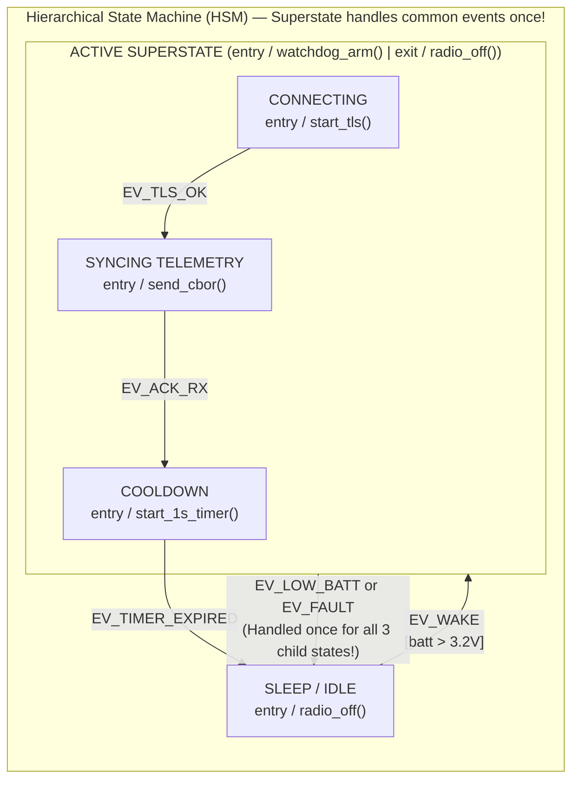

## Key figures {.stats style=tiles}

| Value | Label | Change | Verdict |
|---|---|---|---|
| 2^N states | Implicit state explosion caused by `N` independent boolean flags | untestable spaghetti | bad |
| 0 blocking | Run-to-Completion (`RTC`) event steps never block on `delay()` | deterministic | good |
| 1 parent | Hierarchical State Machine (`HSM`) superstate handling common events | eliminates duplication | good |
| 1 queue | Active Object (Actor) pattern: private state + 1 event queue + 1 thread | zero mutex deadlocks | good |

## Introduction {.abstract}

Most firmware and reactive software starts with a few innocent boolean flags (`is_connected`, `is_retrying`, `is_low_battery`, `is_ota_active`). Six months later, `10` boolean flags create **`2^10 = 1,024` implicit states**, littered with `if (is_connected && !is_ota_active)` checks that deadlock on unexpected event sequences. **Event-Driven Architecture (`EDA`)** paired with explicit **Finite State Machines (`FSMs`)** and **Hierarchical State Machines (`HSMs` / Harel Statecharts)** makes every valid state, event, guard and transition explicit, testable and visually verifiable.

## 1. The boolean flag trap vs explicit state machines

Compare a fragile flag-driven module against an explicit event-driven state machine:

```lcd cols=2
// SPAGHETTI FLAGS (6 booleans = 64 hidden states!):
bool is_connecting, is_connected, is_error, is_sleeping;

void on_button_press(void) {
  if (!is_sleeping && !is_connecting) {
    if (is_connected && !is_error) {
      send_report();
    } else if (is_error) {
      is_error = false; // Forgot to reset retry timer!
      is_connecting = true;
    }
  }
}
-- Impossible to prove what happens if timeout fires during error!

// EXPLICIT TABLE / SWITCH FSM (Every state x event is explicit):
typedef enum { ST_SLEEP, ST_CONNECTING, ST_ONLINE, ST_FAULT } State_t;
typedef enum { EV_BTN, EV_CONN_OK, EV_TIMEOUT, EV_ERR } Event_t;

State_t fsm_dispatch(State_t st, Event_t ev) {
  switch (st) {
    case ST_SLEEP:
      if (ev == EV_BTN) { modem_power_on(); return ST_CONNECTING; }
      break;
    case ST_CONNECTING:
      if (ev == EV_CONN_OK) { return ST_ONLINE; }
      if (ev == EV_TIMEOUT) { modem_off(); return ST_FAULT; }
      break;
    // Unhandled events in any state are safely ignored by default!
  }
  return st;
}
```

## 2. Why flat state machines explode — and how hierarchy fixes it {.wide}

In a classic flat **Finite State Machine (FSM)**, if an event like `EV_LOW_BATTERY` or `EV_FAULT` requires identical handling across `6` operational states, you must draw **6 duplicate transition arrows**. David Harel's **Hierarchical State Machine (HSM)** solves this with **state nesting**: child substates inherit transitions from their parent **superstate**:



[[CAPTION:Figure]] Any `EV_LOW_BATT` or `EV_FAULT` arriving while in `CONNECTING`, `SYNCING` or `COOLDOWN` bubbles up to the `ACTIVE` superstate and runs its `exit / radio_off()` action automatically.

## 3. Four essential Statechart primitives

```cards cols=4 style=top
1. Entry & Exit Actions | Guaranteed hooks (`entry /`, `exit /`) that run whenever a state is entered or left, no matter which transition path was taken—ideal for turning hardware power rails on and off safely | purple
2. Guard Conditions (`[guard]`) | Boolean predicates (`[retry_count < 3]`) evaluated before taking a transition; keeps state count small without hiding control flow | blue
3. Internal Transitions | Events handled inside a state (`EV_TICK / blink_led()`) without exiting or re-running the state's `entry` and `exit` actions | teal
4. Time Events (One-Shot / Periodic) | Instead of calling `delay_ms(5000)`, a state's `entry` arms a non-blocking timer that posts `EV_TIMEOUT` to the event queue when it expires | green
```

## 4. The Active Object (Actor) concurrency pattern {.wide}

Sharing a state machine across multiple threads with mutexes causes priority inversion and deadlocks. The **Active Object (Actor)** pattern gives each autonomous component its own **private state machine**, **private event queue** and **Run-to-Completion (`RTC`)** dispatch loop:

```figure
@lanes
ISR / Producer Thread | *Posts Immutable Event (EV_RX_FRAME) to Queue | Continues immediately (Zero mutex wait!)
Active Object Event Queue | *[EV_RX_FRAME] | *[EV_TIMER_100MS] | *[EV_CLOUD_ACK] | Thread-safe FIFO buffer
Active Object Dispatch Loop | *Pop EV_RX_FRAME -> Run State Handler to Completion | *Pop EV_TIMER_100MS -> Run Handler | *Sleep on Empty Queue
```

```compare
| Shared-State Threads + Mutexes | Event-Driven Active Objects (`Actor Model` / `QP` / `Zephyr SMF`)
How components interact | Call functions directly across threads while holding `Mutex` locks | **Asynchronous message passing**: post immutable `Event` structs to a queue
Concurrency hazards | Deadlocks, lock-order inversions, forgotten mutex unlocks | **Zero data races** (state variables are 100% private to the Active Object!)
Blocking calls allowed | Common (`vTaskDelay`, blocking `I2C` read inside lock) | **Strictly forbidden**: every event step is **Run-to-Completion (`RTC`)** in microseconds
Traceability & replay | Hard to reproduce timing-dependent race conditions | **Deterministic**: log the sequence of `(State, Event) -> NextState` tuples!
```

## 5. Event-driven architecture checklist {style=card colour=purple}

```checklist
[x] Replace combinations of 2 or more interacting boolean mode flags with an explicit `enum` state variable
[x] Never call a blocking delay (`sleep`, `vTaskDelay`) inside an event handler; arm a timer that posts a timeout event instead
[x] Put resource cleanup (`radio_off()`, `timer_stop()`) inside state **`exit` actions** so resources never leak on error transitions
[x] Group states that share common error, cancel or power-down transitions inside a parent **HSM superstate**
[x] Keep a 32-entry ring buffer in RAM logging `[Timestamp, PrevState, Event, NextState]` for instant post-mortem debugging
```

## 6. Acronym guide: every term defined {.wide}

```cards cols=4 style=label
EDA | Event-Driven Architecture: software pattern where decoupled components communicate exclusively by producing and consuming events
FSM | Finite State Machine: mathematical model of computation that can be in exactly one of a finite number of states at any time
HSM | Hierarchical State Machine (Harel Statechart): extends FSMs with nested superstates, entry/exit actions and orthogonal regions
RTC | Run-to-Completion: rule that an Active Object finishes processing one event completely before dequeuing the next event
UML | Unified Modelling Language: defines standard visual statechart notation (rounded state boxes, `entry/`, `exit/`, `EV [guard] / action`)
SMF | State Machine Framework: lightweight table-driven flat and hierarchical state machine library built into Zephyr RTOS
FIFO | First-In First-Out: message queue ordering ensuring events are processed in the exact sequence they occurred
ISR | Interrupt Service Routine: hardware interrupt handler that posts events into an Active Object queue using non-blocking APIs
```

## In short {.summary}

Delete tangled boolean flags: model reactive behaviour as an explicit **Hierarchical State Machine (HSM)**. Encapsulate each subsystem inside an **Active Object** with its own event queue and **Run-to-Completion (RTC)** handlers.

### Booleans multiply; states add

Adding a 5th boolean flag doubles your hidden state combinations from 16 to 32; adding a 5th enum state adds just one explicit case.

### Cleanup belongs in `exit` actions

When a state turns a heater or radio on in `entry/` and turns it off in `exit/`, no fault transition can ever leave the heater stuck on.

### Share nothing; pass events

When only one Active Object thread touches its state struct, you never need a mutex and can replay any field bug from its event log.
