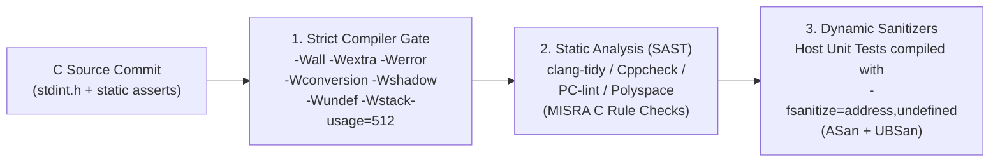

## Key figures {.stats style=tiles}

| Value | Label | Change | Verdict |
|---|---|---|---|
| 0 bytes | Dynamic heap (`malloc`) allowed after startup in safety-critical loops | zero fragmentation | good |
| 100% | Loops that must have a provable upper iteration bound (`Power of 10`) | no infinite hangs | good |
| Undefined | Compiler behaviour on signed integer overflow or null dereference (`UB`) | silent bugs | bad |
| 3 layers | Compiler flags (`-Wall -Wextra -Werror`), Static Analysis and Sanitizers | automated gate | good |

## Introduction {.abstract}

The C language gives firmware direct access to hardware registers with zero runtime overhead, but it also contains dozens of **Undefined Behaviour (UB)** traps. When code triggers Undefined Behaviour—such as overflowing a signed integer or violating strict aliasing—the optimising compiler can delete safety checks silently. Originating in the **Motor Industry Software Reliability Association (MISRA)** guidelines and spaceflight's **Power of 10**, defensive C restricts the language to a safe subset verified on every commit.

## 1. Six classic undefined behaviour and hardware traps {.wide}

Compare fragile everyday C with the defensive pattern required in high-reliability firmware:

```cards cols=3 style=top
1. Missing `volatile` on Hardware / ISR | Without `volatile`, the compiler caches a status register or Interrupt Service Routine (`ISR`) flag in a CPU register and loops forever | red
2. Implicit Integer Promotion | In C, `uint8_t` and `uint16_t` promote to signed `int` before arithmetic; shifting `1 << 31` on a 32-bit signed `int` is Undefined Behaviour (`use 1UL << 31U`) | amber
3. Unbounded Dynamic Heap (`malloc`) | Repeated `malloc()` and `free()` calls fragment small microcontroller Static Random-Access Memory (`SRAM`) until an allocation returns `NULL` after weeks in the field | red
4. Unbounded Loops Polling Hardware | `while (!(SPI1->SR & RXNE));` hangs the entire system forever if a sensor wire breaks; every hardware wait loop must have a decrementing timeout counter | amber
5. Pointer Type-Punning (`Strict Aliasing`) | Casting `float f; uint32_t u = *(uint32_t*)&f;` violates C strict aliasing rules and miscompiles under `-O2`; always use `memcpy(&u, &f, sizeof(u))` | blue
6. Non-Atomic Multi-Word Shared State | Reading a 64-bit timestamp or struct shared with an `ISR` without a critical section reads half old bytes and half new bytes (**torn read**) | navy
```

## 2. Side-by-side code fixes: buggy C vs defensive C

```lcd cols=2
// BUGGY C (Hangs on hardware fault, UB shift, torn read):
uint32_t status_flags; // Shared with ISR (missing volatile!)

void wait_sensor_ready(int bit) {
  while (!(REG_STATUS & (1 << bit))) {
    // Hangs forever if sensor disconnects!
    // Also: (1 << 31) is signed overflow UB!
  }
}
-- Compiles without warnings under default flags, fails in field!

// DEFENSIVE C (Bounded timeout, unsigned U suffix, explicit status):
volatile uint32_t g_status_flags;

Err_t wait_sensor_ready(uint8_t bit, uint32_t max_polls) {
  if (bit >= 32U) { return ERR_INVALID_ARG; }
  uint32_t mask = (1UL << bit);
  while (((REG_STATUS & mask) == 0U) && (max_polls > 0U)) {
    max_polls--;
  }
  return (max_polls > 0U) ? ERR_OK : ERR_TIMEOUT;
}
-- Deterministic upper bound; every error path handled explicitly
```

## 3. Core rules of defensive C {.wide}

You do not need a 300-page manual to get 90% of the safety benefits. Enforce these six structural rules across your codebase:

```compare
| Standard C Habit | Defensive / `MISRA C` & `Power of 10` Requirement
Memory allocation | `malloc()` / `free()` on demand | **Zero dynamic allocation after initialisation**; use fixed-size static pools or ring buffers in `.bss`
Loop bounds | `while (condition)` until done | **Every loop must have a fixed, provable upper bound** (`max_iterations` guard) to prevent infinite hangs
Function structure | `goto`, deep recursion, 500-line functions | **Zero recursion** (guarantees bounded call stack depth) and functions under `60 lines` with low cyclomatic complexity
Type discipline | `int`, `long`, implicit sign conversions | Always use `<stdint.h>` exact-width types (`uint8_t`, `int32_t`) and suffix unsigned literals (`0x10U`)
Return values & parameters | Ignore `printf` / driver return codes | **Check the return value of every non-void function** and validate pointer/range preconditions at function entry
Preprocessor macros | Function-like `#define MAX(a,b)` with side effects | Replace function macros with type-safe **`static inline`** functions and `enum` / `const` constants
```

## 4. Automated verification pipeline in CI

Human code reviewers miss subtle integer promotions and race conditions. Build a three-stage automated gate in **Continuous Integration (CI)**:



[[CAPTION:Figure]] Running host unit tests with AddressSanitizer (`ASan`) and UndefinedBehaviorSanitizer (`UBSan`) catches out-of-bounds array accesses and signed overflows immediately.

## 5. Compile-time assertions & stack bounding

Catch layout and sizing mistakes at compile time before the binary ever touches hardware:

```lcd cols=1
#include <assert.h>
// C11 compile-time assertion (zero runtime cost!):
static_assert(sizeof(PacketHeader_t) == 12U, "Padding broke header!");
static_assert((RING_BUF_SIZE & (RING_BUF_SIZE - 1U)) == 0U,
              "Ring buffer size must be a power of 2!");
-- GCC/Clang flag -fstack-usage emits a .su file per compilation unit
-- so CI can fail the build if any function frame exceeds 256 bytes!
```

## 6. Defensive C code-review checklist {style=card colour=red}

```checklist
[x] Compile with `-Wall -Wextra -Werror -Wconversion -Wsign-conversion -Wshadow -WStrict-prototypes`
[x] Zero calls to `malloc()`, `calloc()`, `realloc()`, `free()`, `strcpy()`, `sprintf()` or `atoi()` (use `snprintf` and `strtol`)
[x] Zero recursive functions; maximum call-graph stack depth verified statically (`-fstack-usage` or `puncover`)
[x] Every hardware register wait loop includes a timeout counter and returns an explicit error code on failure
[x] Shared variables between `ISR` and main thread use `<stdatomic.h>` or disable interrupts briefly inside a critical section
```

## 7. Acronym guide: every term defined {.wide}

```cards cols=4 style=label
MISRA | Motor Industry Software Reliability Association: authors of the MISRA C coding standard for safety-critical systems
UB | Undefined Behaviour: C constructs for which the ISO C standard imposes no requirements (allowing compilers to break assumptions)
SAST | Static Application Security Testing: automated tools that analyse source code for bugs without executing it
ASan & UBSan | AddressSanitizer (catches out-of-bounds/use-after-free) and UndefinedBehaviorSanitizer (catches overflow/shift bugs)
ISR & DMA | Interrupt Service Routine and Direct Memory Access: asynchronous contexts requiring `volatile` or atomic barriers
JPL | Jet Propulsion Laboratory (NASA): origin of Gerard Holzmann's "Power of 10" rules for safety-critical C code
SIL & ASIL | Safety Integrity Level (IEC 61508) and Automotive Safety Integrity Level (ISO 26262) functional safety ratings
CI | Continuous Integration: automated server pipeline compiling and verifying every code commit
```

## In short {.summary}

Ban post-startup **`malloc`** and **recursion**, bound every hardware wait loop with a **timeout**, use exact **`<stdint.h>`** types with `-Wconversion -Werror`, and run **static analysis + `ASan`/`UBSan`** on every commit.

### If it can hang, it will hang

A sensor wire will eventually vibrate loose in the field; a bounded timeout loop turns a total system lockup into a recoverable error log.

### Turn warnings into errors

`-Wconversion` and `-Wshadow` catch 80% of sign-extension and variable-shadowing bugs at the moment you type `make`.

### Verify with `ASan` and `UBSan` on host

Compiling your hardware-independent C modules on Linux/Windows with `-fsanitize=address,undefined` catches off-by-one bugs in milliseconds.
