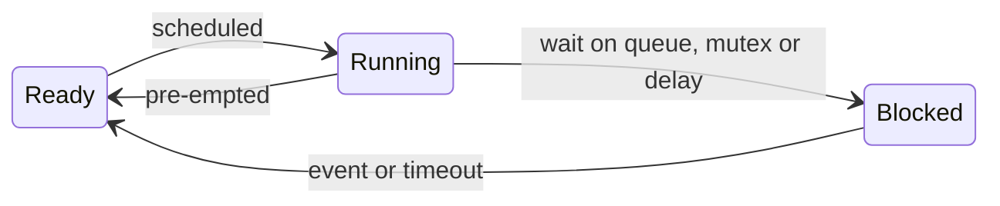

## Key figures {.stats style=tiles}

| Value | Label |
|---|---|
| 1 stack | Shared by every function in a superloop |
| Under 10 µs | A typical RTOS context switch |
| 6 to 12 KB | Flash for a small RTOS kernel |
| 1 stack each | For every RTOS thread, sized for its worst case |

## Introduction {.abstract}

Every firmware project starts with a choice: a **bare-metal superloop**, a `while (1)` loop with interrupts, or a **real-time operating system (RTOS)** such as FreeRTOS or Zephyr. A superloop needs almost no RAM and never switches context, but one slow function delays everything else. An RTOS gives each job a thread and a priority, and pauses slow background work the moment an urgent loop needs the CPU.

## 1. Timelines: one loop, or priorities {.wide}

In a superloop the worst-case response is the **sum of every task**. In an RTOS, a high-priority thread pre-empts a low one as soon as its event arrives.

```lanes
Superloop | *Read sensor, 1 ms | *Update display, 45 ms | *Motor PID, 45 ms late | Sleep
RTOS, motor (high) | Asleep | *PID on time, 1 ms | Asleep | *PID on time, 1 ms
RTOS, display (low) | *Draw | Paused | *Draw | Idle
```

## 2. Where 64 KB of SRAM goes, with four threads

```memory
0x2000_0000 | 16 KB | Globals and buffers | navy
0x2000_4000 | 8 KB | Kernel objects, queues | blue
0x2000_6000 | 2 KB | Motor stack | amber | down
0x2000_6800 | 4 KB | Comms stack | amber | down
0x2000_7800 | 4 KB | UI stack | amber | down
0x2000_8800 | 1 KB | Idle stack | amber | down
```

Each stack must fit its own worst case, and the free space above is the safety margin.

## 3. How each works

```cards cols=1 style=top
Superloop and interrupts | Interrupts put urgent bytes into ring buffers and set `volatile` flags. The main loop handles them in turn, with non-blocking state machines | blue
Pre-emptive RTOS | The SysTick timer and the PendSV exception swap the CPU registers and stack pointer between threads. The highest-priority ready thread always runs | navy
```



[[CAPTION:Figure]] A blocked thread uses no CPU, so when every thread is blocked the idle thread can sleep the processor.

## 4. Passing data safely

```cards cols=1 style=label
Queue | A thread-safe FIFO that copies messages from an interrupt or producer to a consumer
Semaphore | Signals an event: an interrupt gives it when a packet arrives, and the parser thread wakes
Mutex | Locks a shared resource such as an I2C bus. Priority inheritance lifts a low-priority holder so a high-priority waiter is not stuck behind medium work: no priority inversion
```

```c
void sensor_task(void *arg) {
    for (;;) {
        reading_t r = read_sensor();
        xQueueSend(q_telemetry, &r, portMAX_DELAY);
        vTaskDelay(pdMS_TO_TICKS(1000));
    }
}
```

> [!WARNING]
> Never block in an interrupt. It has no thread to suspend: use the `FromISR` queue and semaphore calls.

## 5. Head to head {.wide}

```compare
| Superloop | RTOS (FreeRTOS, Zephyr)
RAM and flash | **Minimal**: one stack, no kernel | **Moderate**: about 8 KB of flash, and a stack per thread
Worst-case latency | The sum of the other tasks, unless they are cut into small steps | **Microseconds**: only higher priorities and interrupts delay it
Protocol stacks | Hard to fit blocking TLS, TCP/IP, USB or BLE | Easy: each runs in its own thread
Readability | Grows into nested state machines for slow I/O | Straight-line code in each thread
Typical bugs | Races on shared flags | Deadlock, priority inversion, stack overflow
Best for | Small MCUs, under 16 KB of RAM, doing one job | Products mixing control, display, TLS and files
```

## 6. Which to choose

```structogram
if Under 16 KB of RAM, or one or two simple periodic jobs?
  Superloop
else
  if Slow work (display, flash, TLS) beside a deadline under 1 ms?
    Pre-emptive RTOS
  else
    Superloop, with DMA and non-blocking state machines
```

## 7. RTOS safety checklist {style=card colour=navy}

```checklist
[x] Turn on stack overflow checking, `configCHECK_FOR_STACK_OVERFLOW = 2`, and MPU guard regions
[x] Lock shared buses with a mutex, never a binary semaphore
[x] Keep interrupts to microseconds; pass the work to a thread through a queue
[x] Take several mutexes in one fixed order everywhere, so deadlock cannot happen
[x] Use tickless idle, so the CPU sleeps between wake-ups
```

## 8. Glossary {.wide}

```glossary cols=4
FIFO | First in, first out
ISR | Interrupt service routine
MPU | Memory protection unit
PendSV, SysTick | Cortex-M exceptions that drive the scheduler
PID | Proportional-integral-derivative control
RTOS | Real-time operating system
SP, PC | Stack pointer and program counter
WCET | Worst-case execution time
```

## In short {.summary}

Use a superloop with non-blocking state machines on a small MCU doing one job. Move to a pre-emptive RTOS as soon as slow communication or display work must share the CPU with tight deadlines.

### Separate fast from slow

A 200 ms TLS handshake can run in the background while a 1 kHz motor loop runs on time.

### Talk through queues

Pass messages, not shared globals guarded by flags.

### Watch every stack

Size stacks from their high-water marks, and keep the hardware guards on.
