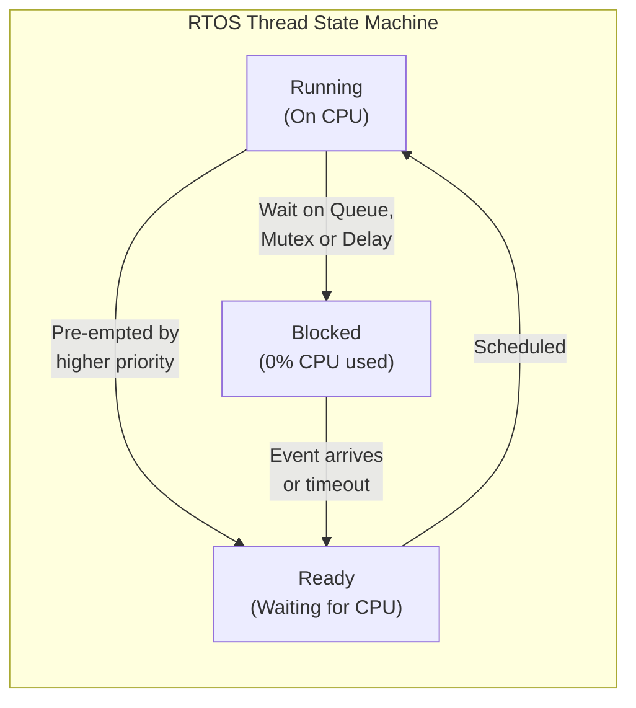

## Key figures {.stats style=tiles}

| Value | Label | Change | Verdict |
|---|---|---|---|
| 1 stack | A bare-metal superloop shares one call stack across all functions | zero RAM overhead | good |
| < 10 µs | Typical Real-Time Operating System (RTOS) context-switch time | deterministic | good |
| 6 to 12 KB | Typical Flash footprint of a minimal RTOS kernel (`FreeRTOS` / `Zephyr`) | compact | good |
| N stacks | An RTOS allocates an independent stack in RAM for every thread | isolation | good |

## Introduction {.abstract}

Every microcontroller firmware project begins with an architectural choice: a **bare-metal superloop** (`while(1)` polling loop paired with hardware interrupts) or a **Real-Time Operating System (RTOS)** such as `FreeRTOS` or `Zephyr`. A superloop uses almost zero **Random-Access Memory (RAM)** and has no context-switching overhead, but one slow function delays every other task. A pre-emptive **RTOS** gives each job its own thread and priority. The scheduler pauses slow background work immediately when an urgent control loop needs the **Central Processing Unit (CPU)**.

## 1. Execution timelines: sequential loop vs pre-emptive priority {.wide}

In a superloop, tasks run one after another in a fixed circle; worst-case response time is the **sum of every task's duration**. In a pre-emptive RTOS, a high-priority task preempts a low-priority task the instant an event arrives:

```figure
@lanes
Bare-Metal Superloop | *1. Read Sensor (1 ms) | *2. Update Display (45 ms — blocks everything!) | *3. Motor PID (delayed 45 ms!) | *4. Sleep until tick
RTOS: High Priority (Motor) | Sleep | *Wake on Timer & Run PID (1 ms) | Sleep | *Wake & Run PID (1 ms)
RTOS: Low Priority (Display) | *Start Display Draw | Paused by scheduler | *Resume Display Draw | Sleep (Idle hook)
+++
@segments
title: Typical 64 KB microcontroller SRAM allocation: Superloop vs 4-Thread RTOS
3 | Static Globals & Buffers (16 KB) | Shared | navy
2 | RTOS Kernel Objects & Queues (8 KB) | RTOS only | blue
6 | Per-Thread Stacks: Motor (2 KB) + Comms (4 KB) + UI (4 KB) + Idle (1 KB) | Must be sized for worst-case depth | amber
4 | Unused SRAM Headroom | Safety margin | green
```

## 2. Architecture: how each model works {cols=2}

```cards cols=2 style=top
Bare-Metal Superloop + ISRs | Hardware Interrupt Service Routines (ISRs) capture urgent bytes into ring buffers and set volatile flags; the main `while(1)` loop processes flags sequentially with non-blocking state machines | blue
Pre-emptive RTOS Kernel | The SysTick hardware timer and PendSV exception switch CPU registers (`R0–R15`, Stack Pointer `SP`) between independent threads; highest-priority ready thread always runs | navy
```



[[CAPTION:Figure]] Blocked RTOS threads consume zero CPU cycles, allowing the Idle thread to put the processor into low-power sleep.

## 3. Passing data safely: queues, semaphores and mutexes

When multiple threads or interrupts share hardware or memory, race conditions corrupt data unless you synchronise access with kernel primitives:

```cards cols=1 style=label
Message Queue | Thread-safe First-In First-Out (FIFO) buffer that copies structs between an ISR or producer thread and a consumer thread
Binary / Counting Semaphore | Signals that an event occurred (for example, `ISR` gives semaphore when a full UART packet arrives; parser thread wakes and takes it)
Mutex (with Priority Inheritance) | Mutual Exclusion lock protecting a shared resource (such as an `I2C` bus). If a high-priority thread waits on a low-priority holder, the kernel boosts the holder's priority to prevent **Priority Inversion**
```

```lcd cols=1
void vSensorTask(void *pv) {
  for (;;) {
    Reading_t r = read_i2c_sensor();
    xQueueSend(qTelemetry, &r, portMAX_DELAY);
    vTaskDelay(pdMS_TO_TICKS(1000));
  }
}
-- Clean blocking RTOS thread (no giant switch-case state machine)
```

> [!WARNING]
> Never call a blocking function (such as `vTaskDelay` or taking a Mutex) inside a hardware **Interrupt Service Routine (ISR)**. An ISR has no thread control block to block; use non-blocking `FromISR` queue and semaphore APIs instead.

## 4. Head-to-head comparison: superloop vs RTOS {.wide}

```compare
| Bare-Metal Superloop (`while(1)`) | Real-Time Operating System (`FreeRTOS` / `Zephyr`)
RAM & Flash overhead | **Minimal** (1 shared stack, 0 kernel bytes) | **Moderate** (~8 KB Flash + separate stack per thread)
Worst-case task latency | Sum of all other tasks in the loop (unless split into tiny state machines) | **Microseconds** (determined only by higher-priority threads & ISRs)
Third-party protocol stacks | Hard to integrate blocking TLS, TCP/IP, USB or BLE stacks | Easy: each stack runs in its own isolated thread
Code readability | Degrades into complex nested `switch(state)` machines for slow I/O | Linear, sequential code inside each task loop
Concurrency bugs | Shared `volatile` flag races between ISR and main loop | Deadlocks, priority inversion and per-thread stack overflows
Best suited for | Ultra-small MCUs (< 16 KB RAM) and simple sense-and-sleep nodes | Complex products combining control loops, displays, TLS and file systems
```

## 5. Architecture selection workflow {cols=2}

Walk through three questions before adding an RTOS to your firmware:

```flow
[MCU has <16 KB RAM or 1–2 simple periodic tasks?|navy] -yes-> [Bare-Metal Superloop|green]
[Slow tasks (display, flash, TLS) run beside <1 ms control?|navy] -yes-> [Pre-emptive RTOS|navy]
[Using Superloop with slow I/O?|amber] -split work-> [Non-blocking FSM + DMA|blue]
```

## 6. Concurrency & RTOS safety checklist {style=card colour=navy}

Verify these five rules to prevent field hangs and stack corruption:

```checklist
[x] Enable hardware stack-overflow detection (`configCHECK_FOR_STACK_OVERFLOW = 2`) and MPU stack guard pages
[x] Use Mutexes (with priority inheritance), never binary semaphores, when locking shared buses like SPI or I2C
[x] Keep Interrupt Service Routines (ISRs) under a few microseconds; defer heavy parsing to a high-priority task via a Queue
[x] Acquire multiple Mutexes in a strict global order across all threads to make deadlock impossible
[x] Hook the RTOS tickless-idle mode (`configUSE_TICKLESS_IDLE`) so the CPU sleeps between scheduled wakeups
```

## 7. Acronym guide: every term defined {.wide}

```cards cols=4 style=label
RTOS | Real-Time Operating System: deterministic multi-threaded kernel with bounded interrupt and scheduling latency
ISR & IRQ | Interrupt Service Routine (handler function) and Interrupt Request (hardware signal pausing normal execution)
FIFO | First-In First-Out: queue ordering where the oldest message added is the first one processed
FSM | Finite State Machine: design pattern that breaks a slow operation into non-blocking steps for a superloop
PID | Proportional-Integral-Derivative: closed-loop feedback control algorithm requiring strict periodic timing
SP & PC | Stack Pointer and Program Counter: core CPU registers swapped by the RTOS context switcher
SysTick & PendSV | System Tick timer and Pendable Service Call: ARM Cortex-M hardware exceptions driving the RTOS scheduler
DMA | Direct Memory Access: peripheral controller that transfers bytes in the background while the CPU sleeps
MPU | Memory Protection Unit: hardware block that triggers a fault immediately if a thread overflows its stack
WCET | Worst-Case Execution Time: maximum time a function or task can take to complete under any input
BLE & USB | Bluetooth Low Energy and Universal Serial Bus: complex event-driven protocol stacks often run in RTOS threads
CPU & RAM | Central Processing Unit and Random-Access Memory (Static RAM on microcontrollers)
```

## In short {.summary}

Use a **bare-metal superloop** with non-blocking state machines on tiny microcontrollers doing one job. Switch to a **pre-emptive RTOS** as soon as slow communication or display tasks must coexist with fast deadlines.

### Decouple fast from slow

An RTOS lets a 200-millisecond **Transport Layer Security (TLS)** handshake or flash write run in a background thread while a 1-kilohertz motor loop runs on the dot.

### Communicate through queues

Pass immutable messages over RTOS queues instead of sharing global variables protected by fragile flags.

### Watch every stack

Size each thread's stack using high-water-mark telemetry and enable hardware stack guards to catch overflows during testing.
