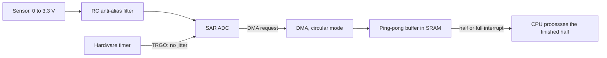

## Key figures {.stats style=tiles}

| Value | Label |
|---|---|
| Over 2 × f_max | The Nyquist rate: sample faster, or high frequencies fold back |
| 0.8 mV | One step of a 12-bit ADC at 3.3 V |
| 0 % CPU | While DMA moves the samples |
| 2 halves | Of a ping-pong buffer: the CPU reads one while DMA fills the other |

## Introduction {.abstract}

Every embedded system bridges the analogue world and software. An **analogue-to-digital converter (ADC)** turns a voltage into a number at a fixed rate; **pulse-width modulation (PWM)** and **DACs** drive the outputs. A hardware timer and **direct memory access (DMA)** can stream millions of samples a second into RAM without waking the CPU.

## 1. A signal chain with no CPU in it {.wide}

Instead of an interrupt for every sample, a timer triggers the ADC and a circular DMA channel fills a double buffer:



## 2. The ping-pong buffer

```ring cells=16
fill: 0-7 | Ping: the CPU reads it | green
fill: 8-15 | Pong: DMA is filling it | purple
pointer: 11 | DMA write | red
pointer: 3 | CPU read | navy
```

DMA raises a **half-transfer** interrupt when Ping is full, and a **transfer-complete** interrupt when Pong is. At 500 kHz with 1,024 samples, that is about 1,000 interrupts a second instead of 500,000.

## 3. Resolution and effective bits

```equation
title: One step, and the bits that are real
\mathrm{LSB} = \frac{V_{\text{ref}}}{2^{n}} \qquad \mathrm{ENOB} = \frac{\mathrm{SINAD} - 1.76}{6.02}
V_{\text{ref}} | Full-scale reference | V
n | Bits of the converter |
\mathrm{SINAD} | Signal to noise and distortion | dB
```

```cards cols=1 style=top
Oversampling | Take 4ᴺ samples, add them and shift right by N: N extra bits. Sixteen samples turn 12 bits into 14, +12 dB | purple
The sample capacitor | Each conversion charges a capacitor of about 5 pF from the pin. A divider over 50 kΩ needs a 100 nF capacitor on the pin, or a longer sample time | blue
```

## 4. PWM: power without heat

A transistor fully on or fully off wastes little power. PWM sets the average by the share of time it is on: at 25 % duty, the load sees a quarter of the supply.

```instrument type=logic title="Half bridge: high side (HS), low side (LS), ADC trigger"
HS | 000111111000000111111000
LS | 110000000011110000000011
ADC | 000001000000000001000000
```

> [!WARNING]
> In a half or full bridge, always enable the timer's **dead time**, 100 to 500 ns, when both transistors are off. Without it, both conduct at once for an instant: **shoot-through**, a short across the supply.

Trigger the current measurement in the **middle of the pulse**, when the switching ringing has settled.

## 5. SAR or sigma-delta {.wide}

```compare
| Successive approximation (SAR) | Sigma-delta (ΣΔ)
How | A binary search with a capacitor DAC | Oversamples at MHz with a 1-bit modulator, then filters digitally
Resolution | **10 to 16 bits** | **16 to 24 bits**
Speed | **100 kSPS to over 5 MSPS** | **10 SPS to 100 kSPS**, with more latency
Filtering | None: needs an external anti-alias filter | Built-in sinc filter, often notching 50 and 60 Hz
For | Motor current, battery sensing, audio, ultrasound | Strain gauges, thermocouples, scales, metering
```

## 6. Checklist {cols=2 style=card colour=purple}

```checklist
[x] An RC anti-alias filter before the ADC pin, cutting above half the sample rate
[x] ADC triggered by a hardware timer, never by a software delay
[x] The ADC's own offset calibration run at start-up and after large temperature changes
[x] The internal reference channel read, to correct for a sagging supply
[x] On a Cortex-M7, DMA buffers in non-cacheable RAM, or the cache invalidated before reading
```

## 7. Glossary

```glossary cols=2
ADC, DAC | Analogue-to-digital and digital-to-analogue converter
DMA | Direct memory access
ENOB | Effective number of bits
LSB | Least significant bit: one step
PWM | Pulse-width modulation
SAR | Successive approximation register
SINAD, SNR | Signal to noise and distortion, signal to noise
SPS | Samples per second
```

## In short {.summary}

Clock the ADC from a hardware timer, stream it into a ping-pong DMA buffer, oversample for extra bits, and sample PWM currents in the quiet middle of the pulse.

### Obey Nyquist

Anything above half the sample rate appears in your data as a false, lower frequency.

### Let DMA move the bytes

One interrupt per half-buffer, not one per sample.

### Mind the dead time

A few hundred nanoseconds with both switches off saves the bridge.
