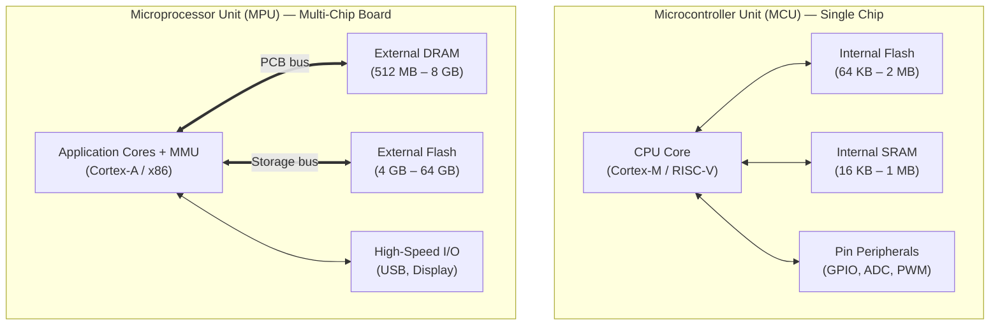

## Key figures {.stats style=tiles}

| Value | Label | Change | Verdict |
|---|---|---|---|
| 1 chip | Microcontroller Unit (MCU) integrates CPU, Flash and I/O | all-in-one | good |
| < 1 ms | Typical MCU boot time to first instruction | vs 5–15 s Linux | good |
| 2 µA | Typical MCU deep-sleep current on a coin cell | vs watts on Linux | good |
| MHz vs GHz | MCUs run at 16–400 MHz; Microprocessor Units (MPUs) at 0.5–3+ GHz | deterministic | good |

## Introduction {.abstract style=quote}

Every smart product has a computing brain, chosen from two families: a **Microcontroller Unit (MCU)** or a **Microprocessor Unit (MPU)**. An **MCU** integrates the **Central Processing Unit (CPU)**, flash firmware storage, **Static Random-Access Memory (SRAM)** and hardware peripherals onto a single silicon chip built for deterministic, low-power control. An **MPU** concentrates its silicon area on high-speed processing cores and a **Memory Management Unit (MMU)**, relying on external memory chips to run full operating systems such as Linux.

## 1. Architecture: everything on one chip vs external chips

The fundamental difference is where memory and peripherals live:

```cards cols=2 style=top
Microcontroller Unit (MCU) | A complete computer on a single chip: CPU core, non-volatile Flash, SRAM, timers, analogue converters and serial buses all sit on one die | navy
Microprocessor Unit (MPU) | A powerful CPU and graphics System on Chip (SoC) that connects over high-speed circuit board traces to external Dynamic RAM (DRAM) and flash storage | blue
```



[[CAPTION:Figure]] An MCU integrates memory and peripherals inside one package; an MPU connects to external memory chips on the circuit board.

## 2. Memory and timing: bare-metal loop vs operating system

Because an MCU executes instructions directly from internal flash, it wakes and toggles pins within microseconds of power-on. An MPU loads its operating system from external flash into external **Dynamic Random-Access Memory (DRAM)** before running applications.

```figure
@segments
title: Typical boot-to-ready timeline comparison (not to scale)
2 | MCU: Power-on to main() in < 1 ms | Executes directly from internal Flash | green
8 | MPU: ROM bootloader -> U-Boot -> Linux kernel -> user space (3 to 15 s) | Copies OS into external DRAM | navy
+++
@lanes
MCU (RTOS / ISR) | *Sensor IRQ (<1 µs) | *Control loop | *PWM update | Sleep until next timer
MPU (Linux OS) | *IRQ queued | Kernel context switch | *User-space process | Background daemon
```

| Layer | Microcontroller Unit (MCU) | Microprocessor Unit (MPU) |
|---|---|---|
| Memory protection | Optional Memory Protection Unit | Hardware Memory Management Unit (MMU) with virtual memory |
| Typical software | Bare-metal loop or Real-Time Operating System (RTOS) | Linux, Android or Windows Embedded |
| Code storage | 32 KB to 4 MB internal Flash | 4 GB to 64 GB external flash module |
| Working memory | 8 KB to 1 MB internal SRAM | 256 MB to 16 GB external Double Data Rate (DDR) DRAM |
| Timing behaviour | Hard real-time, microsecond interrupt latency | Soft real-time, throughput optimised |

## 3. On-chip peripherals: talking to the physical world

An MCU connects directly to sensors, switches and motor drivers. An MPU focuses on high-bandwidth data buses, rich displays and networking:

```cards cols=2 style=label
GPIO & PWM | General-Purpose Input/Output (GPIO) reads switches; Pulse-Width Modulation (PWM) dims LEDs and drives motors
ADC & DAC | Analogue-to-Digital Converter (ADC) measures sensor voltages; Digital-to-Analogue Converter (DAC) outputs waveforms
UART, I2C, SPI | Universal Asynchronous Receiver-Transmitter, Inter-Integrated Circuit (I2C) and Serial Peripheral Interface (SPI) link sensors
DMA & Watchdog | Direct Memory Access (DMA) moves bytes without waking the CPU; Watchdog Timer (WDT) resets hung firmware
```

```lcd cols=2
ISR_TIM1_UP() {
  adc = ADC1->DR;
  TIM1->CCR1 = pid(adc);
}
-- MCU: 2 us hard real-time ISR

$ docker ps && free -m
Mem: 2048M total, 612M used
python3 app.py --port 8080
-- MPU: Full Linux user space
```

> [!TIP]
> Many complex products pair both chips on one board: an **MPU** runs the touchscreen, database and cloud **Transport Layer Security (TLS)** stack, while a companion **MCU** handles safety interlocks, motor control and microamp battery sleep.

## 4. Head-to-head comparison: single-chip vs application processor

```compare
| Microcontroller (MCU) | Microprocessor (MPU)
Representative families | ARM Cortex-M, AVR, MSP430, ESP32 | ARM Cortex-A, Raspberry Pi CM4, i.MX8
Clock frequency | 16 MHz to 400 MHz | 500 MHz to 3+ GHz (multi-core)
RAM capacity | Kilobytes (8 KB – 1 MB SRAM) | Megabytes to Gigabytes (DDR DRAM)
Sleep power | ~1 to 5 µA (coin-cell friendly) | Tens of milliwatts to watts
Active power | 5 mW to 150 mW | 500 mW to 10+ W
Printed Circuit Board (PCB) | 2 to 4 layers, simple routing | 6 to 10 layers, impedance-matched DDR traces
Unit BOM cost | $0.30 to $6 | $8 to $60+ (including external RAM & power IC)
```

```chart type=bar title="Typical active power consumption (mW)" unit=" mW" max=3500
Cortex-M0+ MCU | 12
Cortex-M7 MCU | 140
Cortex-A7 MPU | 650
Cortex-A53 MPU | 3200
```

## 5. Selection workflow: which one does your project need?

Walk through four engineering questions to pick the right architecture:

```flow
[Start design|navy] -needs coin-cell or <1 ms real-time?-> [Choose MCU|green]
[Start design|navy] -needs Linux, containers or rich 60 fps GUI?-> [Choose MPU|blue]
[Both hard real-time AND rich Linux UI?|amber] -yes-> [Hybrid: MPU + companion MCU|navy]
```

```steps
Check power budget | If the device runs for months on AA or coin-cell batteries, pick an MCU with microamp deep sleep
Check real-time deadlines | If control loops require guaranteed microsecond response (motor control, digital power), pick an MCU
Check software ecosystem | If you need Python, Docker, high-resolution video, PostgreSQL or complex web servers, pick an MPU | blue
Check board complexity | An MCU needs only a few decoupling capacitors; an MPU requires a Power Management Integrated Circuit (PMIC) and multi-layer DRAM routing | amber
```

## 6. Hardware design checklist {style=card colour=amber}

Before freezing your schematic, verify the architectural trade-offs:

```checklist
[x] Interrupt response under 10 microseconds assigned to MCU hardware timers
[x] High-level TLS, database and web UI workloads isolated on MPU or gateway
[x] Power supply rails sized for peak current (single 3.3 V LDO for MCU vs multi-rail PMIC for MPU)
[ ] Firmware update storage budgeted (dual-bank internal Flash vs A/B external eMMC partitions)
```

```highlight
4 layers | Typical MCU PCB | simple 3.3 V routing, no length matching | green
8 layers | Typical MPU PCB | controlled-impedance differential DDR traces | navy
```

## 7. Acronym guide: every term defined {.wide}

```cards cols=4 style=label
MCU | Microcontroller Unit: single-chip computer combining CPU, Flash, SRAM and real-time peripherals
MPU | Microprocessor Unit: high-performance application processor using external RAM and flash storage
CPU & FPU | Central Processing Unit (main processor core) and Floating-Point Unit (hardware decimal maths)
SoC | System on Chip: integrated circuit combining processor cores, graphics and buses on one silicon die
MMU | Memory Management Unit: hardware block translating virtual memory addresses for operating systems like Linux
RTOS | Real-Time Operating System: lightweight scheduler (such as FreeRTOS or Zephyr) with deterministic timing
RAM / SRAM / DRAM | Random-Access Memory: fast internal Static RAM (on MCUs) vs dense external Dynamic RAM (on MPUs)
DDR & ROM | Double Data Rate (high-speed external memory bus) and Read-Only Memory (permanent boot code)
GPIO & PWM | General-Purpose Input/Output (digital pins) and Pulse-Width Modulation (variable duty-cycle pulses)
ADC & DAC | Analogue-to-Digital Converter (reads voltages) and Digital-to-Analogue Converter (outputs voltages)
UART / SPI / I2C | Universal Asynchronous Receiver-Transmitter, Serial Peripheral Interface and Inter-Integrated Circuit buses
DMA & PMIC | Direct Memory Access (CPU-free data transfer) and Power Management Integrated Circuit (multi-rail supply)
```

## In short {.summary}

Choose a Microcontroller (`MCU`) to sense and control hardware in real time on milliwatts; choose a Microprocessor (`MPU`) to run full operating systems, rich interfaces and large applications.

### One chip vs a chipset

An MCU holds its Flash and SRAM inside one package; an MPU uses external gigabyte DRAM and storage chips.

### Microseconds vs gigabytes

MCUs wake in microseconds and respond deterministically; MPUs trade boot time and watts for Linux and rich networking.

### Better together

Industrial gateways and medical instruments often combine an MPU for the user interface with an MCU for hard real-time safety.
