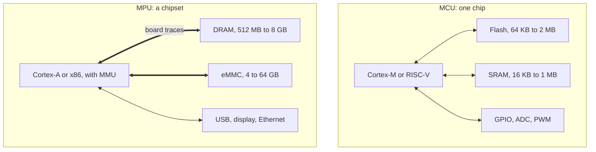

## Key figures {.stats style=tiles}

| Value | Label |
|---|---|
| 1 chip | An MCU holds its CPU, flash, RAM and I/O |
| Under 1 ms | From power-on to main() on an MCU; Linux takes seconds |
| 2 µA | A typical MCU asleep, on a coin cell |
| MHz or GHz | MCUs at 16 to 400 MHz; MPUs at 0.5 to 3 GHz and more |

## Introduction {.abstract style=quote}

Every smart product has one of two kinds of brain. A **microcontroller (MCU)** puts the CPU, flash, SRAM and peripherals on one chip, built for low-power, deterministic control. A **microprocessor (MPU)** spends its silicon on fast cores and a **memory management unit (MMU)**, and relies on external memory chips to run an operating system such as Linux.

## 1. One chip, or several

```cards cols=2 style=top
Microcontroller | A whole computer on one die: CPU, flash, SRAM, timers, ADCs and serial buses | navy
Microprocessor | A system on chip of fast cores and graphics, wired across the board to external DRAM and flash | blue
```



## 2. Time to be ready

An MCU runs straight from its own flash. An MPU first copies its operating system from external flash into DRAM.

```logscale unit=" s"
5e-6 | MCU: wake from deep sleep | green
5e-4 | MCU: power-on to main() | green
1 | MPU: U-Boot started | blue
8 | MPU: Linux to user space | navy
```

```lanes
MCU, RTOS | *Interrupt in under 1 µs | *Control loop | *PWM updated | Sleep
MPU, Linux | *Interrupt queued | Kernel switch | *User process | Daemons
```

## 3. Memory and software

| Layer | MCU | MPU |
|---|---|---|
| Protection | An optional MPU | An MMU, with virtual memory |
| Software | Bare metal, or an RTOS | Linux, Android, Windows |
| Code | 32 KB to 4 MB of internal flash | 4 to 64 GB of external flash |
| Working memory | 8 KB to 1 MB of SRAM | 256 MB to 16 GB of DDR |
| Timing | Hard real time, µs latency | Soft real time, built for throughput |

## 4. Two kinds of code

```c
void TIM1_UP_IRQHandler(void) {      /* MCU: a 2 µs hard real-time interrupt */
    uint16_t adc = ADC1->DR;
    TIM1->CCR1 = pid(adc);
}
```

```terminal title="MPU: a whole Linux user space"
$ free -m
Mem:  2048 total, 612 used
$ docker ps
$ python3 app.py --port 8080
```

> [!TIP]
> Many products use both: an **MPU** for the touchscreen, database and TLS, and a companion **MCU** for safety interlocks, motor control and microamp sleep.

## 5. Head to head {.wide}

```compare
| Microcontroller (MCU) | Microprocessor (MPU)
Families | Arm Cortex-M, AVR, MSP430, ESP32 | Arm Cortex-A, i.MX 8, Raspberry Pi CM4
Clock | 16 to 400 MHz | 500 MHz to 3 GHz and more, several cores
RAM | Kilobytes: 8 KB to 1 MB | Megabytes to gigabytes of DDR
Asleep | **1 to 5 µA** | Tens of milliwatts to watts
Running | 5 to 150 mW | 0.5 to 10 W and more
Board | 2 to 4 layers, simple routing | 6 to 10 layers, impedance-matched DDR traces
Cost | $0.30 to $6 | $8 to $60 and more, with RAM and PMIC
```

## 6. Power, from asleep to busy

```logscale unit=" W"
6e-6 | MCU asleep | green
1.2e-2 | Cortex-M0+ running | teal
1.4e-1 | Cortex-M7 running | blue
6.5e-1 | Cortex-A7 running | navy
3.2 | Cortex-A53 running | red
```

```highlight cols=2
4 layers | A typical MCU board | Simple 3.3 V routing | green
8 layers | A typical MPU board | Controlled-impedance DDR | navy
```

## 7. Which to choose

```structogram
if Months on a battery, or deadlines under 1 ms?
  if Also Linux, containers or a rich display?
    MPU with a companion MCU
  else
    MCU
else
  if Linux, Python, video, or a database?
    MPU
  else
    MCU: simpler board, lower cost
```

## 8. Design checklist {style=card colour=amber}

```checklist
[x] Responses under 10 µs given to MCU timers
[x] TLS, database and web UI kept on the MPU or a gateway
[x] Supplies sized for peak current: one LDO for an MCU, a multi-rail PMIC for an MPU
[ ] Room for updates budgeted: dual-bank flash, or A/B partitions on eMMC
```

## 9. Glossary {.wide}

```glossary cols=4
DDR | Double data rate: the fast external memory bus
MCU, MPU | Microcontroller, microprocessor
MMU | Memory management unit: virtual memory for an OS
PMIC | Power management IC: the supplies of an MPU
RTOS | Real-time operating system
SoC | System on chip
SRAM, DRAM | Static RAM inside an MCU, dynamic RAM beside an MPU
XIP | Execute in place, from flash
```

## In short {.summary}

Choose an MCU to sense and control in real time on milliwatts; choose an MPU to run an operating system, a rich interface and large applications.

### One chip or a chipset

An MCU keeps flash and SRAM in one package; an MPU uses gigabytes of external memory.

### Microseconds or gigabytes

MCUs wake in microseconds; MPUs trade boot time and watts for Linux and networking.

### Better together

Gateways and medical instruments often pair an MPU for the interface with an MCU for safety.
