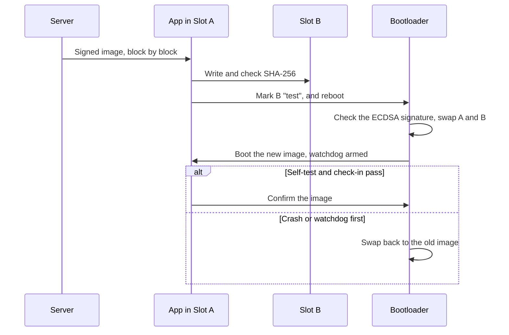

## Key figures {.stats style=tiles}

| Value | Label |
|---|---|
| 0x0800_0000 | Where flash usually starts on a Cortex-M |
| 0x2000_0000 | Where SRAM usually starts |
| 4 sections | text, rodata, data and bss |
| 2 slots | One running, one for the next update, so an update can be undone |

## Introduction {.abstract}

When firmware is linked into an **ELF** file, the **linker script** places every function and variable in **flash** or **SRAM**. At power-on the CPU reads its first **stack pointer** and **reset handler** from the **vector table** at the start of flash. A **bootloader** then checks the firmware's signature, applies any update, and jumps to the application.

## 1. Four sections {.wide}

```cards cols=4 style=top
.text, in flash | Machine code and the vector table, run in place from flash | navy
.rodata, in flash | `const` tables and strings, kept in flash to save SRAM | blue
.data, flash to SRAM | Globals with a starting value, such as `int gain = 5;`. The values are stored in flash and copied to SRAM at start-up | green
.bss, SRAM only | Globals that start at zero, such as `uint8_t buf[512];`. They take no space in the image; start-up clears them | amber
```

## 2. Flash: 512 KB, for two-slot updates

```memory
0x0800_0000 | 32 KB | Bootloader: immutable | navy
0x0800_8000 | 224 KB | Slot A: running app | blue
0x0804_0000 | 224 KB | Slot B: next update | green
0x0807_8000 | 32 KB | Scratch and settings | amber
```

## 3. SRAM: 128 KB

```memory
0x2000_0000 | 4 KB | .data | green
0x2000_1000 | 40 KB | .bss | blue
0x2000_B000 | 16 KB | Heap | amber | up
0x2001_C000 | 16 KB | Stack | red | down
```

The gap between the heap and the stack is all that stops one overwriting the other.

## 4. From power-on to main() {.wide}

```steps cols=3
Reset | The CPU loads the stack pointer from 0x0800_0000 and jumps to the reset handler named at 0x0800_0004 | navy
Bootloader | Checks the signature of Slot A, or first swaps in a new image from Slot B | navy
Vector table | Points VTOR at the application's table, 0x0800_8000, and jumps there | blue
Copy .data | Copies the starting values from flash into SRAM | green
Zero .bss | Clears the bss region, and turns on the FPU | amber
main() | Runs any static constructors, enables interrupts and starts the scheduler | green
```

## 5. What did that change cost?

```terminal title="Size of the build"
$ arm-none-eabi-size build/firmware.elf
   text    data     bss     dec     hex filename
  94216    1840   24512  120568   1d6f8 build/firmware.elf
-- Flash = text + data = 96,056 B. SRAM = data + bss = 26,352 B
```

> [!TIP]
> Mark tables and configuration `const`. Without it they go into `.data`, and cost flash for the values **and** SRAM for the copy.

## 6. Keeping memory safe

```cards cols=1 style=label
Static buffers | Size every buffer at build time, in .bss, so nothing can run out later
Stack at the bottom | Place the stack below the other data (flip-link does this), so an overflow faults at once instead of quietly corrupting globals
MPU guard | Mark a small region below the stack no-access: an overflow faults on the spot
Paint the stack | Fill it with 0xDEADBEEF at start-up; after a stress test, the untouched part shows the peak use
```

## 7. Two slots and rollback {.wide}

A single-slot bootloader bricks the device if power fails while flash is erased. A **two-slot** bootloader such as **MCUboot** downloads into Slot B while Slot A runs, and undoes the update if the new firmware fails its self-test:



## 8. Update strategies {.wide}

```compare
| Single slot, overwritten | Two slots, swapped (MCUboot) | Two banks, flipped in hardware
Flash needed | The app once, and the bootloader | **The app twice**, and the bootloader | The app twice, in two banks
Download happens | In the bootloader: the device is offline | **While the app runs** | While the app runs
If power fails | **Bricked** | **Safe**: the swap resumes at next boot | **Safe**
Rollback | None: a cable is needed | **Yes**, on watchdog reset | **Yes**, if not confirmed
Cost at boot | None | 1 to 3 s to swap | **Under 1 ms**: an address remap
```

## 9. Checklist {style=card colour=navy}

```checklist
[x] The bootloader checks an ECDSA P-256 or Ed25519 signature before booting any image
[x] The independent watchdog stays on through the jump to the app
[x] VTOR is set before the app enables interrupts
[x] The stack is painted at start-up and its peak measured under stress
[x] Bootloader sectors are write-protected in hardware
```

## 10. Glossary

```glossary cols=1
BSS | Block started by symbol: zero-initialised data
ELF | Executable and Linkable Format
FOTA, DFU | Firmware over the air, device firmware upgrade
IWDG | Independent watchdog
VTOR | Vector table offset register
WRP | Flash write protection
XIP | Execute in place
```

## In short {.summary}

Keep constants in rodata, size buffers in bss, guard the stack, and use a signed two-slot bootloader with watchdog rollback, so no update can brick a device.

### Know your sections

`arm-none-eabi-size` shows whether a change grew flash or SRAM, before you flash it.

### Never trust an unsigned image

Check the signature in the immutable bootloader before running anything.

### Keep a way back

Confirm a new image only after it boots, passes its self-test and checks in.
