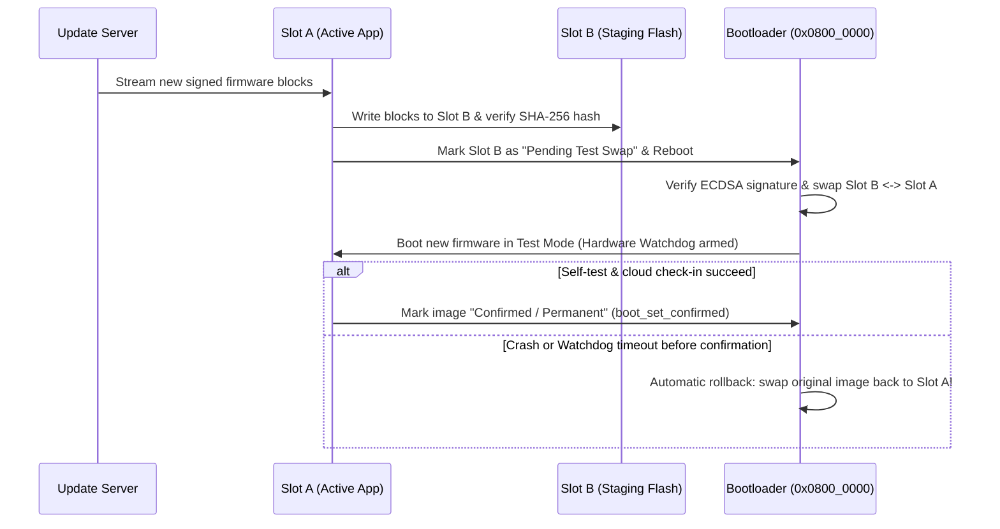

## Key figures {.stats style=tiles}

| Value | Label | Change | Verdict |
|---|---|---|---|
| `0x0800_0000` | Typical Cortex-M internal Flash base address | non-volatile | good |
| `0x2000_0000` | Typical Cortex-M Static Random-Access Memory (SRAM) base | byte-addressable | good |
| 4 sections | `.text` (code), `.rodata` (constants), `.data` (init) and `.bss` (zero) | linker layout | good |
| 2 slots | Primary and Secondary Flash slots for atomic rollback updates | brick-proof | good |

## Introduction {.abstract}

When you compile C or Rust firmware into an **Executable and Linkable Format (ELF)** binary, the **linker script** (`.ld`) maps every symbol to **Flash** or **Static Random-Access Memory (SRAM)**. At power-on, the **Central Processing Unit (CPU)** reads its initial **Stack Pointer (SP)** and **Reset Handler** address from the **Vector Table** at the start of Flash. It then runs a **bootloader** to verify cryptographic signatures, applies pending **Firmware Over The Air (FOTA)** updates, and jumps to `main()`.

## 1. The four ELF sections: where code and variables live {.wide}

Every compiled variable and function lands in one of four memory sections, divided between non-volatile **Flash** (kept when power is off) and volatile **SRAM** (lost when power is off):

```cards cols=4 style=top
.text (Flash) | Compiled machine instructions and the Interrupt Vector Table; executed directly in place from Flash (`XIP`) | navy
.rodata (Flash) | Read-only constants (`const` arrays, lookup tables and string literals) that stay in Flash to save scarce SRAM | blue
.data (Flash -> SRAM) | Global and `static` variables with non-zero initial values (`int gain = 5;`); initial values are stored in Flash and copied to SRAM by `Reset_Handler` before `main()` | green
.bss (SRAM only) | Block Started by Symbol: uninitialised or zero-initialised globals (`uint8_t buf[512];`); occupies zero bytes in the Flash image and is zeroed by startup code | amber
```

```figure
@segments
title: Non-volatile Flash layout (e.g. 512 KB at 0x0800_0000) — partitioned for safe dual-slot bootloader updates
2 | Bootloader (32 KB) | Immutable root of trust | navy
4 | Slot A: Active App (.text + .rodata + .data init, 224 KB) | Running firmware | blue
4 | Slot B: Staging Slot (224 KB) | New FOTA image download | green
1 | Scratch / NVS (32 KB) | Config & swap state | amber
+++
@segments
title: Volatile SRAM layout (e.g. 128 KB at 0x2000_0000) — watch out for Stack and Heap colliding!
2 | .data (Copied from Flash) | Initialised globals | green
3 | .bss (Zeroed at boot) | Static buffers & RTOS queues | blue
2 | Heap (grows upward ->) | malloc() / dynamic | amber
2 | Free SRAM Margin | Guard gap | teal
3 | Stack (<- grows downward from top) | Local vars & ISR frames | red
```

## 2. Boot sequence: from power-on to `main()` {cols=2}

Before a single line of `main()` runs, hardware and startup assembly (`startup.s`) prepare the processor and memory:

```steps
Hardware Reset | CPU hardware loads the initial Stack Pointer (SP) from address 0x0800_0000 and jumps to the Reset_Handler address at 0x0800_0004
Bootloader Check | The immutable bootloader verifies the cryptographic signature of Slot A (or swaps in a newly downloaded image from Slot B) | navy
Relocate Vector Table | Bootloader sets the Vector Table Offset Register (VTOR = 0x0800_8000) to point to the application's interrupt vectors and jumps to the app | blue
Copy .data to SRAM | Application Reset_Handler copies initial values of .data variables from Flash (_sidata) into SRAM (_sdata to _edata) | green
Zero out .bss | Startup loop writes 0x00 across the entire .bss region (_sbss to _ebss) and enables the Floating-Point Unit (FPU) | amber
Call main() | Startup calls C++ static constructors (if any) and enters main(); interrupts are enabled and the scheduler starts
```

```lcd cols=1
$ arm-none-eabi-size build/firmware.elf
   text    data     bss     dec     hex filename
  94216    1840   24512  120568   1d6f8 build/firmware.elf
-- Flash used = text + data (96,056 B); SRAM used = data + bss (26,352 B)
```

> [!TIP]
> Mark lookup tables and configuration structs `const` in C. Without `const`, the compiler places them in `.data`, wasting both **Flash** (for the initial values) and **SRAM** (for the runtime copy).

## 3. Safe dual-bank bootloader and rollback

A single-slot bootloader bricks the device if power fails halfway through erasing Flash. A **dual-slot bootloader** (`MCUboot`) downloads the new image into **Slot B** while the old image runs safely in **Slot A**. If the new firmware fails its self-test, the bootloader rolls back automatically:



[[CAPTION:Figure]] Atomic swap with self-test confirmation guarantees that a buggy update or power loss never bricks a field device.

## 4. Comparing bootloader update strategies {.wide}

```compare
| Single-Slot (In-Place Overwrite) | Dual-Slot Swap (`MCUboot` Scratch/Swap) | Dual-Bank Hardware Flash (`A/B` Bank Flip)
Flash required | `1x` app size + bootloader | `2x` app size + bootloader | `2x` app size (two physical Flash banks)
Download happens during | Bootloader mode (device offline during download) | Normal application runtime (zero downtime) | Normal application runtime (zero downtime)
Power-loss safety | **Unsafe** if connection drops before reflash | **100% atomic** (resumes swap on next boot) | **100% atomic** (flips hardware bank bit)
Automatic rollback | None (requires recovery cable if app crashes) | **Yes** (reverts to previous image on watchdog reset) | **Yes** (boots previous bank if unconfirmed)
Swap wear & boot delay | None | 1 to 3 seconds to copy blocks between slots | **Instant (< 1 ms)** via hardware address remap
```

## 5. Preventing memory corruption in embedded C {cols=2}

Most field crashes trace back to stack collisions or unguarded dynamic allocation:

```flow
[Need buffers?|navy] -known max size-> [Allocate static in .bss|green]
[Stack at bottom of RAM?|amber] -invert layout-> [Place Stack at bottom so overflow hits fault, not .bss!|navy]
```

## 6. Linker & bootloader verification checklist {style=card colour=navy}

Verify these five safeguards before locking your production bootloader:

```checklist
[x] Bootloader verifies an asymmetric signature (`ECDSA-P256` or `Ed25519`) before booting any image
[x] Hardware Independent Watchdog Timer (IWDG) stays active across bootloader-to-app jump to catch boot hangs
[x] Vector Table Offset Register (`SCB->VTOR`) updated before enabling interrupts in the application
[x] Stack painted with `0xDEADBEEF` sentinel pattern at boot to measure peak stack usage in stress tests
[x] Bootloader Flash sectors locked against accidental erase/write via hardware Write Protection (`WRP`) bits
```

## 7. Acronym guide: every term defined {.wide}

```cards cols=4 style=label
ELF & BSS | Executable and Linkable Format binary file and Block Started by Symbol (zero-initialised SRAM section)
SRAM & NVS | Static Random-Access Memory (fast volatile RAM) and Non-Volatile Storage (key-value flash settings)
SP, PC & VTOR | Stack Pointer, Program Counter and Vector Table Offset Register (Cortex-M interrupt table pointer)
XIP | Execute In Place: CPU fetches and runs instructions directly from internal or QSPI Flash without copying to RAM
FOTA / DFU | Firmware Over The Air and Device Firmware Upgrade: updating embedded software in the field
IWDG / WDT | Independent Watchdog Timer: hardware counter that forces a system reset if firmware stops kicking it
ECDSA & SHA | Elliptic Curve Digital Signature Algorithm (authenticates firmware) and Secure Hash Algorithm (integrity)
MPU & WRP | Memory Protection Unit (RAM access guard) and Write Protection (hardware Flash sector lock)
```

## In short {.summary}

Keep `const` data in `.rodata`, size static buffers in `.bss`, guard your stack against overflow, and use a **signed dual-slot bootloader** with watchdog rollback so no update can ever brick a device.

### Know your four sections

`arm-none-eabi-size` tells you before you flash whether a change bloated `.text` (Flash) or `.bss` (SRAM).

### Never trust an unsigned image

Verify an `ECDSA` or `Ed25519` signature in immutable bootloader ROM before jumping to application code.

### Always keep a rollback slot

Only mark a new firmware update permanent after it boots, passes self-test and reconnects to the server.
