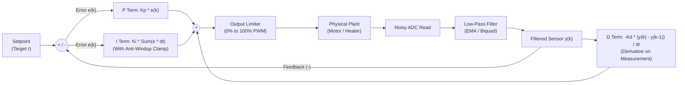

## Key figures {.stats style=tiles}

| Value | Label | Change | Verdict |
|---|---|---|---|
| 3 terms | Proportional (`P`), Integral (`I`) and Derivative (`D`) control actions | present, past, future | good |
| Fixed dt | Deterministic sample period (`Δt`) required for discrete digital control | timer interrupt | good |
| 3 lines | Code required for a first-order Exponential Moving Average (EMA) filter | zero array RAM | good |
| Windup | Actuator saturation trap when the Integral sum grows unchecked | clamp required | bad |

## Introduction {.abstract}

Whether regulating a heater to `0.1 °C`, holding a drone level or governing motor speed, open-loop commands fail whenever load or supply voltage changes. A **Proportional-Integral-Derivative (PID)** controller closes the loop by subtracting the measurement from the **setpoint** to find the error (`e`) and computing a command at a fixed step (`Δt`). Pairing a discrete PID loop with a digital filter—such as an **Exponential Moving Average (EMA)** or **Kalman filter**—keeps sensor noise from rattling the actuator.

## 1. Anatomy of the three PID terms {.wide}

Each term reacts to a different aspect of the error `e(t) = Setpoint - Measurement` before summing into the **Pulse-Width Modulation (PWM)** or **Digital-to-Analogue Converter (DAC)** output:

```cards cols=3 style=top
Proportional (Kp × e) — The Present | Produces an output proportional to current error. Too little `Kp` responds sluggishly; too much `Kp` causes violent oscillation. Alone, `P` control often leaves a small **steady-state droop** | blue
Integral (Ki × ∫e dt) — The Past | Accumulates error over time to eliminate steady-state offset against constant loads (such as gravity or heat loss). Must include **anti-windup clamping** when the actuator hits 100% | green
Derivative (-Kd × d(Measurement)/dt) — The Future | Applies a braking force proportional to the rate of change, damping overshoot. Always compute `D` on the **filtered measurement** (not raw error) to avoid **derivative kick** on setpoint steps | amber
```



[[CAPTION:Figure]] Computing the Derivative term on the filtered measurement (`-Kd × dy/dt`) prevents a massive spike when the user changes the setpoint.

## 2. Step response: how tuning shapes behaviour

```chart type=line title="Step response towards 100 °C setpoint across tuning profiles" unit=" C" min=0 max=140 step=20 height=200 colours=green,amber,red values=last
series: Tuned PID, High Kp, P-Only
0 s | 20 | 20 | 20
1 s | 75 | 95 | 65
2 s | 102 | 132 | 84
3 s | 100 | 82 | 88
4 s | 100 | 112 | 89
5 s | 100 | 98 | 89
```

| Symptom in step test | Root cause | Tuning fix |
|---|---|---|
| Slow rise, settles below target | `Kp` too low; no `Ki` | Increase `Kp`; add small `Ki` |
| Overshoots and rings | `Kp` or `Ki` too aggressive | Increase `Kd` damping or lower `Kp` |
| High-frequency buzz in actuator | Sensor noise amplified by `Kd` | Low-pass filter sensor before `D` term |
| Huge overshoot after long ramp | **Integral windup** during 100% saturation | Freeze or clamp `I` term when output saturates |

## 3. Two essential firmware protections

Naive textbook PID equations fail in real hardware without **anti-windup** and **derivative-on-measurement**:

```lcd cols=1
float pid_step(PID *c, float sp, float meas, float dt) {
  float err = sp - meas;
  c->i_sum = clamp(c->i_sum + c->ki * err * dt, c->min, c->max);
  float d_term = -c->kd * (meas - c->prev_meas) / dt;
  c->prev_meas = meas;
  return clamp(c->kp * err + c->i_sum + d_term, c->min, c->max);
}
-- Production C loop: clamped integral + derivative on measurement
```

> [!WARNING]
> Never run a PID calculation inside a variable-time `while(1)` superloop without measuring time or triggering from a hardware timer. Jitter in `dt` directly corrupts both the Integral (`err × dt`) and Derivative (`Δmeas / dt`) terms.

## 4. Cleaning noisy sensors before control

An **Analogue-to-Digital Converter (ADC)** reading carries thermal noise, power-supply ripple and quantisation steps. Choose the simplest filter that removes noise without adding excessive **phase lag**:

```compare
| Moving Average (`N`-tap Boxcar) | Exponential Moving Average (`EMA`) | Median-of-3 + `EMA` Cascade | 1D / Multi-State Kalman Filter
RAM required | `N` samples ring buffer | **1 float (`y_prev`)** | 3-sample window + 1 float | State vector `x` + covariance `P`
CPU cost per sample | Low (add new, subtract oldest) | **Minimal (1 multiply-accumulate)** | 3 comparisons + 1 multiply | Matrix multiply & divide
Rejects single-sample spikes | Poor (smears spike across `N` steps) | Poor (step jumps by `α × spike`) | **100% (drops 1-sample outliers)** | Good (weights by measurement noise `R`)
Frequency roll-off | Sinc lobes (poor stopband) | Smooth `-20 dB/decade` first-order | Rejects glitches + smooth roll-off | Optimal minimum mean-square error
```

```lcd cols=1
// 1. Median-of-3 kills single-sample EMI / I2C glitches:
float clean = median3(s[0], s[1], s[2]);

// 2. Exponential Moving Average (alpha = 0.0..1.0):
filtered += alpha * (clean - filtered);
-- 4 lines of C remove both impulse spikes and Gaussian hiss
```

## 5. Practical tuning workflow

Tune a new physical plant safely in four incremental steps:

```steps
1. Verify filter & direction | Zero all gains (`Kp = Ki = Kd = 0`). Plot raw vs filtered sensor data and verify that increasing actuator command moves the sensor in the expected direction
2. Tune Proportional (Kp) | Set `Ki = 0, Kd = 0`. Increase `Kp` on small step changes until the system responds briskly with a slight, damped 10% overshoot | blue
3. Add Derivative damping (Kd) | If inertia causes overshoot, increase `Kd` (with low-pass filtering on the measurement) to brake the approach to the setpoint | amber
4. Add Integral (Ki) & clamp | Increase `Ki` slowly until steady-state droop disappears, then test a large step to verify anti-windup clamping prevents saturation overshoot | green
```

## 6. Control loop sign-off checklist {style=card colour=blue}

```checklist
[x] Control loop executes at a deterministic hardware timer rate (`10x` faster than the plant's dominant time constant)
[x] Integral accumulator is clamped (`anti-windup`) whenever the actuator hits its physical 0% or 100% limit
[x] Derivative term is computed on the **filtered measurement** (`-Kd × d(meas)/dt`), never on raw unsmoothed error
[x] Manual-to-automatic mode transitions initialise `i_sum = current_output` for **bumpless transfer**
[x] Sensor disconnection or out-of-range reading immediately trips a safe actuator shutdown state (`0% PWM`)
```

## 7. Acronym guide: every term defined {.wide}

```cards cols=4 style=label
PID | Proportional-Integral-Derivative: closed-loop feedback controller combining present error, past accumulation and rate of change
EMA & IIR | Exponential Moving Average and Infinite Impulse Response: recursive digital filters using minimal memory
FIR | Finite Impulse Response: digital filter (such as a moving average) whose output depends only on the last N inputs
ADC & DAC | Analogue-to-Digital Converter (measures physical voltage) and Digital-to-Analogue Converter (drives voltage output)
PWM | Pulse-Width Modulation: switches a digital pin rapidly at variable duty cycle (0% to 100%) to control average power
EMI | Electromagnetic Interference: electrical noise from motors or radios that causes single-sample sensor spikes
LTI | Linear Time-Invariant: mathematical system class where superposition holds and PID stability can be proven
DSP & FPU | Digital Signal Processing and Floating-Point Unit: hardware extensions that execute filter maths in single cycles
```

## In short {.summary}

Run your control loop on a fixed hardware timer and strip single-sample glitches with a **median-of-3 + EMA filter**. Compute **Derivative on measurement**, and **clamp the Integral sum** whenever the actuator saturates.

### Filter glitches before `Kd`

A single noisy ADC bit multiplied by `Kd / dt` slams the actuator; a 3-sample median plus EMA costs four lines of code.

### Always clamp the integral

Without anti-windup, holding a motor stalled for five seconds winds the integral so high that it overshoots wildly on release.

### Sample at a rock-solid `dt`

Trigger the ADC conversion from a hardware timer so sample jitter never masquerades as derivative rate of change.
