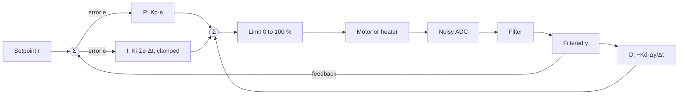

## Key figures {.stats style=tiles}

| Value | Label |
|---|---|
| 3 terms | Proportional, integral and derivative: the present, past and future of the error |
| Fixed Δt | A digital loop needs a steady sample period, from a hardware timer |
| 1 variable | Of RAM for an exponential moving average filter |
| Windup | The trap of an integral that grows while the actuator is saturated |

## Introduction {.abstract}

Whether it holds a heater to 0.1 °C, a drone level or a motor's speed, an open-loop command fails as soon as the load or supply changes. A **PID controller** closes the loop: it subtracts the measurement from the **setpoint** to get the error, and computes a new output at a fixed step. A digital **filter** in front of it keeps sensor noise from shaking the actuator.

## 1. The loop {.wide}



```cards cols=3 style=top
Proportional: the present | Output in proportion to the error. Too little is sluggish, too much oscillates. Alone, it leaves a **steady droop** | blue
Integral: the past | Adds up the error, to remove the offset a constant load causes. Needs **anti-windup** when the actuator is at its limit | green
Derivative: the future | Brakes in proportion to the rate of change. Take it from the **filtered measurement**, not the error, or a setpoint step makes a **derivative kick** | amber
```

## 2. The discrete controller

```equation
title: PID, one step at a time
u_k = K_p e_k + K_i \sum_{j \le k} e_j \, \Delta t - K_d \frac{y_k - y_{k-1}}{\Delta t}
u_k | Output at step k |
e_k | Error: setpoint minus measurement |
y_k | Filtered measurement |
\Delta t | Sample period, from a timer | s
```

> [!WARNING]
> Never run a PID loop in a superloop of varying length. Jitter in Δt corrupts both the integral and the derivative.

## 3. Step response: what tuning does

```plot type=function from=0 to=6 width=460 height=260 xtitle="Time (s)" ytitle="Temperature (°C)"
curve: Tuned PID | 20 + 80 * (1 - exp(-1.6 * x) * (cos(1.8 * x) + 0.89 * sin(1.8 * x)))
curve: Kp too high | 20 + 80 * (1 - exp(-0.6 * x) * (cos(3 * x) + 0.2 * sin(3 * x)))
curve: P only | 20 + 69 * (1 - exp(-1.2 * x))
```

| Symptom | Cause | Fix |
|---|---|---|
| Slow, settles low | Kp too low, no Ki | Raise Kp; add a little Ki |
| Overshoots and rings | Kp or Ki too high | More Kd, or less Kp |
| The actuator buzzes | Noise amplified by Kd | Filter before the D term |
| Huge overshoot after saturation | **Integral windup** | Clamp or freeze I at the limits |

## 4. From textbook to firmware {.wide}

```code-compare
@bad The textbook loop
err = sp - meas;
i_sum += ki * err * dt;                <1>
d = kd * (err - prev_err) / dt;        <2>
prev_err = err;
return kp * err + i_sum + d;           <3>
@good A production loop
err = sp - meas;
i_sum = clamp(i_sum + ki * err * dt, out_min, out_max);
d = -kd * (meas - prev_meas) / dt;
prev_meas = meas;
return clamp(kp * err + i_sum + d, out_min, out_max);
-- 1 | Grows without limit while the output is saturated: windup
-- 2 | Derivative of the error: a setpoint step makes a spike
-- 3 | No limit on the output the actuator can take
```

## 5. Cleaning the signal first

Pick the simplest filter that removes the noise without adding too much **lag**:

```compare
| Moving average | Exponential (EMA) | Median of 3, then EMA | Kalman filter
RAM | A ring of N samples | **One value** | 3 samples and one value | A state and its covariance
Cost per sample | Add one, subtract one | **One multiply-add** | 3 compares, one multiply | Matrix arithmetic
Single spikes | Smeared over N samples | Leaks through, scaled by α | **Removed** | Weighted by noise
Roll-off | Sinc lobes: poor | Smooth, first order | Spikes gone, then smooth | Optimal for its model
```

```c
float clean = median3(s[0], s[1], s[2]);   /* drops one-sample glitches */
filtered += alpha * (clean - filtered);    /* EMA, 0 < alpha <= 1     */
```

## 6. Tuning, in order

```steps
Check direction and noise | All gains zero. Plot raw and filtered readings; check that more output moves the reading the right way
Proportional | Ki and Kd zero. Raise Kp on small steps until the response is brisk, with about 10 % overshoot | blue
Derivative | If inertia overshoots, add Kd, on the filtered measurement | amber
Integral | Raise Ki slowly until the droop goes; then try a large step to check the anti-windup | green
```

## 7. Sign-off checklist {style=card colour=blue}

```checklist
[x] The loop runs from a hardware timer, at least ten times faster than the plant's main time constant
[x] The integral is clamped whenever the actuator is at 0 or 100 %
[x] The derivative uses the filtered measurement, never the raw error
[x] Switching from manual to automatic sets the integral to the current output: a bumpless transfer
[x] A disconnected or impossible reading switches the actuator safely off
```

## 8. Glossary

```glossary cols=1
EMA | Exponential moving average
FIR, IIR | Finite and infinite impulse response filters
PID | Proportional-integral-derivative
PWM | Pulse-width modulation
Setpoint | The value the loop is asked to hold
Windup | An integral that grows while the output cannot respond
```

## In short {.summary}

Run the loop from a hardware timer, remove glitches with a median and an EMA, take the derivative of the measurement, and clamp the integral when the actuator saturates.

### Filter before Kd

One noisy bit times Kd/Δt slams the actuator. A median and an EMA cost two lines.

### Clamp the integral

Hold a stalled motor for five seconds without anti-windup, and it overshoots wildly when released.

### Keep Δt steady

Trigger the ADC from a timer, so jitter never looks like a rate of change.
