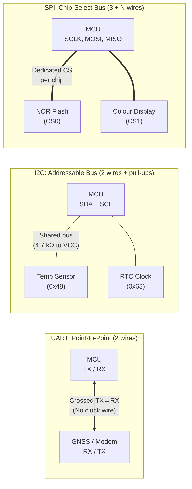

## Key figures {.stats style=tiles}

| Value | Label | Change | Verdict |
|---|---|---|---|
| 2 wires | Universal Asynchronous Receiver-Transmitter (UART) and `I2C` pin count | minimal pins | good |
| 50+ Mbps | Serial Peripheral Interface (SPI) peak board data rate | fastest on board | good |
| 127 | Maximum targets on one 7-bit Inter-Integrated Circuit (`I2C`) bus | addressable | good |
| 1,200 m | Maximum cable reach for differential RS-485 and Controller Area Network (CAN) | noise-immune | good |

## Introduction {.abstract}

Microcontrollers talk to sensors, displays, memory chips and distant actuators over serial buses that trade pin count for speed and cable reach. **Universal Asynchronous Receiver-Transmitter (UART)** links two devices with no clock wire. **Inter-Integrated Circuit (`I2C`)** shares two open-drain wires across dozens of sensors on a **Printed Circuit Board (PCB)**. **Serial Peripheral Interface (SPI)** uses four dedicated wires for high-speed streaming on a board. **Recommended Standard 485 (`RS-485`)** and **Controller Area Network (CAN)** use twisted-pair differential voltages to survive factory noise over hundreds of metres.

## 1. Board-level buses: point-to-point vs shared topologies

Each board-level bus makes a distinct trade-off between microcontroller pins, addressing and throughput:

```cards cols=3 style=top
UART (Asynchronous) | Point-to-point full-duplex link using Transmit (TX) and Receive (RX) lines; both sides must agree on the baud rate in advance | amber
I2C (Two-Wire Shared Bus) | Half-duplex bus using Serial Data (SDA) and Serial Clock (SCL) with pull-up resistors; every target has a unique 7-bit or 10-bit address | blue
SPI (Four-Wire Synchronous) | Full-duplex high-speed link using Serial Clock (SCLK), Controller Out (MOSI), Controller In (MISO) and one Chip Select (CS) wire per target | navy
```



[[CAPTION:Figure]] UART connects two peers directly; `I2C` addresses targets over two shared wires; SPI selects targets with dedicated Chip Select pins.

## 2. Wire framing: what travels on the pins

Without a shared clock wire, UART frames each byte with start and stop bits. `I2C` frames transactions with Start, Address and Acknowledge (`ACK`) bits, while SPI shifts raw bits on every clock edge:

```figure
@segments
title: UART 8N1 frame (10 bits per byte = 80% payload efficiency)
1 | Start (0) | 1 bit | amber
8 | Data Byte (LSB first, b0..b7) | 8 bits | navy
1 | Stop (1) | 1 bit | green
+++
@segments
title: I2C read/write address frame (9 clock pulses per byte)
1 | Start | S | amber
7 | Target Address | 7 bits (e.g. 0x48) | navy
1 | R/W | 1 bit | blue
1 | ACK | Target pulls SDA low | green
+++
@lanes
SPI Mode 0 | *CS pulls low | *MOSI & MISO shift on rising SCLK | *Multi-byte burst stream | *CS returns high
I2C Transaction | *Start condition | *7-bit Address + ACK | *Register & Data + ACK | *Stop condition
```

| SPI Mode | Clock Polarity (`CPOL`) | Clock Phase (`CPHA`) | Idle clock state and sampling edge |
|---|---|---|---|
| `Mode 0` | `0` | `0` | Clock idles low (`0`); data sampled on rising edge (most common) |
| `Mode 1` | `0` | `1` | Clock idles low (`0`); data sampled on falling edge |
| `Mode 2` | `1` | `0` | Clock idles high (`1`); data sampled on falling edge |
| `Mode 3` | `1` | `1` | Clock idles high (`1`); data sampled on rising edge |

## 3. Leaving the board: differential twisted-pair signalling

Single-ended `3.3 V` traces pick up electromagnetic interference beyond 0.5 metres. To cross a room or vehicle, `RS-485` and **Controller Area Network (CAN)** transmit the voltage difference between a twisted pair (`A/B` or `CAN_H/CAN_L`), cancelling out common-mode noise:

```cards cols=2 style=top
RS-485 (TIA/EIA-485) | Differential physical layer supporting 32 to 256 transceivers over 1,200 m; typically paired with Modbus Remote Terminal Unit (RTU) polling | blue
Controller Area Network (CAN) | Multi-master bus with non-destructive bitwise priority arbitration, hardware Cyclic Redundancy Check (CRC) and automatic fault confinement | green
```

```lcd cols=2
I2C Write 0x48: [S] 90 [A] 01 [A] [P]
I2C Read  0x48: [S] 91 [A] 15 [A] 80 [N] [P]
-- Logic analyser: I2C temperature read (21.5 C)

CAN ID: 0x18FF50E5  DLC: 8
Data:   04 EC 00 32 10 00 FF FF
CRC:    0x4A91 [ACK]
-- CAN 2.0B extended frame with hardware ACK
```

> [!WARNING]
> Always fit a `120 Ω` termination resistor at both physical ends of an `RS-485` or **CAN** bus trunk. Missing termination causes signal reflections that corrupt bits at high baud rates.

## 4. Head-to-head comparison across all five buses

```compare
| UART | I2C | SPI | RS-485 | CAN Bus
Wires required | 2 (TX, RX) | 2 (SDA, SCL) | 4+ (SCLK, MOSI, MISO, CS) | 2 or 4 (twisted pair) | 2 (CAN_H, CAN_L)
Duplex mode | Full-duplex | Half-duplex | Full-duplex | Half-duplex (2-wire) | Half-duplex (arbitrated)
Max devices | 2 (peer-to-peer) | 127 (7-bit address) | Limited by CS pins | 32 to 256 nodes | 64 to 120+ nodes
Typical speed | 9.6 kbps – 3 Mbps | 100 kbps / 400 kbps / 1 Mbps | 1 Mbps – 80 Mbps | 9.6 kbps – 10 Mbps | 125 kbps – 5 Mbps (CAN FD)
Typical distance | < 1 m (TTL) | < 0.5 m (on PCB) | < 0.3 m (on PCB) | Up to 1,200 m | Up to 500 m (at 125 kbps)
Hardware framing | Byte only (8N1) | Address + ACK/NACK | Raw bit shift | None (uses UART bytes) | Full message ID + CRC + ACK
```

```chart type=bar title="Typical board and field bus data rates (kbps)" unit=" kbps" max=55000
UART (115.2k) | 115
I2C Fast Mode | 400
CAN 2.0 High-Speed | 1000
RS-485 Fast | 10000
SPI Flash Bus | 50000
```

## 5. Bus selection workflow

Choose the simplest bus that satisfies distance, speed and topology:

```flow
[Need >1 m cable?|navy] -yes, multi-drop polling-> [RS-485 + Modbus|blue]
[Need >1 m cable?|navy] -yes, event-driven peers-> [CAN Bus|green]
[On one PCB (<0.5 m)|navy] -high speed (>1 Mbps)-> [SPI (4 wires)|navy]
[On one PCB (<0.5 m)|navy] -many low-speed sensors-> [I2C (2 wires)|amber]
```

## 6. Hardware bring-up and debugging checklist {style=card colour=navy}

When a serial bus fails to respond on a prototype board, check these six common hardware faults:

```checklist
[x] UART TX and RX crossed properly between controller and target (and baud rates within 2%)
[x] I2C pull-up resistors fitted on both SDA and SCL (typically 2.2 kΩ to 4.7 kΩ for 3.3 V at 400 kHz)
[x] I2C 7-bit address not confused with 8-bit shifted address (e.g. 0x48 shifted left is 0x90/0x91)
[x] SPI clock polarity (CPOL) and phase (CPHA) in firmware match the target datasheet timing diagram
[x] Common Ground (GND) reference connected between all communicating boards and logic analyser
[ ] 120 Ω termination resistors fitted only at the two extreme ends of RS-485 or CAN cables
```

## 7. Acronym guide: every term defined {.wide}

```cards cols=4 style=label
UART | Universal Asynchronous Receiver-Transmitter: two-wire serial link with start/stop bits and no clock wire
I2C | Inter-Integrated Circuit: two-wire addressable sensor bus using open-drain Serial Data (SDA) and Serial Clock (SCL)
SPI | Serial Peripheral Interface: high-speed synchronous bus using SCLK, MOSI, MISO and Chip Select (CS)
MOSI / MISO | Main Out Subnode In (or Controller Out Peripheral In) and Main In Subnode Out data lines on SPI
CPOL / CPHA | Clock Polarity (idle high or low) and Clock Phase (sample on first or second clock edge) in SPI
ACK / NACK | Acknowledge (SDA pulled low on 9th clock) and Not-Acknowledge (SDA left high) in I2C
RS-485 / TTL | Recommended Standard 485 (differential field bus) and Transistor-Transistor Logic (single-ended 3.3 V / 5 V levels)
CAN / CAN FD | Controller Area Network and CAN Flexible Data-Rate: rugged differential message bus with bitwise arbitration
LSB / MSB | Least Significant Bit (sent first in UART) and Most Significant Bit (sent first in I2C, SPI and CAN)
PCB & GND | Printed Circuit Board and common electrical Ground reference
CRC & RTU | Cyclic Redundancy Check (error-detecting checksum) and Remote Terminal Unit (binary Modbus framing)
DLC | Data Length Code: 4-bit field inside a CAN frame specifying payload length (0 to 8 bytes, or up to 64 B in CAN FD)
```

## In short {.summary}

Use `I2C` for slow on-board sensors, `SPI` for high-speed on-board chips, `UART` for point-to-point modules, and `RS-485` or `CAN` whenever wires leave the circuit board.

### Two wires on a board

`I2C` connects a dozen sensors on two pins, provided pull-up resistors match the bus capacitance.

### Four wires for speed

SPI dedicated clock and data lines stream megabytes per second to flash chips and displays without address overhead.

### Twisted pair for distance

`RS-485` and CAN reject industrial noise over hundreds of metres by measuring the voltage difference between two twisted wires.
