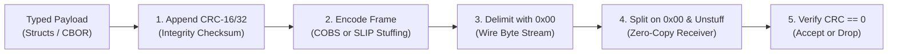

## Key figures {.stats style=tiles}

| Value | Label | Change | Verdict |
|---|---|---|---|
| 1 byte | Consistent Overhead Byte Stuffing (COBS) max overhead per 254 B | deterministic | good |
| 0x00 | Exclusive delimiter byte guaranteed never to appear inside COBS data | instant sync | good |
| 99.998% | Multi-bit burst errors caught by a 16-bit Cyclic Redundancy Check (CRC) | vs weak sum | good |
| 7 params | Rocksoft parametric model defining any CRC (`width`, `poly`, `init`, etc.) | universal | good |

## Introduction {.abstract}

A **Universal Asynchronous Receiver-Transmitter (UART)** or **Transmission Control Protocol (TCP)** stream delivers raw bytes with no built-in packet boundaries, and electrical noise can flip bits in transit. If a receiver loses one byte or mistakes a payload byte for a start marker, every subsequent packet breaks. Reliable embedded protocols solve this in two layers: **framing** marks unambiguous packet boundaries, and a **Cyclic Redundancy Check (CRC)** proves that every bit arrived intact.

## 1. The framing problem: why raw length fields fail {.wide}

If a protocol sends `[Sync 0xAA][Length][Payload]` without byte stuffing, two failures occur whenever noise hits the wire or a device connects mid-stream:

```cards cols=3 style=top
False Sync Collision | If the payload contains the number 0xAA, a receiver joining mid-packet locks onto the payload byte as a false start header | red
Corrupted Length Hang | If a noise spike flips a length byte from 4 to 250, the receiver waits forever for 246 missing bytes and drops valid packets | amber
Silent Bit Flips | A simple 8-bit sum (`A + B`) misses swapped bytes and opposing bit flips (`+1` in one byte and `-1` in the next cancel out) | navy
```



[[CAPTION:Figure]] Always compute the CRC over the payload before byte-stuffing, and verify the CRC after unstuffing.

## 2. Three framing strategies: length, escape and offset pointers {cols=2}

Embedded protocols use one of three framing schemes to separate packets, including **Serial Line Internet Protocol (SLIP)** and **Consistent Overhead Byte Stuffing (COBS)**:

```figure
@segments
title: 1. Preamble + Length + CRC envelope (needs timeout recovery)
2 | Sync (0xAA55) | 2 B | navy
1 | Len | 1 B | blue
5 | Payload (may contain 0xAA55) | N bytes | amber
2 | CRC-16 | 2 B | teal
+++
@segments
title: 2. Serial Line Internet Protocol (SLIP) — escapes 0xC0 as 0xDB 0xDC
1 | 0xC0 | start | navy
7 | Payload + CRC (up to 2x size if full of 0xC0) | 1x–2x | blue
1 | 0xC0 | end | navy
+++
@segments
title: 3. Consistent Overhead Byte Stuffing (COBS) — max +1 B per 254 B
1 | Code | offset | green
7 | Non-zero Payload + CRC (0x00 replaced by offset) | N + 1 B | navy
1 | 0x00 | end | amber
```

| Property | Preamble + Length | `SLIP` (Escape) | `COBS` (Offset Pointer) |
|---|---|---|---|
| Delimiter | Header + count | `0xC0` (`END` byte) | `0x00` (never in payload) |
| 100 B overhead | Fixed 4 to 6 B | 2 B best; **102 B** worst | **Exactly 1 B** (+1 `0x00`) |
| Recovery | Silence timeout | Next `0xC0` byte | Next `0x00` byte |

## 3. How pointer stuffing eliminates zero bytes

**COBS** scans the packet for `0x00` bytes and replaces each `0x00` with a 1-byte pointer (`1` to `254`) telling the decoder how many bytes to read before the next zero:

```lcd cols=1
Raw packet (5 bytes):        11  22  00  33  00
COBS encoded + 0x00 (7 B):  [03] 11  22 [02] 33 [01] 00
-- [03]=2 bytes then zero; [02]=1 byte then zero; [01]=zero

Receiver loop:
  byte == 0x00 -> Frame complete! Unstuff & check CRC
  byte != 0x00 -> Append to receive buffer
-- Any corrupted frame resynchronises on the next 0x00
```

> [!TIP]
> Because **COBS** adds at most `1` overhead byte per `254` payload bytes, you can size your microcontroller **Direct Memory Access (DMA)** transmit and receive buffers deterministically at compile time.

## 4. Error detection: why polynomial division wins

A **CRC** treats the message as a binary number and divides it using carry-less exclusive-or (`XOR`) arithmetic by a generator polynomial. The remainder is the checksum:

```compare
| 8-bit Sum / `XOR` | Fletcher-16 | CRC-16 / CRC-32
Single-bit errors | 100 % | 100 % | 100 %
Double-bit errors | Misses cancelling flips | Misses some | **100 %**
Swapped bytes | Misses (`A+B == B+A`) | Catches | **100 %**
16-bit burst noise | ~99.6 % | ~99.99 % | **100 %** (≤ 16 bits)
```

```chart type=bar title="Undetected errors per 100,000 corrupted frames (lower is better)" unit=" missed" max=450
8-bit XOR Sum | 390
16-bit Simple Sum | 15
CRC-16-CCITT | 1
CRC-32 (Ethernet) | 0
```

## 5. The Rocksoft parametric model {style=card colour=blue}

Two "CRC-16" functions produce different numbers unless all **seven Rocksoft parameters** match:

| Parameter | Meaning | `CRC-16/CCITT-FALSE` | `CRC-16/MODBUS` |
|---|---|---|---|
| `width` | Width in bits | `16` | `16` |
| `poly` | Generator polynomial | `0x1021` | `0x8005` |
| `init` | Initial register value | `0xFFFF` | `0xFFFF` |
| `refin`/`out` | Reflect input/output bits | `false` / `false` | `true` / `true` |
| `xorout` | Final `XOR` mask | `0x0000` | `0x0000` |
| `check` | Result for `"123456789"` | `0x29B1` | `0x4B37` |

> [!IMPORTANT]
> Always test your C and Python CRC functions against the standard 9-byte string `"123456789"` (`0x31..0x39` in **American Standard Code for Information Interchange (ASCII)**).

## 6. Protocol design workflow {.wide}

```steps cols=3
1. Version & opcode | Start the payload with a 1-byte version and 1-byte command ID
2. Explicit endianness | Use little-endian uint16_le, int32_le and float32 fields | blue
3. Append CRC-16/32 | Compute CRC over header + payload before stuffing
4. Encode with COBS | Stuff all 0x00 bytes and append a trailing 0x00 delimiter | navy
5. Assert "123456789" | Lock the Rocksoft check value in C and Python unit tests | green
6. Fuzz the decoder | Feed random, truncated and bit-flipped frames in CI | amber
```

## 7. Acronym guide: every term defined {.wide}

```cards cols=4 style=label
COBS | Consistent Overhead Byte Stuffing: framing algorithm that removes all 0x00 bytes with fixed max overhead
SLIP | Serial Line Internet Protocol: byte-stuffing protocol using 0xC0 frame end markers and 0xDB escape bytes
CRC | Cyclic Redundancy Check: polynomial division checksum that detects multi-bit burst errors on noisy links
XOR & LRC | Exclusive Or bitwise operation and Longitudinal Redundancy Check (simple byte-by-byte XOR checksum)
RTU | Remote Terminal Unit: binary Modbus serial framing that relies on 3.5-character silent gaps between frames
CCITT | International Telegraph and Telephone Consultative Committee: origin of the 0x1021 CRC-16 polynomial
IEEE | Institute of Electrical and Electronics Engineers: standards body for Ethernet CRC-32 and floating-point numbers
UART / TCP | Universal Asynchronous Receiver-Transmitter (serial wire) and Transmission Control Protocol (byte stream)
DMA | Direct Memory Access: hardware controller that copies serial bytes to RAM without CPU intervention
ASCII | American Standard Code for Information Interchange: character encoding used in the "123456789" CRC test vector
CBOR | Concise Binary Object Representation: self-describing binary payload format often carried inside COBS frames
LSB / MSB | Least Significant Bit (reflected CRC order) and Most Significant Bit (normal big-endian bit order)
```

## In short {.summary}

Never send raw unframed structs over a serial line: compute a Rocksoft-verified `CRC` over the payload, wrap the frame in `COBS`, and delimit packets with `0x00`.

### Resynchronise in one byte

COBS guarantees that `0x00` never appears inside a packet, so a receiver recovers from any line glitch on the next `0x00`.

### Predictable buffer sizes

Unlike `SLIP`, which can double a packet's size, COBS adds at most one byte per 254 payload bytes.

### Test with `"123456789"`

Lock down all seven Rocksoft CRC parameters (`width`, `poly`, `init`, `refin`, `refout`, `xorout`, `check`) so firmware and host tools never disagree.

## References {.references}

1. Stuart Cheshire and Mary Baker, *Consistent Overhead Byte Stuffing (COBS)*, Transactions on Networking, 1999.
2. Ross N. Williams, *A Painless Guide to CRC Error Detection Algorithms* (The Rocksoft Parametric Model), 1993.
