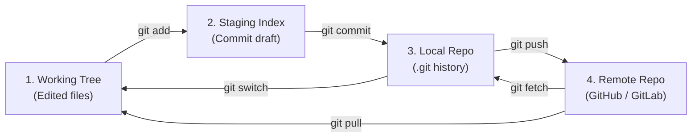

## Key figures {.stats style=tiles}

| Value | Label | Change | Verdict |
|---|---|---|---|
| 4 zones | Working Tree, Staging Index, Local Repo and Remote Repo | structured | good |
| 40 hex chars | Secure Hash Algorithm (SHA) checksum naming every commit | tamper-proof | good |
| 3 object types | Blob (file bytes), Tree (folder map) and Commit (snapshot) | immutable | good |
| 41 bytes | Size of a Git branch pointer file on disk | instant branching | good |

## Introduction {.abstract}

**Git** is an open-source **Distributed Version Control System (DVCS)** created by Linus Torvalds in 2005. Unlike older centralised systems that store only file-by-file line differences on a single server, Git records cryptographic snapshots of your entire project inside a local `.git` folder. Every developer has a full copy of the history, so branching, committing, inspecting logs and switching contexts happen in milliseconds without a network connection.

## 1. The four zones: how files move through Git

Understanding Git starts with knowing which of the four zones a command reads from and writes to:

```cards cols=2 style=top
1. Working Tree | The ordinary files and folders on your disk where you edit, compile and test code | amber
2. Staging Index | The draft area (.git/index) where you assemble the exact changes that will go into the next commit | blue
3. Local Repository | Your private history database (.git/objects) storing every committed snapshot and branch on your machine | navy
4. Remote Repository | The shared team repository (on GitHub, GitLab or Gitea) used to publish and synchronise branches | green
```



[[CAPTION:Figure]] Commands move changes deliberately from your working files through the staging index to local and remote history.

```lanes
Local offline work | *Edit Working Tree | *git add (Stage) | *git commit (Local Repo) | Push later when online
Team sync workflow | *git fetch (Download) | *Inspect log/diff | *git merge or rebase | *git push (Publish)
```

## 2. Under the hood: snapshots, not diffs

Every time you run `git commit`, Git computes a **Secure Hash Algorithm (SHA)** checksum of the contents and stores three immutable objects in a **Directed Acyclic Graph (DAG)**. If a file has not changed since the previous commit, Git points to the existing file blob rather than copying it again.

```cards cols=3 style=label
Blob object | Stores the compressed raw bytes of a single file, named by its SHA hash (no filename attached)
Tree object | Represents a folder: maps filenames and permissions to Blob hashes and sub-folder Tree hashes
Commit object | Points to one root Tree snapshot, the parent Commit hash(es), author name, timestamp and message
```

| Pointer | What it points to |
|---|---|
| Branch (`main`, `feat/login`) | A lightweight movable pointer to the latest commit in a line of work |
| `HEAD` | A special pointer to the branch or commit currently checked out in your Working Tree |
| Tag (`v1.2.0`) | A permanent, unmoving bookmark pinned to a specific release commit |

## 3. File states and live terminal output

Inside your local checkout, every file is in one of four states:

```flow
[Untracked|amber] -git add-> [Staged|blue] -git commit-> [Unmodified (Committed)|navy]
[Unmodified (Committed)|navy] -edit file-> [Modified|amber] -git add-> [Staged|blue]
[Modified|amber] -git restore-> [Unmodified (Committed)|navy]
```

```lcd cols=2
$ git status -sb
M  src/driver.c
 M src/main.c
?? tests/test_sensor.py
-- Staged (M), modified (M) and untracked (??)

* 9f3a1b2 (HEAD -> feat/sensor) Add CRC
* 4c8e0d1 Add I2C register read
| * 7a2d9e0 (main) Fix build script
|/
-- git log --oneline --graph --all
```

> [!TIP]
> Run `git status` and `git diff` before staging, and `git diff --staged` before committing, to review every line going into your snapshot.

## 4. Daily workflow: six steps from idea to Pull Request

Teams collaborate safely by isolating each task on its own short-lived feature branch before opening a **Pull Request (PR)** or **Merge Request (MR)**:

```steps
Synchronise main | Run git switch main && git pull to start from the latest shared commit
Create a branch | Run git switch -c feat/sensor-driver to move HEAD onto a new isolated branch | blue
Edit and stage | Modify files, run tests, and stage logical chunks with git add file.c or git add -p
Record a commit | Run git commit -m "feat: add I2C temperature driver" with a clear summary line | navy
Push to remote | Run git push -u origin feat/sensor-driver to publish the branch to the remote server | green
Open Pull Request | Open a PR/MR so Continuous Integration (CI) runs automated tests and teammates review the diff
```

## 5. Combining work: merge vs rebase and fetch vs pull

Git offers two ways to integrate commits from one branch into another, and two ways to download remote changes:

```compare
| git merge | git rebase
How it combines branches | Creates a new merge commit with two parents | Replays your commits one by one onto the target tip
Commit history shape | Non-linear graph preserving exact branch timing | Straight, linear history without merge commits
Original commit hashes | Preserved unchanged | Rewritten with new SHA hashes
Golden rule | Safe on shared public branches (like main) | Use only on your own local feature branches
```

```cards cols=2 style=top
git fetch | Downloads new commits and branch pointers from the Remote Repository into your Local Repository without touching your Working Tree files | blue
git pull | Runs git fetch followed immediately by git merge (or git rebase with --rebase) to update your current Working Tree branch | green
```

> [!WARNING]
> Never rebase commits that other developers have already pulled. Because `git rebase` creates new commit hashes, rewriting shared history forces teammates into conflicting duplicate histories.

## 6. Essential commands and commit hygiene {style=card colour=navy}

| Task | Command | What it does |
|---|---|---|
| Start or clone | `git init` / `git clone <url>` | Creates a new `.git` repo or downloads an existing remote project |
| Inspect state | `git status` / `git log --oneline --graph` | Shows modified/staged files or draws a compact commit graph |
| Shelve work | `git stash` / `git stash pop` | Temporarily sets aside uncommitted edits so you can switch branches |
| Undo safely | `git revert <commit>` | Creates a brand-new commit that reverses an earlier commit safely |
| Unstage / discard | `git restore --staged <f>` / `git restore <f>` | Moves a file out of the Staging Index or discards Working Tree edits |

Before pushing a branch for review, check these four habits:

```checklist
[x] Each commit does one logical thing and compiles cleanly on its own
[x] Commit message explains why the change was made, not just which file changed
[x] No secrets, build binaries or temporary logs are staged (checked with git status)
[x] Branch is up to date with main and passes Continuous Integration (CI) checks
```

## 7. Acronym guide: every term defined {.wide}

```cards cols=4 style=label
VCS / DVCS | Version Control System / Distributed Version Control System: every clone holds the full history
SHA | Secure Hash Algorithm: cryptographic checksum (40-character hex ID) naming every Git object
DAG | Directed Acyclic Graph: one-way graph of commits where each commit points back to its parent(s)
HEAD | Current checkout pointer: references the active branch tip in your Working Tree
PR / MR | Pull Request (GitHub / Bitbucket) or Merge Request (GitLab): peer code review before merging
CI / CD | Continuous Integration and Continuous Delivery: automated build, test and deployment pipelines
CLI / GUI | Command-Line Interface (terminal commands) and Graphical User Interface (visual Git clients)
SSH / HTTPS | Secure Shell (key-pair authentication) and Hypertext Transfer Protocol Secure (encrypted web transport)
```

## In short {.summary style=line}

Git keeps your work safe by recording cryptographic snapshots across four clear zones: stage intentionally, commit small logical steps and branch for every feature.

### Stage with purpose

The Staging Index lets you craft clean, focused commits even when your Working Tree has unrelated experiments.

### Branch for everything

Branches in Git are just 41-byte pointer files, so creating, switching and merging branches takes milliseconds.

### History is a safety net

Once you commit a snapshot to your Local Repository, you can always inspect, restore or revert to it.
