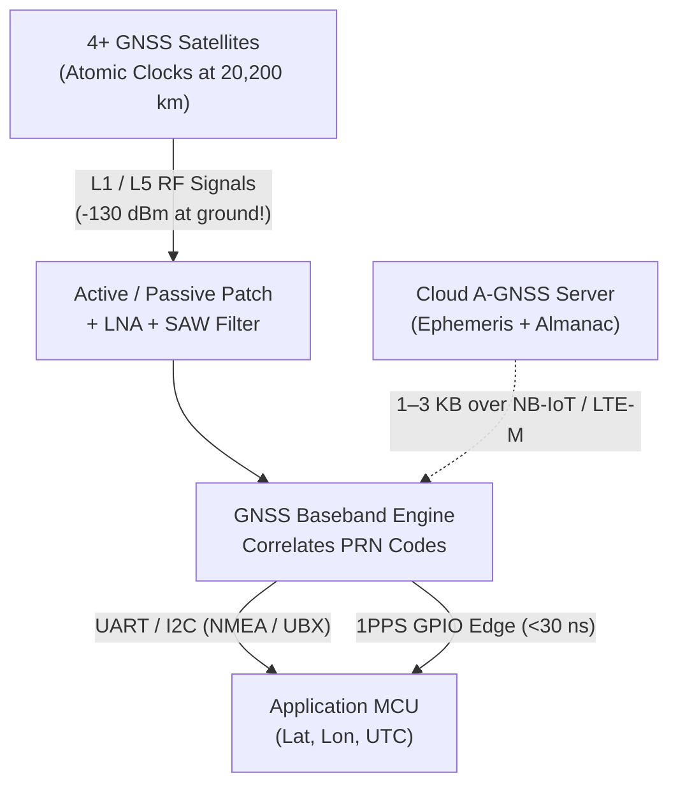

## Key figures {.stats style=tiles}

| Value | Label | Change | Verdict |
|---|---|---|---|
| 4 satellites | Minimum satellites required to solve `X, Y, Z` and receiver clock bias | 4 unknowns | good |
| 1 to 2 cm | Horizontal accuracy achieved with Real-Time Kinematic (RTK) carrier phase | vs 2.5 m standalone | good |
| ~30 seconds | Cold-start Time To First Fix (TTFF) while downloading 50 bps ephemeris | drains battery | bad |
| < 100 ns | Clock accuracy using Pulse Per Second (PPS) or Precision Time Protocol (PTP) | hardware timestamp | good |

## Introduction {.abstract}

Every **Global Navigation Satellite System (GNSS)** receiver is a precision timing instrument. Radio waves travel at **30 centimetres per nanosecond**, so measuring transit times from orbiting atomic clocks lets a receiver solve its 3D position and synchronise to **Coordinated Universal Time (UTC)**. **Assisted GNSS (`A-GNSS`)** slashes battery drain on cellular trackers, while **Real-Time Kinematic (RTK)** corrections and **Precision Time Protocol (PTP)** bring centimetre positioning and nanosecond clock sync to industrial networks.

## 1. The four global constellations & trilateration

Modern multi-constellation receivers track **Global Positioning System (GPS)**, **Galileo**, `GLONASS` and **BeiDou** simultaneously to maintain a fix in urban canyons:

```cards cols=1 style=top
Why 4 satellites are required (Not 3!) | Three spheres intersect at a point only if the receiver's clock is already synchronised to atomic time. A `1 microsecond` receiver crystal offset creates a **`300 metre` range error**, so the 4th satellite solves receiver clock bias (`Δt`) | navy
Multi-Band L1 + L5 Reception | Classic `L1` (`1575.42 MHz`) signals bend in the ionosphere and bounce off glass buildings (**multipath**). Dual-band `L1 + L5` (`1176.45 MHz`) receivers cancel ionospheric delay and reject urban reflections | blue
Pulse Per Second (`1PPS` Hardware Pin) | Once locked, the GNSS module outputs a rising hardware edge aligned to the top of every UTC second within **`10 to 30 nanoseconds`**, disciplining the microcontroller's local timer | green
```



[[CAPTION:Figure]] Satellite signals arrive at Earth weaker than thermal noise (`-130 dBm`); downloading ephemeris via `A-GNSS` avoids a 30-second radio wait.

## 2. Cold start vs hot start & battery life

Why does a tracker take 35 seconds to get a fix after replacing the battery, but only 1 second ten minutes later?

```figure
@lanes
Cold Start (TTFF ~30 to 45 s) | *Search Doppler & PRN | *Decode 50 bps Ephemeris (18–36 s continuous 25 mA Rx!) | *First 3D Fix | High battery cost
Assisted GNSS (A-GNSS, TTFF ~2 to 4 s) | *Fetch 2 KB Ephemeris over Cellular/BLE | *Measure Pseudoranges (2 s) | *First 3D Fix | 90% less energy!
Hot Start (Backup RAM kept, TTFF ~1 s) | *Ephemeris & RTC valid in V_BCKP | *Snap Lock (1 s) | *Return to Sleep | Ideal for periodic trackers
```

| Start Mode | Valid Data in Receiver Backup RAM | Typical `TTFF` | Energy per Fix (`25 mA` at `3.3 V`) |
|---|---|---|---|
| **Cold Start** | None (blind sky search + decode `50 bps` orbital data) | `30` to `45 s` | `~2.8 Joules` (`~850 µAs`) |
| **Warm Start** | Almanac + coarse time + last position (needs ephemeris) | `15` to `25 s` | `~1.6 Joules` (`~480 µAs`) |
| **Assisted (`A-GNSS`)** | Ephemeris injected over UART from cellular/Wi-Fi | **`2` to `4 s`** | **`~0.25 Joules`** (`10x` battery saving!) |
| **Hot Start** | Valid ephemeris (`< 2 hours` old) + accurate `RTC` | **`~1.0 s`** | **`~0.08 Joules`** |

> [!WARNING]
> Always keep the GNSS module's backup power pin (`V_BCKP`) supplied from your battery or supercapacitor during sleep. Dropping `V_BCKP` erases cached ephemeris and forces a costly 35-second Cold Start on every wakeup!

## 3. From metres to centimetres: how RTK works

Standard code-phase GNSS aligns `1 MHz` pseudorandom chips (~300 m wavelength), yielding `1.5 to 3.0 m` accuracy. **Real-Time Kinematic (RTK)** locks onto the **`19 cm` `L1` carrier wave phase** itself, using corrections streamed from a stationary **Base Station** over `NTRIP`:

```chart type=bar title="Horizontal positioning error by technique (centimetres, smaller is better)" unit=" cm" max=300
Standard L1 GNSS | 250
Dual-Band L1+L5 | 90
SBAS (WAAS/EGNOS) | 60
RTK Float | 25
RTK Fixed (Integer) | 2
```

```lcd cols=1
$GNGGA,091422.00,5130.45128,N,00007.67341,W,4,18,0.6,48.2,M,47.0,M,1.0,0000*5F
                                             ^ Fix Quality: 1=SPS, 2=DGPS, 4=RTK Fixed!
-- NMEA 0183 GGA sentence: Quality=4 (RTK Fixed, 1.5 cm), 18 satellites, HDOP=0.6
```

## 4. Network time synchronisation across protocols {.wide}

Distributed sensors, power-grid phasor units and industrial robots need a shared wall clock. Compare **Network Time Protocol (NTP)** with **Precision Time Protocol (PTP)** and hardware pulse sync:

```compare
| Network Time Protocol (`NTP` / `SNTP`) | `IEEE 1588` Precision Time Protocol (`PTP`) | GNSS `1PPS` + `NMEA`/`UBX` Time-of-Day
Typical clock accuracy | **`1` to `20 milliseconds`** (over WAN/Internet) | **`10` to `200 nanoseconds`** (on local Ethernet) | **`10` to `50 nanoseconds`** (anywhere outdoors)
Timestamping point | Software socket layer (affected by OS & queue jitter) | **Hardware Ethernet `MAC` / `PHY`** (eliminates OS jitter) | Dedicated hardware timer capture pin (`TIM_IC`)
Infrastructure required | Any UDP internet connection (port `123`) | PTP-aware boundary/transparent Ethernet switches | Sky view for GNSS antenna
Primary use case | TLS certificate expiry checks, cloud log timestamps | Industrial motion sync, audio/video (`AVB`), 5G base stations | Remote seismic, power-grid synchrophasors & telecom towers
```

## 5. Antenna, board & timing sign-off checklist {style=card colour=blue}

```checklist
[x] Keep `V_BCKP` powered continuously and inject `A-GNSS` orbital assistance on cold boots so trackers lock in `< 3 seconds`
[x] Route the GNSS `50 Ω` radio trace away from switching buck regulators, `SPI` clocks and cellular antennas; include a Surface Acoustic Wave (`SAW`) filter
[x] Provide the uninterrupted copper ground-plane area specified in the patch antenna datasheet (`e.g. 50 × 50 mm`)
[x] When using `1PPS`, capture the rising edge in a hardware timer Input Capture register (`TIM_CCR`), then read the UTC second number from the next serial message
[x] Store internal device timestamps as 64-bit monotonic **UTC Unix Epoch milliseconds/nanoseconds** (`int64_t`), never 32-bit seconds (which overflow in **2038**!)
```

## 6. Acronym guide: every term defined {.wide}

```cards cols=4 style=label
GNSS & GPS | Global Navigation Satellite System (umbrella term) and Global Positioning System (US constellation)
TTFF & A-GNSS | Time To First Fix (seconds to acquire lock) and Assisted GNSS (downloading orbital ephemeris over the network)
RTK & NTRIP | Real-Time Kinematic (carrier-phase centimetre positioning) and Networked Transport of RTCM via Internet Protocol
NMEA & HDOP | National Marine Electronics Association (standard ASCII sentence format) and Horizontal Dilution of Precision (sky geometry score)
1PPS & UTC | One Pulse Per Second hardware timing signal and Coordinated Universal Time global reference timescale
NTP & SNTP | Network Time Protocol and Simple Network Time Protocol (UDP port 123 millisecond clock synchronisation)
PTP | Precision Time Protocol (IEEE 1588): hardware-timestamped sub-microsecond clock sync over local Ethernet
LNA & SAW | Low-Noise Amplifier (boosts weak satellite signals) and Surface Acoustic Wave bandpass filter (blocks cellular interference)
```

## In short {.summary}

Keep **`V_BCKP`** powered and inject **`A-GNSS`** data so battery trackers lock in 2 seconds instead of 35. Stream **`RTK`** corrections for 2-centimetre robotics accuracy, and use **`1PPS`** or **`PTP`** when software **NTP** jitter is too slow.

### Never cold-start on a coin cell

Waiting 35 seconds to download `50 bps` satellite ephemeris burns 10x more battery than fetching 2 KB of `A-GNSS` data over cellular.

### Combine `1PPS` with serial messages

The serial `NMEA` text tells you *which* second it is; the hardware `1PPS` pin tells you the *exact nanosecond* that second begins.

### Store 64-bit epoch timestamps

A signed 32-bit Unix timestamp rolls over on 19 January 2038; always use `int64_t` for epoch time in long-lived embedded products.
