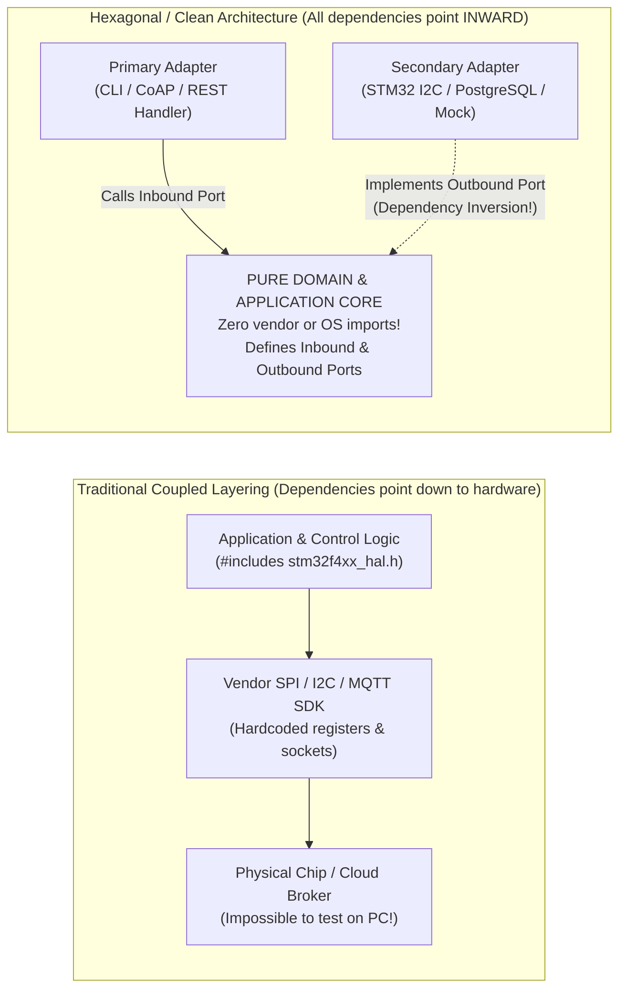

## Key figures {.stats style=tiles}

| Value | Label | Change | Verdict |
|---|---|---|---|
| 1 rule | Source-code dependencies only ever point **inward** towards the domain | Dependency Rule | good |
| 0 imports | Software Development Kit (SDK), database or web headers inside domain | pure business logic | good |
| 2 sides | Driving (Primary) adapters vs Driven (Secondary) infrastructure adapters | Ports & Adapters | good |
| < 1 day | Effort to swap a microcontroller family or database when behind a Port | zero domain rewrite | good |

## Introduction {.abstract}

In a traditional layered codebase, control policies depend directly on low-level infrastructure. They call vendor **Serial Peripheral Interface (SPI)** registers, **Structured Query Language (SQL)** queries or **Message Queuing Telemetry Transport (MQTT)** libraries inline. When a chip goes out of stock or a cloud protocol changes, the application must be rewritten. **Hexagonal Architecture (Ports and Adapters)** and **Clean Architecture** apply the **Dependency Inversion Principle (DIP)**. The core domain sits at the centre and defines abstract **Ports**, while outer hardware and network **Adapters** plug into those ports from the outside.

## 1. Traditional coupling vs dependency inversion {.wide}

Compare how the direction of source-code `#include` or `import` arrows changes when you invert the boundary:



[[CAPTION:Figure]] By placing an abstract interface (Port) inside the Domain, the low-level hardware driver depends on the Domain instead of the Domain depending on the driver.

## 2. Anatomy of ports and adapters

Every interaction between the outside world and your application crosses a **Port** implemented by an **Adapter**:

```cards cols=2 style=top
Inbound / Driving Ports (Use Cases) | Define how the outside world asks the application to do work (for example, `TelemetryUseCase::record_sample()`). Called by **Driving Adapters** such as a hardware timer interrupt, a Command-Line Interface (`CLI`), an MQTT subscriber or a unit test | navy
Outbound / Driven Ports (SPI / Repositories) | Interfaces defined by the core declaring what it needs from infrastructure (for example, `PressureSensorPort`, `TelemetryStorePort`, `ClockPort`). Implemented by **Driven Adapters** such as an `STM32` driver, a flash ring buffer or an in-memory test fake | blue
```

```figure
@segments
title: Concentric Rings of Clean Architecture (Dependencies point strictly from outer rings to inner rings)
2 | 1. Outer Ring: Frameworks, Drivers & Hardware (HAL, SQL, Web, RTOS) | Volatile details | amber
3 | 2. Interface Adapters (Controllers, Presenters, Gateways, Codecs) | Translates formats | blue
3 | 3. Application Use Cases (Orchestrates workflows & Inbound/Outbound Ports) | System actions | teal
2 | 4. Inner Core: Domain Entities & Pure Rules (Maths, State, Invariants) | Never changes! | green
```

## 3. Implementing ports and adapters in C

You do not need an **Object-Oriented Programming (OOP)** language with heavy dynamic dispatch to use Hexagonal Architecture on a microcontroller. In C, a **Port** is either a clean header seam (link-time polymorphism) or a `const` struct of function pointers (`vtable`):

```lcd cols=2
// 1. Outbound Port defined by Domain (sensor_port.h)
// Zero knowledge of I2C, SPI, STM32 or nRF52!
typedef struct {
  Err_t (*read_kpa)(void *ctx, float *out_kpa);
} PressureSensorPort_t;

// Pure Domain logic depends ONLY on the Port:
Action_t safety_valve_step(const PressureSensorPort_t *port,
                           void *ctx, float limit_kpa) {
  float kpa = 0.0f;
  if (port->read_kpa(ctx, &kpa) != ERR_OK) {
    return ACTION_TRIP_SAFE_OPEN; // Fail-safe rule!
  }
  return (kpa > limit_kpa) ? ACTION_OPEN_VALVE : ACTION_HOLD;
}

// 2a. Production Driven Adapter (bme280_i2c_adapter.c)
static Err_t bme280_read_kpa(void *ctx, float *out_kpa) {
  I2cHandle_t *bus = (I2cHandle_t *)ctx;
  return hw_i2c_read_bme280(bus, out_kpa);
}
const PressureSensorPort_t kBme280Adapter = { bme280_read_kpa };

// 2b. Host Unit-Test Fake Adapter (test_valve.c)
static Err_t fake_sensor_read(void *ctx, float *out_kpa) {
  *out_kpa = *(float *)ctx;
  return ERR_OK;
}
-- Swap STM32 for nRF52 or a unit-test fake with zero edits to safety_valve_step()!
```

## 4. Comparing architectural styles {.wide}

```compare
| Classic 3-Tier / Layered (`App -> BLL -> HAL`) | Hexagonal (`Ports & Adapters`) | Clean / Onion Architecture
Dependency direction | Top-down (`Domain` depends on `Data / HAL` layer) | **Inward** (`Adapters` depend on `Domain` Ports) | **Strictly inward** across concentric rings
Swapping hardware or DB | Ripples upward into business logic if types leak | **Write one new Adapter** implementing the Port | **Write one new Gateway/Adapter** in outer ring
Off-target unit testing | Hard without link-time tricks | **Natural** (plug in an in-memory Fake Adapter) | **Natural** (Entities & Use Cases have zero dependencies)
Risk of over-engineering | Low (familiar, minimal boilerplate) | Moderate if trivial pass-through code is wrapped | High if every struct gets 4 mapper layers unnecessarily
Best suited for | Tiny single-purpose scripts or throwaway prototypes | **Long-lived firmware, IoT gateways & microservices** | **Complex enterprise & safety-critical systems**
```

## 5. Architecture enforcement checklist {style=card colour=blue}

```checklist
[x] Place core domain and control logic in a dedicated directory (`src/domain/`) whose `CMakeLists.txt` or `Cargo.toml` cannot link vendor SDKs
[x] Name **Outbound Ports** in the language of the **Domain** (`ThermometerPort::read_temperature`), never the hardware (`I2cRegisterPort::read_0x48`)
[x] Keep Data Transfer Objects (`DTOs`) such as raw `Protobuf`, `JSON` or `Modbus` register frames inside the outer **Adapter**, converting them to domain types at the boundary
[x] Wire concrete Adapters to Domain Ports in a single top-level startup file (`main.c` — the **Composition Root**)
[x] Add an automated CI architecture check (`clang-tidy`, `depclean` or `ArchUnit`) that fails if `src/domain/` imports an outer adapter header
```

## 6. Acronym guide: every term defined {.wide}

```cards cols=4 style=label
DIP & SOLID | Dependency Inversion Principle (high-level policy must not depend on low-level detail) and the five SOLID design principles
HAL & BSP | Hardware Abstraction Layer and Board Support Package: Driven Adapters that isolate microcontroller pins and peripherals
DTO | Data Transfer Object: wire-format struct (JSON, CBOR, Protobuf) kept strictly in the outer Adapter layer
CLI & API | Command-Line Interface and Application Programming Interface: Driving Adapters that invoke Application Use Cases
SQL & ORM | Structured Query Language and Object-Relational Mapping: persistence details kept in Secondary Database Adapters
OOP & FP | Object-Oriented Programming and Functional Programming (pure functions in the domain core, side effects in the outer shell)
MCU & SDK | Microcontroller Unit and Software Development Kit (vendor peripheral library isolated behind Outbound Ports)
CI | Continuous Integration: automated build pipeline enforcing inward-only dependency rules
```

## In short {.summary}

Keep your **Domain and Control Core** 100% pure: define narrow **Ports** in domain terms, implement hardware and network details in outer **Adapters**, and wire them together only in `main()`.

### Functional core, imperative shell

Write your core control laws, parsers and business rules as pure deterministic functions; push all I/O side effects to the outer adapter shell.

### Name ports after intent, not wires

A domain port named `BatteryGaugePort` survives switching from an `I2C` fuel-gauge chip to an `ADC` divider without touching a single line of domain code.

### Enforce boundaries in the build script

If `src/domain` cannot see the vendor SDK include path in `CMake`, no developer under deadline pressure can accidentally couple them.
