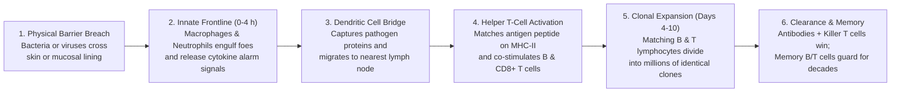

## Key figures {.stats style=tiles}

| Value | Label | Change | Verdict |
|---|---|---|---|
| 4k–11k /µL | Normal White Blood Cell (leukocyte) count circulating in human blood | 24/7 patrol | good |
| ~10¹¹ shapes | Distinct T-cell and B-cell receptor shapes built by gene shuffling | matches anything | good |
| 2,000 / sec | Rate at which a single activated plasma B cell secretes antibodies | rapid flood | good |
| 10 to 100× | Speed & peak antibody boost on second exposure thanks to memory cells | vaccine power | good |

## Introduction {.abstract}

The human immune system combines two cooperative armies. The **innate immune system** acts within minutes using pre-programmed chemical barriers, complement proteins and phagocytes that swallow invaders whole. When an infection overwhelms frontline defences, dendritic cells carry molecular snapshots of the enemy to the **adaptive immune system**. There, custom-matched T lymphocytes and antibody-producing B lymphocytes multiply into millions of targeted effectors and store immunological memory for decades.

## 1. End-to-end timeline: from skin breach to memory {.wide}



[[CAPTION:Figure]] Dendritic cells act as the courier between the two armies: they engulf invaders at the wound site and present the enemy's peptide fragments inside lymph nodes.

## 2. Two defence layers: innate vs adaptive immunity {.wide}

```compare
| Innate Immune System (First Line) | Adaptive Immune System (Second Line)
Response speed | **Immediate to hours** (`0 to 96 hours` after exposure) | **Delayed** (`4 to 14 days` for clonal expansion on first exposure)
Target recognition | Fixed germ-line sensors detect conserved microbial motifs (`PAMPs`) | Randomly recombined receptors (`TCR` and `BCR`) match one specific 3D shape
Specificity | Broad class recognition (bacterial cell walls, double-stranded viral `RNA`) | Pinpoint precision down to a single `8 to 15` amino-acid peptide epitope
Key cell types | Neutrophils, macrophages, natural killer (`NK`) cells, mast & dendritic cells | Helper T cells (`CD4+`), cytotoxic killer T cells (`CD8+`), B & plasma cells
Immunological memory | **None** (same speed and intensity on every repeat encounter) | **Long-lived memory B and T cells** respond `10 to 100×` faster on re-exposure
Soluble weapons | Complement cascade proteins, interferons, antimicrobial peptides, cytokines | Secreted immunoglobulins (`IgM`, `IgG`, `IgA`, `IgE`) tailored to the pathogen
```

## 3. Antigen presentation: `MHC` class I vs class II

T cells are blind to whole viruses floating in blood; they only inspect short peptide fragments displayed inside **Major Histocompatibility Complex (MHC)** cradles:

```cards cols=1 style=top
MHC Class I (Every Nucleated Cell — "Internal Quality Check") | Every nucleated cell constantly chops up a sample of its internal proteins and displays them on `MHC` Class I cradles. If a virus hijacks the cell, viral peptides appear on the surface, alerting **`CD8+` cytotoxic killer T cells** to trigger self-destruction (`apoptosis`) before the virus can multiply | red
MHC Class II (Antigen-Presenting Cells — "External Recon") | Dendritic cells, macrophages and B cells swallow extracellular invaders, digest them in acidic vesicles, and load the fragments onto `MHC` Class II cradles to activate **`CD4+` helper T cells** | blue
Natural Killer (`NK`) Cells ("Missing-Self" Patrol) | Some viruses hide from killer T cells by forcing infected cells to pull `MHC` Class I off their surface. `NK` cells execute any cell that lacks normal `MHC` Class I display | purple
```

```chart type=bar title="Share of circulating white blood cells in healthy adults (%)" unit="%" max=70
Neutrophils | 60
Lymphocytes (T/B) | 30
Monocytes | 6
Eosinophils | 3
Basophils | 1
```

## 4. How antibodies neutralise and clear pathogens

```cards cols=2 style=label
1. Direct Neutralisation | Antibodies bind tightly to viral spike proteins or bacterial toxins, physically blocking them from latching onto host cell receptors
2. Opsonisation ("Tagging") | The variable arms (`Fab`) grip the bacterium while the constant stem (`Fc`) acts as a handle for macrophage receptors, speeding up engulfment 100-fold
3. Complement Cascade | Bound `IgM` or `IgG` antibodies recruit serum complement proteins that punch lethal pores (**Membrane Attack Complex**) straight through bacterial membranes
4. NK Cell Targeting | Natural killer cells bind the exposed antibody stems coating an infected or tumour cell and inject enzymes that command the cell to self-destruct
```

```chart type=line title="Primary vs secondary antibody response (log10 titre)" unit=" log" min=0 max=10 step=2 height=180 colours=blue,red values=last
series: 1st Exposure, 2nd (Vaccine)
W0 | 0 | 2
W1 | 1 | 9
W2 | 4 | 10
W3 | 3 | 9
W4 | 2 | 8
W6 | 2 | 7
```

## 5. How vaccines train immunological memory

Vaccination introduces a harmless version or genetic blueprint of the pathogen's antigen. This builds a standing army of memory B and T cells without risking severe disease:

```compare
| Live Attenuated / Inactivated | Subunit / Recombinant Protein | Genetic Blueprint (`mRNA` / Vector)
What enters the body | Weakened or killed whole virus or bacterium | Purified surface protein (plus an immune-boosting adjuvant) | Messenger Ribonucleic Acid (`mRNA`) or harmless viral vector encoding the antigen
Pathways triggered | Both `MHC` Class I and II (attenuated); mainly Class II (inactivated) | Primarily `MHC` Class II (strong antibodies, lighter `CD8+` killer T response) | Both `MHC` Class I (host cell builds protein internally) and `MHC` Class II
Clinical examples | Measles-Mumps-Rubella (`MMR`), inactivated polio, yellow fever | Hepatitis B surface antigen, shingles, acellular pertussis | Coronavirus spike `mRNA` vaccines, adenovirus-vectored vaccines
```

## 6. Acronym guide: every term defined {.wide}

```cards cols=4 style=label
PAMPs & PRR | Pathogen-Associated Molecular Patterns (microbial signatures) and Pattern Recognition Receptor (innate Toll-like alarm sensor)
MHC & APC | Major Histocompatibility Complex (peptide display cradle) and Antigen-Presenting Cell (dendritic cell, macrophage or B cell)
TCR & BCR | T-Cell Receptor (recognises peptide bound to MHC) and B-Cell Receptor (surface antibody recognising intact 3D pathogen shapes)
CD4+ & CD8+ | Cluster of Differentiation 4 (Helper T cells coordinating immunity) and Cluster of Differentiation 8 (Cytotoxic Killer T cells)
IgG, IgM & IgA | Immunoglobulin G (main blood antibody), IgM (first-responder pentamer) and IgA (mucosal antibody in tears, saliva and gut)
NK & MAC | Natural Killer cell (innate lymphocyte targeting virus/tumour cells) and Membrane Attack Complex (complement pore-forming ring)
Fab & Fc | Fragment antigen-binding (variable Y-tips of an antibody) and Fragment crystallisable (constant stem that signals phagocytes)
mRNA & MMR | Messenger Ribonucleic Acid (temporary genetic blueprint for protein synthesis) and Measles, Mumps and Rubella vaccine
```

## In short {.summary}

The **innate system** holds the line for the first 96 hours while **dendritic cells** carry antigen snapshots to lymph nodes. There, the **adaptive system** multiplies matching `CD4+`, `CD8+` and B-cell clones that clear the infection and remember the pathogen for life.

### Two cradles for two threats

`MHC` Class I reveals viruses hiding *inside* cells to killer T cells, whereas `MHC` Class II shows engulfed *external* invaders to helper T cells.

### Swollen nodes mean clonal expansion

Swollen lymph nodes during a sore throat mean matching T and B lymphocytes are dividing rapidly into millions of effector cells inside the node.

### Vaccines skip the dangerous wait

Pre-training memory B and T cells turns a slow 14-day primary response into an immediate 24-hour flood of high-affinity `IgG` antibodies.
