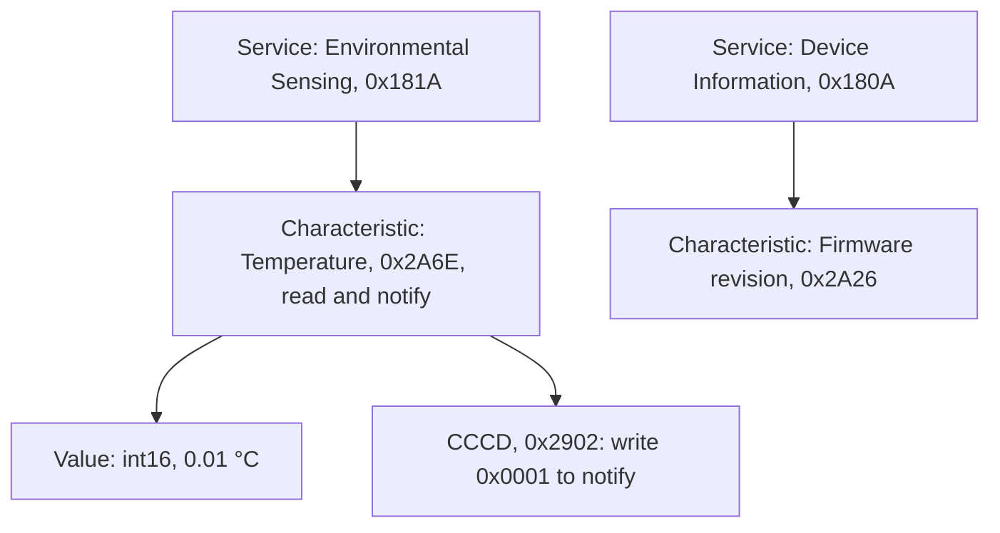

## Key figures {.stats style=tiles}

| Value | Label |
|---|---|
| 40 channels | Of 2 MHz: 3 for advertising and 37 for data |
| 31 bytes | In a legacy advertisement; 254 in an extended one |
| 2 Mbps | The LE 2M PHY; Coded PHY trades speed for 4 × range |
| Under 15 µA | Average current, holding a connection with a 1 s interval |

## Introduction {.abstract}

**Bluetooth Low Energy (BLE)** is built for coin-cell sensors that sleep 99 % of the time and wake for milliseconds. It has two halves. The **Generic Access Profile (GAP)** governs how devices advertise and connect. The **Generic Attribute Profile (GATT)** organises every reading and command into a table of **services**, **characteristics** and **descriptors**.

## 1. Sharing 2.4 GHz with Wi-Fi {.wide}

The three advertising channels sit in the gaps between Wi-Fi channels 1, 6 and 11. Once connected, both sides hop over the 37 data channels, avoiding busy ones.

```spectrum mode=channels from=2400 to=2485 width=1200
Wi-Fi 1 | 2412 | 20 | blue
Wi-Fi 6 | 2437 | 20 | blue
Wi-Fi 11 | 2462 | 20 | blue
BLE 37 | 2402 | 2 | amber
BLE 38 | 2426 | 2 | amber
BLE 39 | 2480 | 2 | amber
```

## 2. Roles

```cards cols=1 style=top
Broadcaster | Sends non-connectable advertisements; any number of scanners read them, with no pairing | teal
Peripheral | Advertises, accepts a connection, and sleeps between connection events | blue
Central | Scans, connects to one or more peripherals, and sets the timing | navy
```

## 3. The attribute table

Data lives in an **Attribute Protocol (ATT)** table, named by 16-bit standard or 128-bit custom UUIDs:



## 4. A notification, byte by byte

```hex-dissect title="ATT Handle Value Notification" ascii=no
bytes: 1B 14 00 61 08
0 | Opcode | 0x1B: notification | navy
1-2 | Handle | 0x0014, little-endian | blue
3-4 | Value | 0x0861 = 2145: 21.45 °C | green
```

## 5. Push, don't poll

| Operation | Who sends | Acknowledged | Use |
|---|---|---|---|
| Read | Central pulls | Request and reply | Slow; for static settings |
| Write command | Central pushes | Link layer only | **Fastest**: firmware updates |
| Notification | Peripheral pushes | Link layer only | **Fastest** telemetry |
| Indication | Peripheral pushes | By the application | Alerts that must arrive |

> [!TIP]
> Right after connecting, negotiate an **ATT MTU of 247** and **data length extension (DLE) of 251**. Default packets carry 20 bytes of data; DLE carries 244, twelve times as much.

## 6. PHYs and timing {.wide}

```compare
| LE 1M (default) | LE 2M | LE Coded (S=2, S=8)
Bit rate | 1 Mbps | **2 Mbps**: half the radio time | 500 or 125 kbps, with error correction
Range | 30 to 100 m in the open | A little less: **least energy per byte** | **About 4 ×** outdoors
Application throughput | About 700 kbps | **About 1.4 Mbps**: logs and updates | About 90 kbps at S=8
```

```lanes
Fast: 15 ms interval | *Event | *Event | *Event | About 180 µA: for keyboards and mice
Peripheral latency 9: 100 ms | *Event | Skips 9 empty events: 1 s | Asleep | *Wakes at once to notify: about 12 µA
```

## 7. Pairing securely

Legacy passkey pairing falls to a passive sniffer in seconds. Require **LE Secure Connections**, with elliptic-curve Diffie-Hellman:

```steps
Exchange features | Each side says what it can show or enter: a display, a keypad, or neither
ECDH key exchange | Both make P-256 key pairs, so a sniffer learns nothing | blue
Authenticate and bond | Numeric comparison, passkey or out-of-band (NFC); then store the long-term key | green
Private addresses | Change the MAC address every 15 minutes, resolved by the identity key, so the device cannot be tracked | navy
```

## 8. Firmware checklist {style=card colour=blue}

```checklist
[x] Advertise fast (100 ms) for 30 s after a button press, then slow (1 s)
[x] Set peripheral latency of 4 to 10, to sleep through empty events
[x] Negotiate MTU 247 and LE 2M before bulk transfers
[x] Require LE Secure Connections with MITM protection on writable characteristics
[x] Fit a 32.768 kHz crystal of ±20 ppm or better, for narrow wake-up windows
```

## 9. Glossary

```glossary cols=1
ATT, GATT | Attribute protocol and profile
CCCD | Client characteristic configuration descriptor
DLE | Data length extension
GAP | Generic access profile
IRK, LTK | Identity resolving key, long-term key
MTU | Maximum transmission unit
PHY | Physical layer
UUID | Universally unique identifier
```

## In short {.summary}

Push telemetry with notifications, negotiate MTU 247 and 2M PHY to cut radio time, and use peripheral latency so the sensor sleeps through empty events.

### Notify, never poll

The sensor wakes its radio only when something changes.

### Bigger, faster packets

244 bytes at 2 Mbps instead of 20 at 1 Mbps cuts radio energy per kilobyte by most of it.

### Secure Connections only

Legacy pairing is broken: use ECDH P-256.
