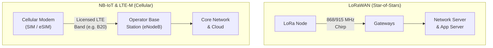

## Key figures {.stats style=tiles}

| Value | Label | Change | Verdict |
|---|---|---|---|
| 10+ km | Rural range of Long Range Wide Area Network (LoRaWAN) | multi-km reach | good |
| 164 dB | Maximum Coupling Loss (MCL) of Narrowband IoT (NB-IoT) | deepest indoor | good |
| 1 Mbps | Peak rate of Long-Term Evolution for Machines (`LTE-M`) | mobility & voice | good |
| 1% | Typical sub-gigahertz duty-cycle limit in unlicensed spectrum | air-time cap | bad |

## Introduction {.abstract}

**Low-Power Wide-Area (LPWA)** radio technologies bridge the gap between short-range wireless and high-power cellular broadband. **Long Range Wide Area Network (LoRaWAN)** operates in unlicensed **Industrial, Scientific and Medical (ISM)** bands using chirp spread spectrum, letting anyone deploy private gateways without **Subscriber Identity Module (SIM)** fees. **Narrowband Internet of Things (NB-IoT)** and **Long-Term Evolution for Machines (`LTE-M`)** operate in licensed **3rd Generation Partnership Project (3GPP)** cellular spectrum. They use mobile operator towers for guaranteed quality of service.

## 1. Three radio architectures: unlicensed vs cellular

Each technology serves a distinct slice of the range, bandwidth and deployment spectrum:

```cards cols=1 style=top
LoRaWAN (Unlicensed ISM) | Chirp Spread Spectrum (CSS) in 868 MHz (Europe) or 915 MHz (North America); nodes broadcast to any nearby gateway, which forwards packets to a Network Server | green
NB-IoT (Licensed 180 kHz) | Ultra-narrowband cellular carrier inside Long-Term Evolution (LTE) spectrum; maximises indoor penetration and sleep life for stationary sensors | navy
LTE-M (Licensed 1.4 MHz) | Wider cellular IoT carrier supporting full tower handover, lower latency, higher throughput for firmware updates and Voice over LTE (VoLTE) | blue
```



[[CAPTION:Figure]] Any gateway in range receives LoRaWAN packets; cellular nodes attach to a licensed operator tower.

## 2. Modulation, spreading factors and link budget

**LoRaWAN** trades data rate for sensitivity using **Spreading Factors (`SF7` to `SF12`)** managed by **Adaptive Data Rate (ADR)**. **NB-IoT** achieves its 164 dB link budget by repeating transmissions up to 2,048 times:

```chart type=bar title="Maximum Coupling Loss (MCL) link budget (dB)" unit=" dB" max=170
Standard 4G LTE | 142
LoRaWAN SF7 (Fast) | 142
LoRaWAN SF12 (Slow) | 157
LTE-M (Cat-M1) | 156
NB-IoT (Cat-NB2) | 164
```

| LoRa Spreading Factor | Bit rate (`125 kHz`) | Time on air (`50 B`) | Max payload (`EU868`) |
|---|---|---|---|
| `SF7` (nearest gateway) | `5,470 bps` | ~100 ms | `222 bytes` |
| `SF9` (medium range) | `1,760 bps` | ~350 ms | `115 bytes` |
| `SF12` (deepest edge) | `250 bps` | ~2,460 ms | `51 bytes` |

> [!WARNING]
> In Europe (`868 MHz`), unlicensed transmitters must obey a **1% duty-cycle limit** (36 seconds of air time per hour). A node stuck at `SF12` takes over 2 seconds per packet, severely limiting how often it can send.

## 3. Sleep and downlink listening modes

How a server reaches a sleeping device depends on the device's listening class or timer mode:

```figure
@lanes
LoRaWAN Class A | *Uplink Tx | *Rx1 (1 s) | *Rx2 (2 s) | Deep sleep until next uplink (lowest power)
LoRaWAN Class B | *Beacon sync | *Ping slot | *Ping slot | Scheduled downlink windows
LoRaWAN Class C | *Continuous Rx | *Uplink Tx | *Continuous Rx | Mains-powered actuators (zero downlink latency)
Cellular PSM / eDRX | *Uplink Tx | *T3324 Idle | Deep sleep in Power Saving Mode (PSM) | *Wake on T3412
```

```lcd cols=1
AT+JOIN=1:0:10:8
+EVT:JOINED (OTAA DevAddr 260B1F42)
AT+SEND=2:1:A41580 (ADR: SF7, 14 dBm)
-- LoRaWAN Over-The-Air Activation (OTAA)

AT+COPS? -> +COPS: 0,2,"23415",9
RSRP: -98 dBm, CE Level 1, PSM Active
-- NB-IoT operator attach (3GPP Release 14)
```

## 4. Head-to-head comparison across all three standards {.wide}

```compare
| LoRaWAN (Class A/B/C) | NB-IoT (Cat-NB2) | `LTE-M` (Cat-M1)
Spectrum & licensing | Unlicensed ISM (`868` / `915 MHz`), free | Licensed cellular (`700–2100 MHz`), SIM | Licensed cellular (`700–2100 MHz`), SIM
Network ownership | Private gateways or public community/operator | Mobile network operators only | Mobile network operators only
Channel bandwidth | `125 kHz` to `500 kHz` | `180 kHz` | `1.4 MHz`
Data rate | `0.3 kbps` to `27 kbps` | `26 kbps` to `159 kbps` | `300 kbps` to `1 Mbps`
Typical packet size | `11` to `222 bytes` (SF-dependent) | `20` to `1,500 bytes` | Unlimited IP streams & large FOTA
Duty-cycle restriction | **1% in EU868** (or dwell time in US915) | None (managed by base station scheduler) | None (managed by base station scheduler)
Mobility & handover | Works while moving (broadcast to all gateways) | Stationary (cell reselection only) | Full seamless cell handover at highway speed
Peak transmit current | **~35 to 110 mA** (at +14 to +20 dBm) | `70` to `220 mA` (at +23 dBm) | `150` to `350 mA` (at +23 dBm)
```

## 5. Selecting the right LPWA technology {cols=2}

Follow three questions to choose between unlicensed LoRaWAN and cellular IoT:

```flow
[Private site, farm or campus with no SIM fees?|navy] -yes, <100 B/hr-> [Choose LoRaWAN|green]
[Public nationwide coverage, deep basements, >100 B/day?|navy] -stationary-> [Choose NB-IoT|navy]
[Moving vehicles, voice or frequent megabyte firmware updates?|amber] -yes-> [Choose LTE-M|blue]
```

## 6. Deployment & radio engineering checklist {style=card colour=green}

Verify these five items before rolling out an LPWA sensor fleet:

```checklist
[x] LoRaWAN uses Over-The-Air Activation (OTAA) with unique root keys, never hardcoded Activation By Personalisation (ABP)
[x] Adaptive Data Rate (ADR) enabled on stationary LoRaWAN nodes so close sensors step down to SF7 and save battery
[x] Battery chemistry matched to peak current (coin cells struggle with 220 mA cellular bursts without a supercapacitor)
[x] Payload packed in binary (CBOR or bitfields) so LoRaWAN frames fit inside SF12's 51-byte ceiling
[x] Firmware Over The Air (FOTA) strategy tested (LoRaWAN multicast fragments vs NB-IoT/LTE-M CoAP blocks)
```

## 7. Acronym guide: every term defined {.wide}

```cards cols=4 style=label
LPWA / LPWAN | Low-Power Wide-Area Network: wireless technologies built for multi-kilometre range on small batteries
LoRa / LoRaWAN | Long Range physical layer (Chirp Spread Spectrum) and Long Range Wide Area Network MAC protocol
NB-IoT & LTE-M | Narrowband Internet of Things (180 kHz) and Long-Term Evolution for Machines (1.4 MHz) 3GPP standards
ISM | Industrial, Scientific and Medical: unlicensed sub-gigahertz radio bands (868 MHz in Europe, 915 MHz in Americas)
CSS & SF | Chirp Spread Spectrum modulation and Spreading Factor (SF7 to SF12, trading data rate for range)
ADR | Adaptive Data Rate: LoRaWAN mechanism that optimises each node's Spreading Factor and transmit power
OTAA / ABP | Over-The-Air Activation (dynamic session keys) and Activation By Personalisation (static keys) in LoRaWAN
MCL & CE | Maximum Coupling Loss (dB link budget) and Coverage Enhancement repetition levels in cellular IoT
PSM & eDRX | Power Saving Mode (~3 µA deep sleep) and Extended Discontinuous Reception in NB-IoT and LTE-M
SIM / eSIM | Subscriber Identity Module and embedded SIM chip used to authenticate on licensed cellular networks
FOTA & CBOR | Firmware Over The Air updates and Concise Binary Object Representation compact payload format
3GPP & VoLTE | 3rd Generation Partnership Project cellular standards body and Voice over Long-Term Evolution
```

## In short {.summary}

Choose `LoRaWAN` when you want private gateways, zero recurring `SIM` costs and 40 mA transmit peaks; choose `NB-IoT` for nationwide carrier coverage deep underground; choose `LTE-M` for moving assets and heavy firmware updates.

### Own the network with LoRaWAN

One gateway on a roof covers a factory or farm in unlicensed spectrum with no monthly cellular subscription per sensor.

### Penetrate concrete with narrowband cellular

Licensed spectrum, 23 dBm transmit power and automatic repetitions reach basements where unlicensed radios cannot.

### Track moving assets with cellular handover

A 1.4 MHz channel and full tower handover let trackers cross countries while streaming megabyte firmware updates.
