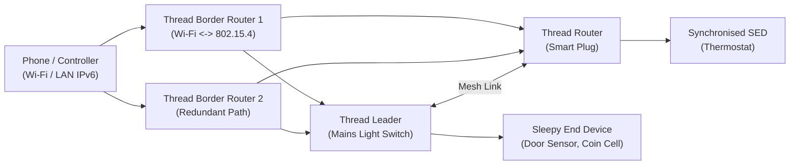

## Key figures {.stats style=tiles}

| Value | Label | Change | Verdict |
|---|---|---|---|
| 250 kbps | Raw physical data rate of `IEEE 802.15.4` in `2.4 GHz` | low-power mesh | good |
| 127 bytes | Maximum physical frame size requiring header compression | `6LoWPAN` layer | good |
| 0 single points | Any mains-powered Thread Router or Border Router takes over | self-healing | good |
| 1 data model | Matter unifies Thread, Wi-Fi and Ethernet under one IPv6 app layer | vendor-neutral | good |

## Introduction {.abstract}

Traditional low-power mesh networks (`Zigbee`, `Z-Wave`) use non-IP layers that require protocol-translating hubs to talk to local phones or cloud servers. **IPv6 over Low-Power Wireless Personal Area Networks (`6LoWPAN`)** and **Thread** solve this by compressing standard **Internet Protocol Version 6 (IPv6)** packets to fit inside 127-byte `IEEE 802.15.4` radio frames. Built on this IPv6 foundation, **Matter** provides one encrypted application layer and device data model. It runs identically over **Thread**, **Wi-Fi** and **Ethernet**.

## 1. The converged IPv6 protocol stack {.wide}

Notice how **Matter** uses standard IPv6, **User Datagram Protocol (UDP)** and **Transmission Control Protocol (TCP)** across every physical link layer:

```figure
@segments
title: Top Layer — Unified Matter Application Layer (Clusters, Attributes, Commands, Events & Fabrics)
10 | Matter Application Data Model (TLV Binary Encoding) + CASE / PASE Elliptic-Curve Security | Identical across all radios | teal
+++
@segments
title: Transport & Network Layer — End-to-End IPv6 Addressing (No protocol translation hubs!)
5 | UDP (Message Framing + MRP Reliable Retry) or TCP | Standard Transport | blue
5 | IPv6 Routing + mDNS / DNS-SD Local Discovery | Native IPv6 | navy
+++
@segments
title: Link & Physical Layers — Choose the radio that matches the device power budget
4 | Thread Mesh (6LoWPAN + IEEE 802.15.4, 250 kbps) — Coin-cell & low-power sensors | Mesh | green
3 | Wi-Fi (IEEE 802.11, 50+ Mbps) — Mains-powered appliances | Star | amber
3 | Ethernet (IEEE 802.3) — Bridges & controllers | Wired | purple
```

## 2. Inside a self-healing Thread mesh

A Thread network eliminates single points of failure by dynamically electing a **Leader** and promoting **Router-Eligible End Devices (`REEDs`)** whenever a link drops:



[[CAPTION:Figure]] Border Routers forward IPv6 packets transparently without decrypting the end-to-end Matter payload.

## 3. Thread device roles & sleep modes

Thread separates devices into **Full Thread Devices (`FTDs`)** that stay awake to route packets, and **Minimal Thread Devices (`MTDs`)** that conserve battery:

```cards cols=1 style=label
Thread Border Router | Bridges the 802.15.4 mesh to the local Wi-Fi or Ethernet IPv6 network; multiple Border Routers provide automatic failover
Thread Router & Leader | Mains-powered node (Up to 32 active Routers per mesh) that keeps its radio receiver on continuously to forward packets and buffer messages for sleeping children
Sleepy End Device (SED) | Battery-powered child node that sleeps with its radio off and wakes periodically to poll its parent Router for buffered downlink messages
Synchronised SED (`SSED`) | Uses Coordinated Sampled Listening (`CSL`) to wake on a microsecond schedule shared with its parent Router, slashing polling energy
```

## 4. How `6LoWPAN` compresses 48 bytes into 3 bytes

A standard **IPv6** header (`40 bytes`) plus a **UDP** header (`8 bytes`) would consume **38%** of a 127-byte `IEEE 802.15.4` radio frame (`RFC 4944` / `RFC 6282`). **`6LoWPAN`** strips redundant fields and reconstructs them from the 802.15.4 **Media Access Control (MAC)** header and shared mesh prefix:

| Header Field | Standard IPv6 + UDP | `6LoWPAN` (`IPHC`) | How the receiver reconstructs it |
|---|---|---|---|
| IPv6 Version, Traffic, Flow | `4 bytes` | `1 byte` | Elided when default zero |
| IPv6 Source & Dest Address | `32 bytes` (`2 × 128-bit`) | **`0 to 2 bytes`** | Derived from mesh prefix + 16-bit short MAC address |
| UDP Ports & Checksum | `8 bytes` | **`2 to 4 bytes`** | Compressed when using well-known port range (`0xF0B0`) |
| **Total Header Overhead** | **`48 bytes`** | **`3 to 7 bytes`** | Leaves `> 100 bytes` for encrypted payload! |

## 5. Matter data model & commissioning

Every Matter device exposes a structured tree of **Nodes**, **Endpoints**, **Clusters** and **Attributes**, commissioned securely over **Bluetooth Low Energy (BLE)**:

```lcd cols=1
Node (Matter Device: Dimmable Smart Plug)
 ├── Endpoint 0 (Root Node: Commissioning, Network, OTA)
 └── Endpoint 1 (On/Off Plug-in Unit)
      ├── Cluster 0x0003: Identify (Server)
      ├── Cluster 0x0006: On/Off -> Attribute 0x0000: OnOff (bool)
      └── Cluster 0x0008: Level Control -> CurrentLevel (uint8)
-- Multi-Admin lets multiple ecosystems (Apple, Google, Home Assistant)
-- join the same device on independent cryptographic Fabrics!
```

## 6. Commissioning & security workflow

```steps
1. BLE Discovery & PASE | Controller scans the Quick Response (`QR`) code or Manual Pairing Code, connects over `BLE`, and runs Password-Authenticated Session Establishment (`PASE` via `SPAKE2+`)
2. Attestation Verification | Controller verifies the device's factory Device Attestation Certificate (`DAC`) against the Distributed Compliance Ledger (`DCL`) to prove genuine hardware | teal
3. Network & Fabric Join | Controller installs an Operational Certificate (`NOC`) for its Fabric and passes Thread Operational Dataset credentials (or Wi-Fi credentials) | blue
4. CASE Operational Comms | Device joins the Thread/Wi-Fi IPv6 network, advertises via Multicast DNS (`mDNS`), and communicates using Certificate-Authenticated Session Establishment (`CASE`) | green
```

## 7. Mesh & Matter engineering checklist {style=card colour=teal}

```checklist
[x] Configure battery sensors as Sleepy End Devices (`SED`) or Synchronised SEDs (`CSL`) so the 802.15.4 radio never idles in receive mode
[x] Size Flash (`>= 1 MB`) and Static Random-Access Memory (`>= 256 KB SRAM`) to accommodate the Matter stack, Thread stack and dual-bank OTA slot
[x] Inject a unique factory Device Attestation Certificate (`DAC`) and private key into secure storage during manufacturing
[x] Support at least 5 concurrent Matter **Fabrics** so users can share the device across multiple smart-home controllers simultaneously
```

## 8. Acronym guide: every term defined {.wide}

```cards cols=4 style=label
6LoWPAN | IPv6 over Low-Power Wireless Personal Area Networks: compresses IPv6 headers to fit 127-byte 802.15.4 frames
FTD & MTD | Full Thread Device (can act as Router/Leader) and Minimal Thread Device (end device that never routes)
SED & CSL | Sleepy End Device (radio off in sleep) and Coordinated Sampled Listening (scheduled low-power receive window)
PASE & CASE | Password-Authenticated (commissioning via QR code) and Certificate-Authenticated (operational) Session Establishment
DAC & NOC | Device Attestation Certificate (factory hardware identity) and Node Operational Certificate (per-Fabric identity)
mDNS & DNS-SD | Multicast Domain Name System and DNS-Based Service Discovery: local zero-configuration IPv6 discovery
MRP & TLV | Message Reliability Protocol (Matter UDP retry layer) and Tag-Length-Value compact binary payload encoding
IEEE 802.15.4 | Institute of Electrical and Electronics Engineers standard defining the 250 kbps low-power radio physical/MAC layer
```

## In short {.summary}

Use **Thread (`6LoWPAN` over `802.15.4`)** to give battery sensors a self-healing IPv6 mesh with no single point of failure. Layer **Matter** on top so Thread, Wi-Fi and Ethernet devices speak one common language.

### End-to-end IPv6 kills hubs

Because Thread carries real IPv6 packets, a Border Router forwards frames directly without knowing or decrypting application data.

### Sleepy nodes poll their parent

A Thread Sleepy End Device wakes on its own schedule; its mains-powered parent Router holds incoming packets until it asks.

### One device, multiple fabrics

Matter's Multi-Admin cryptography lets a homeowner control the same lock from local Home Assistant, Apple Home and Google Home simultaneously.
