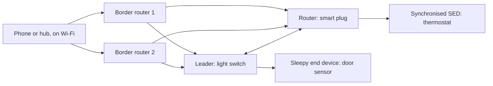

## Key figures {.stats style=tiles}

| Value | Label |
|---|---|
| 250 kbps | The IEEE 802.15.4 radio under Thread |
| 127 bytes | Its largest frame: why headers must shrink |
| No single point | Of failure: any router can take over |
| 1 data model | Matter, over Thread, Wi-Fi and Ethernet alike |

## Introduction {.abstract}

Older meshes such as Zigbee and Z-Wave are not IP, so a hub must translate before a phone or the cloud can talk to them. **6LoWPAN** and **Thread** compress real **IPv6** packets into 127-byte 802.15.4 frames, so a mesh is just another IP network. **Matter** puts one encrypted application layer and data model on top, the same over Thread, Wi-Fi and Ethernet.

## 1. The stack

```stack
Matter | L7 | Clusters, attributes and commands, in TLV | teal
Security | CASE, PASE | Sessions from certificates, or a setup code | purple
Transport | UDP, TCP | With Matter's own retries (MRP) | blue
Network | IPv6 | Routing, mDNS discovery | navy
Adaptation | 6LoWPAN | Header compression: Thread only | green
Link | 802.15.4, Wi-Fi, Ethernet | Choose by power budget | grey
side: The same on every link | 1-4 | teal
side: Thread | 5-6 | green
```

## 2. A Thread mesh

A Thread network elects a **leader**, and promotes **router-eligible end devices** when a link fails:



[[CAPTION:Figure]] Border routers forward IPv6 without decrypting the Matter payload.

## 3. Device roles

```cards cols=1 style=label
Border router | Joins the 802.15.4 mesh to Wi-Fi or Ethernet; several give automatic failover
Router and leader | Mains powered, receiver always on, up to 32 in a mesh: forwards packets and holds messages for sleeping children
Sleepy end device | On a battery: sleeps with the radio off, and wakes to poll its parent for messages
Synchronised SED | Wakes at times agreed with its parent (CSL), so it barely needs to poll
```

## 4. 6LoWPAN: 48 bytes into a few

An IPv6 header (40 B) and a UDP header (8 B) would take a third of a 127-byte frame. 6LoWPAN leaves out everything the receiver can work out from the MAC header and the mesh prefix:

```figure
@segments
title: A 127-byte 802.15.4 frame, uncompressed
23 | MAC header and security | 23 B | grey
48 | IPv6 and UDP | 48 B | red
56 | Payload | 56 B | green
+++
@segments
title: The same frame with 6LoWPAN (IPHC)
23 | MAC header and security | 23 B | grey
6 | Compressed IPv6 and UDP | 6 B | amber
98 | Payload | 98 B | green
```

| Field | Uncompressed | Compressed | Rebuilt from |
|---|---|---|---|
| Version, traffic class, flow | 4 B | Under 1 B | Defaults of zero |
| Source and destination | 32 B | **0 to 2 B** | The mesh prefix and the 16-bit MAC address |
| UDP ports and checksum | 8 B | **2 to 4 B** | Ports in the range 0xF0B0 to 0xF0BF |

## 5. The Matter data model

```text
Node: dimmable plug
├── Endpoint 0: root (commissioning, network, OTA)
└── Endpoint 1: on/off plug-in unit
    ├── Cluster 0x0003 Identify
    ├── Cluster 0x0006 On/Off        → attribute 0x0000 OnOff (bool)
    └── Cluster 0x0008 Level Control → CurrentLevel (uint8)
```

With **multi-admin**, Apple Home, Google Home and Home Assistant can all control one device, each on its own **fabric**.

## 6. Commissioning {.wide}

```steps cols=4
Discover, PASE | Scan the QR code, connect over BLE, and agree a session from the setup code (SPAKE2+) | teal
Attestation | Check the device's factory certificate against the Distributed Compliance Ledger: genuine hardware | navy
Join the fabric | Install an operational certificate, and hand over the Thread or Wi-Fi credentials | blue
CASE | The device joins the network, announces itself with mDNS, and talks over certificate-based sessions | green
```

## 7. Checklist {style=card colour=teal}

```checklist
[x] Battery sensors as sleepy or synchronised end devices, never idling in receive
[x] At least 1 MB of flash and 256 KB of RAM, for Matter, Thread and a second OTA slot
[x] A unique attestation certificate and key put in secure storage at the factory
[x] At least five fabrics supported, so several controllers can share a device
```

## 8. Glossary

```glossary cols=1
6LoWPAN | IPv6 over low-power wireless personal area networks
CASE, PASE | Certificate- and passcode-authenticated session establishment
CSL | Coordinated sampled listening
DAC, NOC | Device attestation and node operational certificates
FTD, MTD | Full and minimal Thread devices
MRP | Matter's message reliability protocol
SED | Sleepy end device
TLV | Tag-length-value encoding
```

## In short {.summary}

Thread gives battery sensors a self-healing IPv6 mesh with no single point of failure. Matter on top lets Thread, Wi-Fi and Ethernet devices speak one language.

### IPv6 all the way removes the hub

A border router forwards packets without knowing or decrypting what is in them.

### Sleepy nodes ask their parent

The router holds messages until its sleeping child wakes and asks.

### One device, many fabrics

One lock, controlled from Home Assistant, Apple Home and Google Home at once.
