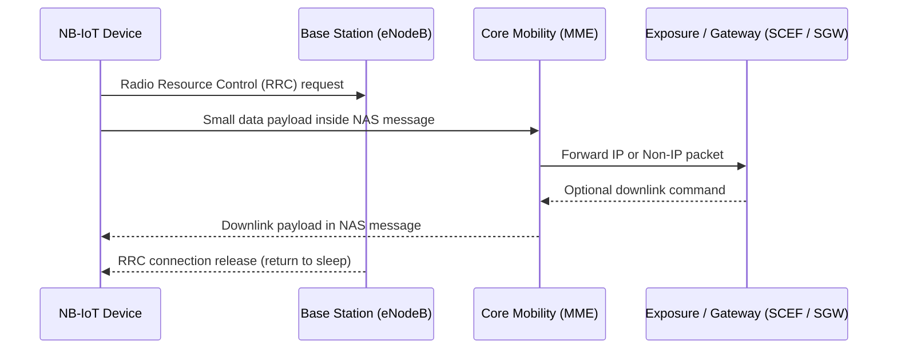

## Key figures {.stats style=tiles}

| Value | Label | Change | Verdict |
|---|---|---|---|
| 180 kHz | Carrier bandwidth: one Long-Term Evolution (LTE) block | -87 % vs LTE-M | good |
| 164 dB | Maximum Coupling Loss (MCL) indoor link budget | +20 dB reach | good |
| 10+ years | Battery life on a 5 Wh cell using Power Saving Mode (PSM) | 3 µA sleep | good |
| 50,000+ | Supported low-throughput devices per cell sector | high density | good |

## Introduction {.abstract}

**Narrowband Internet of Things (NB-IoT)** is a **Low-Power Wide-Area (LPWA)** cellular radio standard defined by the **3rd Generation Partnership Project (3GPP)**. Operating in licensed mobile spectrum alongside **Long-Term Evolution (LTE)**, it reaches deep inside buildings and underground chambers. Devices can sleep at microamps for days between transmissions, making it ideal for utility sensors and asset monitors that send a few hundred bytes a day.

## 1. Spectrum deployment: three ways to fit a 180 kHz carrier

Mobile operators deploy an NB-IoT carrier wherever 180 kHz of spectrum is available, typically via a software upgrade to existing LTE base stations:

```cards cols=3 style=top
Standalone | Occupies a dedicated 200 kHz channel refarmed from legacy Global System for Mobile (GSM) spectrum | navy
Guard-band | Sits inside the unused edge spectrum of a wide LTE carrier without reducing LTE capacity | blue
In-band | Uses one 180 kHz Physical Resource Block (PRB) directly inside an active LTE carrier | green
```

| Radio parameter | NB-IoT specification (`Cat-NB1` / `Cat-NB2`) |
|---|---|
| Duplex mode | Half-duplex Frequency-Division Duplexing (FDD); Time-Division Duplexing (TDD) from Rel-15 |
| Downlink air interface | Orthogonal Frequency-Division Multiple Access (OFDMA) with 15 kHz subcarriers |
| Uplink air interface | Single-Carrier Frequency Division Multiple Access (FDMA), single-tone (3.75 or 15 kHz) or multi-tone |
| Peak data rate | ~26 kbps in `Cat-NB1` (Rel-13); up to 127 kbps down / 159 kbps up in `Cat-NB2` (Rel-14) |
| Device transmit power | 23 dBm standard class, plus 20 dBm and 14 dBm low-power classes |
| Typical latency | 1.6 s to 10 s (optimised for reach and battery life rather than real-time streaming) |

## 2. Deep indoor coverage: repeat until the message arrives

NB-IoT achieves a **164 dB Maximum Coupling Loss (MCL)**—20 dB beyond **General Packet Radio Service (GPRS)**—by repeating each transmission and combining the copies at the receiver. The modem selects one of three **Coverage Enhancement (CE)** levels (`CE0` normal, `CE1` robust, `CE2` extreme) from the signal it measures.

```chart type=bar title="Maximum Coupling Loss (MCL) comparison" unit=" dB" max=170
Standard LTE | 142
2G GPRS | 144
LTE-M (Cat-M1) | 156
NB-IoT (Cat-NB2) | 164
```

```highlight
2,048 | Max downlink repetitions | in Coverage Enhancement level 2 (CE2) | navy
128 | Max uplink repetitions | for deep basement or utility chamber installations | blue
```

```chart type=line title="Remaining 5 Wh battery capacity by coverage level (%)" unit=" %" min=0 max=100 step=25 height=210 colours=green,amber values=last dashed=CE2
series: CE0 (Window), CE2 (Deep basement)
Year 0 | 100 | 100
Year 2 | 88 | 64
Year 5 | 71 | 18
Year 8 | 53 | 0
Year 10 | 41 | 0
```

> [!NOTE]
> Repetitions cost air time and battery charge. A sensor in a deep basement (`CE2`) can consume over fifty times more energy per message than one mounted near a window (`CE0`).

## 3. Saving battery: sleeping for days between messages

Two 3GPP sleep mechanisms let an NB-IoT modem keep its radio switched off for more than 99% of its lifetime: **Power Saving Mode (PSM)** and **Extended Discontinuous Reception (eDRX)**. When the `T3412` timer expires, the device wakes to send a **Tracking Area Update (TAU)**.

```figure
@flow
[Connected (Tx/Rx)|amber] -inactivity-> [Idle (eDRX paging)|blue] -T3324 expires-> [Deep Sleep (PSM)|navy]
[Deep Sleep (PSM)|navy] -T3412 or sensor data-> [Connected (Tx/Rx)|amber]
[Idle (eDRX paging)|blue] -downlink page-> [Connected (Tx/Rx)|amber]
+++
@segments
title: 24-hour energy profile of a daily reporting sensor (not to scale)
2 | Transmit & Receive (3 s) | 70 to 220 mA | amber
2 | Active Idle T3324 (10 s) | 3 mA | blue
8 | Power Saving Mode PSM (23 h 59 m 47 s) | 3 µA | navy
+++
@lanes
Standard DRX | *Listen | *Listen | *Listen | *Listen
Extended eDRX | *Listen | Sleep (up to 2.9 h) | *Listen | Sleep (up to 2.9 h)
Deep Sleep PSM | *Send report | *T3324 window | Radio off (~3 µA, up to 413 days) | *Wake on T3412
```

| Network timer | What it controls | Maximum duration |
|---|---|---|
| `T3324` (Active Timer) | How long the device listens in Idle state (`eDRX`) after a transmission before entering `PSM` | 186 minutes |
| `T3412` (Extended TAU) | How long the device may stay asleep in `PSM` before sending a keep-alive Tracking Area Update | 413 days |
| `eDRX` cycle | Time between brief paging reception windows while in Idle state | 10,485.76 s (~2.9 hours) |

## 4. Small-data paths: control plane and non-IP delivery

Establishing a full LTE data bearer for a 50-byte sensor reading wastes time and battery. NB-IoT introduces **Control Plane Cellular IoT (CIoT) Optimisation**, carrying small data packets directly inside **Non-Access Stratum (NAS)** control messages through the **Mobility Management Entity (MME)**.



[[CAPTION:Figure]] Control Plane optimisation sends data inside NAS signalling messages without setting up a user data bearer.

```cards cols=3 style=label
Control Plane (CP) | Carries data inside NAS control messages via the MME; lowest overhead for infrequent small packets
User Plane (UP) | Suspends and resumes the radio connection context so multi-packet sessions skip full setup
Non-IP Data Delivery (NIDD) | Routes raw frames through the Service Capability Exposure Function (SCEF) with zero IP/UDP header bytes
```

## 5. Module bring-up: commands and field diagnostics

Bringing up a cellular modem (such as a Quectel `BC660K`) from power-on to deep sleep follows six steps using standard 3GPP **Attention (AT)** commands:

```steps
Configure APN and band | AT+QCGDEFCONT="IP","iot.carrier.net" sets the Access Point Name (APN); AT+QBAND=1,20 locks Band 20
Enable the radio | AT+CFUN=1 turns on the radio transceiver and starts cell search
Verify registration | Poll AT+CEREG? until status is 1 (registered, home network) or 5 (registered, roaming) | green
Request sleep timers | AT+CPSMS=1,,,"00111000","00000101" requests a 24-hour TAU (T3412) and a 10-second active window (T3324)
Inspect signal quality | AT+CESQ or AT+QENG=0 reads Reference Signal Received Power (RSRP), Signal-to-Noise Ratio (SNR) and CE level | amber
Transmit and sleep | Send the UDP/CoAP packet; when T3324 expires, the modem enters 3 µA PSM sleep automatically
```

```lcd cols=2
+CEREG: 4,1,"2A10","01B4F02",9
,"00000101","00111000"
-- Registered (T3324=10s, T3412=24h)

+QENG: 0,1680,2,"01B4F02"
RSRP:-94dBm SNR:+8dB ECL:0
-- Good signal (CE Level 0)
```

> [!TIP]
> The mobile network may grant different `T3324` and `T3412` timer values than the device requested. Always read back the network-granted timers with `AT+CEREG=4` to calculate real battery life.

## 6. Choosing a standard and field acceptance {style=card colour=blue}

```compare
| LTE-M (Cat-M1) | NB-IoT (Cat-NB2)
Channel bandwidth | 1.4 MHz | 180 kHz
Peak data rate | ~1 Mbps | ~127 kbps down / 159 kbps up
Typical latency | 10 to 15 ms | 1.6 to 10 s
Mobility | Full cell handover | Stationary (cell reselection)
Voice support | Voice over LTE (VoLTE) | None
Maximum Coupling Loss | 156 dB | 164 dB (deepest indoor reach)
Modem complexity & cost | Moderate | Lowest
```

Verify four items on site before signing off an installation:

```checklist
[x] RSRP is stronger than -115 dBm and Coverage Enhancement is CE0 or CE1
[x] Granted T3324 and T3412 PSM timers confirmed via AT+CEREG=4
[x] First uplink packet reaches the cloud server within 10 seconds
[ ] Enclosure antenna clearance checked with cover closed
```

## 7. Acronym guide: every term defined {.wide}

```cards cols=4 style=label
NB-IoT | Narrowband Internet of Things: 3GPP 180 kHz cellular radio technology for low-power devices
3GPP | 3rd Generation Partnership Project: global standards body behind GSM, LTE, NB-IoT and 5G
LPWA | Low-Power Wide-Area: wireless network class designed for multi-kilometre range and 10-year batteries
LTE / LTE-M | Long-Term Evolution (4G cellular) and LTE for Machines (1.4 MHz higher-speed IoT standard)
PSM | Power Saving Mode: deep sleep state (~3 µA) where the radio is off while network registration stays active
eDRX | Extended Discontinuous Reception: lengthens the time between paging checks in Idle mode (up to 2.9 h)
TAU | Tracking Area Update: periodic check-in sent when timer T3412 expires to keep registration alive
MCL & CE | Maximum Coupling Loss (164 dB signal loss limit) and Coverage Enhancement repetition levels (CE0–CE2)
FDD / TDD | Frequency-Division Duplexing (separate up/down frequencies) and Time-Division Duplexing (shared frequency)
OFDMA / SC-FDMA | Orthogonal Frequency-Division Multiple Access (downlink) and Single-Carrier FDMA (uplink)
eNodeB & MME | Evolved Node B (LTE radio base station) and Mobility Management Entity (core control server)
RRC & NAS | Radio Resource Control (air link layer) and Non-Access Stratum (device-to-core signalling layer)
NIDD & SCEF | Non-IP Data Delivery (headerless payloads) and Service Capability Exposure Function (core API gateway)
APN | Access Point Name: network identifier that selects the operator packet data network and routing policy
RSRP & SNR | Reference Signal Received Power (signal strength in dBm) and Signal-to-Noise Ratio (link clarity in dB)
GPRS & GSM | General Packet Radio Service (2.5G data) and Global System for Mobile Communications (2G cellular)
```

```timeline
2016 | 3GPP Release 13 | NB-IoT (Cat-NB1) launched with 180 kHz carrier, PSM, eDRX and Control Plane CIoT | navy
2017 | 3GPP Release 14 | Cat-NB2 doubles throughput (~159 kbps), adds multicast, positioning and 14 dBm power class | blue
2019 | 3GPP Release 15 | Wake-Up Signal (WUS), Early Data Transmission (EDT) and Time-Division Duplexing (TDD) | green
2020 | 3GPP Release 16 | Coexistence inside 5G New Radio (NR) carriers and 5G core network integration | amber
2022 | 3GPP Release 17 | Non-Terrestrial Network (NTN) support for direct satellite NB-IoT connectivity | red
```

## In short {.summary}

NB-IoT trades data rate for deep indoor reach and decade-long battery life: sending small telemetry packets reliably from basements and underground chambers for ten years.

### Deep indoor reach

Automatic signal repetitions add 20 dB of link budget over 2G GPRS so buried and basement sensors stay connected.

### Asleep almost all day

Power Saving Mode (`PSM`) and Extended Discontinuous Reception (`eDRX`) drop idle current to a few microamps between reports.

### Long-term cellular life

Deployed inside standard operator LTE and 5G spectrum, ensuring managed interference and long-term carrier support.

## References {.references}

1. 3GPP Technical Specification 36.211 and 36.331, *Universal Terrestrial Radio Access (UTRA) Physical Channels and Radio Resource Control*.
2. 3GPP TS 24.301, *Non-Access-Stratum (NAS) Protocol for Evolved Packet System (EPS)* (PSM, eDRX and Control Plane CIoT).
